# NuSCR Software Requirements Specification - Notional Four-Channel Reactor Protection System (Bistable Processor and Coincidence Processor)

> **STATUS: SYNTHETIC REFERENCE SPECIFICATION - NOT DERIVED FROM ANY PLANT DESIGN - NOT FOR OPERATIONAL, LICENSING OR SAFETY-CLASSIFIED USE WITHOUT FULL INDEPENDENT V&V**
>
> Every constant in this document is an ILLUSTRATIVE placeholder. See section 1.

| Field | Value |
|---|---|
| Document ID | NUSCR-RPS-SYN-001 |
| Revision | 0 |
| Date | 2026-09-27 |
| Machine-readable source | `1_requirements/rps_nuscr_spec.json` (nuscr-json/1.0) |
| Generated by | `tools/render_docs.py` - do not edit by hand |

## Contents

- [1. Purpose, provenance and limitations](#1-purpose-provenance-and-limitations)
- [2. NuSCR notation and execution semantics](#2-nuscr-notation-and-execution-semantics)
- [3. System overview](#3-system-overview)
- [4. System requirements](#4-system-requirements)
- [5. Constants and setpoints](#5-constants-and-setpoints)
- [6. Module BP - Bistable Processor](#6-module-bp---bistable-processor)
- [7. Module CP - Coincidence Processor](#7-module-cp---coincidence-processor)
- [8. System configuration](#8-system-configuration)
- [9. Traceability](#9-traceability)
- [10. Verification status](#10-verification-status)
- [Appendix A - Expression grammar](#appendix-a---expression-grammar)

## 1. Purpose, provenance and limitations

This document is the NuSCR software requirements specification of a notional four-channel digital reactor protection system: the bistable processor (BP) logic of each channel and the coincidence processor (CP) logic.  It exists to provide complete, internally consistent NuSCR design data for tool development, method research, training and prototyping.

**Provenance.** Generated by tools/build_spec.py.  The specification uses the NuSCR notation (FOD, SDT, FSM, TTS; f_/h_/th_/k_/g_ naming) and groups the trip functions into four logic categories (fixed set-point, variable set-point, manual reset and digital trips).  The set of trip functions is modelled at a general level on publicly described pressurized-water-reactor protection systems.  The design is notional and is not derived from any existing plant specification; every logic detail, constant, setpoint, delay and range is an illustrative choice.

**Limitations.**

- All constants (setpoints, hysteresis, delays, ranges, rates) are ILLUSTRATIVE placeholders. Real values must come from the plant safety analysis and an approved setpoint methodology (e.g. ISA-67.04.01 / NRC RG 1.105).
- The logic is a notional design. It has not been reviewed against any plant's system requirements, safety analysis, hazard analysis or regulatory requirements.
- The specification has been checked for internal consistency by the tools in this package (SDT completeness/disjointness, FSM/TTS determinism, invariant and obligation proofs, simulation tests). This is not a substitute for independent verification and validation (e.g. IEEE 1012, IEC 60880, IEEE 7-4.3.2) under a nuclear quality-assurance programme.
- Hardware, input conditioning, communication protocols, manual trip, reactor trip switchgear and the engineered safety features actuation system are outside the scope of this specification.

**Applicable standards.**

- [S1] IEEE Std 603, IEEE Standard Criteria for Safety Systems for Nuclear Power Generating Stations.
- [S2] IEEE Std 7-4.3.2, IEEE Standard Criteria for Programmable Digital Devices in Safety Systems of Nuclear Power Generating Stations.
- [S3] IEC 60880, Nuclear power plants - Instrumentation and control important to safety - Software aspects for computer-based systems performing category A functions.
- [S4] IEEE Std 1012, IEEE Standard for System, Software, and Hardware Verification and Validation.
- [S5] ISA-67.04.01, Setpoints for Nuclear Safety-Related Instrumentation.
- [S6] U.S. NRC Regulatory Guide 1.105, Setpoints for Safety-Related Instrumentation.

## 2. NuSCR notation and execution semantics

A NuSCR specification consists of a hierarchical **Function Overview Diagram (FOD)** describing the data flow between nodes, and one definition per node: a **Structured Decision Table (SDT)** for a function variable, a **Finite State Machine (FSM)** for a history variable, or a **Timed Transition System (TTS)** for a timed-history variable.

**Execution.** Each module executes synchronously in scan cycles of period k_Scan_Period.  At the start of a cycle all inputs are sampled.  Nodes are then evaluated once, in the module's execution_order (a topological order of the FOD data flow with ties broken by FOD node number).  A node reads the current-cycle value of every other variable it references.  An FSM/TTS reading its own variable reads the value from the previous cycle.

**SDT.** A Structured Decision Table defines a function variable (stateless).  Each rule (column) is the conjunction of its condition cells (T = condition holds, F = condition does not hold, - = don't care).  In every cycle exactly one rule must hold (completeness and disjointness are proved by nuscr_check.py), and the variable takes the value of that rule's action.

**FSM.** A Finite State Machine defines a history variable.  In each cycle, the transitions leaving the current state are evaluated; guards leaving a state are pairwise disjoint (proved), so at most one is enabled.  If one is enabled it is taken, its action becomes the variable's new value and the target state becomes current.  If none is enabled the state and value are unchanged.  At most one transition is taken per cycle.

**TTS.** A Timed Transition System defines a timed-history variable.  It behaves like an FSM, except that a transition labelled [lower, upper] is enabled only when its guard holds and the time spent in the source state, tau = (current cycle - entry cycle) * k_Scan_Period, satisfies lower <= tau <= upper.  Every timed guard is required (and proved) to be complemented by the untimed exits of its source state, so the guard holds continuously for the whole time spent in that state: the timed transition therefore fires after the condition has persisted for 'lower'.

**Initialisation.** Before the first cycle every history and timed-history variable is set to its initial_value and its machine to its initial_state; the initial state counts as entered one cycle before the first scan.  Function variables have no initial value.

**Types.** Finite types enumerate their admissible values; inputs of finite type are assumed to be restricted to those values by input conditioning (the simulator rejects anything else).  Type 'real' is an exact rational/real quantity; analog inputs are NOT assumed to lie in any range (validity is checked by SDTs).

**Range invariants.** A 'range' on a computed variable is an invariant.  nuscr_check.py proves it inductively (initial value and every rule/transition preserve it, assuming the proved ranges of the variables read) and then uses it as an assumption in all other proofs.

### Conventions

| Prefix | Meaning |
|---|---|
| `f_` | input or function variable (SDT) |
| `h_` | history variable (FSM) |
| `th_` | timed-history variable (TTS) |
| `k_` | constant |
| `g_` | group node of the FOD |

**Polarity.** Trip and pre-trip signals are de-energize-to-trip: 0 = TRIP / PRETRIP, 1 = NORMAL.  Error flags: 1 = error.  Validity flags: 1 = valid.

**Time.** Time constants are in milliseconds (ms).

| Unit | Meaning |
|---|---|
| `%RTP` | percent of rated thermal power |
| `psia` | pounds per square inch absolute |
| `psig` | pounds per square inch gauge |
| `%NR` | percent of narrow-range span |
| `%DF` | percent of design reactor coolant flow |
| `ms` | milliseconds |

### Types

| Type | Values | Description |
|---|---|---|
| `real` | real | Real-valued quantity (exact rational arithmetic). |
| `bool` | 0 = FALSE, 1 = TRUE | Boolean flag. |
| `error_flag` | 0 = OK, 1 = ERROR | Diagnostic error flag. |
| `valid_flag` | 0 = INVALID, 1 = VALID | Input validity. |
| `permissive` | 0 = NOT_PERMITTED, 1 = PERMITTED | Operating-bypass permissive. |
| `bypass_status` | 0 = NOT_BYPASSED, 1 = BYPASSED | Operating-bypass status. |
| `pushbutton` | 0 = RELEASED, 1 = PRESSED | Momentary pushbutton. |
| `switch` | 0 = NORMAL, 1 = BYPASS | Trip channel (maintenance) bypass switch. |
| `pulse` | 0 = NO_PULSE, 1 = PULSE | One-scan pulse produced by an edge detector. |
| `trip` | 0 = TRIP, 1 = NORMAL | Trip signal, de-energize-to-trip. |
| `pretrip` | 0 = PRETRIP, 1 = NORMAL | Pre-trip alarm signal, de-energize-to-alarm. |
| `vote` | 0 = NO_VOTE, 1 = TRIP_VOTE | A channel's contribution to a coincidence vote. |
| `count_0_4` | 0 = 0, 1 = 1, 2 = 2, 3 = 3, 4 = 4 | Count of channels. |

## 3. System overview

Four redundant channels A-D, each with a bistable processor; every coincidence processor receives the bistable outputs of all four channels.  Links are modelled as ideal (same-scan) transfers; link failure is modelled by the CP inputs `f_<ch>_Link_Error`.

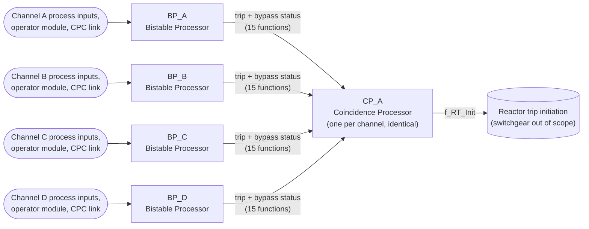

### Trip functions

Trip functions are grouped into four logic categories: fixed set-point, variable set-point, manual reset and digital trips.

| Group | Function | NuSCR logic type | Category | Main inputs | Trip output |
|---|---|---|---|---|---|
| `g_VOPT` | Variable Overpower trip | `Variable_Setpoint_Rising_Trip` | Variable set-point trip | `f_NPWR_LIN`, `f_NPWR_LIN_Valid` | `th_VOPT_Trip` |
| `g_LOGP_HI` | High Logarithmic Power Level trip | `Fixed_Setpoint_Rising_Trip_with_OB` | Fixed set-point trip | `f_NPWR_LOG`, `f_NPWR_LOG_Valid` | `th_LOGP_HI_Trip` |
| `g_LPD_HI` | High Local Power Density (CPC) trip | `Digital_Trip_with_OB` | Digital trip | `f_LPD_HI_Pretrip_In`, `f_LPD_HI_Trip_In`, `f_LP_OB_Perm` | `th_LPD_HI_Trip` |
| `g_DNBR_LO` | Low DNBR (CPC) trip | `Digital_Trip_with_OB` | Digital trip | `f_DNBR_LO_Pretrip_In`, `f_DNBR_LO_Trip_In`, `f_LP_OB_Perm` | `th_DNBR_LO_Trip` |
| `g_PZR_P_HI` | High Pressurizer Pressure trip | `Fixed_Setpoint_Rising_Trip` | Fixed set-point trip | `f_PZR_P`, `f_PZR_P_Valid` | `th_PZR_P_HI_Trip` |
| `g_PZR_P_LO` | Low Pressurizer Pressure trip | `Manual_Reset_Variable_Setpoint_Falling_Trip_with_OB` | Manual reset trip | `f_PZR_P`, `f_PZR_P_Valid` | `th_PZR_P_LO_Trip` |
| `g_SG1_L_LO` | Low Steam Generator 1 Water Level trip | `Fixed_Setpoint_Falling_Trip` | Fixed set-point trip | `f_SG1_L`, `f_SG1_L_Valid` | `th_SG1_L_LO_Trip` |
| `g_SG2_L_LO` | Low Steam Generator 2 Water Level trip | `Fixed_Setpoint_Falling_Trip` | Fixed set-point trip | `f_SG2_L`, `f_SG2_L_Valid` | `th_SG2_L_LO_Trip` |
| `g_SG1_L_HI` | High Steam Generator 1 Water Level trip | `Fixed_Setpoint_Rising_Trip` | Fixed set-point trip | `f_SG1_L`, `f_SG1_L_Valid` | `th_SG1_L_HI_Trip` |
| `g_SG2_L_HI` | High Steam Generator 2 Water Level trip | `Fixed_Setpoint_Rising_Trip` | Fixed set-point trip | `f_SG2_L`, `f_SG2_L_Valid` | `th_SG2_L_HI_Trip` |
| `g_SG1_P_LO` | Low Steam Generator 1 Pressure trip | `Manual_Reset_Variable_Setpoint_Falling_Trip_with_OB` | Manual reset trip | `f_SG1_P`, `f_SG1_P_Valid` | `th_SG1_P_LO_Trip` |
| `g_SG2_P_LO` | Low Steam Generator 2 Pressure trip | `Manual_Reset_Variable_Setpoint_Falling_Trip_with_OB` | Manual reset trip | `f_SG2_P`, `f_SG2_P_Valid` | `th_SG2_P_LO_Trip` |
| `g_CTMT_P_HI` | High Containment Pressure trip | `Fixed_Setpoint_Rising_Trip` | Fixed set-point trip | `f_CTMT_P`, `f_CTMT_P_Valid` | `th_CTMT_P_HI_Trip` |
| `g_SG1_F_LO` | Low Reactor Coolant Flow (SG1 loop) trip | `Variable_Setpoint_Falling_Trip_with_OB` | Variable set-point trip | `f_LP_OB_Perm`, `f_SG1_F`, `f_SG1_F_Valid` | `th_SG1_F_LO_Trip` |
| `g_SG2_F_LO` | Low Reactor Coolant Flow (SG2 loop) trip | `Variable_Setpoint_Falling_Trip_with_OB` | Variable set-point trip | `f_LP_OB_Perm`, `f_SG2_F`, `f_SG2_F_Valid` | `th_SG2_F_LO_Trip` |

## 4. System requirements

Notional system-level requirements allocated to the NuSCR specification.  Each NuSCR node lists the requirements it implements (section 9 gives the full matrix).

| ID | Requirement |
|---|---|
| **SYS-GEN-01** | Each RPS channel shall execute its protection logic cyclically with a fixed scan period k_Scan_Period; inputs are sampled once at the start of each scan. |
| **SYS-GEN-02** | A trip function shall be placed in the tripped state, and its pre-trip alarm actuated, without intentional delay whenever an error of the function is present. The errors of a function are: a processor module error (f_Module_Error = 1), a channel error (f_Channel_Error = 1), an invalid process input of the function, and for functions using core protection calculator signals the loss of the CPC data link.  An input used only by an operating-bypass permissive is not a process input: while it is invalid the permissive is not satisfied (SYS-GEN-09). |
| **SYS-GEN-03** | Each analog process input f_S shall be declared invalid when it lies outside its valid range [k_S_Valid_Min, k_S_Valid_Max]. |
| **SYS-GEN-04** | At start-up every trip and pre-trip output shall be in the tripped state and every operating bypass shall be removed; an output shall leave the tripped state only in a scan in which no error of the function is present.  When an error that did not interrupt a process trip clears (or at start-up) while the trip (pre-trip) condition is present and the function is not in operating bypass, the output shall remain tripped; it shall become a process trip if the condition persists for the trip (pre-trip) delay, and shall return to NORMAL as soon as the condition clears.  A process trip interrupted by an error is governed by SYS-GEN-07. |
| **SYS-GEN-05** | Trip and pre-trip outputs shall use de-energize-to-trip polarity: 0 = TRIP/PRETRIP, 1 = NORMAL. |
| **SYS-GEN-06** | A trip (pre-trip) caused by a process condition shall be generated when, and only when, the condition has persisted continuously for the trip (pre-trip) delay of the function.  Process conditions are evaluated only in scans in which no error of the function is present; persistence is measured over consecutive such scans in which the function is not in operating bypass, so an error or an active operating bypass interrupts it.  When a bypass is removed while the condition is present, the trip follows after the delay. |
| **SYS-GEN-07** | Once tripped (pre-tripped) by a process condition, a trip function shall remain tripped until the process variable has recovered past the trip (pre-trip) setpoint by more than the reset hysteresis, or the function is placed in operating bypass.  A process trip is held through errors of the function; its release condition is evaluated only in scans without an error of the function. |
| **SYS-GEN-08** | Each trip function shall provide a pre-trip alarm generated at a setpoint closer to normal operating conditions than the trip setpoint. |
| **SYS-GEN-09** | An operating bypass shall be established only by an operator initiation, i.e. a press of its initiation pushbutton made while its permissive condition is satisfied; a pushbutton held or stuck in the pressed state (including at start-up) shall not establish a bypass.  A permissive is not satisfied while its input is invalid.  The bypass shall be removed automatically, without operator action, in the first scan in which the permissive is no longer satisfied.  While bypassed, the function's process trip and pre-trip are inhibited; trips caused by errors are not inhibited. |
| **SYS-GEN-10** | The status of each trip channel bypass switch shall be transmitted with the channel's trip outputs to the coincidence processors. |
| **SYS-CP-01** | For each trip function the coincidence processor shall generate a coincidence trip when at least two of the four channels are tripped (2-out-of-4). |
| **SYS-CP-02** | A channel with a trip channel bypass requested shall be excluded from the vote of that function (2-out-of-3 logic), provided no other channel requests bypass of the same function; if two or more channels request bypass of the same function, all those requests shall be ignored (2-out-of-4 logic retained). |
| **SYS-CP-03** | A channel whose data link has failed shall be counted as tripped for every trip function for which it is not validly bypassed. |
| **SYS-CP-04** | The coincidence processor shall generate the reactor trip initiation signal when the coincidence trip of any trip function is present. |
| **SYS-VOPT-01** | The RPS shall generate a Variable Overpower trip when the excore linear nuclear power (f_NPWR_LIN) rises to or above the variable trip setpoint h_VOPT_Trip_SP, and a pre-trip alarm when it rises to or above h_VOPT_Trip_SP - k_VOPT_Pretrip_Margin. |
| **SYS-VOPT-02** | The trip setpoint h_VOPT_Trip_SP shall track f_NPWR_LIN + k_VOPT_Band limited to [k_VOPT_SP_Min, k_VOPT_SP_Max].  It shall follow decreasing power without delay and shall increase at no more than k_VOPT_SP_Rate, so that a rapid power increase produces a trip.  At start-up it shall be initialised from the first valid input. |
| **SYS-LOGP_HI-01** | The RPS shall generate a High Logarithmic Power Level trip when the excore logarithmic nuclear power (f_NPWR_LOG) rises to or above k_LOGP_HI_Trip_SP, and a pre-trip alarm when it rises to or above k_LOGP_HI_Pretrip_SP. |
| **SYS-LOGP_HI-03** | The High Logarithmic Power Level trip may be placed in operating bypass (f_LOGP_HI_OB_Ini) while f_NPWR_LOG >= k_LOGP_HI_OB_Perm. |
| **SYS-LPD_HI-01** | The RPS shall generate a High Local Power Density (CPC) trip when the core protection calculator reports a local power density trip (f_LPD_HI_Trip_In = 0), and a pre-trip alarm when it reports a pre-trip (f_LPD_HI_Pretrip_In = 0).  Loss of the CPC data link (f_CPC_Link_Error = 1) shall be treated as an error. |
| **SYS-LPD_HI-03** | The High Local Power Density (CPC) trip may be placed in operating bypass (f_LPD_HI_OB_Ini) while the low-power permissive is present (f_NPWR_LOG < k_LP_OB_Perm). |
| **SYS-DNBR_LO-01** | The RPS shall generate a Low DNBR (CPC) trip when the core protection calculator reports a departure from nucleate boiling ratio trip (f_DNBR_LO_Trip_In = 0), and a pre-trip alarm when it reports a pre-trip (f_DNBR_LO_Pretrip_In = 0).  Loss of the CPC data link (f_CPC_Link_Error = 1) shall be treated as an error. |
| **SYS-DNBR_LO-03** | The Low DNBR (CPC) trip may be placed in operating bypass (f_DNBR_LO_OB_Ini) while the low-power permissive is present (f_NPWR_LOG < k_LP_OB_Perm). |
| **SYS-PZR_P_HI-01** | The RPS shall generate a High Pressurizer Pressure trip when the pressurizer pressure (wide range) (f_PZR_P) rises to or above k_PZR_P_HI_Trip_SP, and a pre-trip alarm when it rises to or above k_PZR_P_HI_Pretrip_SP. |
| **SYS-PZR_P_LO-01** | The RPS shall generate a Low Pressurizer Pressure trip when the pressurizer pressure (wide range) (f_PZR_P) falls to or below the variable trip setpoint h_PZR_P_LO_Trip_SP, and a pre-trip alarm when it falls to or below h_PZR_P_LO_Trip_SP + k_PZR_P_LO_Pretrip_Margin. |
| **SYS-PZR_P_LO-02** | The trip setpoint h_PZR_P_LO_Trip_SP shall be k_PZR_P_LO_SP_Max at start-up.  Each operator actuation of the setpoint reset pushbutton f_PZR_P_LO_SP_Reset shall lower the setpoint to f_PZR_P - k_PZR_P_LO_Band, but not below k_PZR_P_LO_SP_Min; a reset shall never raise the setpoint and one actuation shall produce at most one reduction.  A pushbutton held or stuck in the pressed state (including at start-up) shall produce no reduction, an actuation made while f_PZR_P is invalid shall be ignored, and the setpoint shall hold its value while f_PZR_P is invalid.  The setpoint shall rise automatically so that it is never more than k_PZR_P_LO_Band below f_PZR_P, up to k_PZR_P_LO_SP_Max. |
| **SYS-PZR_P_LO-03** | The Low Pressurizer Pressure trip may be placed in operating bypass (f_PZR_P_LO_OB_Ini) while f_PZR_P < k_PZR_P_LO_OB_Perm. |
| **SYS-SG1_L_LO-01** | The RPS shall generate a Low Steam Generator 1 Water Level trip when the steam generator 1 water level (narrow range) (f_SG1_L) falls to or below k_SG1_L_LO_Trip_SP, and a pre-trip alarm when it falls to or below k_SG1_L_LO_Pretrip_SP. |
| **SYS-SG2_L_LO-01** | The RPS shall generate a Low Steam Generator 2 Water Level trip when the steam generator 2 water level (narrow range) (f_SG2_L) falls to or below k_SG2_L_LO_Trip_SP, and a pre-trip alarm when it falls to or below k_SG2_L_LO_Pretrip_SP. |
| **SYS-SG1_L_HI-01** | The RPS shall generate a High Steam Generator 1 Water Level trip when the steam generator 1 water level (narrow range) (f_SG1_L) rises to or above k_SG1_L_HI_Trip_SP, and a pre-trip alarm when it rises to or above k_SG1_L_HI_Pretrip_SP. |
| **SYS-SG2_L_HI-01** | The RPS shall generate a High Steam Generator 2 Water Level trip when the steam generator 2 water level (narrow range) (f_SG2_L) rises to or above k_SG2_L_HI_Trip_SP, and a pre-trip alarm when it rises to or above k_SG2_L_HI_Pretrip_SP. |
| **SYS-SG1_P_LO-01** | The RPS shall generate a Low Steam Generator 1 Pressure trip when the steam generator 1 pressure (f_SG1_P) falls to or below the variable trip setpoint h_SG1_P_LO_Trip_SP, and a pre-trip alarm when it falls to or below h_SG1_P_LO_Trip_SP + k_SG1_P_LO_Pretrip_Margin. |
| **SYS-SG1_P_LO-02** | The trip setpoint h_SG1_P_LO_Trip_SP shall be k_SG1_P_LO_SP_Max at start-up.  Each operator actuation of the setpoint reset pushbutton f_SG1_P_LO_SP_Reset shall lower the setpoint to f_SG1_P - k_SG1_P_LO_Band, but not below k_SG1_P_LO_SP_Min; a reset shall never raise the setpoint and one actuation shall produce at most one reduction.  A pushbutton held or stuck in the pressed state (including at start-up) shall produce no reduction, an actuation made while f_SG1_P is invalid shall be ignored, and the setpoint shall hold its value while f_SG1_P is invalid.  The setpoint shall rise automatically so that it is never more than k_SG1_P_LO_Band below f_SG1_P, up to k_SG1_P_LO_SP_Max. |
| **SYS-SG1_P_LO-03** | The Low Steam Generator 1 Pressure trip may be placed in operating bypass (f_SG1_P_LO_OB_Ini) while f_SG1_P < k_SG1_P_LO_OB_Perm. |
| **SYS-SG2_P_LO-01** | The RPS shall generate a Low Steam Generator 2 Pressure trip when the steam generator 2 pressure (f_SG2_P) falls to or below the variable trip setpoint h_SG2_P_LO_Trip_SP, and a pre-trip alarm when it falls to or below h_SG2_P_LO_Trip_SP + k_SG2_P_LO_Pretrip_Margin. |
| **SYS-SG2_P_LO-02** | The trip setpoint h_SG2_P_LO_Trip_SP shall be k_SG2_P_LO_SP_Max at start-up.  Each operator actuation of the setpoint reset pushbutton f_SG2_P_LO_SP_Reset shall lower the setpoint to f_SG2_P - k_SG2_P_LO_Band, but not below k_SG2_P_LO_SP_Min; a reset shall never raise the setpoint and one actuation shall produce at most one reduction.  A pushbutton held or stuck in the pressed state (including at start-up) shall produce no reduction, an actuation made while f_SG2_P is invalid shall be ignored, and the setpoint shall hold its value while f_SG2_P is invalid.  The setpoint shall rise automatically so that it is never more than k_SG2_P_LO_Band below f_SG2_P, up to k_SG2_P_LO_SP_Max. |
| **SYS-SG2_P_LO-03** | The Low Steam Generator 2 Pressure trip may be placed in operating bypass (f_SG2_P_LO_OB_Ini) while f_SG2_P < k_SG2_P_LO_OB_Perm. |
| **SYS-CTMT_P_HI-01** | The RPS shall generate a High Containment Pressure trip when the containment pressure (f_CTMT_P) rises to or above k_CTMT_P_HI_Trip_SP, and a pre-trip alarm when it rises to or above k_CTMT_P_HI_Pretrip_SP. |
| **SYS-SG1_F_LO-01** | The RPS shall generate a Low Reactor Coolant Flow (SG1 loop) trip when the reactor coolant flow, SG1 loop (from SG differential pressure) (f_SG1_F) falls to or below the variable trip setpoint h_SG1_F_LO_Trip_SP, and a pre-trip alarm when it falls to or below h_SG1_F_LO_Trip_SP + k_SG1_F_LO_Pretrip_Margin. |
| **SYS-SG1_F_LO-02** | The trip setpoint h_SG1_F_LO_Trip_SP shall track f_SG1_F - k_SG1_F_LO_Band limited to [k_SG1_F_LO_SP_Min, k_SG1_F_LO_SP_Max].  It shall follow increasing flow without delay and shall decrease at no more than k_SG1_F_LO_SP_Rate, so that a rapid flow reduction produces a trip.  At start-up it shall be initialised from the first valid input. |
| **SYS-SG1_F_LO-03** | The Low Reactor Coolant Flow (SG1 loop) trip may be placed in operating bypass (f_SG1_F_LO_OB_Ini) while the low-power permissive is present (f_NPWR_LOG < k_LP_OB_Perm). |
| **SYS-SG2_F_LO-01** | The RPS shall generate a Low Reactor Coolant Flow (SG2 loop) trip when the reactor coolant flow, SG2 loop (from SG differential pressure) (f_SG2_F) falls to or below the variable trip setpoint h_SG2_F_LO_Trip_SP, and a pre-trip alarm when it falls to or below h_SG2_F_LO_Trip_SP + k_SG2_F_LO_Pretrip_Margin. |
| **SYS-SG2_F_LO-02** | The trip setpoint h_SG2_F_LO_Trip_SP shall track f_SG2_F - k_SG2_F_LO_Band limited to [k_SG2_F_LO_SP_Min, k_SG2_F_LO_SP_Max].  It shall follow increasing flow without delay and shall decrease at no more than k_SG2_F_LO_SP_Rate, so that a rapid flow reduction produces a trip.  At start-up it shall be initialised from the first valid input. |
| **SYS-SG2_F_LO-03** | The Low Reactor Coolant Flow (SG2 loop) trip may be placed in operating bypass (f_SG2_F_LO_OB_Ini) while the low-power permissive is present (f_NPWR_LOG < k_LP_OB_Perm). |

## 5. Constants and setpoints

> **All values are ILLUSTRATIVE placeholders** chosen only to make the specification concrete and self-consistent.  Replace them with values from the plant safety analysis and setpoint methodology.  `DERIVED` constants are computed from other constants.

### Constants: timing

| Name | Value | Unit | Status | Description |
|---|---|---|---|---|
| `k_Scan_Period` | `50` | ms | ILLUSTRATIVE | Scan (cycle) period of the bistable and coincidence processors. |
| `k_VOPT_Trip_Delay` | `100` | ms | ILLUSTRATIVE | Variable Overpower: Trip time delay (persistence / noise filter). |
| `k_VOPT_Pretrip_Delay` | `100` | ms | ILLUSTRATIVE | Variable Overpower: Pre-trip time delay (persistence / noise filter). |
| `k_LOGP_HI_Trip_Delay` | `100` | ms | ILLUSTRATIVE | High Logarithmic Power Level: Trip time delay (persistence / noise filter). |
| `k_LOGP_HI_Pretrip_Delay` | `100` | ms | ILLUSTRATIVE | High Logarithmic Power Level: Pre-trip time delay (persistence / noise filter). |
| `k_LPD_HI_Trip_Delay` | `100` | ms | ILLUSTRATIVE | High Local Power Density (CPC): Trip time delay (persistence / noise filter). |
| `k_LPD_HI_Pretrip_Delay` | `100` | ms | ILLUSTRATIVE | High Local Power Density (CPC): Pre-trip time delay (persistence / noise filter). |
| `k_DNBR_LO_Trip_Delay` | `100` | ms | ILLUSTRATIVE | Low DNBR (CPC): Trip time delay (persistence / noise filter). |
| `k_DNBR_LO_Pretrip_Delay` | `100` | ms | ILLUSTRATIVE | Low DNBR (CPC): Pre-trip time delay (persistence / noise filter). |
| `k_PZR_P_HI_Trip_Delay` | `100` | ms | ILLUSTRATIVE | High Pressurizer Pressure: Trip time delay (persistence / noise filter). |
| `k_PZR_P_HI_Pretrip_Delay` | `100` | ms | ILLUSTRATIVE | High Pressurizer Pressure: Pre-trip time delay (persistence / noise filter). |
| `k_PZR_P_LO_Trip_Delay` | `100` | ms | ILLUSTRATIVE | Low Pressurizer Pressure: Trip time delay (persistence / noise filter). |
| `k_PZR_P_LO_Pretrip_Delay` | `100` | ms | ILLUSTRATIVE | Low Pressurizer Pressure: Pre-trip time delay (persistence / noise filter). |
| `k_SG1_L_LO_Trip_Delay` | `100` | ms | ILLUSTRATIVE | Low Steam Generator 1 Water Level: Trip time delay (persistence / noise filter). |
| `k_SG1_L_LO_Pretrip_Delay` | `100` | ms | ILLUSTRATIVE | Low Steam Generator 1 Water Level: Pre-trip time delay (persistence / noise filter). |
| `k_SG2_L_LO_Trip_Delay` | `100` | ms | ILLUSTRATIVE | Low Steam Generator 2 Water Level: Trip time delay (persistence / noise filter). |
| `k_SG2_L_LO_Pretrip_Delay` | `100` | ms | ILLUSTRATIVE | Low Steam Generator 2 Water Level: Pre-trip time delay (persistence / noise filter). |
| `k_SG1_L_HI_Trip_Delay` | `100` | ms | ILLUSTRATIVE | High Steam Generator 1 Water Level: Trip time delay (persistence / noise filter). |
| `k_SG1_L_HI_Pretrip_Delay` | `100` | ms | ILLUSTRATIVE | High Steam Generator 1 Water Level: Pre-trip time delay (persistence / noise filter). |
| `k_SG2_L_HI_Trip_Delay` | `100` | ms | ILLUSTRATIVE | High Steam Generator 2 Water Level: Trip time delay (persistence / noise filter). |
| `k_SG2_L_HI_Pretrip_Delay` | `100` | ms | ILLUSTRATIVE | High Steam Generator 2 Water Level: Pre-trip time delay (persistence / noise filter). |
| `k_SG1_P_LO_Trip_Delay` | `100` | ms | ILLUSTRATIVE | Low Steam Generator 1 Pressure: Trip time delay (persistence / noise filter). |
| `k_SG1_P_LO_Pretrip_Delay` | `100` | ms | ILLUSTRATIVE | Low Steam Generator 1 Pressure: Pre-trip time delay (persistence / noise filter). |
| `k_SG2_P_LO_Trip_Delay` | `100` | ms | ILLUSTRATIVE | Low Steam Generator 2 Pressure: Trip time delay (persistence / noise filter). |
| `k_SG2_P_LO_Pretrip_Delay` | `100` | ms | ILLUSTRATIVE | Low Steam Generator 2 Pressure: Pre-trip time delay (persistence / noise filter). |
| `k_CTMT_P_HI_Trip_Delay` | `100` | ms | ILLUSTRATIVE | High Containment Pressure: Trip time delay (persistence / noise filter). |
| `k_CTMT_P_HI_Pretrip_Delay` | `100` | ms | ILLUSTRATIVE | High Containment Pressure: Pre-trip time delay (persistence / noise filter). |
| `k_SG1_F_LO_Trip_Delay` | `100` | ms | ILLUSTRATIVE | Low Reactor Coolant Flow (SG1 loop): Trip time delay (persistence / noise filter). |
| `k_SG1_F_LO_Pretrip_Delay` | `100` | ms | ILLUSTRATIVE | Low Reactor Coolant Flow (SG1 loop): Pre-trip time delay (persistence / noise filter). |
| `k_SG2_F_LO_Trip_Delay` | `100` | ms | ILLUSTRATIVE | Low Reactor Coolant Flow (SG2 loop): Trip time delay (persistence / noise filter). |
| `k_SG2_F_LO_Pretrip_Delay` | `100` | ms | ILLUSTRATIVE | Low Reactor Coolant Flow (SG2 loop): Pre-trip time delay (persistence / noise filter). |

### Constants: range

| Name | Value | Unit | Status | Description |
|---|---|---|---|---|
| `k_NPWR_LIN_Valid_Min` | `0` | %RTP | ILLUSTRATIVE | Lower limit of the valid range of f_NPWR_LIN. |
| `k_NPWR_LIN_Valid_Max` | `200` | %RTP | ILLUSTRATIVE | Upper limit of the valid range of f_NPWR_LIN. |
| `k_NPWR_LOG_Valid_Min` | `1.0e-8` | %RTP | ILLUSTRATIVE | Lower limit of the valid range of f_NPWR_LOG. |
| `k_NPWR_LOG_Valid_Max` | `200` | %RTP | ILLUSTRATIVE | Upper limit of the valid range of f_NPWR_LOG. |
| `k_PZR_P_Valid_Min` | `0` | psia | ILLUSTRATIVE | Lower limit of the valid range of f_PZR_P. |
| `k_PZR_P_Valid_Max` | `3000` | psia | ILLUSTRATIVE | Upper limit of the valid range of f_PZR_P. |
| `k_SG1_L_Valid_Min` | `0` | %NR | ILLUSTRATIVE | Lower limit of the valid range of f_SG1_L. |
| `k_SG1_L_Valid_Max` | `100` | %NR | ILLUSTRATIVE | Upper limit of the valid range of f_SG1_L. |
| `k_SG2_L_Valid_Min` | `0` | %NR | ILLUSTRATIVE | Lower limit of the valid range of f_SG2_L. |
| `k_SG2_L_Valid_Max` | `100` | %NR | ILLUSTRATIVE | Upper limit of the valid range of f_SG2_L. |
| `k_SG1_P_Valid_Min` | `0` | psia | ILLUSTRATIVE | Lower limit of the valid range of f_SG1_P. |
| `k_SG1_P_Valid_Max` | `1500` | psia | ILLUSTRATIVE | Upper limit of the valid range of f_SG1_P. |
| `k_SG2_P_Valid_Min` | `0` | psia | ILLUSTRATIVE | Lower limit of the valid range of f_SG2_P. |
| `k_SG2_P_Valid_Max` | `1500` | psia | ILLUSTRATIVE | Upper limit of the valid range of f_SG2_P. |
| `k_CTMT_P_Valid_Min` | `-5` | psig | ILLUSTRATIVE | Lower limit of the valid range of f_CTMT_P. |
| `k_CTMT_P_Valid_Max` | `70` | psig | ILLUSTRATIVE | Upper limit of the valid range of f_CTMT_P. |
| `k_SG1_F_Valid_Min` | `0` | %DF | ILLUSTRATIVE | Lower limit of the valid range of f_SG1_F. |
| `k_SG1_F_Valid_Max` | `120` | %DF | ILLUSTRATIVE | Upper limit of the valid range of f_SG1_F. |
| `k_SG2_F_Valid_Min` | `0` | %DF | ILLUSTRATIVE | Lower limit of the valid range of f_SG2_F. |
| `k_SG2_F_Valid_Max` | `120` | %DF | ILLUSTRATIVE | Upper limit of the valid range of f_SG2_F. |

### Constants: setpoint

| Name | Value | Unit | Status | Description |
|---|---|---|---|---|
| `k_VOPT_Band` | `10` | %RTP | ILLUSTRATIVE | Variable Overpower: Band between the process value and the variable setpoint. |
| `k_VOPT_SP_Min` | `30` | %RTP | ILLUSTRATIVE | Variable Overpower: Minimum (floor) value of the variable setpoint. |
| `k_VOPT_SP_Max` | `110` | %RTP | ILLUSTRATIVE | Variable Overpower: Maximum (ceiling) value of the variable setpoint. |
| `k_VOPT_SP_Rate` | `0.2` | %RTP/s | ILLUSTRATIVE | Variable Overpower: Maximum rate of change of the variable setpoint. |
| `k_VOPT_Pretrip_Margin` | `5` | %RTP | ILLUSTRATIVE | Variable Overpower: Pre-trip margin from the variable trip setpoint. |
| `k_VOPT_SP_Step` | `k_VOPT_SP_Rate * k_Scan_Period / 1000 = 0.01` | %RTP | DERIVED | Variable Overpower: maximum setpoint change per scan. |
| `k_LOGP_HI_Trip_SP` | `0.01` | %RTP | ILLUSTRATIVE | High Logarithmic Power Level: Trip setpoint. |
| `k_LOGP_HI_Pretrip_SP` | `0.005` | %RTP | ILLUSTRATIVE | High Logarithmic Power Level: Pre-trip (alarm) setpoint. |
| `k_PZR_P_HI_Trip_SP` | `2385` | psia | ILLUSTRATIVE | High Pressurizer Pressure: Trip setpoint. |
| `k_PZR_P_HI_Pretrip_SP` | `2350` | psia | ILLUSTRATIVE | High Pressurizer Pressure: Pre-trip (alarm) setpoint. |
| `k_PZR_P_LO_SP_Max` | `1800` | psia | ILLUSTRATIVE | Low Pressurizer Pressure: Maximum (ceiling) value of the variable setpoint. |
| `k_PZR_P_LO_SP_Min` | `100` | psia | ILLUSTRATIVE | Low Pressurizer Pressure: Minimum (floor) value of the variable setpoint. |
| `k_PZR_P_LO_Band` | `200` | psia | ILLUSTRATIVE | Low Pressurizer Pressure: Band between the process value and the variable setpoint. |
| `k_PZR_P_LO_Pretrip_Margin` | `50` | psia | ILLUSTRATIVE | Low Pressurizer Pressure: Pre-trip margin from the variable trip setpoint. |
| `k_SG1_L_LO_Trip_SP` | `25` | %NR | ILLUSTRATIVE | Low Steam Generator 1 Water Level: Trip setpoint. |
| `k_SG1_L_LO_Pretrip_SP` | `30` | %NR | ILLUSTRATIVE | Low Steam Generator 1 Water Level: Pre-trip (alarm) setpoint. |
| `k_SG2_L_LO_Trip_SP` | `25` | %NR | ILLUSTRATIVE | Low Steam Generator 2 Water Level: Trip setpoint. |
| `k_SG2_L_LO_Pretrip_SP` | `30` | %NR | ILLUSTRATIVE | Low Steam Generator 2 Water Level: Pre-trip (alarm) setpoint. |
| `k_SG1_L_HI_Trip_SP` | `90` | %NR | ILLUSTRATIVE | High Steam Generator 1 Water Level: Trip setpoint. |
| `k_SG1_L_HI_Pretrip_SP` | `85` | %NR | ILLUSTRATIVE | High Steam Generator 1 Water Level: Pre-trip (alarm) setpoint. |
| `k_SG2_L_HI_Trip_SP` | `90` | %NR | ILLUSTRATIVE | High Steam Generator 2 Water Level: Trip setpoint. |
| `k_SG2_L_HI_Pretrip_SP` | `85` | %NR | ILLUSTRATIVE | High Steam Generator 2 Water Level: Pre-trip (alarm) setpoint. |
| `k_SG1_P_LO_SP_Max` | `810` | psia | ILLUSTRATIVE | Low Steam Generator 1 Pressure: Maximum (ceiling) value of the variable setpoint. |
| `k_SG1_P_LO_SP_Min` | `100` | psia | ILLUSTRATIVE | Low Steam Generator 1 Pressure: Minimum (floor) value of the variable setpoint. |
| `k_SG1_P_LO_Band` | `200` | psia | ILLUSTRATIVE | Low Steam Generator 1 Pressure: Band between the process value and the variable setpoint. |
| `k_SG1_P_LO_Pretrip_Margin` | `40` | psia | ILLUSTRATIVE | Low Steam Generator 1 Pressure: Pre-trip margin from the variable trip setpoint. |
| `k_SG2_P_LO_SP_Max` | `810` | psia | ILLUSTRATIVE | Low Steam Generator 2 Pressure: Maximum (ceiling) value of the variable setpoint. |
| `k_SG2_P_LO_SP_Min` | `100` | psia | ILLUSTRATIVE | Low Steam Generator 2 Pressure: Minimum (floor) value of the variable setpoint. |
| `k_SG2_P_LO_Band` | `200` | psia | ILLUSTRATIVE | Low Steam Generator 2 Pressure: Band between the process value and the variable setpoint. |
| `k_SG2_P_LO_Pretrip_Margin` | `40` | psia | ILLUSTRATIVE | Low Steam Generator 2 Pressure: Pre-trip margin from the variable trip setpoint. |
| `k_CTMT_P_HI_Trip_SP` | `3.0` | psig | ILLUSTRATIVE | High Containment Pressure: Trip setpoint. |
| `k_CTMT_P_HI_Pretrip_SP` | `2.7` | psig | ILLUSTRATIVE | High Containment Pressure: Pre-trip (alarm) setpoint. |
| `k_SG1_F_LO_Band` | `8` | %DF | ILLUSTRATIVE | Low Reactor Coolant Flow (SG1 loop): Band between the process value and the variable setpoint. |
| `k_SG1_F_LO_SP_Min` | `40` | %DF | ILLUSTRATIVE | Low Reactor Coolant Flow (SG1 loop): Minimum (floor) value of the variable setpoint. |
| `k_SG1_F_LO_SP_Max` | `90` | %DF | ILLUSTRATIVE | Low Reactor Coolant Flow (SG1 loop): Maximum (ceiling) value of the variable setpoint. |
| `k_SG1_F_LO_SP_Rate` | `2.0` | %DF/s | ILLUSTRATIVE | Low Reactor Coolant Flow (SG1 loop): Maximum rate of change of the variable setpoint. |
| `k_SG1_F_LO_Pretrip_Margin` | `3` | %DF | ILLUSTRATIVE | Low Reactor Coolant Flow (SG1 loop): Pre-trip margin from the variable trip setpoint. |
| `k_SG1_F_LO_SP_Step` | `k_SG1_F_LO_SP_Rate * k_Scan_Period / 1000 = 0.1` | %DF | DERIVED | Low Reactor Coolant Flow (SG1 loop): maximum setpoint change per scan. |
| `k_SG2_F_LO_Band` | `8` | %DF | ILLUSTRATIVE | Low Reactor Coolant Flow (SG2 loop): Band between the process value and the variable setpoint. |
| `k_SG2_F_LO_SP_Min` | `40` | %DF | ILLUSTRATIVE | Low Reactor Coolant Flow (SG2 loop): Minimum (floor) value of the variable setpoint. |
| `k_SG2_F_LO_SP_Max` | `90` | %DF | ILLUSTRATIVE | Low Reactor Coolant Flow (SG2 loop): Maximum (ceiling) value of the variable setpoint. |
| `k_SG2_F_LO_SP_Rate` | `2.0` | %DF/s | ILLUSTRATIVE | Low Reactor Coolant Flow (SG2 loop): Maximum rate of change of the variable setpoint. |
| `k_SG2_F_LO_Pretrip_Margin` | `3` | %DF | ILLUSTRATIVE | Low Reactor Coolant Flow (SG2 loop): Pre-trip margin from the variable trip setpoint. |
| `k_SG2_F_LO_SP_Step` | `k_SG2_F_LO_SP_Rate * k_Scan_Period / 1000 = 0.1` | %DF | DERIVED | Low Reactor Coolant Flow (SG2 loop): maximum setpoint change per scan. |

### Constants: hysteresis

| Name | Value | Unit | Status | Description |
|---|---|---|---|---|
| `k_VOPT_Trip_Hys` | `1` | %RTP | ILLUSTRATIVE | Variable Overpower: Trip reset hysteresis. |
| `k_VOPT_Pretrip_Hys` | `1` | %RTP | ILLUSTRATIVE | Variable Overpower: Pre-trip reset hysteresis. |
| `k_LOGP_HI_Trip_Hys` | `0.001` | %RTP | ILLUSTRATIVE | High Logarithmic Power Level: Trip reset hysteresis. |
| `k_LOGP_HI_Pretrip_Hys` | `0.0005` | %RTP | ILLUSTRATIVE | High Logarithmic Power Level: Pre-trip reset hysteresis. |
| `k_PZR_P_HI_Trip_Hys` | `10` | psia | ILLUSTRATIVE | High Pressurizer Pressure: Trip reset hysteresis. |
| `k_PZR_P_HI_Pretrip_Hys` | `10` | psia | ILLUSTRATIVE | High Pressurizer Pressure: Pre-trip reset hysteresis. |
| `k_PZR_P_LO_Trip_Hys` | `10` | psia | ILLUSTRATIVE | Low Pressurizer Pressure: Trip reset hysteresis. |
| `k_PZR_P_LO_Pretrip_Hys` | `10` | psia | ILLUSTRATIVE | Low Pressurizer Pressure: Pre-trip reset hysteresis. |
| `k_SG1_L_LO_Trip_Hys` | `1` | %NR | ILLUSTRATIVE | Low Steam Generator 1 Water Level: Trip reset hysteresis. |
| `k_SG1_L_LO_Pretrip_Hys` | `1` | %NR | ILLUSTRATIVE | Low Steam Generator 1 Water Level: Pre-trip reset hysteresis. |
| `k_SG2_L_LO_Trip_Hys` | `1` | %NR | ILLUSTRATIVE | Low Steam Generator 2 Water Level: Trip reset hysteresis. |
| `k_SG2_L_LO_Pretrip_Hys` | `1` | %NR | ILLUSTRATIVE | Low Steam Generator 2 Water Level: Pre-trip reset hysteresis. |
| `k_SG1_L_HI_Trip_Hys` | `1` | %NR | ILLUSTRATIVE | High Steam Generator 1 Water Level: Trip reset hysteresis. |
| `k_SG1_L_HI_Pretrip_Hys` | `1` | %NR | ILLUSTRATIVE | High Steam Generator 1 Water Level: Pre-trip reset hysteresis. |
| `k_SG2_L_HI_Trip_Hys` | `1` | %NR | ILLUSTRATIVE | High Steam Generator 2 Water Level: Trip reset hysteresis. |
| `k_SG2_L_HI_Pretrip_Hys` | `1` | %NR | ILLUSTRATIVE | High Steam Generator 2 Water Level: Pre-trip reset hysteresis. |
| `k_SG1_P_LO_Trip_Hys` | `5` | psia | ILLUSTRATIVE | Low Steam Generator 1 Pressure: Trip reset hysteresis. |
| `k_SG1_P_LO_Pretrip_Hys` | `5` | psia | ILLUSTRATIVE | Low Steam Generator 1 Pressure: Pre-trip reset hysteresis. |
| `k_SG2_P_LO_Trip_Hys` | `5` | psia | ILLUSTRATIVE | Low Steam Generator 2 Pressure: Trip reset hysteresis. |
| `k_SG2_P_LO_Pretrip_Hys` | `5` | psia | ILLUSTRATIVE | Low Steam Generator 2 Pressure: Pre-trip reset hysteresis. |
| `k_CTMT_P_HI_Trip_Hys` | `0.1` | psig | ILLUSTRATIVE | High Containment Pressure: Trip reset hysteresis. |
| `k_CTMT_P_HI_Pretrip_Hys` | `0.1` | psig | ILLUSTRATIVE | High Containment Pressure: Pre-trip reset hysteresis. |
| `k_SG1_F_LO_Trip_Hys` | `1` | %DF | ILLUSTRATIVE | Low Reactor Coolant Flow (SG1 loop): Trip reset hysteresis. |
| `k_SG1_F_LO_Pretrip_Hys` | `1` | %DF | ILLUSTRATIVE | Low Reactor Coolant Flow (SG1 loop): Pre-trip reset hysteresis. |
| `k_SG2_F_LO_Trip_Hys` | `1` | %DF | ILLUSTRATIVE | Low Reactor Coolant Flow (SG2 loop): Trip reset hysteresis. |
| `k_SG2_F_LO_Pretrip_Hys` | `1` | %DF | ILLUSTRATIVE | Low Reactor Coolant Flow (SG2 loop): Pre-trip reset hysteresis. |

### Constants: permissive

| Name | Value | Unit | Status | Description |
|---|---|---|---|---|
| `k_LP_OB_Perm` | `0.0001` | %RTP | ILLUSTRATIVE | Low-power operating-bypass permissive: bypass of the CPC and low-flow trips is permitted while logarithmic power is below this value. |
| `k_LOGP_HI_OB_Perm` | `0.0001` | %RTP | ILLUSTRATIVE | High Logarithmic Power Level: Operating-bypass permissive threshold. |
| `k_PZR_P_LO_OB_Perm` | `400` | psia | ILLUSTRATIVE | Low Pressurizer Pressure: Operating-bypass permissive threshold. |
| `k_SG1_P_LO_OB_Perm` | `500` | psia | ILLUSTRATIVE | Low Steam Generator 1 Pressure: Operating-bypass permissive threshold. |
| `k_SG2_P_LO_OB_Perm` | `500` | psia | ILLUSTRATIVE | Low Steam Generator 2 Pressure: Operating-bypass permissive threshold. |

### Constant assertions

Relations between constants that the design relies on; evaluated by `nuscr_check.py`.

| ID | Assertion | Rationale | Holds |
|---|---|---|---|
| AS-GEN-01 | `k_Scan_Period > 0` | Scan period must be positive. | yes |
| AS-GEN-02 | `k_NPWR_LOG_Valid_Min < k_LP_OB_Perm` | The low-power permissive must be reachable inside the valid log-power range. | yes |
| AS-NPWR_LIN-RANGE | `k_NPWR_LIN_Valid_Min < k_NPWR_LIN_Valid_Max` | Valid range must be non-empty. | yes |
| AS-NPWR_LOG-RANGE | `k_NPWR_LOG_Valid_Min < k_NPWR_LOG_Valid_Max` | Valid range must be non-empty. | yes |
| AS-PZR_P-RANGE | `k_PZR_P_Valid_Min < k_PZR_P_Valid_Max` | Valid range must be non-empty. | yes |
| AS-SG1_L-RANGE | `k_SG1_L_Valid_Min < k_SG1_L_Valid_Max` | Valid range must be non-empty. | yes |
| AS-SG2_L-RANGE | `k_SG2_L_Valid_Min < k_SG2_L_Valid_Max` | Valid range must be non-empty. | yes |
| AS-SG1_P-RANGE | `k_SG1_P_Valid_Min < k_SG1_P_Valid_Max` | Valid range must be non-empty. | yes |
| AS-SG2_P-RANGE | `k_SG2_P_Valid_Min < k_SG2_P_Valid_Max` | Valid range must be non-empty. | yes |
| AS-CTMT_P-RANGE | `k_CTMT_P_Valid_Min < k_CTMT_P_Valid_Max` | Valid range must be non-empty. | yes |
| AS-SG1_F-RANGE | `k_SG1_F_Valid_Min < k_SG1_F_Valid_Max` | Valid range must be non-empty. | yes |
| AS-SG2_F-RANGE | `k_SG2_F_Valid_Min < k_SG2_F_Valid_Max` | Valid range must be non-empty. | yes |
| AS-VOPT-01 | `k_VOPT_Trip_Delay > 0 && k_VOPT_Pretrip_Delay > 0` | Persistence delays must be positive. | yes |
| AS-VOPT-02 | `k_VOPT_SP_Min < k_VOPT_SP_Max` | Variable setpoint limits must be ordered. | yes |
| AS-VOPT-03 | `k_VOPT_Band > 0 && k_VOPT_Trip_Hys > 0 && k_VOPT_Pretrip_Hys > 0` | Band and hysteresis must be positive. | yes |
| AS-VOPT-04 | `k_VOPT_Pretrip_Margin > 0 && k_VOPT_Pretrip_Margin + k_VOPT_Pretrip_Hys < k_VOPT_Band` | At the steady-state setpoint position (one band away) neither pre-trip nor trip is active. | yes |
| AS-VOPT-05 | `k_NPWR_LIN_Valid_Min <= k_VOPT_SP_Min && k_VOPT_SP_Max <= k_NPWR_LIN_Valid_Max` | Variable setpoint limits must lie inside the valid range. | yes |
| AS-VOPT-06 | `k_VOPT_SP_Rate > 0 && k_VOPT_SP_Step > 0` | Setpoint rate limit must be positive. | yes |
| AS-LOGP_HI-01 | `k_LOGP_HI_Trip_Delay > 0 && k_LOGP_HI_Pretrip_Delay > 0` | Persistence delays must be positive. | yes |
| AS-LOGP_HI-02 | `k_LOGP_HI_Trip_Hys > 0 && k_LOGP_HI_Pretrip_Hys > 0` | Hysteresis must be positive. | yes |
| AS-LOGP_HI-03 | `k_NPWR_LOG_Valid_Min < k_LOGP_HI_Pretrip_SP - k_LOGP_HI_Pretrip_Hys` | Pre-trip reset threshold must lie inside the valid range. | yes |
| AS-LOGP_HI-04 | `k_LOGP_HI_Pretrip_SP < k_LOGP_HI_Trip_SP` | Pre-trip must precede the trip on a rising excursion. | yes |
| AS-LOGP_HI-05 | `k_LOGP_HI_Trip_SP < k_NPWR_LOG_Valid_Max` | Trip setpoint must be reachable inside the valid range. | yes |
| AS-LOGP_HI-06 | `k_NPWR_LOG_Valid_Min < k_LOGP_HI_OB_Perm && k_LOGP_HI_OB_Perm < k_LOGP_HI_Pretrip_SP - k_LOGP_HI_Pretrip_Hys` | Operating bypass must be establishable before the pre-trip region is reached. | yes |
| AS-LPD_HI-01 | `k_LPD_HI_Trip_Delay > 0 && k_LPD_HI_Pretrip_Delay > 0` | Persistence delays must be positive. | yes |
| AS-DNBR_LO-01 | `k_DNBR_LO_Trip_Delay > 0 && k_DNBR_LO_Pretrip_Delay > 0` | Persistence delays must be positive. | yes |
| AS-PZR_P_HI-01 | `k_PZR_P_HI_Trip_Delay > 0 && k_PZR_P_HI_Pretrip_Delay > 0` | Persistence delays must be positive. | yes |
| AS-PZR_P_HI-02 | `k_PZR_P_HI_Trip_Hys > 0 && k_PZR_P_HI_Pretrip_Hys > 0` | Hysteresis must be positive. | yes |
| AS-PZR_P_HI-03 | `k_PZR_P_Valid_Min < k_PZR_P_HI_Pretrip_SP - k_PZR_P_HI_Pretrip_Hys` | Pre-trip reset threshold must lie inside the valid range. | yes |
| AS-PZR_P_HI-04 | `k_PZR_P_HI_Pretrip_SP < k_PZR_P_HI_Trip_SP` | Pre-trip must precede the trip on a rising excursion. | yes |
| AS-PZR_P_HI-05 | `k_PZR_P_HI_Trip_SP < k_PZR_P_Valid_Max` | Trip setpoint must be reachable inside the valid range. | yes |
| AS-PZR_P_LO-01 | `k_PZR_P_LO_Trip_Delay > 0 && k_PZR_P_LO_Pretrip_Delay > 0` | Persistence delays must be positive. | yes |
| AS-PZR_P_LO-02 | `k_PZR_P_LO_SP_Min < k_PZR_P_LO_SP_Max` | Variable setpoint limits must be ordered. | yes |
| AS-PZR_P_LO-03 | `k_PZR_P_LO_Band > 0 && k_PZR_P_LO_Trip_Hys > 0 && k_PZR_P_LO_Pretrip_Hys > 0` | Band and hysteresis must be positive. | yes |
| AS-PZR_P_LO-04 | `k_PZR_P_LO_Pretrip_Margin > 0 && k_PZR_P_LO_Pretrip_Margin + k_PZR_P_LO_Pretrip_Hys < k_PZR_P_LO_Band` | At the steady-state setpoint position (one band away) neither pre-trip nor trip is active. | yes |
| AS-PZR_P_LO-05 | `k_PZR_P_Valid_Min <= k_PZR_P_LO_SP_Min && k_PZR_P_LO_SP_Max <= k_PZR_P_Valid_Max` | Variable setpoint limits must lie inside the valid range. | yes |
| AS-PZR_P_LO-06 | `k_PZR_P_Valid_Min < k_PZR_P_LO_OB_Perm` | Operating-bypass permissive must be reachable. | yes |
| AS-SG1_L_LO-01 | `k_SG1_L_LO_Trip_Delay > 0 && k_SG1_L_LO_Pretrip_Delay > 0` | Persistence delays must be positive. | yes |
| AS-SG1_L_LO-02 | `k_SG1_L_LO_Trip_Hys > 0 && k_SG1_L_LO_Pretrip_Hys > 0` | Hysteresis must be positive. | yes |
| AS-SG1_L_LO-03 | `k_SG1_L_LO_Pretrip_SP + k_SG1_L_LO_Pretrip_Hys < k_SG1_L_Valid_Max` | Pre-trip reset threshold must lie inside the valid range. | yes |
| AS-SG1_L_LO-04 | `k_SG1_L_LO_Trip_SP < k_SG1_L_LO_Pretrip_SP` | Pre-trip must precede the trip on a falling excursion. | yes |
| AS-SG1_L_LO-05 | `k_SG1_L_Valid_Min < k_SG1_L_LO_Trip_SP` | Trip setpoint must be reachable inside the valid range. | yes |
| AS-SG2_L_LO-01 | `k_SG2_L_LO_Trip_Delay > 0 && k_SG2_L_LO_Pretrip_Delay > 0` | Persistence delays must be positive. | yes |
| AS-SG2_L_LO-02 | `k_SG2_L_LO_Trip_Hys > 0 && k_SG2_L_LO_Pretrip_Hys > 0` | Hysteresis must be positive. | yes |
| AS-SG2_L_LO-03 | `k_SG2_L_LO_Pretrip_SP + k_SG2_L_LO_Pretrip_Hys < k_SG2_L_Valid_Max` | Pre-trip reset threshold must lie inside the valid range. | yes |
| AS-SG2_L_LO-04 | `k_SG2_L_LO_Trip_SP < k_SG2_L_LO_Pretrip_SP` | Pre-trip must precede the trip on a falling excursion. | yes |
| AS-SG2_L_LO-05 | `k_SG2_L_Valid_Min < k_SG2_L_LO_Trip_SP` | Trip setpoint must be reachable inside the valid range. | yes |
| AS-SG1_L_HI-01 | `k_SG1_L_HI_Trip_Delay > 0 && k_SG1_L_HI_Pretrip_Delay > 0` | Persistence delays must be positive. | yes |
| AS-SG1_L_HI-02 | `k_SG1_L_HI_Trip_Hys > 0 && k_SG1_L_HI_Pretrip_Hys > 0` | Hysteresis must be positive. | yes |
| AS-SG1_L_HI-03 | `k_SG1_L_Valid_Min < k_SG1_L_HI_Pretrip_SP - k_SG1_L_HI_Pretrip_Hys` | Pre-trip reset threshold must lie inside the valid range. | yes |
| AS-SG1_L_HI-04 | `k_SG1_L_HI_Pretrip_SP < k_SG1_L_HI_Trip_SP` | Pre-trip must precede the trip on a rising excursion. | yes |
| AS-SG1_L_HI-05 | `k_SG1_L_HI_Trip_SP < k_SG1_L_Valid_Max` | Trip setpoint must be reachable inside the valid range. | yes |
| AS-SG2_L_HI-01 | `k_SG2_L_HI_Trip_Delay > 0 && k_SG2_L_HI_Pretrip_Delay > 0` | Persistence delays must be positive. | yes |
| AS-SG2_L_HI-02 | `k_SG2_L_HI_Trip_Hys > 0 && k_SG2_L_HI_Pretrip_Hys > 0` | Hysteresis must be positive. | yes |
| AS-SG2_L_HI-03 | `k_SG2_L_Valid_Min < k_SG2_L_HI_Pretrip_SP - k_SG2_L_HI_Pretrip_Hys` | Pre-trip reset threshold must lie inside the valid range. | yes |
| AS-SG2_L_HI-04 | `k_SG2_L_HI_Pretrip_SP < k_SG2_L_HI_Trip_SP` | Pre-trip must precede the trip on a rising excursion. | yes |
| AS-SG2_L_HI-05 | `k_SG2_L_HI_Trip_SP < k_SG2_L_Valid_Max` | Trip setpoint must be reachable inside the valid range. | yes |
| AS-SG1_P_LO-01 | `k_SG1_P_LO_Trip_Delay > 0 && k_SG1_P_LO_Pretrip_Delay > 0` | Persistence delays must be positive. | yes |
| AS-SG1_P_LO-02 | `k_SG1_P_LO_SP_Min < k_SG1_P_LO_SP_Max` | Variable setpoint limits must be ordered. | yes |
| AS-SG1_P_LO-03 | `k_SG1_P_LO_Band > 0 && k_SG1_P_LO_Trip_Hys > 0 && k_SG1_P_LO_Pretrip_Hys > 0` | Band and hysteresis must be positive. | yes |
| AS-SG1_P_LO-04 | `k_SG1_P_LO_Pretrip_Margin > 0 && k_SG1_P_LO_Pretrip_Margin + k_SG1_P_LO_Pretrip_Hys < k_SG1_P_LO_Band` | At the steady-state setpoint position (one band away) neither pre-trip nor trip is active. | yes |
| AS-SG1_P_LO-05 | `k_SG1_P_Valid_Min <= k_SG1_P_LO_SP_Min && k_SG1_P_LO_SP_Max <= k_SG1_P_Valid_Max` | Variable setpoint limits must lie inside the valid range. | yes |
| AS-SG1_P_LO-06 | `k_SG1_P_Valid_Min < k_SG1_P_LO_OB_Perm` | Operating-bypass permissive must be reachable. | yes |
| AS-SG2_P_LO-01 | `k_SG2_P_LO_Trip_Delay > 0 && k_SG2_P_LO_Pretrip_Delay > 0` | Persistence delays must be positive. | yes |
| AS-SG2_P_LO-02 | `k_SG2_P_LO_SP_Min < k_SG2_P_LO_SP_Max` | Variable setpoint limits must be ordered. | yes |
| AS-SG2_P_LO-03 | `k_SG2_P_LO_Band > 0 && k_SG2_P_LO_Trip_Hys > 0 && k_SG2_P_LO_Pretrip_Hys > 0` | Band and hysteresis must be positive. | yes |
| AS-SG2_P_LO-04 | `k_SG2_P_LO_Pretrip_Margin > 0 && k_SG2_P_LO_Pretrip_Margin + k_SG2_P_LO_Pretrip_Hys < k_SG2_P_LO_Band` | At the steady-state setpoint position (one band away) neither pre-trip nor trip is active. | yes |
| AS-SG2_P_LO-05 | `k_SG2_P_Valid_Min <= k_SG2_P_LO_SP_Min && k_SG2_P_LO_SP_Max <= k_SG2_P_Valid_Max` | Variable setpoint limits must lie inside the valid range. | yes |
| AS-SG2_P_LO-06 | `k_SG2_P_Valid_Min < k_SG2_P_LO_OB_Perm` | Operating-bypass permissive must be reachable. | yes |
| AS-CTMT_P_HI-01 | `k_CTMT_P_HI_Trip_Delay > 0 && k_CTMT_P_HI_Pretrip_Delay > 0` | Persistence delays must be positive. | yes |
| AS-CTMT_P_HI-02 | `k_CTMT_P_HI_Trip_Hys > 0 && k_CTMT_P_HI_Pretrip_Hys > 0` | Hysteresis must be positive. | yes |
| AS-CTMT_P_HI-03 | `k_CTMT_P_Valid_Min < k_CTMT_P_HI_Pretrip_SP - k_CTMT_P_HI_Pretrip_Hys` | Pre-trip reset threshold must lie inside the valid range. | yes |
| AS-CTMT_P_HI-04 | `k_CTMT_P_HI_Pretrip_SP < k_CTMT_P_HI_Trip_SP` | Pre-trip must precede the trip on a rising excursion. | yes |
| AS-CTMT_P_HI-05 | `k_CTMT_P_HI_Trip_SP < k_CTMT_P_Valid_Max` | Trip setpoint must be reachable inside the valid range. | yes |
| AS-SG1_F_LO-01 | `k_SG1_F_LO_Trip_Delay > 0 && k_SG1_F_LO_Pretrip_Delay > 0` | Persistence delays must be positive. | yes |
| AS-SG1_F_LO-02 | `k_SG1_F_LO_SP_Min < k_SG1_F_LO_SP_Max` | Variable setpoint limits must be ordered. | yes |
| AS-SG1_F_LO-03 | `k_SG1_F_LO_Band > 0 && k_SG1_F_LO_Trip_Hys > 0 && k_SG1_F_LO_Pretrip_Hys > 0` | Band and hysteresis must be positive. | yes |
| AS-SG1_F_LO-04 | `k_SG1_F_LO_Pretrip_Margin > 0 && k_SG1_F_LO_Pretrip_Margin + k_SG1_F_LO_Pretrip_Hys < k_SG1_F_LO_Band` | At the steady-state setpoint position (one band away) neither pre-trip nor trip is active. | yes |
| AS-SG1_F_LO-05 | `k_SG1_F_Valid_Min <= k_SG1_F_LO_SP_Min && k_SG1_F_LO_SP_Max <= k_SG1_F_Valid_Max` | Variable setpoint limits must lie inside the valid range. | yes |
| AS-SG1_F_LO-06 | `k_SG1_F_LO_SP_Rate > 0 && k_SG1_F_LO_SP_Step > 0` | Setpoint rate limit must be positive. | yes |
| AS-SG2_F_LO-01 | `k_SG2_F_LO_Trip_Delay > 0 && k_SG2_F_LO_Pretrip_Delay > 0` | Persistence delays must be positive. | yes |
| AS-SG2_F_LO-02 | `k_SG2_F_LO_SP_Min < k_SG2_F_LO_SP_Max` | Variable setpoint limits must be ordered. | yes |
| AS-SG2_F_LO-03 | `k_SG2_F_LO_Band > 0 && k_SG2_F_LO_Trip_Hys > 0 && k_SG2_F_LO_Pretrip_Hys > 0` | Band and hysteresis must be positive. | yes |
| AS-SG2_F_LO-04 | `k_SG2_F_LO_Pretrip_Margin > 0 && k_SG2_F_LO_Pretrip_Margin + k_SG2_F_LO_Pretrip_Hys < k_SG2_F_LO_Band` | At the steady-state setpoint position (one band away) neither pre-trip nor trip is active. | yes |
| AS-SG2_F_LO-05 | `k_SG2_F_Valid_Min <= k_SG2_F_LO_SP_Min && k_SG2_F_LO_SP_Max <= k_SG2_F_Valid_Max` | Variable setpoint limits must lie inside the valid range. | yes |
| AS-SG2_F_LO-06 | `k_SG2_F_LO_SP_Rate > 0 && k_SG2_F_LO_SP_Step > 0` | Setpoint rate limit must be positive. | yes |

## 6. Module BP - Bistable Processor

Per-channel bistable logic: validates process inputs, compares them with fixed, variable or manually reset setpoints, applies operating bypasses and generates per-function channel trip and pre-trip signals.  The four channels (A-D) run identical software.

### 6.1 Inputs

| Input | Type | Unit | Nominal (illustrative) | Source | Description |
|---|---|---|---|---|---|
| `f_NPWR_LIN` | `real` | %RTP | `100` | Analog input module (process instrumentation) | Excore linear nuclear power. |
| `f_NPWR_LOG` | `real` | %RTP | `100` | Analog input module (process instrumentation) | Excore logarithmic nuclear power. |
| `f_PZR_P` | `real` | psia | `2250` | Analog input module (process instrumentation) | Pressurizer pressure (wide range). |
| `f_SG1_L` | `real` | %NR | `50` | Analog input module (process instrumentation) | Steam generator 1 water level (narrow range). |
| `f_SG2_L` | `real` | %NR | `50` | Analog input module (process instrumentation) | Steam generator 2 water level (narrow range). |
| `f_SG1_P` | `real` | psia | `1000` | Analog input module (process instrumentation) | Steam generator 1 pressure. |
| `f_SG2_P` | `real` | psia | `1000` | Analog input module (process instrumentation) | Steam generator 2 pressure. |
| `f_CTMT_P` | `real` | psig | `0` | Analog input module (process instrumentation) | Containment pressure. |
| `f_SG1_F` | `real` | %DF | `100` | Analog input module (process instrumentation) | Reactor coolant flow, SG1 loop (from SG differential pressure). |
| `f_SG2_F` | `real` | %DF | `100` | Analog input module (process instrumentation) | Reactor coolant flow, SG2 loop (from SG differential pressure). |
| `f_LPD_HI_Trip_In` | `trip` |  | `1` | CPCS data link | High Local Power Density (CPC) trip signal from the core protection calculator. |
| `f_LPD_HI_Pretrip_In` | `pretrip` |  | `1` | CPCS data link | High Local Power Density (CPC) pre-trip signal from the core protection calculator. |
| `f_DNBR_LO_Trip_In` | `trip` |  | `1` | CPCS data link | Low DNBR (CPC) trip signal from the core protection calculator. |
| `f_DNBR_LO_Pretrip_In` | `pretrip` |  | `1` | CPCS data link | Low DNBR (CPC) pre-trip signal from the core protection calculator. |
| `f_CPC_Link_Error` | `error_flag` |  | `0` | Communication diagnostics | Loss or corruption of the CPCS data link. |
| `f_Module_Error` | `error_flag` |  | `0` | Processor self-diagnostics | Processor module self-diagnostic error. |
| `f_Channel_Error` | `error_flag` |  | `0` | Channel diagnostics | Channel-level error (e.g. input module or power supply fault). |
| `f_LOGP_HI_OB_Ini` | `pushbutton` |  | `0` | Operator module | Operator initiation of the High Logarithmic Power Level operating bypass. |
| `f_LPD_HI_OB_Ini` | `pushbutton` |  | `0` | Operator module | Operator initiation of the High Local Power Density (CPC) operating bypass. |
| `f_DNBR_LO_OB_Ini` | `pushbutton` |  | `0` | Operator module | Operator initiation of the Low DNBR (CPC) operating bypass. |
| `f_PZR_P_LO_OB_Ini` | `pushbutton` |  | `0` | Operator module | Operator initiation of the Low Pressurizer Pressure operating bypass. |
| `f_SG1_P_LO_OB_Ini` | `pushbutton` |  | `0` | Operator module | Operator initiation of the Low Steam Generator 1 Pressure operating bypass. |
| `f_SG2_P_LO_OB_Ini` | `pushbutton` |  | `0` | Operator module | Operator initiation of the Low Steam Generator 2 Pressure operating bypass. |
| `f_SG1_F_LO_OB_Ini` | `pushbutton` |  | `0` | Operator module | Operator initiation of the Low Reactor Coolant Flow (SG1 loop) operating bypass. |
| `f_SG2_F_LO_OB_Ini` | `pushbutton` |  | `0` | Operator module | Operator initiation of the Low Reactor Coolant Flow (SG2 loop) operating bypass. |
| `f_PZR_P_LO_SP_Reset` | `pushbutton` |  | `0` | Operator module | Operator setpoint reset pushbutton of the Low Pressurizer Pressure trip. |
| `f_SG1_P_LO_SP_Reset` | `pushbutton` |  | `0` | Operator module | Operator setpoint reset pushbutton of the Low Steam Generator 1 Pressure trip. |
| `f_SG2_P_LO_SP_Reset` | `pushbutton` |  | `0` | Operator module | Operator setpoint reset pushbutton of the Low Steam Generator 2 Pressure trip. |
| `f_VOPT_Byp_Sw` | `switch` |  | `0` | Operator module / maintenance panel | Trip channel (maintenance) bypass switch of the Variable Overpower trip; passed to the coincidence processors. |
| `f_LOGP_HI_Byp_Sw` | `switch` |  | `0` | Operator module / maintenance panel | Trip channel (maintenance) bypass switch of the High Logarithmic Power Level trip; passed to the coincidence processors. |
| `f_LPD_HI_Byp_Sw` | `switch` |  | `0` | Operator module / maintenance panel | Trip channel (maintenance) bypass switch of the High Local Power Density (CPC) trip; passed to the coincidence processors. |
| `f_DNBR_LO_Byp_Sw` | `switch` |  | `0` | Operator module / maintenance panel | Trip channel (maintenance) bypass switch of the Low DNBR (CPC) trip; passed to the coincidence processors. |
| `f_PZR_P_HI_Byp_Sw` | `switch` |  | `0` | Operator module / maintenance panel | Trip channel (maintenance) bypass switch of the High Pressurizer Pressure trip; passed to the coincidence processors. |
| `f_PZR_P_LO_Byp_Sw` | `switch` |  | `0` | Operator module / maintenance panel | Trip channel (maintenance) bypass switch of the Low Pressurizer Pressure trip; passed to the coincidence processors. |
| `f_SG1_L_LO_Byp_Sw` | `switch` |  | `0` | Operator module / maintenance panel | Trip channel (maintenance) bypass switch of the Low Steam Generator 1 Water Level trip; passed to the coincidence processors. |
| `f_SG2_L_LO_Byp_Sw` | `switch` |  | `0` | Operator module / maintenance panel | Trip channel (maintenance) bypass switch of the Low Steam Generator 2 Water Level trip; passed to the coincidence processors. |
| `f_SG1_L_HI_Byp_Sw` | `switch` |  | `0` | Operator module / maintenance panel | Trip channel (maintenance) bypass switch of the High Steam Generator 1 Water Level trip; passed to the coincidence processors. |
| `f_SG2_L_HI_Byp_Sw` | `switch` |  | `0` | Operator module / maintenance panel | Trip channel (maintenance) bypass switch of the High Steam Generator 2 Water Level trip; passed to the coincidence processors. |
| `f_SG1_P_LO_Byp_Sw` | `switch` |  | `0` | Operator module / maintenance panel | Trip channel (maintenance) bypass switch of the Low Steam Generator 1 Pressure trip; passed to the coincidence processors. |
| `f_SG2_P_LO_Byp_Sw` | `switch` |  | `0` | Operator module / maintenance panel | Trip channel (maintenance) bypass switch of the Low Steam Generator 2 Pressure trip; passed to the coincidence processors. |
| `f_CTMT_P_HI_Byp_Sw` | `switch` |  | `0` | Operator module / maintenance panel | Trip channel (maintenance) bypass switch of the High Containment Pressure trip; passed to the coincidence processors. |
| `f_SG1_F_LO_Byp_Sw` | `switch` |  | `0` | Operator module / maintenance panel | Trip channel (maintenance) bypass switch of the Low Reactor Coolant Flow (SG1 loop) trip; passed to the coincidence processors. |
| `f_SG2_F_LO_Byp_Sw` | `switch` |  | `0` | Operator module / maintenance panel | Trip channel (maintenance) bypass switch of the Low Reactor Coolant Flow (SG2 loop) trip; passed to the coincidence processors. |

### 6.2 Outputs

| Output | Type | Unit | Description |
|---|---|---|---|
| `th_VOPT_Trip` | `trip` |  | Variable Overpower channel trip (0 = TRIP). |
| `th_VOPT_Pretrip` | `pretrip` |  | Variable Overpower pre-trip alarm (0 = PRETRIP). |
| `th_LOGP_HI_Trip` | `trip` |  | High Logarithmic Power Level channel trip (0 = TRIP). |
| `th_LOGP_HI_Pretrip` | `pretrip` |  | High Logarithmic Power Level pre-trip alarm (0 = PRETRIP). |
| `th_LPD_HI_Trip` | `trip` |  | High Local Power Density (CPC) channel trip (0 = TRIP). |
| `th_LPD_HI_Pretrip` | `pretrip` |  | High Local Power Density (CPC) pre-trip alarm (0 = PRETRIP). |
| `th_DNBR_LO_Trip` | `trip` |  | Low DNBR (CPC) channel trip (0 = TRIP). |
| `th_DNBR_LO_Pretrip` | `pretrip` |  | Low DNBR (CPC) pre-trip alarm (0 = PRETRIP). |
| `th_PZR_P_HI_Trip` | `trip` |  | High Pressurizer Pressure channel trip (0 = TRIP). |
| `th_PZR_P_HI_Pretrip` | `pretrip` |  | High Pressurizer Pressure pre-trip alarm (0 = PRETRIP). |
| `th_PZR_P_LO_Trip` | `trip` |  | Low Pressurizer Pressure channel trip (0 = TRIP). |
| `th_PZR_P_LO_Pretrip` | `pretrip` |  | Low Pressurizer Pressure pre-trip alarm (0 = PRETRIP). |
| `th_SG1_L_LO_Trip` | `trip` |  | Low Steam Generator 1 Water Level channel trip (0 = TRIP). |
| `th_SG1_L_LO_Pretrip` | `pretrip` |  | Low Steam Generator 1 Water Level pre-trip alarm (0 = PRETRIP). |
| `th_SG2_L_LO_Trip` | `trip` |  | Low Steam Generator 2 Water Level channel trip (0 = TRIP). |
| `th_SG2_L_LO_Pretrip` | `pretrip` |  | Low Steam Generator 2 Water Level pre-trip alarm (0 = PRETRIP). |
| `th_SG1_L_HI_Trip` | `trip` |  | High Steam Generator 1 Water Level channel trip (0 = TRIP). |
| `th_SG1_L_HI_Pretrip` | `pretrip` |  | High Steam Generator 1 Water Level pre-trip alarm (0 = PRETRIP). |
| `th_SG2_L_HI_Trip` | `trip` |  | High Steam Generator 2 Water Level channel trip (0 = TRIP). |
| `th_SG2_L_HI_Pretrip` | `pretrip` |  | High Steam Generator 2 Water Level pre-trip alarm (0 = PRETRIP). |
| `th_SG1_P_LO_Trip` | `trip` |  | Low Steam Generator 1 Pressure channel trip (0 = TRIP). |
| `th_SG1_P_LO_Pretrip` | `pretrip` |  | Low Steam Generator 1 Pressure pre-trip alarm (0 = PRETRIP). |
| `th_SG2_P_LO_Trip` | `trip` |  | Low Steam Generator 2 Pressure channel trip (0 = TRIP). |
| `th_SG2_P_LO_Pretrip` | `pretrip` |  | Low Steam Generator 2 Pressure pre-trip alarm (0 = PRETRIP). |
| `th_CTMT_P_HI_Trip` | `trip` |  | High Containment Pressure channel trip (0 = TRIP). |
| `th_CTMT_P_HI_Pretrip` | `pretrip` |  | High Containment Pressure pre-trip alarm (0 = PRETRIP). |
| `th_SG1_F_LO_Trip` | `trip` |  | Low Reactor Coolant Flow (SG1 loop) channel trip (0 = TRIP). |
| `th_SG1_F_LO_Pretrip` | `pretrip` |  | Low Reactor Coolant Flow (SG1 loop) pre-trip alarm (0 = PRETRIP). |
| `th_SG2_F_LO_Trip` | `trip` |  | Low Reactor Coolant Flow (SG2 loop) channel trip (0 = TRIP). |
| `th_SG2_F_LO_Pretrip` | `pretrip` |  | Low Reactor Coolant Flow (SG2 loop) pre-trip alarm (0 = PRETRIP). |
| `h_LOGP_HI_OB_Sta` | `bypass_status` |  | High Logarithmic Power Level operating-bypass status (1 = bypassed). |
| `h_LPD_HI_OB_Sta` | `bypass_status` |  | High Local Power Density (CPC) operating-bypass status (1 = bypassed). |
| `h_DNBR_LO_OB_Sta` | `bypass_status` |  | Low DNBR (CPC) operating-bypass status (1 = bypassed). |
| `h_PZR_P_LO_OB_Sta` | `bypass_status` |  | Low Pressurizer Pressure operating-bypass status (1 = bypassed). |
| `h_SG1_P_LO_OB_Sta` | `bypass_status` |  | Low Steam Generator 1 Pressure operating-bypass status (1 = bypassed). |
| `h_SG2_P_LO_OB_Sta` | `bypass_status` |  | Low Steam Generator 2 Pressure operating-bypass status (1 = bypassed). |
| `h_SG1_F_LO_OB_Sta` | `bypass_status` |  | Low Reactor Coolant Flow (SG1 loop) operating-bypass status (1 = bypassed). |
| `h_SG2_F_LO_OB_Sta` | `bypass_status` |  | Low Reactor Coolant Flow (SG2 loop) operating-bypass status (1 = bypassed). |
| `h_VOPT_Trip_SP` | `real` | %RTP | Variable Overpower variable trip setpoint. |
| `h_PZR_P_LO_Trip_SP` | `real` | psia | Low Pressurizer Pressure manually reset trip setpoint. |
| `h_SG1_P_LO_Trip_SP` | `real` | psia | Low Steam Generator 1 Pressure manually reset trip setpoint. |
| `h_SG2_P_LO_Trip_SP` | `real` | psia | Low Steam Generator 2 Pressure manually reset trip setpoint. |
| `h_SG1_F_LO_Trip_SP` | `real` | %DF | Low Reactor Coolant Flow (SG1 loop) variable trip setpoint. |
| `h_SG2_F_LO_Trip_SP` | `real` | %DF | Low Reactor Coolant Flow (SG2 loop) variable trip setpoint. |
| `f_VOPT_Byp_Sw` | `switch` |  | Trip channel (maintenance) bypass switch of the Variable Overpower trip; passed to the coincidence processors. |
| `f_LOGP_HI_Byp_Sw` | `switch` |  | Trip channel (maintenance) bypass switch of the High Logarithmic Power Level trip; passed to the coincidence processors. |
| `f_LPD_HI_Byp_Sw` | `switch` |  | Trip channel (maintenance) bypass switch of the High Local Power Density (CPC) trip; passed to the coincidence processors. |
| `f_DNBR_LO_Byp_Sw` | `switch` |  | Trip channel (maintenance) bypass switch of the Low DNBR (CPC) trip; passed to the coincidence processors. |
| `f_PZR_P_HI_Byp_Sw` | `switch` |  | Trip channel (maintenance) bypass switch of the High Pressurizer Pressure trip; passed to the coincidence processors. |
| `f_PZR_P_LO_Byp_Sw` | `switch` |  | Trip channel (maintenance) bypass switch of the Low Pressurizer Pressure trip; passed to the coincidence processors. |
| `f_SG1_L_LO_Byp_Sw` | `switch` |  | Trip channel (maintenance) bypass switch of the Low Steam Generator 1 Water Level trip; passed to the coincidence processors. |
| `f_SG2_L_LO_Byp_Sw` | `switch` |  | Trip channel (maintenance) bypass switch of the Low Steam Generator 2 Water Level trip; passed to the coincidence processors. |
| `f_SG1_L_HI_Byp_Sw` | `switch` |  | Trip channel (maintenance) bypass switch of the High Steam Generator 1 Water Level trip; passed to the coincidence processors. |
| `f_SG2_L_HI_Byp_Sw` | `switch` |  | Trip channel (maintenance) bypass switch of the High Steam Generator 2 Water Level trip; passed to the coincidence processors. |
| `f_SG1_P_LO_Byp_Sw` | `switch` |  | Trip channel (maintenance) bypass switch of the Low Steam Generator 1 Pressure trip; passed to the coincidence processors. |
| `f_SG2_P_LO_Byp_Sw` | `switch` |  | Trip channel (maintenance) bypass switch of the Low Steam Generator 2 Pressure trip; passed to the coincidence processors. |
| `f_CTMT_P_HI_Byp_Sw` | `switch` |  | Trip channel (maintenance) bypass switch of the High Containment Pressure trip; passed to the coincidence processors. |
| `f_SG1_F_LO_Byp_Sw` | `switch` |  | Trip channel (maintenance) bypass switch of the Low Reactor Coolant Flow (SG1 loop) trip; passed to the coincidence processors. |
| `f_SG2_F_LO_Byp_Sw` | `switch` |  | Trip channel (maintenance) bypass switch of the Low Reactor Coolant Flow (SG2 loop) trip; passed to the coincidence processors. |

### 6.3 Top-level FOD `g_BP`

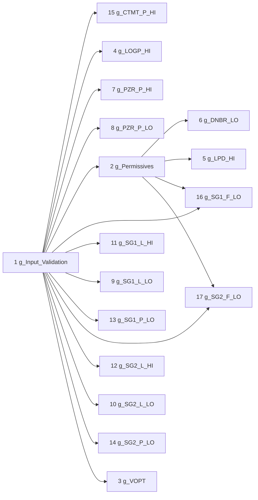

Module inputs are omitted from this diagram; they are shown on each group's FOD.

| No. | Group | Title | Logic type | Nodes | Implements |
|---|---|---|---|---|---|
| 1 | `g_Input_Validation` | Input validation |  | 10 | SYS-GEN-03 |
| 2 | `g_Permissives` | Shared permissives |  | 1 | SYS-GEN-09, SYS-LPD_HI-03, SYS-DNBR_LO-03, SYS-SG1_F_LO-03, SYS-SG2_F_LO-03 |
| 3 | `g_VOPT` | Variable Overpower trip | `Variable_Setpoint_Rising_Trip` | 4 | SYS-VOPT-01, SYS-VOPT-02 |
| 4 | `g_LOGP_HI` | High Logarithmic Power Level trip | `Fixed_Setpoint_Rising_Trip_with_OB` | 5 | SYS-LOGP_HI-01, SYS-LOGP_HI-03 |
| 5 | `g_LPD_HI` | High Local Power Density (CPC) trip | `Digital_Trip_with_OB` | 4 | SYS-LPD_HI-01, SYS-LPD_HI-03 |
| 6 | `g_DNBR_LO` | Low DNBR (CPC) trip | `Digital_Trip_with_OB` | 4 | SYS-DNBR_LO-01, SYS-DNBR_LO-03 |
| 7 | `g_PZR_P_HI` | High Pressurizer Pressure trip | `Fixed_Setpoint_Rising_Trip` | 2 | SYS-PZR_P_HI-01 |
| 8 | `g_PZR_P_LO` | Low Pressurizer Pressure trip | `Manual_Reset_Variable_Setpoint_Falling_Trip_with_OB` | 7 | SYS-PZR_P_LO-01, SYS-PZR_P_LO-02, SYS-PZR_P_LO-03 |
| 9 | `g_SG1_L_LO` | Low Steam Generator 1 Water Level trip | `Fixed_Setpoint_Falling_Trip` | 2 | SYS-SG1_L_LO-01 |
| 10 | `g_SG2_L_LO` | Low Steam Generator 2 Water Level trip | `Fixed_Setpoint_Falling_Trip` | 2 | SYS-SG2_L_LO-01 |
| 11 | `g_SG1_L_HI` | High Steam Generator 1 Water Level trip | `Fixed_Setpoint_Rising_Trip` | 2 | SYS-SG1_L_HI-01 |
| 12 | `g_SG2_L_HI` | High Steam Generator 2 Water Level trip | `Fixed_Setpoint_Rising_Trip` | 2 | SYS-SG2_L_HI-01 |
| 13 | `g_SG1_P_LO` | Low Steam Generator 1 Pressure trip | `Manual_Reset_Variable_Setpoint_Falling_Trip_with_OB` | 7 | SYS-SG1_P_LO-01, SYS-SG1_P_LO-02, SYS-SG1_P_LO-03 |
| 14 | `g_SG2_P_LO` | Low Steam Generator 2 Pressure trip | `Manual_Reset_Variable_Setpoint_Falling_Trip_with_OB` | 7 | SYS-SG2_P_LO-01, SYS-SG2_P_LO-02, SYS-SG2_P_LO-03 |
| 15 | `g_CTMT_P_HI` | High Containment Pressure trip | `Fixed_Setpoint_Rising_Trip` | 2 | SYS-CTMT_P_HI-01 |
| 16 | `g_SG1_F_LO` | Low Reactor Coolant Flow (SG1 loop) trip | `Variable_Setpoint_Falling_Trip_with_OB` | 6 | SYS-SG1_F_LO-01, SYS-SG1_F_LO-02, SYS-SG1_F_LO-03 |
| 17 | `g_SG2_F_LO` | Low Reactor Coolant Flow (SG2 loop) trip | `Variable_Setpoint_Falling_Trip_with_OB` | 6 | SYS-SG2_F_LO-01, SYS-SG2_F_LO-02, SYS-SG2_F_LO-03 |

### 6.4 Execution order

Topological order of the FOD data flow (dependencies first, ties broken by node number):

<details><summary>Show all 73 nodes</summary>

1. `f_NPWR_LIN_Valid` (1.1)
2. `f_NPWR_LOG_Valid` (1.2)
3. `f_PZR_P_Valid` (1.3)
4. `f_SG1_L_Valid` (1.4)
5. `f_SG2_L_Valid` (1.5)
6. `f_SG1_P_Valid` (1.6)
7. `f_SG2_P_Valid` (1.7)
8. `f_CTMT_P_Valid` (1.8)
9. `f_SG1_F_Valid` (1.9)
10. `f_SG2_F_Valid` (1.10)
11. `f_LP_OB_Perm` (2.1)
12. `f_VOPT_SP_Target` (3.1)
13. `h_VOPT_Trip_SP` (3.2)
14. `th_VOPT_Pretrip` (3.3)
15. `th_VOPT_Trip` (3.4)
16. `f_LOGP_HI_OB_Perm` (4.1)
17. `h_LOGP_HI_OB_Pulse` (4.2)
18. `h_LOGP_HI_OB_Sta` (4.3)
19. `th_LOGP_HI_Pretrip` (4.4)
20. `th_LOGP_HI_Trip` (4.5)
21. `h_LPD_HI_OB_Pulse` (5.1)
22. `h_LPD_HI_OB_Sta` (5.2)
23. `th_LPD_HI_Pretrip` (5.3)
24. `th_LPD_HI_Trip` (5.4)
25. `h_DNBR_LO_OB_Pulse` (6.1)
26. `h_DNBR_LO_OB_Sta` (6.2)
27. `th_DNBR_LO_Pretrip` (6.3)
28. `th_DNBR_LO_Trip` (6.4)
29. `th_PZR_P_HI_Pretrip` (7.1)
30. `th_PZR_P_HI_Trip` (7.2)
31. `f_PZR_P_LO_OB_Perm` (8.1)
32. `h_PZR_P_LO_OB_Pulse` (8.2)
33. `h_PZR_P_LO_OB_Sta` (8.3)
34. `h_PZR_P_LO_Reset_Pulse` (8.4)
35. `h_PZR_P_LO_Trip_SP` (8.5)
36. `th_PZR_P_LO_Pretrip` (8.6)
37. `th_PZR_P_LO_Trip` (8.7)
38. `th_SG1_L_LO_Pretrip` (9.1)
39. `th_SG1_L_LO_Trip` (9.2)
40. `th_SG2_L_LO_Pretrip` (10.1)
41. `th_SG2_L_LO_Trip` (10.2)
42. `th_SG1_L_HI_Pretrip` (11.1)
43. `th_SG1_L_HI_Trip` (11.2)
44. `th_SG2_L_HI_Pretrip` (12.1)
45. `th_SG2_L_HI_Trip` (12.2)
46. `f_SG1_P_LO_OB_Perm` (13.1)
47. `h_SG1_P_LO_OB_Pulse` (13.2)
48. `h_SG1_P_LO_OB_Sta` (13.3)
49. `h_SG1_P_LO_Reset_Pulse` (13.4)
50. `h_SG1_P_LO_Trip_SP` (13.5)
51. `th_SG1_P_LO_Pretrip` (13.6)
52. `th_SG1_P_LO_Trip` (13.7)
53. `f_SG2_P_LO_OB_Perm` (14.1)
54. `h_SG2_P_LO_OB_Pulse` (14.2)
55. `h_SG2_P_LO_OB_Sta` (14.3)
56. `h_SG2_P_LO_Reset_Pulse` (14.4)
57. `h_SG2_P_LO_Trip_SP` (14.5)
58. `th_SG2_P_LO_Pretrip` (14.6)
59. `th_SG2_P_LO_Trip` (14.7)
60. `th_CTMT_P_HI_Pretrip` (15.1)
61. `th_CTMT_P_HI_Trip` (15.2)
62. `h_SG1_F_LO_OB_Pulse` (16.1)
63. `h_SG1_F_LO_OB_Sta` (16.2)
64. `f_SG1_F_LO_SP_Target` (16.3)
65. `h_SG1_F_LO_Trip_SP` (16.4)
66. `th_SG1_F_LO_Pretrip` (16.5)
67. `th_SG1_F_LO_Trip` (16.6)
68. `h_SG2_F_LO_OB_Pulse` (17.1)
69. `h_SG2_F_LO_OB_Sta` (17.2)
70. `f_SG2_F_LO_SP_Target` (17.3)
71. `h_SG2_F_LO_Trip_SP` (17.4)
72. `th_SG2_F_LO_Pretrip` (17.5)
73. `th_SG2_F_LO_Trip` (17.6)

</details>

### 6.5 Proof obligations

Formulas proved valid by `tools/nuscr_check.py` for all inputs (constants substituted, proved range invariants assumed), and states proved to be left whenever the stated condition holds.

| ID | Formula | Rationale |
|---|---|---|
| PO-VOPT-PRETRIP-HYS | `!((f_NPWR_LIN >= h_VOPT_Trip_SP - k_VOPT_Pretrip_Margin) && (f_NPWR_LIN < h_VOPT_Trip_SP - k_VOPT_Pretrip_Margin - k_VOPT_Pretrip_Hys))` | th_VOPT_Pretrip: the reset condition must exclude the pretrip condition (positive hysteresis), otherwise the output could chatter between PRETRIP_BY_LOGIC and WAITING. |
| PO-VOPT-TRIP-HYS | `!((f_NPWR_LIN >= h_VOPT_Trip_SP) && (f_NPWR_LIN < h_VOPT_Trip_SP - k_VOPT_Trip_Hys))` | th_VOPT_Trip: the reset condition must exclude the trip condition (positive hysteresis), otherwise the output could chatter between TRIP_BY_LOGIC and WAITING. |
| PO-LOGP_HI-PRETRIP-HYS | `!((f_NPWR_LOG >= k_LOGP_HI_Pretrip_SP) && (f_NPWR_LOG < k_LOGP_HI_Pretrip_SP - k_LOGP_HI_Pretrip_Hys))` | th_LOGP_HI_Pretrip: the reset condition must exclude the pretrip condition (positive hysteresis), otherwise the output could chatter between PRETRIP_BY_LOGIC and WAITING. |
| PO-LOGP_HI-TRIP-HYS | `!((f_NPWR_LOG >= k_LOGP_HI_Trip_SP) && (f_NPWR_LOG < k_LOGP_HI_Trip_SP - k_LOGP_HI_Trip_Hys))` | th_LOGP_HI_Trip: the reset condition must exclude the trip condition (positive hysteresis), otherwise the output could chatter between TRIP_BY_LOGIC and WAITING. |
| PO-LPD_HI-PRETRIP-HYS | `!((f_LPD_HI_Pretrip_In = 0) && (f_LPD_HI_Pretrip_In = 1))` | th_LPD_HI_Pretrip: the reset condition must exclude the pretrip condition (positive hysteresis), otherwise the output could chatter between PRETRIP_BY_LOGIC and WAITING. |
| PO-LPD_HI-TRIP-HYS | `!((f_LPD_HI_Trip_In = 0) && (f_LPD_HI_Trip_In = 1))` | th_LPD_HI_Trip: the reset condition must exclude the trip condition (positive hysteresis), otherwise the output could chatter between TRIP_BY_LOGIC and WAITING. |
| PO-DNBR_LO-PRETRIP-HYS | `!((f_DNBR_LO_Pretrip_In = 0) && (f_DNBR_LO_Pretrip_In = 1))` | th_DNBR_LO_Pretrip: the reset condition must exclude the pretrip condition (positive hysteresis), otherwise the output could chatter between PRETRIP_BY_LOGIC and WAITING. |
| PO-DNBR_LO-TRIP-HYS | `!((f_DNBR_LO_Trip_In = 0) && (f_DNBR_LO_Trip_In = 1))` | th_DNBR_LO_Trip: the reset condition must exclude the trip condition (positive hysteresis), otherwise the output could chatter between TRIP_BY_LOGIC and WAITING. |
| PO-PZR_P_HI-PRETRIP-HYS | `!((f_PZR_P >= k_PZR_P_HI_Pretrip_SP) && (f_PZR_P < k_PZR_P_HI_Pretrip_SP - k_PZR_P_HI_Pretrip_Hys))` | th_PZR_P_HI_Pretrip: the reset condition must exclude the pretrip condition (positive hysteresis), otherwise the output could chatter between PRETRIP_BY_LOGIC and WAITING. |
| PO-PZR_P_HI-TRIP-HYS | `!((f_PZR_P >= k_PZR_P_HI_Trip_SP) && (f_PZR_P < k_PZR_P_HI_Trip_SP - k_PZR_P_HI_Trip_Hys))` | th_PZR_P_HI_Trip: the reset condition must exclude the trip condition (positive hysteresis), otherwise the output could chatter between TRIP_BY_LOGIC and WAITING. |
| PO-PZR_P_LO-PRETRIP-HYS | `!((f_PZR_P <= h_PZR_P_LO_Trip_SP + k_PZR_P_LO_Pretrip_Margin) && (f_PZR_P > h_PZR_P_LO_Trip_SP + k_PZR_P_LO_Pretrip_Margin + k_PZR_P_LO_Pretrip_Hys))` | th_PZR_P_LO_Pretrip: the reset condition must exclude the pretrip condition (positive hysteresis), otherwise the output could chatter between PRETRIP_BY_LOGIC and WAITING. |
| PO-PZR_P_LO-TRIP-HYS | `!((f_PZR_P <= h_PZR_P_LO_Trip_SP) && (f_PZR_P > h_PZR_P_LO_Trip_SP + k_PZR_P_LO_Trip_Hys))` | th_PZR_P_LO_Trip: the reset condition must exclude the trip condition (positive hysteresis), otherwise the output could chatter between TRIP_BY_LOGIC and WAITING. |
| PO-SG1_L_LO-PRETRIP-HYS | `!((f_SG1_L <= k_SG1_L_LO_Pretrip_SP) && (f_SG1_L > k_SG1_L_LO_Pretrip_SP + k_SG1_L_LO_Pretrip_Hys))` | th_SG1_L_LO_Pretrip: the reset condition must exclude the pretrip condition (positive hysteresis), otherwise the output could chatter between PRETRIP_BY_LOGIC and WAITING. |
| PO-SG1_L_LO-TRIP-HYS | `!((f_SG1_L <= k_SG1_L_LO_Trip_SP) && (f_SG1_L > k_SG1_L_LO_Trip_SP + k_SG1_L_LO_Trip_Hys))` | th_SG1_L_LO_Trip: the reset condition must exclude the trip condition (positive hysteresis), otherwise the output could chatter between TRIP_BY_LOGIC and WAITING. |
| PO-SG2_L_LO-PRETRIP-HYS | `!((f_SG2_L <= k_SG2_L_LO_Pretrip_SP) && (f_SG2_L > k_SG2_L_LO_Pretrip_SP + k_SG2_L_LO_Pretrip_Hys))` | th_SG2_L_LO_Pretrip: the reset condition must exclude the pretrip condition (positive hysteresis), otherwise the output could chatter between PRETRIP_BY_LOGIC and WAITING. |
| PO-SG2_L_LO-TRIP-HYS | `!((f_SG2_L <= k_SG2_L_LO_Trip_SP) && (f_SG2_L > k_SG2_L_LO_Trip_SP + k_SG2_L_LO_Trip_Hys))` | th_SG2_L_LO_Trip: the reset condition must exclude the trip condition (positive hysteresis), otherwise the output could chatter between TRIP_BY_LOGIC and WAITING. |
| PO-SG1_L_HI-PRETRIP-HYS | `!((f_SG1_L >= k_SG1_L_HI_Pretrip_SP) && (f_SG1_L < k_SG1_L_HI_Pretrip_SP - k_SG1_L_HI_Pretrip_Hys))` | th_SG1_L_HI_Pretrip: the reset condition must exclude the pretrip condition (positive hysteresis), otherwise the output could chatter between PRETRIP_BY_LOGIC and WAITING. |
| PO-SG1_L_HI-TRIP-HYS | `!((f_SG1_L >= k_SG1_L_HI_Trip_SP) && (f_SG1_L < k_SG1_L_HI_Trip_SP - k_SG1_L_HI_Trip_Hys))` | th_SG1_L_HI_Trip: the reset condition must exclude the trip condition (positive hysteresis), otherwise the output could chatter between TRIP_BY_LOGIC and WAITING. |
| PO-SG2_L_HI-PRETRIP-HYS | `!((f_SG2_L >= k_SG2_L_HI_Pretrip_SP) && (f_SG2_L < k_SG2_L_HI_Pretrip_SP - k_SG2_L_HI_Pretrip_Hys))` | th_SG2_L_HI_Pretrip: the reset condition must exclude the pretrip condition (positive hysteresis), otherwise the output could chatter between PRETRIP_BY_LOGIC and WAITING. |
| PO-SG2_L_HI-TRIP-HYS | `!((f_SG2_L >= k_SG2_L_HI_Trip_SP) && (f_SG2_L < k_SG2_L_HI_Trip_SP - k_SG2_L_HI_Trip_Hys))` | th_SG2_L_HI_Trip: the reset condition must exclude the trip condition (positive hysteresis), otherwise the output could chatter between TRIP_BY_LOGIC and WAITING. |
| PO-SG1_P_LO-PRETRIP-HYS | `!((f_SG1_P <= h_SG1_P_LO_Trip_SP + k_SG1_P_LO_Pretrip_Margin) && (f_SG1_P > h_SG1_P_LO_Trip_SP + k_SG1_P_LO_Pretrip_Margin + k_SG1_P_LO_Pretrip_Hys))` | th_SG1_P_LO_Pretrip: the reset condition must exclude the pretrip condition (positive hysteresis), otherwise the output could chatter between PRETRIP_BY_LOGIC and WAITING. |
| PO-SG1_P_LO-TRIP-HYS | `!((f_SG1_P <= h_SG1_P_LO_Trip_SP) && (f_SG1_P > h_SG1_P_LO_Trip_SP + k_SG1_P_LO_Trip_Hys))` | th_SG1_P_LO_Trip: the reset condition must exclude the trip condition (positive hysteresis), otherwise the output could chatter between TRIP_BY_LOGIC and WAITING. |
| PO-SG2_P_LO-PRETRIP-HYS | `!((f_SG2_P <= h_SG2_P_LO_Trip_SP + k_SG2_P_LO_Pretrip_Margin) && (f_SG2_P > h_SG2_P_LO_Trip_SP + k_SG2_P_LO_Pretrip_Margin + k_SG2_P_LO_Pretrip_Hys))` | th_SG2_P_LO_Pretrip: the reset condition must exclude the pretrip condition (positive hysteresis), otherwise the output could chatter between PRETRIP_BY_LOGIC and WAITING. |
| PO-SG2_P_LO-TRIP-HYS | `!((f_SG2_P <= h_SG2_P_LO_Trip_SP) && (f_SG2_P > h_SG2_P_LO_Trip_SP + k_SG2_P_LO_Trip_Hys))` | th_SG2_P_LO_Trip: the reset condition must exclude the trip condition (positive hysteresis), otherwise the output could chatter between TRIP_BY_LOGIC and WAITING. |
| PO-CTMT_P_HI-PRETRIP-HYS | `!((f_CTMT_P >= k_CTMT_P_HI_Pretrip_SP) && (f_CTMT_P < k_CTMT_P_HI_Pretrip_SP - k_CTMT_P_HI_Pretrip_Hys))` | th_CTMT_P_HI_Pretrip: the reset condition must exclude the pretrip condition (positive hysteresis), otherwise the output could chatter between PRETRIP_BY_LOGIC and WAITING. |
| PO-CTMT_P_HI-TRIP-HYS | `!((f_CTMT_P >= k_CTMT_P_HI_Trip_SP) && (f_CTMT_P < k_CTMT_P_HI_Trip_SP - k_CTMT_P_HI_Trip_Hys))` | th_CTMT_P_HI_Trip: the reset condition must exclude the trip condition (positive hysteresis), otherwise the output could chatter between TRIP_BY_LOGIC and WAITING. |
| PO-SG1_F_LO-PRETRIP-HYS | `!((f_SG1_F <= h_SG1_F_LO_Trip_SP + k_SG1_F_LO_Pretrip_Margin) && (f_SG1_F > h_SG1_F_LO_Trip_SP + k_SG1_F_LO_Pretrip_Margin + k_SG1_F_LO_Pretrip_Hys))` | th_SG1_F_LO_Pretrip: the reset condition must exclude the pretrip condition (positive hysteresis), otherwise the output could chatter between PRETRIP_BY_LOGIC and WAITING. |
| PO-SG1_F_LO-TRIP-HYS | `!((f_SG1_F <= h_SG1_F_LO_Trip_SP) && (f_SG1_F > h_SG1_F_LO_Trip_SP + k_SG1_F_LO_Trip_Hys))` | th_SG1_F_LO_Trip: the reset condition must exclude the trip condition (positive hysteresis), otherwise the output could chatter between TRIP_BY_LOGIC and WAITING. |
| PO-SG2_F_LO-PRETRIP-HYS | `!((f_SG2_F <= h_SG2_F_LO_Trip_SP + k_SG2_F_LO_Pretrip_Margin) && (f_SG2_F > h_SG2_F_LO_Trip_SP + k_SG2_F_LO_Pretrip_Margin + k_SG2_F_LO_Pretrip_Hys))` | th_SG2_F_LO_Pretrip: the reset condition must exclude the pretrip condition (positive hysteresis), otherwise the output could chatter between PRETRIP_BY_LOGIC and WAITING. |
| PO-SG2_F_LO-TRIP-HYS | `!((f_SG2_F <= h_SG2_F_LO_Trip_SP) && (f_SG2_F > h_SG2_F_LO_Trip_SP + k_SG2_F_LO_Trip_Hys))` | th_SG2_F_LO_Trip: the reset condition must exclude the trip condition (positive hysteresis), otherwise the output could chatter between TRIP_BY_LOGIC and WAITING. |

| Machine | State | Must be left when |
|---|---|---|
| `th_VOPT_Pretrip` | PRETRIP_BY_ERROR | `f_NPWR_LIN_Valid = 1 && f_Module_Error = 0 && f_Channel_Error = 0` |
| `th_VOPT_Pretrip` | PRETRIP_BY_ERROR_LATCHED | `f_NPWR_LIN_Valid = 1 && f_Module_Error = 0 && f_Channel_Error = 0` |
| `th_VOPT_Trip` | TRIP_BY_ERROR | `f_NPWR_LIN_Valid = 1 && f_Module_Error = 0 && f_Channel_Error = 0` |
| `th_VOPT_Trip` | TRIP_BY_ERROR_LATCHED | `f_NPWR_LIN_Valid = 1 && f_Module_Error = 0 && f_Channel_Error = 0` |
| `th_LOGP_HI_Pretrip` | PRETRIP_BY_ERROR | `f_NPWR_LOG_Valid = 1 && f_Module_Error = 0 && f_Channel_Error = 0` |
| `th_LOGP_HI_Pretrip` | PRETRIP_BY_ERROR_LATCHED | `f_NPWR_LOG_Valid = 1 && f_Module_Error = 0 && f_Channel_Error = 0` |
| `th_LOGP_HI_Trip` | TRIP_BY_ERROR | `f_NPWR_LOG_Valid = 1 && f_Module_Error = 0 && f_Channel_Error = 0` |
| `th_LOGP_HI_Trip` | TRIP_BY_ERROR_LATCHED | `f_NPWR_LOG_Valid = 1 && f_Module_Error = 0 && f_Channel_Error = 0` |
| `th_LPD_HI_Pretrip` | PRETRIP_BY_ERROR | `f_CPC_Link_Error = 0 && f_Module_Error = 0 && f_Channel_Error = 0` |
| `th_LPD_HI_Pretrip` | PRETRIP_BY_ERROR_LATCHED | `f_CPC_Link_Error = 0 && f_Module_Error = 0 && f_Channel_Error = 0` |
| `th_LPD_HI_Trip` | TRIP_BY_ERROR | `f_CPC_Link_Error = 0 && f_Module_Error = 0 && f_Channel_Error = 0` |
| `th_LPD_HI_Trip` | TRIP_BY_ERROR_LATCHED | `f_CPC_Link_Error = 0 && f_Module_Error = 0 && f_Channel_Error = 0` |
| `th_DNBR_LO_Pretrip` | PRETRIP_BY_ERROR | `f_CPC_Link_Error = 0 && f_Module_Error = 0 && f_Channel_Error = 0` |
| `th_DNBR_LO_Pretrip` | PRETRIP_BY_ERROR_LATCHED | `f_CPC_Link_Error = 0 && f_Module_Error = 0 && f_Channel_Error = 0` |
| `th_DNBR_LO_Trip` | TRIP_BY_ERROR | `f_CPC_Link_Error = 0 && f_Module_Error = 0 && f_Channel_Error = 0` |
| `th_DNBR_LO_Trip` | TRIP_BY_ERROR_LATCHED | `f_CPC_Link_Error = 0 && f_Module_Error = 0 && f_Channel_Error = 0` |
| `th_PZR_P_HI_Pretrip` | PRETRIP_BY_ERROR | `f_PZR_P_Valid = 1 && f_Module_Error = 0 && f_Channel_Error = 0` |
| `th_PZR_P_HI_Pretrip` | PRETRIP_BY_ERROR_LATCHED | `f_PZR_P_Valid = 1 && f_Module_Error = 0 && f_Channel_Error = 0` |
| `th_PZR_P_HI_Trip` | TRIP_BY_ERROR | `f_PZR_P_Valid = 1 && f_Module_Error = 0 && f_Channel_Error = 0` |
| `th_PZR_P_HI_Trip` | TRIP_BY_ERROR_LATCHED | `f_PZR_P_Valid = 1 && f_Module_Error = 0 && f_Channel_Error = 0` |
| `th_PZR_P_LO_Pretrip` | PRETRIP_BY_ERROR | `f_PZR_P_Valid = 1 && f_Module_Error = 0 && f_Channel_Error = 0` |
| `th_PZR_P_LO_Pretrip` | PRETRIP_BY_ERROR_LATCHED | `f_PZR_P_Valid = 1 && f_Module_Error = 0 && f_Channel_Error = 0` |
| `th_PZR_P_LO_Trip` | TRIP_BY_ERROR | `f_PZR_P_Valid = 1 && f_Module_Error = 0 && f_Channel_Error = 0` |
| `th_PZR_P_LO_Trip` | TRIP_BY_ERROR_LATCHED | `f_PZR_P_Valid = 1 && f_Module_Error = 0 && f_Channel_Error = 0` |
| `th_SG1_L_LO_Pretrip` | PRETRIP_BY_ERROR | `f_SG1_L_Valid = 1 && f_Module_Error = 0 && f_Channel_Error = 0` |
| `th_SG1_L_LO_Pretrip` | PRETRIP_BY_ERROR_LATCHED | `f_SG1_L_Valid = 1 && f_Module_Error = 0 && f_Channel_Error = 0` |
| `th_SG1_L_LO_Trip` | TRIP_BY_ERROR | `f_SG1_L_Valid = 1 && f_Module_Error = 0 && f_Channel_Error = 0` |
| `th_SG1_L_LO_Trip` | TRIP_BY_ERROR_LATCHED | `f_SG1_L_Valid = 1 && f_Module_Error = 0 && f_Channel_Error = 0` |
| `th_SG2_L_LO_Pretrip` | PRETRIP_BY_ERROR | `f_SG2_L_Valid = 1 && f_Module_Error = 0 && f_Channel_Error = 0` |
| `th_SG2_L_LO_Pretrip` | PRETRIP_BY_ERROR_LATCHED | `f_SG2_L_Valid = 1 && f_Module_Error = 0 && f_Channel_Error = 0` |
| `th_SG2_L_LO_Trip` | TRIP_BY_ERROR | `f_SG2_L_Valid = 1 && f_Module_Error = 0 && f_Channel_Error = 0` |
| `th_SG2_L_LO_Trip` | TRIP_BY_ERROR_LATCHED | `f_SG2_L_Valid = 1 && f_Module_Error = 0 && f_Channel_Error = 0` |
| `th_SG1_L_HI_Pretrip` | PRETRIP_BY_ERROR | `f_SG1_L_Valid = 1 && f_Module_Error = 0 && f_Channel_Error = 0` |
| `th_SG1_L_HI_Pretrip` | PRETRIP_BY_ERROR_LATCHED | `f_SG1_L_Valid = 1 && f_Module_Error = 0 && f_Channel_Error = 0` |
| `th_SG1_L_HI_Trip` | TRIP_BY_ERROR | `f_SG1_L_Valid = 1 && f_Module_Error = 0 && f_Channel_Error = 0` |
| `th_SG1_L_HI_Trip` | TRIP_BY_ERROR_LATCHED | `f_SG1_L_Valid = 1 && f_Module_Error = 0 && f_Channel_Error = 0` |
| `th_SG2_L_HI_Pretrip` | PRETRIP_BY_ERROR | `f_SG2_L_Valid = 1 && f_Module_Error = 0 && f_Channel_Error = 0` |
| `th_SG2_L_HI_Pretrip` | PRETRIP_BY_ERROR_LATCHED | `f_SG2_L_Valid = 1 && f_Module_Error = 0 && f_Channel_Error = 0` |
| `th_SG2_L_HI_Trip` | TRIP_BY_ERROR | `f_SG2_L_Valid = 1 && f_Module_Error = 0 && f_Channel_Error = 0` |
| `th_SG2_L_HI_Trip` | TRIP_BY_ERROR_LATCHED | `f_SG2_L_Valid = 1 && f_Module_Error = 0 && f_Channel_Error = 0` |
| `th_SG1_P_LO_Pretrip` | PRETRIP_BY_ERROR | `f_SG1_P_Valid = 1 && f_Module_Error = 0 && f_Channel_Error = 0` |
| `th_SG1_P_LO_Pretrip` | PRETRIP_BY_ERROR_LATCHED | `f_SG1_P_Valid = 1 && f_Module_Error = 0 && f_Channel_Error = 0` |
| `th_SG1_P_LO_Trip` | TRIP_BY_ERROR | `f_SG1_P_Valid = 1 && f_Module_Error = 0 && f_Channel_Error = 0` |
| `th_SG1_P_LO_Trip` | TRIP_BY_ERROR_LATCHED | `f_SG1_P_Valid = 1 && f_Module_Error = 0 && f_Channel_Error = 0` |
| `th_SG2_P_LO_Pretrip` | PRETRIP_BY_ERROR | `f_SG2_P_Valid = 1 && f_Module_Error = 0 && f_Channel_Error = 0` |
| `th_SG2_P_LO_Pretrip` | PRETRIP_BY_ERROR_LATCHED | `f_SG2_P_Valid = 1 && f_Module_Error = 0 && f_Channel_Error = 0` |
| `th_SG2_P_LO_Trip` | TRIP_BY_ERROR | `f_SG2_P_Valid = 1 && f_Module_Error = 0 && f_Channel_Error = 0` |
| `th_SG2_P_LO_Trip` | TRIP_BY_ERROR_LATCHED | `f_SG2_P_Valid = 1 && f_Module_Error = 0 && f_Channel_Error = 0` |
| `th_CTMT_P_HI_Pretrip` | PRETRIP_BY_ERROR | `f_CTMT_P_Valid = 1 && f_Module_Error = 0 && f_Channel_Error = 0` |
| `th_CTMT_P_HI_Pretrip` | PRETRIP_BY_ERROR_LATCHED | `f_CTMT_P_Valid = 1 && f_Module_Error = 0 && f_Channel_Error = 0` |
| `th_CTMT_P_HI_Trip` | TRIP_BY_ERROR | `f_CTMT_P_Valid = 1 && f_Module_Error = 0 && f_Channel_Error = 0` |
| `th_CTMT_P_HI_Trip` | TRIP_BY_ERROR_LATCHED | `f_CTMT_P_Valid = 1 && f_Module_Error = 0 && f_Channel_Error = 0` |
| `th_SG1_F_LO_Pretrip` | PRETRIP_BY_ERROR | `f_SG1_F_Valid = 1 && f_Module_Error = 0 && f_Channel_Error = 0` |
| `th_SG1_F_LO_Pretrip` | PRETRIP_BY_ERROR_LATCHED | `f_SG1_F_Valid = 1 && f_Module_Error = 0 && f_Channel_Error = 0` |
| `th_SG1_F_LO_Trip` | TRIP_BY_ERROR | `f_SG1_F_Valid = 1 && f_Module_Error = 0 && f_Channel_Error = 0` |
| `th_SG1_F_LO_Trip` | TRIP_BY_ERROR_LATCHED | `f_SG1_F_Valid = 1 && f_Module_Error = 0 && f_Channel_Error = 0` |
| `th_SG2_F_LO_Pretrip` | PRETRIP_BY_ERROR | `f_SG2_F_Valid = 1 && f_Module_Error = 0 && f_Channel_Error = 0` |
| `th_SG2_F_LO_Pretrip` | PRETRIP_BY_ERROR_LATCHED | `f_SG2_F_Valid = 1 && f_Module_Error = 0 && f_Channel_Error = 0` |
| `th_SG2_F_LO_Trip` | TRIP_BY_ERROR | `f_SG2_F_Valid = 1 && f_Module_Error = 0 && f_Channel_Error = 0` |
| `th_SG2_F_LO_Trip` | TRIP_BY_ERROR_LATCHED | `f_SG2_F_Valid = 1 && f_Module_Error = 0 && f_Channel_Error = 0` |

Forced values: whenever the condition holds, the variable has the value after the scan, from every state (the fail-safe property of SYS-GEN-02).

| Machine | Condition | Value |
|---|---|---|
| `th_VOPT_Pretrip` | `f_NPWR_LIN_Valid = 0 \|\| f_Module_Error = 1 \|\| f_Channel_Error = 1` | `0` |
| `th_VOPT_Trip` | `f_NPWR_LIN_Valid = 0 \|\| f_Module_Error = 1 \|\| f_Channel_Error = 1` | `0` |
| `th_LOGP_HI_Pretrip` | `f_NPWR_LOG_Valid = 0 \|\| f_Module_Error = 1 \|\| f_Channel_Error = 1` | `0` |
| `th_LOGP_HI_Trip` | `f_NPWR_LOG_Valid = 0 \|\| f_Module_Error = 1 \|\| f_Channel_Error = 1` | `0` |
| `th_LPD_HI_Pretrip` | `f_CPC_Link_Error = 1 \|\| f_Module_Error = 1 \|\| f_Channel_Error = 1` | `0` |
| `th_LPD_HI_Trip` | `f_CPC_Link_Error = 1 \|\| f_Module_Error = 1 \|\| f_Channel_Error = 1` | `0` |
| `th_DNBR_LO_Pretrip` | `f_CPC_Link_Error = 1 \|\| f_Module_Error = 1 \|\| f_Channel_Error = 1` | `0` |
| `th_DNBR_LO_Trip` | `f_CPC_Link_Error = 1 \|\| f_Module_Error = 1 \|\| f_Channel_Error = 1` | `0` |
| `th_PZR_P_HI_Pretrip` | `f_PZR_P_Valid = 0 \|\| f_Module_Error = 1 \|\| f_Channel_Error = 1` | `0` |
| `th_PZR_P_HI_Trip` | `f_PZR_P_Valid = 0 \|\| f_Module_Error = 1 \|\| f_Channel_Error = 1` | `0` |
| `th_PZR_P_LO_Pretrip` | `f_PZR_P_Valid = 0 \|\| f_Module_Error = 1 \|\| f_Channel_Error = 1` | `0` |
| `th_PZR_P_LO_Trip` | `f_PZR_P_Valid = 0 \|\| f_Module_Error = 1 \|\| f_Channel_Error = 1` | `0` |
| `th_SG1_L_LO_Pretrip` | `f_SG1_L_Valid = 0 \|\| f_Module_Error = 1 \|\| f_Channel_Error = 1` | `0` |
| `th_SG1_L_LO_Trip` | `f_SG1_L_Valid = 0 \|\| f_Module_Error = 1 \|\| f_Channel_Error = 1` | `0` |
| `th_SG2_L_LO_Pretrip` | `f_SG2_L_Valid = 0 \|\| f_Module_Error = 1 \|\| f_Channel_Error = 1` | `0` |
| `th_SG2_L_LO_Trip` | `f_SG2_L_Valid = 0 \|\| f_Module_Error = 1 \|\| f_Channel_Error = 1` | `0` |
| `th_SG1_L_HI_Pretrip` | `f_SG1_L_Valid = 0 \|\| f_Module_Error = 1 \|\| f_Channel_Error = 1` | `0` |
| `th_SG1_L_HI_Trip` | `f_SG1_L_Valid = 0 \|\| f_Module_Error = 1 \|\| f_Channel_Error = 1` | `0` |
| `th_SG2_L_HI_Pretrip` | `f_SG2_L_Valid = 0 \|\| f_Module_Error = 1 \|\| f_Channel_Error = 1` | `0` |
| `th_SG2_L_HI_Trip` | `f_SG2_L_Valid = 0 \|\| f_Module_Error = 1 \|\| f_Channel_Error = 1` | `0` |
| `th_SG1_P_LO_Pretrip` | `f_SG1_P_Valid = 0 \|\| f_Module_Error = 1 \|\| f_Channel_Error = 1` | `0` |
| `th_SG1_P_LO_Trip` | `f_SG1_P_Valid = 0 \|\| f_Module_Error = 1 \|\| f_Channel_Error = 1` | `0` |
| `th_SG2_P_LO_Pretrip` | `f_SG2_P_Valid = 0 \|\| f_Module_Error = 1 \|\| f_Channel_Error = 1` | `0` |
| `th_SG2_P_LO_Trip` | `f_SG2_P_Valid = 0 \|\| f_Module_Error = 1 \|\| f_Channel_Error = 1` | `0` |
| `th_CTMT_P_HI_Pretrip` | `f_CTMT_P_Valid = 0 \|\| f_Module_Error = 1 \|\| f_Channel_Error = 1` | `0` |
| `th_CTMT_P_HI_Trip` | `f_CTMT_P_Valid = 0 \|\| f_Module_Error = 1 \|\| f_Channel_Error = 1` | `0` |
| `th_SG1_F_LO_Pretrip` | `f_SG1_F_Valid = 0 \|\| f_Module_Error = 1 \|\| f_Channel_Error = 1` | `0` |
| `th_SG1_F_LO_Trip` | `f_SG1_F_Valid = 0 \|\| f_Module_Error = 1 \|\| f_Channel_Error = 1` | `0` |
| `th_SG2_F_LO_Pretrip` | `f_SG2_F_Valid = 0 \|\| f_Module_Error = 1 \|\| f_Channel_Error = 1` | `0` |
| `th_SG2_F_LO_Trip` | `f_SG2_F_Valid = 0 \|\| f_Module_Error = 1 \|\| f_Channel_Error = 1` | `0` |

### 6.6 Groups and node definitions

#### BP.1 `g_Input_Validation` - Input validation

Range checks of every analog process input (SYS-GEN-03).

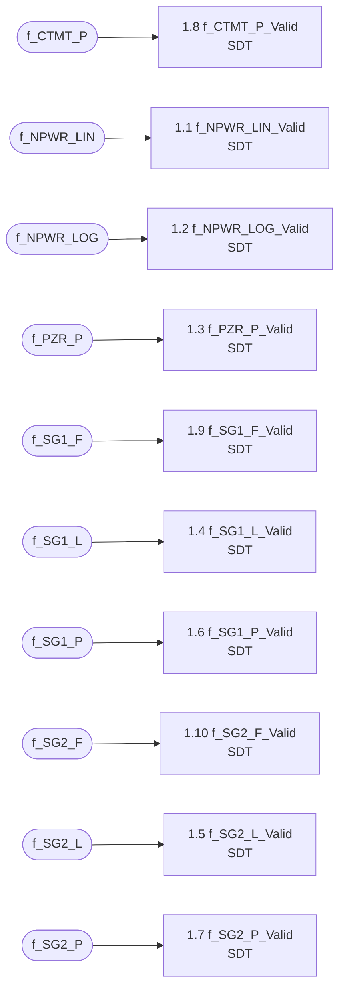

| No. | Node | Kind | Inputs |
|---|---|---|---|
| 1.1 | `f_NPWR_LIN_Valid` | SDT | `f_NPWR_LIN` |
| 1.2 | `f_NPWR_LOG_Valid` | SDT | `f_NPWR_LOG` |
| 1.3 | `f_PZR_P_Valid` | SDT | `f_PZR_P` |
| 1.4 | `f_SG1_L_Valid` | SDT | `f_SG1_L` |
| 1.5 | `f_SG2_L_Valid` | SDT | `f_SG2_L` |
| 1.6 | `f_SG1_P_Valid` | SDT | `f_SG1_P` |
| 1.7 | `f_SG2_P_Valid` | SDT | `f_SG2_P` |
| 1.8 | `f_CTMT_P_Valid` | SDT | `f_CTMT_P` |
| 1.9 | `f_SG1_F_Valid` | SDT | `f_SG1_F` |
| 1.10 | `f_SG2_F_Valid` | SDT | `f_SG2_F` |

##### BP.1.1 `f_NPWR_LIN_Valid` (SDT)

*function variable, type `valid_flag`.*  Implements: SYS-GEN-03.

f_NPWR_LIN is valid (1) inside [k_NPWR_LIN_Valid_Min, k_NPWR_LIN_Valid_Max], invalid (0) otherwise.

|  | R1 | R2 | R3 |
|---|:-:|:-:|:-:|
| **Conditions** |  |  |  |
| `f_NPWR_LIN >= k_NPWR_LIN_Valid_Min` | T | T | F |
| `f_NPWR_LIN <= k_NPWR_LIN_Valid_Max` | T | F | - |
| **Actions** |  |  |  |
| `f_NPWR_LIN_Valid := 1` | O |  |  |
| `f_NPWR_LIN_Valid := 0` |  | O | O |

##### BP.1.2 `f_NPWR_LOG_Valid` (SDT)

*function variable, type `valid_flag`.*  Implements: SYS-GEN-03.

f_NPWR_LOG is valid (1) inside [k_NPWR_LOG_Valid_Min, k_NPWR_LOG_Valid_Max], invalid (0) otherwise.

|  | R1 | R2 | R3 |
|---|:-:|:-:|:-:|
| **Conditions** |  |  |  |
| `f_NPWR_LOG >= k_NPWR_LOG_Valid_Min` | T | T | F |
| `f_NPWR_LOG <= k_NPWR_LOG_Valid_Max` | T | F | - |
| **Actions** |  |  |  |
| `f_NPWR_LOG_Valid := 1` | O |  |  |
| `f_NPWR_LOG_Valid := 0` |  | O | O |

##### BP.1.3 `f_PZR_P_Valid` (SDT)

*function variable, type `valid_flag`.*  Implements: SYS-GEN-03.

f_PZR_P is valid (1) inside [k_PZR_P_Valid_Min, k_PZR_P_Valid_Max], invalid (0) otherwise.

|  | R1 | R2 | R3 |
|---|:-:|:-:|:-:|
| **Conditions** |  |  |  |
| `f_PZR_P >= k_PZR_P_Valid_Min` | T | T | F |
| `f_PZR_P <= k_PZR_P_Valid_Max` | T | F | - |
| **Actions** |  |  |  |
| `f_PZR_P_Valid := 1` | O |  |  |
| `f_PZR_P_Valid := 0` |  | O | O |

##### BP.1.4 `f_SG1_L_Valid` (SDT)

*function variable, type `valid_flag`.*  Implements: SYS-GEN-03.

f_SG1_L is valid (1) inside [k_SG1_L_Valid_Min, k_SG1_L_Valid_Max], invalid (0) otherwise.

|  | R1 | R2 | R3 |
|---|:-:|:-:|:-:|
| **Conditions** |  |  |  |
| `f_SG1_L >= k_SG1_L_Valid_Min` | T | T | F |
| `f_SG1_L <= k_SG1_L_Valid_Max` | T | F | - |
| **Actions** |  |  |  |
| `f_SG1_L_Valid := 1` | O |  |  |
| `f_SG1_L_Valid := 0` |  | O | O |

##### BP.1.5 `f_SG2_L_Valid` (SDT)

*function variable, type `valid_flag`.*  Implements: SYS-GEN-03.

f_SG2_L is valid (1) inside [k_SG2_L_Valid_Min, k_SG2_L_Valid_Max], invalid (0) otherwise.

|  | R1 | R2 | R3 |
|---|:-:|:-:|:-:|
| **Conditions** |  |  |  |
| `f_SG2_L >= k_SG2_L_Valid_Min` | T | T | F |
| `f_SG2_L <= k_SG2_L_Valid_Max` | T | F | - |
| **Actions** |  |  |  |
| `f_SG2_L_Valid := 1` | O |  |  |
| `f_SG2_L_Valid := 0` |  | O | O |

##### BP.1.6 `f_SG1_P_Valid` (SDT)

*function variable, type `valid_flag`.*  Implements: SYS-GEN-03.

f_SG1_P is valid (1) inside [k_SG1_P_Valid_Min, k_SG1_P_Valid_Max], invalid (0) otherwise.

|  | R1 | R2 | R3 |
|---|:-:|:-:|:-:|
| **Conditions** |  |  |  |
| `f_SG1_P >= k_SG1_P_Valid_Min` | T | T | F |
| `f_SG1_P <= k_SG1_P_Valid_Max` | T | F | - |
| **Actions** |  |  |  |
| `f_SG1_P_Valid := 1` | O |  |  |
| `f_SG1_P_Valid := 0` |  | O | O |

##### BP.1.7 `f_SG2_P_Valid` (SDT)

*function variable, type `valid_flag`.*  Implements: SYS-GEN-03.

f_SG2_P is valid (1) inside [k_SG2_P_Valid_Min, k_SG2_P_Valid_Max], invalid (0) otherwise.

|  | R1 | R2 | R3 |
|---|:-:|:-:|:-:|
| **Conditions** |  |  |  |
| `f_SG2_P >= k_SG2_P_Valid_Min` | T | T | F |
| `f_SG2_P <= k_SG2_P_Valid_Max` | T | F | - |
| **Actions** |  |  |  |
| `f_SG2_P_Valid := 1` | O |  |  |
| `f_SG2_P_Valid := 0` |  | O | O |

##### BP.1.8 `f_CTMT_P_Valid` (SDT)

*function variable, type `valid_flag`.*  Implements: SYS-GEN-03.

f_CTMT_P is valid (1) inside [k_CTMT_P_Valid_Min, k_CTMT_P_Valid_Max], invalid (0) otherwise.

|  | R1 | R2 | R3 |
|---|:-:|:-:|:-:|
| **Conditions** |  |  |  |
| `f_CTMT_P >= k_CTMT_P_Valid_Min` | T | T | F |
| `f_CTMT_P <= k_CTMT_P_Valid_Max` | T | F | - |
| **Actions** |  |  |  |
| `f_CTMT_P_Valid := 1` | O |  |  |
| `f_CTMT_P_Valid := 0` |  | O | O |

##### BP.1.9 `f_SG1_F_Valid` (SDT)

*function variable, type `valid_flag`.*  Implements: SYS-GEN-03.

f_SG1_F is valid (1) inside [k_SG1_F_Valid_Min, k_SG1_F_Valid_Max], invalid (0) otherwise.

|  | R1 | R2 | R3 |
|---|:-:|:-:|:-:|
| **Conditions** |  |  |  |
| `f_SG1_F >= k_SG1_F_Valid_Min` | T | T | F |
| `f_SG1_F <= k_SG1_F_Valid_Max` | T | F | - |
| **Actions** |  |  |  |
| `f_SG1_F_Valid := 1` | O |  |  |
| `f_SG1_F_Valid := 0` |  | O | O |

##### BP.1.10 `f_SG2_F_Valid` (SDT)

*function variable, type `valid_flag`.*  Implements: SYS-GEN-03.

f_SG2_F is valid (1) inside [k_SG2_F_Valid_Min, k_SG2_F_Valid_Max], invalid (0) otherwise.

|  | R1 | R2 | R3 |
|---|:-:|:-:|:-:|
| **Conditions** |  |  |  |
| `f_SG2_F >= k_SG2_F_Valid_Min` | T | T | F |
| `f_SG2_F <= k_SG2_F_Valid_Max` | T | F | - |
| **Actions** |  |  |  |
| `f_SG2_F_Valid := 1` | O |  |  |
| `f_SG2_F_Valid := 0` |  | O | O |

#### BP.2 `g_Permissives` - Shared permissives

Low-power operating-bypass permissive derived from logarithmic power.

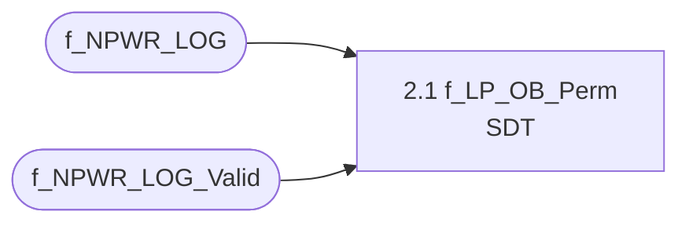

| No. | Node | Kind | Inputs |
|---|---|---|---|
| 2.1 | `f_LP_OB_Perm` | SDT | `f_NPWR_LOG`, `f_NPWR_LOG_Valid` |

##### BP.2.1 `f_LP_OB_Perm` (SDT)

*function variable, type `permissive`.*  Implements: SYS-GEN-09, SYS-LPD_HI-03, SYS-DNBR_LO-03, SYS-SG1_F_LO-03, SYS-SG2_F_LO-03.

Permissive (1) while logarithmic power is valid and below k_LP_OB_Perm; not permitted (0) otherwise, including when the log power input is invalid.

|  | R1 | R2 | R3 |
|---|:-:|:-:|:-:|
| **Conditions** |  |  |  |
| `f_NPWR_LOG_Valid = 1` | T | T | F |
| `f_NPWR_LOG < k_LP_OB_Perm` | T | F | - |
| **Actions** |  |  |  |
| `f_LP_OB_Perm := 1` | O |  |  |
| `f_LP_OB_Perm := 0` |  | O | O |

#### BP.3 `g_VOPT` - Variable Overpower trip

Variable Overpower trip (variable set-point trip, NuSCR logic type Variable_Setpoint_Rising_Trip).

NuSCR logic type: `Variable_Setpoint_Rising_Trip` (Variable set-point trip).  Implements: SYS-VOPT-01, SYS-VOPT-02.

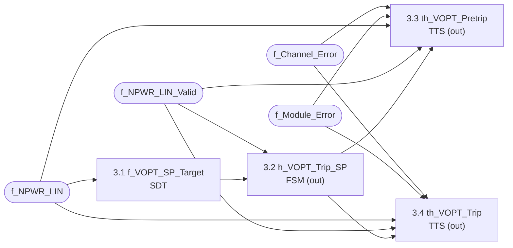

| No. | Node | Kind | Inputs |
|---|---|---|---|
| 3.1 | `f_VOPT_SP_Target` | SDT | `f_NPWR_LIN` |
| 3.2 | `h_VOPT_Trip_SP` | FSM | `f_NPWR_LIN_Valid`, `f_VOPT_SP_Target` |
| 3.3 | `th_VOPT_Pretrip` | TTS | `f_Channel_Error`, `f_Module_Error`, `f_NPWR_LIN`, `f_NPWR_LIN_Valid`, `h_VOPT_Trip_SP` |
| 3.4 | `th_VOPT_Trip` | TTS | `f_Channel_Error`, `f_Module_Error`, `f_NPWR_LIN`, `f_NPWR_LIN_Valid`, `h_VOPT_Trip_SP` |

##### BP.3.1 `f_VOPT_SP_Target` (SDT)

*function variable, type `real`, unit %RTP, range invariant `[k_VOPT_SP_Min, k_VOPT_SP_Max]`.*  Implements: SYS-VOPT-02.

Unconstrained setpoint target f_NPWR_LIN + k_VOPT_Band, clamped to the setpoint limits.

|  | R1 | R2 | R3 |
|---|:-:|:-:|:-:|
| **Conditions** |  |  |  |
| `f_NPWR_LIN + k_VOPT_Band <= k_VOPT_SP_Min` | T | F | F |
| `f_NPWR_LIN + k_VOPT_Band >= k_VOPT_SP_Max` | F | T | F |
| **Actions** |  |  |  |
| `f_VOPT_SP_Target := k_VOPT_SP_Min` | O |  |  |
| `f_VOPT_SP_Target := k_VOPT_SP_Max` |  | O |  |
| `f_VOPT_SP_Target := f_NPWR_LIN + k_VOPT_Band` |  |  | O |

##### BP.3.2 `h_VOPT_Trip_SP` (FSM)

*history variable, type `real`, unit %RTP, range invariant `[k_VOPT_SP_Min, k_VOPT_SP_Max]`.*  Implements: SYS-VOPT-02.

Rate-limited rising setpoint: initialised to the target on the first valid scan, follows a decreasing target immediately and rises by at most k_VOPT_SP_Step per scan.  Holds its value while f_NPWR_LIN is invalid.  Initial value k_VOPT_SP_Min (most restrictive).

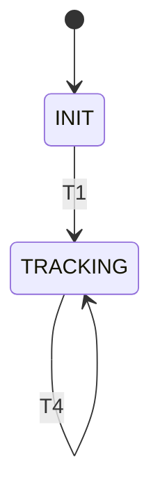

States: INIT, TRACKING.  Initial state `INIT`, initial value `k_VOPT_SP_Min`.

| ID | From | To | Timing | Guard | Action |
|---|---|---|---|---|---|
| T1 | INIT | TRACKING |  | `f_NPWR_LIN_Valid = 1` | `h_VOPT_Trip_SP := f_VOPT_SP_Target` |
| T2 | TRACKING | TRACKING |  | `f_NPWR_LIN_Valid = 1 && f_VOPT_SP_Target <= h_VOPT_Trip_SP` | `h_VOPT_Trip_SP := f_VOPT_SP_Target` |
| T3 | TRACKING | TRACKING |  | `f_NPWR_LIN_Valid = 1 && f_VOPT_SP_Target > h_VOPT_Trip_SP && f_VOPT_SP_Target - h_VOPT_Trip_SP <= k_VOPT_SP_Step` | `h_VOPT_Trip_SP := f_VOPT_SP_Target` |
| T4 | TRACKING | TRACKING |  | `f_NPWR_LIN_Valid = 1 && f_VOPT_SP_Target - h_VOPT_Trip_SP > k_VOPT_SP_Step` | `h_VOPT_Trip_SP := h_VOPT_Trip_SP + k_VOPT_SP_Step` |

##### BP.3.3 `th_VOPT_Pretrip` (TTS)

*timed-history variable, type `pretrip`.*  Implements: SYS-GEN-08, SYS-VOPT-01, SYS-GEN-02, SYS-GEN-04, SYS-GEN-05, SYS-GEN-06, SYS-GEN-07.

Variable Overpower pre-trip: goes to PRETRIP after the pretrip condition has persisted for k_VOPT_Pretrip_Delay in error-free scans (NORMAL -> WAITING -> PRETRIP_BY_LOGIC); goes to PRETRIP immediately on an error; resets when 'f_NPWR_LIN < h_VOPT_Trip_SP - k_VOPT_Pretrip_Margin - k_VOPT_Pretrip_Hys'.  When an error clears with the condition present, the output stays at PRETRIP in PRETRIP_PENDING until the condition has persisted for k_VOPT_Pretrip_Delay (PRETRIP_BY_LOGIC) or clears (NORMAL).  An error during a process trip is held in PRETRIP_BY_ERROR_LATCHED, so the reset condition still applies when the error clears.  Starts in the fail-safe state PRETRIP_BY_ERROR.

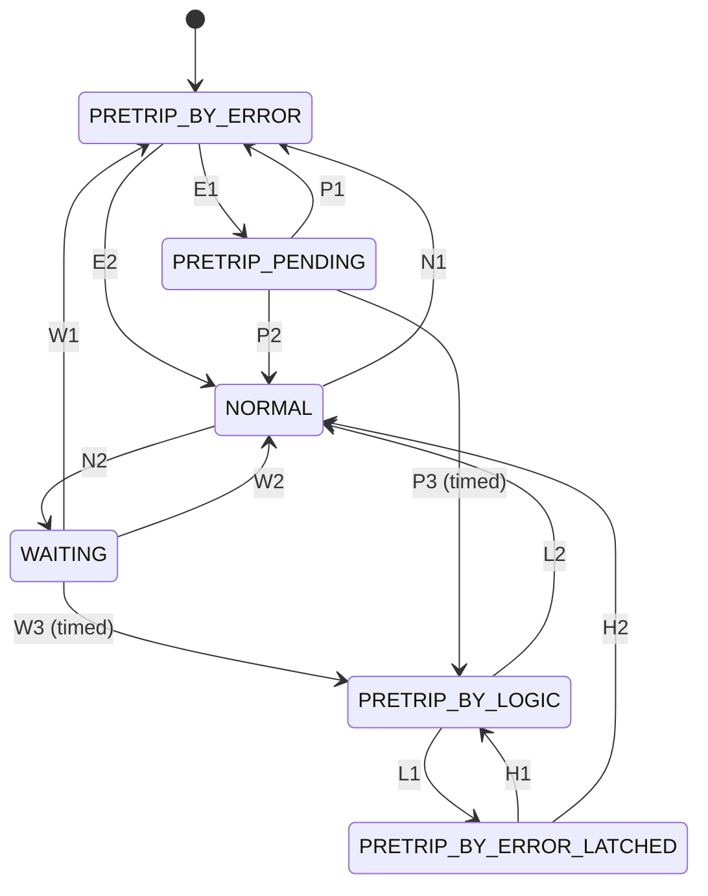

States: NORMAL (1), WAITING (1), PRETRIP_BY_LOGIC (0), PRETRIP_BY_ERROR (0), PRETRIP_PENDING (0), PRETRIP_BY_ERROR_LATCHED (0).  Initial state `PRETRIP_BY_ERROR`, initial value `0`.  Must leave `PRETRIP_BY_ERROR` whenever `f_NPWR_LIN_Valid = 1 && f_Module_Error = 0 && f_Channel_Error = 0` (proved).  Must leave `PRETRIP_BY_ERROR_LATCHED` whenever `f_NPWR_LIN_Valid = 1 && f_Module_Error = 0 && f_Channel_Error = 0` (proved).  Value is `0` after every scan in which `f_NPWR_LIN_Valid = 0 \|\| f_Module_Error = 1 \|\| f_Channel_Error = 1` (proved).

| ID | From | To | Timing | Guard | Action |
|---|---|---|---|---|---|
| N1 | NORMAL | PRETRIP_BY_ERROR |  | `f_NPWR_LIN_Valid = 0 \|\| f_Module_Error = 1 \|\| f_Channel_Error = 1` | `th_VOPT_Pretrip := 0` |
| N2 | NORMAL | WAITING |  | `f_NPWR_LIN_Valid = 1 && f_Module_Error = 0 && f_Channel_Error = 0 && f_NPWR_LIN >= h_VOPT_Trip_SP - k_VOPT_Pretrip_Margin` | `th_VOPT_Pretrip := 1` |
| W1 | WAITING | PRETRIP_BY_ERROR |  | `f_NPWR_LIN_Valid = 0 \|\| f_Module_Error = 1 \|\| f_Channel_Error = 1` | `th_VOPT_Pretrip := 0` |
| W2 | WAITING | NORMAL |  | `f_NPWR_LIN_Valid = 1 && f_Module_Error = 0 && f_Channel_Error = 0 && f_NPWR_LIN < h_VOPT_Trip_SP - k_VOPT_Pretrip_Margin` | `th_VOPT_Pretrip := 1` |
| W3 | WAITING | PRETRIP_BY_LOGIC | `[k_VOPT_Pretrip_Delay, k_VOPT_Pretrip_Delay]` | `f_NPWR_LIN_Valid = 1 && f_Module_Error = 0 && f_Channel_Error = 0 && f_NPWR_LIN >= h_VOPT_Trip_SP - k_VOPT_Pretrip_Margin` | `th_VOPT_Pretrip := 0` |
| L1 | PRETRIP_BY_LOGIC | PRETRIP_BY_ERROR_LATCHED |  | `f_NPWR_LIN_Valid = 0 \|\| f_Module_Error = 1 \|\| f_Channel_Error = 1` | `th_VOPT_Pretrip := 0` |
| L2 | PRETRIP_BY_LOGIC | NORMAL |  | `f_NPWR_LIN_Valid = 1 && f_Module_Error = 0 && f_Channel_Error = 0 && f_NPWR_LIN < h_VOPT_Trip_SP - k_VOPT_Pretrip_Margin - k_VOPT_Pretrip_Hys` | `th_VOPT_Pretrip := 1` |
| E1 | PRETRIP_BY_ERROR | PRETRIP_PENDING |  | `f_NPWR_LIN_Valid = 1 && f_Module_Error = 0 && f_Channel_Error = 0 && f_NPWR_LIN >= h_VOPT_Trip_SP - k_VOPT_Pretrip_Margin` | `th_VOPT_Pretrip := 0` |
| E2 | PRETRIP_BY_ERROR | NORMAL |  | `f_NPWR_LIN_Valid = 1 && f_Module_Error = 0 && f_Channel_Error = 0 && f_NPWR_LIN < h_VOPT_Trip_SP - k_VOPT_Pretrip_Margin` | `th_VOPT_Pretrip := 1` |
| P1 | PRETRIP_PENDING | PRETRIP_BY_ERROR |  | `f_NPWR_LIN_Valid = 0 \|\| f_Module_Error = 1 \|\| f_Channel_Error = 1` | `th_VOPT_Pretrip := 0` |
| P2 | PRETRIP_PENDING | NORMAL |  | `f_NPWR_LIN_Valid = 1 && f_Module_Error = 0 && f_Channel_Error = 0 && f_NPWR_LIN < h_VOPT_Trip_SP - k_VOPT_Pretrip_Margin` | `th_VOPT_Pretrip := 1` |
| P3 | PRETRIP_PENDING | PRETRIP_BY_LOGIC | `[k_VOPT_Pretrip_Delay, k_VOPT_Pretrip_Delay]` | `f_NPWR_LIN_Valid = 1 && f_Module_Error = 0 && f_Channel_Error = 0 && f_NPWR_LIN >= h_VOPT_Trip_SP - k_VOPT_Pretrip_Margin` | `th_VOPT_Pretrip := 0` |
| H1 | PRETRIP_BY_ERROR_LATCHED | PRETRIP_BY_LOGIC |  | `f_NPWR_LIN_Valid = 1 && f_Module_Error = 0 && f_Channel_Error = 0 && f_NPWR_LIN >= h_VOPT_Trip_SP - k_VOPT_Pretrip_Margin - k_VOPT_Pretrip_Hys` | `th_VOPT_Pretrip := 0` |
| H2 | PRETRIP_BY_ERROR_LATCHED | NORMAL |  | `f_NPWR_LIN_Valid = 1 && f_Module_Error = 0 && f_Channel_Error = 0 && f_NPWR_LIN < h_VOPT_Trip_SP - k_VOPT_Pretrip_Margin - k_VOPT_Pretrip_Hys` | `th_VOPT_Pretrip := 1` |

##### BP.3.4 `th_VOPT_Trip` (TTS)

*timed-history variable, type `trip`.*  Implements: SYS-VOPT-01, SYS-GEN-02, SYS-GEN-04, SYS-GEN-05, SYS-GEN-06, SYS-GEN-07.

Variable Overpower trip: goes to TRIP after the trip condition has persisted for k_VOPT_Trip_Delay in error-free scans (NORMAL -> WAITING -> TRIP_BY_LOGIC); goes to TRIP immediately on an error; resets when 'f_NPWR_LIN < h_VOPT_Trip_SP - k_VOPT_Trip_Hys'.  When an error clears with the condition present, the output stays at TRIP in TRIP_PENDING until the condition has persisted for k_VOPT_Trip_Delay (TRIP_BY_LOGIC) or clears (NORMAL).  An error during a process trip is held in TRIP_BY_ERROR_LATCHED, so the reset condition still applies when the error clears.  Starts in the fail-safe state TRIP_BY_ERROR.

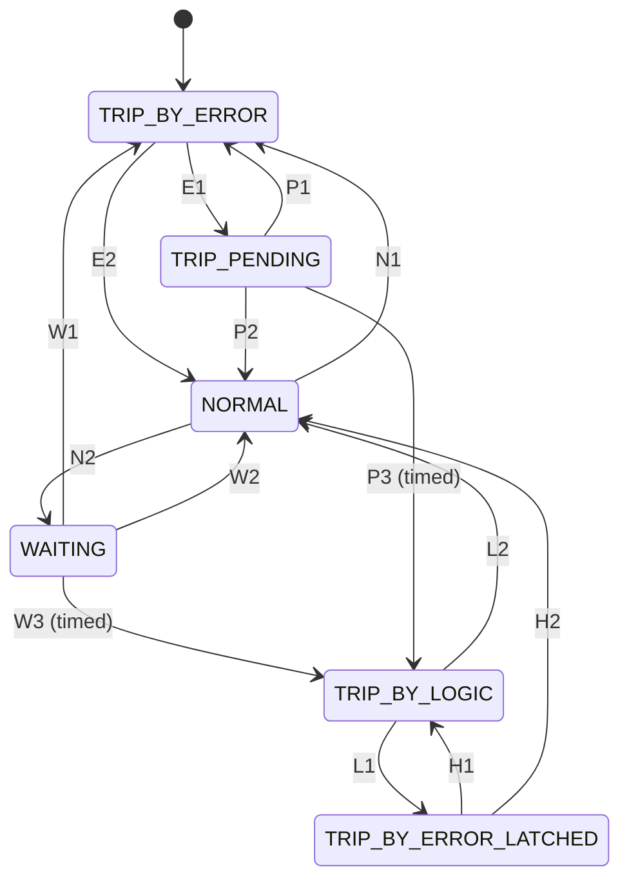

States: NORMAL (1), WAITING (1), TRIP_BY_LOGIC (0), TRIP_BY_ERROR (0), TRIP_PENDING (0), TRIP_BY_ERROR_LATCHED (0).  Initial state `TRIP_BY_ERROR`, initial value `0`.  Must leave `TRIP_BY_ERROR` whenever `f_NPWR_LIN_Valid = 1 && f_Module_Error = 0 && f_Channel_Error = 0` (proved).  Must leave `TRIP_BY_ERROR_LATCHED` whenever `f_NPWR_LIN_Valid = 1 && f_Module_Error = 0 && f_Channel_Error = 0` (proved).  Value is `0` after every scan in which `f_NPWR_LIN_Valid = 0 \|\| f_Module_Error = 1 \|\| f_Channel_Error = 1` (proved).

| ID | From | To | Timing | Guard | Action |
|---|---|---|---|---|---|
| N1 | NORMAL | TRIP_BY_ERROR |  | `f_NPWR_LIN_Valid = 0 \|\| f_Module_Error = 1 \|\| f_Channel_Error = 1` | `th_VOPT_Trip := 0` |
| N2 | NORMAL | WAITING |  | `f_NPWR_LIN_Valid = 1 && f_Module_Error = 0 && f_Channel_Error = 0 && f_NPWR_LIN >= h_VOPT_Trip_SP` | `th_VOPT_Trip := 1` |
| W1 | WAITING | TRIP_BY_ERROR |  | `f_NPWR_LIN_Valid = 0 \|\| f_Module_Error = 1 \|\| f_Channel_Error = 1` | `th_VOPT_Trip := 0` |
| W2 | WAITING | NORMAL |  | `f_NPWR_LIN_Valid = 1 && f_Module_Error = 0 && f_Channel_Error = 0 && f_NPWR_LIN < h_VOPT_Trip_SP` | `th_VOPT_Trip := 1` |
| W3 | WAITING | TRIP_BY_LOGIC | `[k_VOPT_Trip_Delay, k_VOPT_Trip_Delay]` | `f_NPWR_LIN_Valid = 1 && f_Module_Error = 0 && f_Channel_Error = 0 && f_NPWR_LIN >= h_VOPT_Trip_SP` | `th_VOPT_Trip := 0` |
| L1 | TRIP_BY_LOGIC | TRIP_BY_ERROR_LATCHED |  | `f_NPWR_LIN_Valid = 0 \|\| f_Module_Error = 1 \|\| f_Channel_Error = 1` | `th_VOPT_Trip := 0` |
| L2 | TRIP_BY_LOGIC | NORMAL |  | `f_NPWR_LIN_Valid = 1 && f_Module_Error = 0 && f_Channel_Error = 0 && f_NPWR_LIN < h_VOPT_Trip_SP - k_VOPT_Trip_Hys` | `th_VOPT_Trip := 1` |
| E1 | TRIP_BY_ERROR | TRIP_PENDING |  | `f_NPWR_LIN_Valid = 1 && f_Module_Error = 0 && f_Channel_Error = 0 && f_NPWR_LIN >= h_VOPT_Trip_SP` | `th_VOPT_Trip := 0` |
| E2 | TRIP_BY_ERROR | NORMAL |  | `f_NPWR_LIN_Valid = 1 && f_Module_Error = 0 && f_Channel_Error = 0 && f_NPWR_LIN < h_VOPT_Trip_SP` | `th_VOPT_Trip := 1` |
| P1 | TRIP_PENDING | TRIP_BY_ERROR |  | `f_NPWR_LIN_Valid = 0 \|\| f_Module_Error = 1 \|\| f_Channel_Error = 1` | `th_VOPT_Trip := 0` |
| P2 | TRIP_PENDING | NORMAL |  | `f_NPWR_LIN_Valid = 1 && f_Module_Error = 0 && f_Channel_Error = 0 && f_NPWR_LIN < h_VOPT_Trip_SP` | `th_VOPT_Trip := 1` |
| P3 | TRIP_PENDING | TRIP_BY_LOGIC | `[k_VOPT_Trip_Delay, k_VOPT_Trip_Delay]` | `f_NPWR_LIN_Valid = 1 && f_Module_Error = 0 && f_Channel_Error = 0 && f_NPWR_LIN >= h_VOPT_Trip_SP` | `th_VOPT_Trip := 0` |
| H1 | TRIP_BY_ERROR_LATCHED | TRIP_BY_LOGIC |  | `f_NPWR_LIN_Valid = 1 && f_Module_Error = 0 && f_Channel_Error = 0 && f_NPWR_LIN >= h_VOPT_Trip_SP - k_VOPT_Trip_Hys` | `th_VOPT_Trip := 0` |
| H2 | TRIP_BY_ERROR_LATCHED | NORMAL |  | `f_NPWR_LIN_Valid = 1 && f_Module_Error = 0 && f_Channel_Error = 0 && f_NPWR_LIN < h_VOPT_Trip_SP - k_VOPT_Trip_Hys` | `th_VOPT_Trip := 1` |

#### BP.4 `g_LOGP_HI` - High Logarithmic Power Level trip

High Logarithmic Power Level trip (fixed set-point trip, NuSCR logic type Fixed_Setpoint_Rising_Trip_with_OB).

NuSCR logic type: `Fixed_Setpoint_Rising_Trip_with_OB` (Fixed set-point trip).  Implements: SYS-LOGP_HI-01, SYS-LOGP_HI-03.

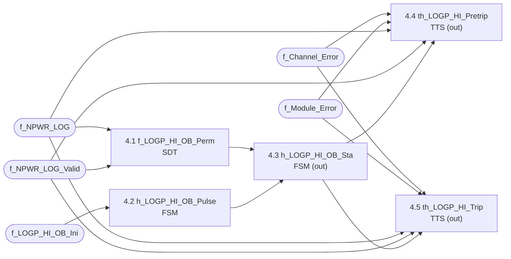

| No. | Node | Kind | Inputs |
|---|---|---|---|
| 4.1 | `f_LOGP_HI_OB_Perm` | SDT | `f_NPWR_LOG`, `f_NPWR_LOG_Valid` |
| 4.2 | `h_LOGP_HI_OB_Pulse` | FSM | `f_LOGP_HI_OB_Ini` |
| 4.3 | `h_LOGP_HI_OB_Sta` | FSM | `f_LOGP_HI_OB_Perm`, `h_LOGP_HI_OB_Pulse` |
| 4.4 | `th_LOGP_HI_Pretrip` | TTS | `f_Channel_Error`, `f_Module_Error`, `f_NPWR_LOG`, `f_NPWR_LOG_Valid`, `h_LOGP_HI_OB_Sta` |
| 4.5 | `th_LOGP_HI_Trip` | TTS | `f_Channel_Error`, `f_Module_Error`, `f_NPWR_LOG`, `f_NPWR_LOG_Valid`, `h_LOGP_HI_OB_Sta` |

##### BP.4.1 `f_LOGP_HI_OB_Perm` (SDT)

*function variable, type `permissive`.*  Implements: SYS-LOGP_HI-03, SYS-GEN-09, SYS-GEN-04.

Permissive (1) while f_NPWR_LOG is valid and >= k_LOGP_HI_OB_Perm; not permitted (0) otherwise, including when the input is invalid.

|  | R1 | R2 | R3 |
|---|:-:|:-:|:-:|
| **Conditions** |  |  |  |
| `f_NPWR_LOG_Valid = 1` | T | T | F |
| `f_NPWR_LOG >= k_LOGP_HI_OB_Perm` | T | F | - |
| **Actions** |  |  |  |
| `f_LOGP_HI_OB_Perm := 1` | O |  |  |
| `f_LOGP_HI_OB_Perm := 0` |  | O | O |

##### BP.4.2 `h_LOGP_HI_OB_Pulse` (FSM)

*history variable, type `pulse`.*  Implements: SYS-LOGP_HI-03, SYS-GEN-09, SYS-GEN-04.

Edge detector for f_LOGP_HI_OB_Ini (operating-bypass initiation): PULSE (1) for exactly one scan per press.  Starts in HELD so that a button held (or stuck) at start-up is ignored until released.

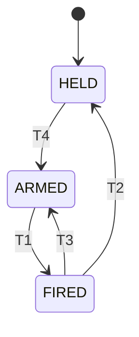

States: ARMED (0), FIRED (1), HELD (0).  Initial state `HELD`, initial value `0`.

| ID | From | To | Timing | Guard | Action |
|---|---|---|---|---|---|
| T1 | ARMED | FIRED |  | `f_LOGP_HI_OB_Ini = 1` | `h_LOGP_HI_OB_Pulse := 1` |
| T2 | FIRED | HELD |  | `f_LOGP_HI_OB_Ini = 1` | `h_LOGP_HI_OB_Pulse := 0` |
| T3 | FIRED | ARMED |  | `f_LOGP_HI_OB_Ini = 0` | `h_LOGP_HI_OB_Pulse := 0` |
| T4 | HELD | ARMED |  | `f_LOGP_HI_OB_Ini = 0` | `h_LOGP_HI_OB_Pulse := 0` |

##### BP.4.3 `h_LOGP_HI_OB_Sta` (FSM)

*history variable, type `bypass_status`.*  Implements: SYS-LOGP_HI-03, SYS-GEN-09, SYS-GEN-04.

High Logarithmic Power Level operating-bypass status: established by an operator initiation (a press of f_LOGP_HI_OB_Ini, i.e. the pulse h_LOGP_HI_OB_Pulse) made while the permissive f_LOGP_HI_OB_Perm is present; a held or stuck pushbutton does not establish the bypass.  Removed automatically as soon as the permissive is lost.  Removed at start-up.

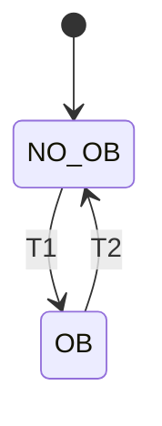

States: NO_OB (0), OB (1).  Initial state `NO_OB`, initial value `0`.

| ID | From | To | Timing | Guard | Action |
|---|---|---|---|---|---|
| T1 | NO_OB | OB |  | `f_LOGP_HI_OB_Perm = 1 && h_LOGP_HI_OB_Pulse = 1` | `h_LOGP_HI_OB_Sta := 1` |
| T2 | OB | NO_OB |  | `f_LOGP_HI_OB_Perm = 0` | `h_LOGP_HI_OB_Sta := 0` |

##### BP.4.4 `th_LOGP_HI_Pretrip` (TTS)

*timed-history variable, type `pretrip`.*  Implements: SYS-GEN-08, SYS-LOGP_HI-01, SYS-GEN-02, SYS-GEN-04, SYS-GEN-05, SYS-GEN-06, SYS-GEN-07, SYS-GEN-09.

High Logarithmic Power Level pre-trip: goes to PRETRIP after the pretrip condition has persisted for k_LOGP_HI_Pretrip_Delay in error-free scans (NORMAL -> WAITING -> PRETRIP_BY_LOGIC); goes to PRETRIP immediately on an error; resets when 'f_NPWR_LOG < k_LOGP_HI_Pretrip_SP - k_LOGP_HI_Pretrip_Hys' or when the operating bypass h_LOGP_HI_OB_Sta is active.  When an error clears with the condition present, the output stays at PRETRIP in PRETRIP_PENDING until the condition has persisted for k_LOGP_HI_Pretrip_Delay (PRETRIP_BY_LOGIC) or clears (NORMAL).  An error during a process trip is held in PRETRIP_BY_ERROR_LATCHED, so the reset condition still applies when the error clears.  Starts in the fail-safe state PRETRIP_BY_ERROR.


States: NORMAL (1), WAITING (1), PRETRIP_BY_LOGIC (0), PRETRIP_BY_ERROR (0), PRETRIP_PENDING (0), PRETRIP_BY_ERROR_LATCHED (0).  Initial state `PRETRIP_BY_ERROR`, initial value `0`.  Must leave `PRETRIP_BY_ERROR` whenever `f_NPWR_LOG_Valid = 1 && f_Module_Error = 0 && f_Channel_Error = 0` (proved).  Must leave `PRETRIP_BY_ERROR_LATCHED` whenever `f_NPWR_LOG_Valid = 1 && f_Module_Error = 0 && f_Channel_Error = 0` (proved).  Value is `0` after every scan in which `f_NPWR_LOG_Valid = 0 \|\| f_Module_Error = 1 \|\| f_Channel_Error = 1` (proved).

| ID | From | To | Timing | Guard | Action |
|---|---|---|---|---|---|
| N1 | NORMAL | PRETRIP_BY_ERROR |  | `f_NPWR_LOG_Valid = 0 \|\| f_Module_Error = 1 \|\| f_Channel_Error = 1` | `th_LOGP_HI_Pretrip := 0` |
| N2 | NORMAL | WAITING |  | `f_NPWR_LOG_Valid = 1 && f_Module_Error = 0 && f_Channel_Error = 0 && h_LOGP_HI_OB_Sta = 0 && f_NPWR_LOG >= k_LOGP_HI_Pretrip_SP` | `th_LOGP_HI_Pretrip := 1` |
| W1 | WAITING | PRETRIP_BY_ERROR |  | `f_NPWR_LOG_Valid = 0 \|\| f_Module_Error = 1 \|\| f_Channel_Error = 1` | `th_LOGP_HI_Pretrip := 0` |
| W2 | WAITING | NORMAL |  | `f_NPWR_LOG_Valid = 1 && f_Module_Error = 0 && f_Channel_Error = 0 && (h_LOGP_HI_OB_Sta = 1 \|\| f_NPWR_LOG < k_LOGP_HI_Pretrip_SP)` | `th_LOGP_HI_Pretrip := 1` |
| W3 | WAITING | PRETRIP_BY_LOGIC | `[k_LOGP_HI_Pretrip_Delay, k_LOGP_HI_Pretrip_Delay]` | `f_NPWR_LOG_Valid = 1 && f_Module_Error = 0 && f_Channel_Error = 0 && h_LOGP_HI_OB_Sta = 0 && f_NPWR_LOG >= k_LOGP_HI_Pretrip_SP` | `th_LOGP_HI_Pretrip := 0` |
| L1 | PRETRIP_BY_LOGIC | PRETRIP_BY_ERROR_LATCHED |  | `f_NPWR_LOG_Valid = 0 \|\| f_Module_Error = 1 \|\| f_Channel_Error = 1` | `th_LOGP_HI_Pretrip := 0` |
| L2 | PRETRIP_BY_LOGIC | NORMAL |  | `f_NPWR_LOG_Valid = 1 && f_Module_Error = 0 && f_Channel_Error = 0 && (h_LOGP_HI_OB_Sta = 1 \|\| f_NPWR_LOG < k_LOGP_HI_Pretrip_SP - k_LOGP_HI_Pretrip_Hys)` | `th_LOGP_HI_Pretrip := 1` |
| E1 | PRETRIP_BY_ERROR | PRETRIP_PENDING |  | `f_NPWR_LOG_Valid = 1 && f_Module_Error = 0 && f_Channel_Error = 0 && h_LOGP_HI_OB_Sta = 0 && f_NPWR_LOG >= k_LOGP_HI_Pretrip_SP` | `th_LOGP_HI_Pretrip := 0` |
| E2 | PRETRIP_BY_ERROR | NORMAL |  | `f_NPWR_LOG_Valid = 1 && f_Module_Error = 0 && f_Channel_Error = 0 && (h_LOGP_HI_OB_Sta = 1 \|\| f_NPWR_LOG < k_LOGP_HI_Pretrip_SP)` | `th_LOGP_HI_Pretrip := 1` |
| P1 | PRETRIP_PENDING | PRETRIP_BY_ERROR |  | `f_NPWR_LOG_Valid = 0 \|\| f_Module_Error = 1 \|\| f_Channel_Error = 1` | `th_LOGP_HI_Pretrip := 0` |
| P2 | PRETRIP_PENDING | NORMAL |  | `f_NPWR_LOG_Valid = 1 && f_Module_Error = 0 && f_Channel_Error = 0 && (h_LOGP_HI_OB_Sta = 1 \|\| f_NPWR_LOG < k_LOGP_HI_Pretrip_SP)` | `th_LOGP_HI_Pretrip := 1` |
| P3 | PRETRIP_PENDING | PRETRIP_BY_LOGIC | `[k_LOGP_HI_Pretrip_Delay, k_LOGP_HI_Pretrip_Delay]` | `f_NPWR_LOG_Valid = 1 && f_Module_Error = 0 && f_Channel_Error = 0 && h_LOGP_HI_OB_Sta = 0 && f_NPWR_LOG >= k_LOGP_HI_Pretrip_SP` | `th_LOGP_HI_Pretrip := 0` |
| H1 | PRETRIP_BY_ERROR_LATCHED | PRETRIP_BY_LOGIC |  | `f_NPWR_LOG_Valid = 1 && f_Module_Error = 0 && f_Channel_Error = 0 && h_LOGP_HI_OB_Sta = 0 && f_NPWR_LOG >= k_LOGP_HI_Pretrip_SP - k_LOGP_HI_Pretrip_Hys` | `th_LOGP_HI_Pretrip := 0` |
| H2 | PRETRIP_BY_ERROR_LATCHED | NORMAL |  | `f_NPWR_LOG_Valid = 1 && f_Module_Error = 0 && f_Channel_Error = 0 && (h_LOGP_HI_OB_Sta = 1 \|\| f_NPWR_LOG < k_LOGP_HI_Pretrip_SP - k_LOGP_HI_Pretrip_Hys)` | `th_LOGP_HI_Pretrip := 1` |

##### BP.4.5 `th_LOGP_HI_Trip` (TTS)

*timed-history variable, type `trip`.*  Implements: SYS-LOGP_HI-01, SYS-GEN-02, SYS-GEN-04, SYS-GEN-05, SYS-GEN-06, SYS-GEN-07, SYS-GEN-09.

High Logarithmic Power Level trip: goes to TRIP after the trip condition has persisted for k_LOGP_HI_Trip_Delay in error-free scans (NORMAL -> WAITING -> TRIP_BY_LOGIC); goes to TRIP immediately on an error; resets when 'f_NPWR_LOG < k_LOGP_HI_Trip_SP - k_LOGP_HI_Trip_Hys' or when the operating bypass h_LOGP_HI_OB_Sta is active.  When an error clears with the condition present, the output stays at TRIP in TRIP_PENDING until the condition has persisted for k_LOGP_HI_Trip_Delay (TRIP_BY_LOGIC) or clears (NORMAL).  An error during a process trip is held in TRIP_BY_ERROR_LATCHED, so the reset condition still applies when the error clears.  Starts in the fail-safe state TRIP_BY_ERROR.


States: NORMAL (1), WAITING (1), TRIP_BY_LOGIC (0), TRIP_BY_ERROR (0), TRIP_PENDING (0), TRIP_BY_ERROR_LATCHED (0).  Initial state `TRIP_BY_ERROR`, initial value `0`.  Must leave `TRIP_BY_ERROR` whenever `f_NPWR_LOG_Valid = 1 && f_Module_Error = 0 && f_Channel_Error = 0` (proved).  Must leave `TRIP_BY_ERROR_LATCHED` whenever `f_NPWR_LOG_Valid = 1 && f_Module_Error = 0 && f_Channel_Error = 0` (proved).  Value is `0` after every scan in which `f_NPWR_LOG_Valid = 0 \|\| f_Module_Error = 1 \|\| f_Channel_Error = 1` (proved).

| ID | From | To | Timing | Guard | Action |
|---|---|---|---|---|---|
| N1 | NORMAL | TRIP_BY_ERROR |  | `f_NPWR_LOG_Valid = 0 \|\| f_Module_Error = 1 \|\| f_Channel_Error = 1` | `th_LOGP_HI_Trip := 0` |
| N2 | NORMAL | WAITING |  | `f_NPWR_LOG_Valid = 1 && f_Module_Error = 0 && f_Channel_Error = 0 && h_LOGP_HI_OB_Sta = 0 && f_NPWR_LOG >= k_LOGP_HI_Trip_SP` | `th_LOGP_HI_Trip := 1` |
| W1 | WAITING | TRIP_BY_ERROR |  | `f_NPWR_LOG_Valid = 0 \|\| f_Module_Error = 1 \|\| f_Channel_Error = 1` | `th_LOGP_HI_Trip := 0` |
| W2 | WAITING | NORMAL |  | `f_NPWR_LOG_Valid = 1 && f_Module_Error = 0 && f_Channel_Error = 0 && (h_LOGP_HI_OB_Sta = 1 \|\| f_NPWR_LOG < k_LOGP_HI_Trip_SP)` | `th_LOGP_HI_Trip := 1` |
| W3 | WAITING | TRIP_BY_LOGIC | `[k_LOGP_HI_Trip_Delay, k_LOGP_HI_Trip_Delay]` | `f_NPWR_LOG_Valid = 1 && f_Module_Error = 0 && f_Channel_Error = 0 && h_LOGP_HI_OB_Sta = 0 && f_NPWR_LOG >= k_LOGP_HI_Trip_SP` | `th_LOGP_HI_Trip := 0` |
| L1 | TRIP_BY_LOGIC | TRIP_BY_ERROR_LATCHED |  | `f_NPWR_LOG_Valid = 0 \|\| f_Module_Error = 1 \|\| f_Channel_Error = 1` | `th_LOGP_HI_Trip := 0` |
| L2 | TRIP_BY_LOGIC | NORMAL |  | `f_NPWR_LOG_Valid = 1 && f_Module_Error = 0 && f_Channel_Error = 0 && (h_LOGP_HI_OB_Sta = 1 \|\| f_NPWR_LOG < k_LOGP_HI_Trip_SP - k_LOGP_HI_Trip_Hys)` | `th_LOGP_HI_Trip := 1` |
| E1 | TRIP_BY_ERROR | TRIP_PENDING |  | `f_NPWR_LOG_Valid = 1 && f_Module_Error = 0 && f_Channel_Error = 0 && h_LOGP_HI_OB_Sta = 0 && f_NPWR_LOG >= k_LOGP_HI_Trip_SP` | `th_LOGP_HI_Trip := 0` |
| E2 | TRIP_BY_ERROR | NORMAL |  | `f_NPWR_LOG_Valid = 1 && f_Module_Error = 0 && f_Channel_Error = 0 && (h_LOGP_HI_OB_Sta = 1 \|\| f_NPWR_LOG < k_LOGP_HI_Trip_SP)` | `th_LOGP_HI_Trip := 1` |
| P1 | TRIP_PENDING | TRIP_BY_ERROR |  | `f_NPWR_LOG_Valid = 0 \|\| f_Module_Error = 1 \|\| f_Channel_Error = 1` | `th_LOGP_HI_Trip := 0` |
| P2 | TRIP_PENDING | NORMAL |  | `f_NPWR_LOG_Valid = 1 && f_Module_Error = 0 && f_Channel_Error = 0 && (h_LOGP_HI_OB_Sta = 1 \|\| f_NPWR_LOG < k_LOGP_HI_Trip_SP)` | `th_LOGP_HI_Trip := 1` |
| P3 | TRIP_PENDING | TRIP_BY_LOGIC | `[k_LOGP_HI_Trip_Delay, k_LOGP_HI_Trip_Delay]` | `f_NPWR_LOG_Valid = 1 && f_Module_Error = 0 && f_Channel_Error = 0 && h_LOGP_HI_OB_Sta = 0 && f_NPWR_LOG >= k_LOGP_HI_Trip_SP` | `th_LOGP_HI_Trip := 0` |
| H1 | TRIP_BY_ERROR_LATCHED | TRIP_BY_LOGIC |  | `f_NPWR_LOG_Valid = 1 && f_Module_Error = 0 && f_Channel_Error = 0 && h_LOGP_HI_OB_Sta = 0 && f_NPWR_LOG >= k_LOGP_HI_Trip_SP - k_LOGP_HI_Trip_Hys` | `th_LOGP_HI_Trip := 0` |
| H2 | TRIP_BY_ERROR_LATCHED | NORMAL |  | `f_NPWR_LOG_Valid = 1 && f_Module_Error = 0 && f_Channel_Error = 0 && (h_LOGP_HI_OB_Sta = 1 \|\| f_NPWR_LOG < k_LOGP_HI_Trip_SP - k_LOGP_HI_Trip_Hys)` | `th_LOGP_HI_Trip := 1` |

#### BP.5 `g_LPD_HI` - High Local Power Density (CPC) trip

High Local Power Density (CPC) trip (digital trip, NuSCR logic type Digital_Trip_with_OB).

NuSCR logic type: `Digital_Trip_with_OB` (Digital trip).  Implements: SYS-LPD_HI-01, SYS-LPD_HI-03.

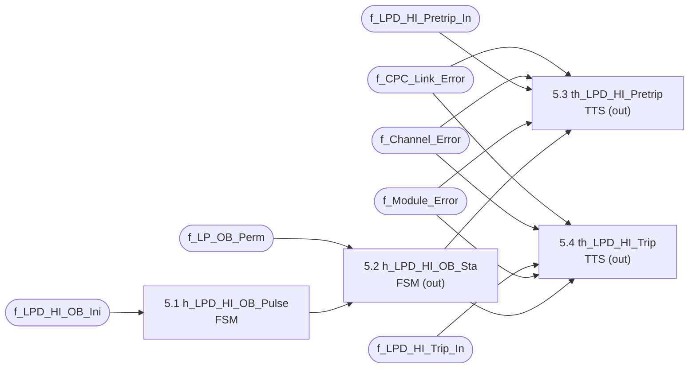

| No. | Node | Kind | Inputs |
|---|---|---|---|
| 5.1 | `h_LPD_HI_OB_Pulse` | FSM | `f_LPD_HI_OB_Ini` |
| 5.2 | `h_LPD_HI_OB_Sta` | FSM | `f_LP_OB_Perm`, `h_LPD_HI_OB_Pulse` |
| 5.3 | `th_LPD_HI_Pretrip` | TTS | `f_CPC_Link_Error`, `f_Channel_Error`, `f_LPD_HI_Pretrip_In`, `f_Module_Error`, `h_LPD_HI_OB_Sta` |
| 5.4 | `th_LPD_HI_Trip` | TTS | `f_CPC_Link_Error`, `f_Channel_Error`, `f_LPD_HI_Trip_In`, `f_Module_Error`, `h_LPD_HI_OB_Sta` |

##### BP.5.1 `h_LPD_HI_OB_Pulse` (FSM)

*history variable, type `pulse`.*  Implements: SYS-LPD_HI-03, SYS-GEN-09, SYS-GEN-04.

Edge detector for f_LPD_HI_OB_Ini (operating-bypass initiation): PULSE (1) for exactly one scan per press.  Starts in HELD so that a button held (or stuck) at start-up is ignored until released.


States: ARMED (0), FIRED (1), HELD (0).  Initial state `HELD`, initial value `0`.

| ID | From | To | Timing | Guard | Action |
|---|---|---|---|---|---|
| T1 | ARMED | FIRED |  | `f_LPD_HI_OB_Ini = 1` | `h_LPD_HI_OB_Pulse := 1` |
| T2 | FIRED | HELD |  | `f_LPD_HI_OB_Ini = 1` | `h_LPD_HI_OB_Pulse := 0` |
| T3 | FIRED | ARMED |  | `f_LPD_HI_OB_Ini = 0` | `h_LPD_HI_OB_Pulse := 0` |
| T4 | HELD | ARMED |  | `f_LPD_HI_OB_Ini = 0` | `h_LPD_HI_OB_Pulse := 0` |

##### BP.5.2 `h_LPD_HI_OB_Sta` (FSM)

*history variable, type `bypass_status`.*  Implements: SYS-LPD_HI-03, SYS-GEN-09, SYS-GEN-04.

High Local Power Density (CPC) operating-bypass status: established by an operator initiation (a press of f_LPD_HI_OB_Ini, i.e. the pulse h_LPD_HI_OB_Pulse) made while the permissive f_LP_OB_Perm is present; a held or stuck pushbutton does not establish the bypass.  Removed automatically as soon as the permissive is lost.  Removed at start-up.


States: NO_OB (0), OB (1).  Initial state `NO_OB`, initial value `0`.

| ID | From | To | Timing | Guard | Action |
|---|---|---|---|---|---|
| T1 | NO_OB | OB |  | `f_LP_OB_Perm = 1 && h_LPD_HI_OB_Pulse = 1` | `h_LPD_HI_OB_Sta := 1` |
| T2 | OB | NO_OB |  | `f_LP_OB_Perm = 0` | `h_LPD_HI_OB_Sta := 0` |

##### BP.5.3 `th_LPD_HI_Pretrip` (TTS)

*timed-history variable, type `pretrip`.*  Implements: SYS-GEN-08, SYS-LPD_HI-01, SYS-GEN-02, SYS-GEN-04, SYS-GEN-05, SYS-GEN-06, SYS-GEN-07, SYS-GEN-09.

High Local Power Density (CPC) pre-trip: goes to PRETRIP after the pretrip condition has persisted for k_LPD_HI_Pretrip_Delay in error-free scans (NORMAL -> WAITING -> PRETRIP_BY_LOGIC); goes to PRETRIP immediately on an error; resets when 'f_LPD_HI_Pretrip_In = 1' or when the operating bypass h_LPD_HI_OB_Sta is active.  When an error clears with the condition present, the output stays at PRETRIP in PRETRIP_PENDING until the condition has persisted for k_LPD_HI_Pretrip_Delay (PRETRIP_BY_LOGIC) or clears (NORMAL).  An error during a process trip is held in PRETRIP_BY_ERROR_LATCHED, so the reset condition still applies when the error clears.  Starts in the fail-safe state PRETRIP_BY_ERROR.


States: NORMAL (1), WAITING (1), PRETRIP_BY_LOGIC (0), PRETRIP_BY_ERROR (0), PRETRIP_PENDING (0), PRETRIP_BY_ERROR_LATCHED (0).  Initial state `PRETRIP_BY_ERROR`, initial value `0`.  Must leave `PRETRIP_BY_ERROR` whenever `f_CPC_Link_Error = 0 && f_Module_Error = 0 && f_Channel_Error = 0` (proved).  Must leave `PRETRIP_BY_ERROR_LATCHED` whenever `f_CPC_Link_Error = 0 && f_Module_Error = 0 && f_Channel_Error = 0` (proved).  Value is `0` after every scan in which `f_CPC_Link_Error = 1 \|\| f_Module_Error = 1 \|\| f_Channel_Error = 1` (proved).

| ID | From | To | Timing | Guard | Action |
|---|---|---|---|---|---|
| N1 | NORMAL | PRETRIP_BY_ERROR |  | `f_CPC_Link_Error = 1 \|\| f_Module_Error = 1 \|\| f_Channel_Error = 1` | `th_LPD_HI_Pretrip := 0` |
| N2 | NORMAL | WAITING |  | `f_CPC_Link_Error = 0 && f_Module_Error = 0 && f_Channel_Error = 0 && h_LPD_HI_OB_Sta = 0 && f_LPD_HI_Pretrip_In = 0` | `th_LPD_HI_Pretrip := 1` |
| W1 | WAITING | PRETRIP_BY_ERROR |  | `f_CPC_Link_Error = 1 \|\| f_Module_Error = 1 \|\| f_Channel_Error = 1` | `th_LPD_HI_Pretrip := 0` |
| W2 | WAITING | NORMAL |  | `f_CPC_Link_Error = 0 && f_Module_Error = 0 && f_Channel_Error = 0 && (h_LPD_HI_OB_Sta = 1 \|\| f_LPD_HI_Pretrip_In = 1)` | `th_LPD_HI_Pretrip := 1` |
| W3 | WAITING | PRETRIP_BY_LOGIC | `[k_LPD_HI_Pretrip_Delay, k_LPD_HI_Pretrip_Delay]` | `f_CPC_Link_Error = 0 && f_Module_Error = 0 && f_Channel_Error = 0 && h_LPD_HI_OB_Sta = 0 && f_LPD_HI_Pretrip_In = 0` | `th_LPD_HI_Pretrip := 0` |
| L1 | PRETRIP_BY_LOGIC | PRETRIP_BY_ERROR_LATCHED |  | `f_CPC_Link_Error = 1 \|\| f_Module_Error = 1 \|\| f_Channel_Error = 1` | `th_LPD_HI_Pretrip := 0` |
| L2 | PRETRIP_BY_LOGIC | NORMAL |  | `f_CPC_Link_Error = 0 && f_Module_Error = 0 && f_Channel_Error = 0 && (h_LPD_HI_OB_Sta = 1 \|\| f_LPD_HI_Pretrip_In = 1)` | `th_LPD_HI_Pretrip := 1` |
| E1 | PRETRIP_BY_ERROR | PRETRIP_PENDING |  | `f_CPC_Link_Error = 0 && f_Module_Error = 0 && f_Channel_Error = 0 && h_LPD_HI_OB_Sta = 0 && f_LPD_HI_Pretrip_In = 0` | `th_LPD_HI_Pretrip := 0` |
| E2 | PRETRIP_BY_ERROR | NORMAL |  | `f_CPC_Link_Error = 0 && f_Module_Error = 0 && f_Channel_Error = 0 && (h_LPD_HI_OB_Sta = 1 \|\| f_LPD_HI_Pretrip_In = 1)` | `th_LPD_HI_Pretrip := 1` |
| P1 | PRETRIP_PENDING | PRETRIP_BY_ERROR |  | `f_CPC_Link_Error = 1 \|\| f_Module_Error = 1 \|\| f_Channel_Error = 1` | `th_LPD_HI_Pretrip := 0` |
| P2 | PRETRIP_PENDING | NORMAL |  | `f_CPC_Link_Error = 0 && f_Module_Error = 0 && f_Channel_Error = 0 && (h_LPD_HI_OB_Sta = 1 \|\| f_LPD_HI_Pretrip_In = 1)` | `th_LPD_HI_Pretrip := 1` |
| P3 | PRETRIP_PENDING | PRETRIP_BY_LOGIC | `[k_LPD_HI_Pretrip_Delay, k_LPD_HI_Pretrip_Delay]` | `f_CPC_Link_Error = 0 && f_Module_Error = 0 && f_Channel_Error = 0 && h_LPD_HI_OB_Sta = 0 && f_LPD_HI_Pretrip_In = 0` | `th_LPD_HI_Pretrip := 0` |
| H1 | PRETRIP_BY_ERROR_LATCHED | PRETRIP_BY_LOGIC |  | `f_CPC_Link_Error = 0 && f_Module_Error = 0 && f_Channel_Error = 0 && h_LPD_HI_OB_Sta = 0 && f_LPD_HI_Pretrip_In = 0` | `th_LPD_HI_Pretrip := 0` |
| H2 | PRETRIP_BY_ERROR_LATCHED | NORMAL |  | `f_CPC_Link_Error = 0 && f_Module_Error = 0 && f_Channel_Error = 0 && (h_LPD_HI_OB_Sta = 1 \|\| f_LPD_HI_Pretrip_In = 1)` | `th_LPD_HI_Pretrip := 1` |

##### BP.5.4 `th_LPD_HI_Trip` (TTS)

*timed-history variable, type `trip`.*  Implements: SYS-LPD_HI-01, SYS-GEN-02, SYS-GEN-04, SYS-GEN-05, SYS-GEN-06, SYS-GEN-07, SYS-GEN-09.

High Local Power Density (CPC) trip: goes to TRIP after the trip condition has persisted for k_LPD_HI_Trip_Delay in error-free scans (NORMAL -> WAITING -> TRIP_BY_LOGIC); goes to TRIP immediately on an error; resets when 'f_LPD_HI_Trip_In = 1' or when the operating bypass h_LPD_HI_OB_Sta is active.  When an error clears with the condition present, the output stays at TRIP in TRIP_PENDING until the condition has persisted for k_LPD_HI_Trip_Delay (TRIP_BY_LOGIC) or clears (NORMAL).  An error during a process trip is held in TRIP_BY_ERROR_LATCHED, so the reset condition still applies when the error clears.  Starts in the fail-safe state TRIP_BY_ERROR.


States: NORMAL (1), WAITING (1), TRIP_BY_LOGIC (0), TRIP_BY_ERROR (0), TRIP_PENDING (0), TRIP_BY_ERROR_LATCHED (0).  Initial state `TRIP_BY_ERROR`, initial value `0`.  Must leave `TRIP_BY_ERROR` whenever `f_CPC_Link_Error = 0 && f_Module_Error = 0 && f_Channel_Error = 0` (proved).  Must leave `TRIP_BY_ERROR_LATCHED` whenever `f_CPC_Link_Error = 0 && f_Module_Error = 0 && f_Channel_Error = 0` (proved).  Value is `0` after every scan in which `f_CPC_Link_Error = 1 \|\| f_Module_Error = 1 \|\| f_Channel_Error = 1` (proved).

| ID | From | To | Timing | Guard | Action |
|---|---|---|---|---|---|
| N1 | NORMAL | TRIP_BY_ERROR |  | `f_CPC_Link_Error = 1 \|\| f_Module_Error = 1 \|\| f_Channel_Error = 1` | `th_LPD_HI_Trip := 0` |
| N2 | NORMAL | WAITING |  | `f_CPC_Link_Error = 0 && f_Module_Error = 0 && f_Channel_Error = 0 && h_LPD_HI_OB_Sta = 0 && f_LPD_HI_Trip_In = 0` | `th_LPD_HI_Trip := 1` |
| W1 | WAITING | TRIP_BY_ERROR |  | `f_CPC_Link_Error = 1 \|\| f_Module_Error = 1 \|\| f_Channel_Error = 1` | `th_LPD_HI_Trip := 0` |
| W2 | WAITING | NORMAL |  | `f_CPC_Link_Error = 0 && f_Module_Error = 0 && f_Channel_Error = 0 && (h_LPD_HI_OB_Sta = 1 \|\| f_LPD_HI_Trip_In = 1)` | `th_LPD_HI_Trip := 1` |
| W3 | WAITING | TRIP_BY_LOGIC | `[k_LPD_HI_Trip_Delay, k_LPD_HI_Trip_Delay]` | `f_CPC_Link_Error = 0 && f_Module_Error = 0 && f_Channel_Error = 0 && h_LPD_HI_OB_Sta = 0 && f_LPD_HI_Trip_In = 0` | `th_LPD_HI_Trip := 0` |
| L1 | TRIP_BY_LOGIC | TRIP_BY_ERROR_LATCHED |  | `f_CPC_Link_Error = 1 \|\| f_Module_Error = 1 \|\| f_Channel_Error = 1` | `th_LPD_HI_Trip := 0` |
| L2 | TRIP_BY_LOGIC | NORMAL |  | `f_CPC_Link_Error = 0 && f_Module_Error = 0 && f_Channel_Error = 0 && (h_LPD_HI_OB_Sta = 1 \|\| f_LPD_HI_Trip_In = 1)` | `th_LPD_HI_Trip := 1` |
| E1 | TRIP_BY_ERROR | TRIP_PENDING |  | `f_CPC_Link_Error = 0 && f_Module_Error = 0 && f_Channel_Error = 0 && h_LPD_HI_OB_Sta = 0 && f_LPD_HI_Trip_In = 0` | `th_LPD_HI_Trip := 0` |
| E2 | TRIP_BY_ERROR | NORMAL |  | `f_CPC_Link_Error = 0 && f_Module_Error = 0 && f_Channel_Error = 0 && (h_LPD_HI_OB_Sta = 1 \|\| f_LPD_HI_Trip_In = 1)` | `th_LPD_HI_Trip := 1` |
| P1 | TRIP_PENDING | TRIP_BY_ERROR |  | `f_CPC_Link_Error = 1 \|\| f_Module_Error = 1 \|\| f_Channel_Error = 1` | `th_LPD_HI_Trip := 0` |
| P2 | TRIP_PENDING | NORMAL |  | `f_CPC_Link_Error = 0 && f_Module_Error = 0 && f_Channel_Error = 0 && (h_LPD_HI_OB_Sta = 1 \|\| f_LPD_HI_Trip_In = 1)` | `th_LPD_HI_Trip := 1` |
| P3 | TRIP_PENDING | TRIP_BY_LOGIC | `[k_LPD_HI_Trip_Delay, k_LPD_HI_Trip_Delay]` | `f_CPC_Link_Error = 0 && f_Module_Error = 0 && f_Channel_Error = 0 && h_LPD_HI_OB_Sta = 0 && f_LPD_HI_Trip_In = 0` | `th_LPD_HI_Trip := 0` |
| H1 | TRIP_BY_ERROR_LATCHED | TRIP_BY_LOGIC |  | `f_CPC_Link_Error = 0 && f_Module_Error = 0 && f_Channel_Error = 0 && h_LPD_HI_OB_Sta = 0 && f_LPD_HI_Trip_In = 0` | `th_LPD_HI_Trip := 0` |
| H2 | TRIP_BY_ERROR_LATCHED | NORMAL |  | `f_CPC_Link_Error = 0 && f_Module_Error = 0 && f_Channel_Error = 0 && (h_LPD_HI_OB_Sta = 1 \|\| f_LPD_HI_Trip_In = 1)` | `th_LPD_HI_Trip := 1` |

#### BP.6 `g_DNBR_LO` - Low DNBR (CPC) trip

Low DNBR (CPC) trip (digital trip, NuSCR logic type Digital_Trip_with_OB).

NuSCR logic type: `Digital_Trip_with_OB` (Digital trip).  Implements: SYS-DNBR_LO-01, SYS-DNBR_LO-03.

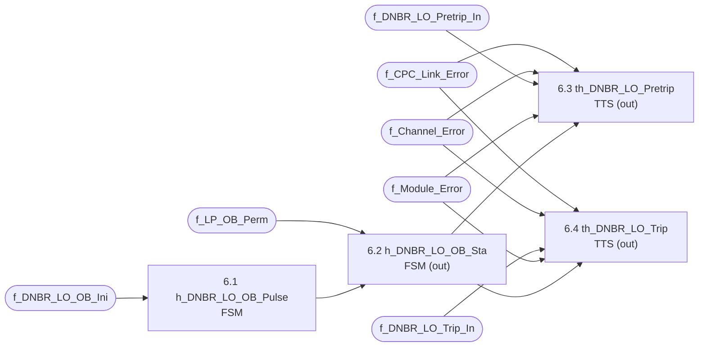

| No. | Node | Kind | Inputs |
|---|---|---|---|
| 6.1 | `h_DNBR_LO_OB_Pulse` | FSM | `f_DNBR_LO_OB_Ini` |
| 6.2 | `h_DNBR_LO_OB_Sta` | FSM | `f_LP_OB_Perm`, `h_DNBR_LO_OB_Pulse` |
| 6.3 | `th_DNBR_LO_Pretrip` | TTS | `f_CPC_Link_Error`, `f_Channel_Error`, `f_DNBR_LO_Pretrip_In`, `f_Module_Error`, `h_DNBR_LO_OB_Sta` |
| 6.4 | `th_DNBR_LO_Trip` | TTS | `f_CPC_Link_Error`, `f_Channel_Error`, `f_DNBR_LO_Trip_In`, `f_Module_Error`, `h_DNBR_LO_OB_Sta` |

##### BP.6.1 `h_DNBR_LO_OB_Pulse` (FSM)

*history variable, type `pulse`.*  Implements: SYS-DNBR_LO-03, SYS-GEN-09, SYS-GEN-04.

Edge detector for f_DNBR_LO_OB_Ini (operating-bypass initiation): PULSE (1) for exactly one scan per press.  Starts in HELD so that a button held (or stuck) at start-up is ignored until released.


States: ARMED (0), FIRED (1), HELD (0).  Initial state `HELD`, initial value `0`.

| ID | From | To | Timing | Guard | Action |
|---|---|---|---|---|---|
| T1 | ARMED | FIRED |  | `f_DNBR_LO_OB_Ini = 1` | `h_DNBR_LO_OB_Pulse := 1` |
| T2 | FIRED | HELD |  | `f_DNBR_LO_OB_Ini = 1` | `h_DNBR_LO_OB_Pulse := 0` |
| T3 | FIRED | ARMED |  | `f_DNBR_LO_OB_Ini = 0` | `h_DNBR_LO_OB_Pulse := 0` |
| T4 | HELD | ARMED |  | `f_DNBR_LO_OB_Ini = 0` | `h_DNBR_LO_OB_Pulse := 0` |

##### BP.6.2 `h_DNBR_LO_OB_Sta` (FSM)

*history variable, type `bypass_status`.*  Implements: SYS-DNBR_LO-03, SYS-GEN-09, SYS-GEN-04.

Low DNBR (CPC) operating-bypass status: established by an operator initiation (a press of f_DNBR_LO_OB_Ini, i.e. the pulse h_DNBR_LO_OB_Pulse) made while the permissive f_LP_OB_Perm is present; a held or stuck pushbutton does not establish the bypass.  Removed automatically as soon as the permissive is lost.  Removed at start-up.

```mermaid
stateDiagram-v2
  [*] --> NO_OB
  NO_OB --> OB : T1
  OB --> NO_OB : T2
```

States: NO_OB (0), OB (1).  Initial state `NO_OB`, initial value `0`.

| ID | From | To | Timing | Guard | Action |
|---|---|---|---|---|---|
| T1 | NO_OB | OB |  | `f_LP_OB_Perm = 1 && h_DNBR_LO_OB_Pulse = 1` | `h_DNBR_LO_OB_Sta := 1` |
| T2 | OB | NO_OB |  | `f_LP_OB_Perm = 0` | `h_DNBR_LO_OB_Sta := 0` |

##### BP.6.3 `th_DNBR_LO_Pretrip` (TTS)

*timed-history variable, type `pretrip`.*  Implements: SYS-GEN-08, SYS-DNBR_LO-01, SYS-GEN-02, SYS-GEN-04, SYS-GEN-05, SYS-GEN-06, SYS-GEN-07, SYS-GEN-09.

Low DNBR (CPC) pre-trip: goes to PRETRIP after the pretrip condition has persisted for k_DNBR_LO_Pretrip_Delay in error-free scans (NORMAL -> WAITING -> PRETRIP_BY_LOGIC); goes to PRETRIP immediately on an error; resets when 'f_DNBR_LO_Pretrip_In = 1' or when the operating bypass h_DNBR_LO_OB_Sta is active.  When an error clears with the condition present, the output stays at PRETRIP in PRETRIP_PENDING until the condition has persisted for k_DNBR_LO_Pretrip_Delay (PRETRIP_BY_LOGIC) or clears (NORMAL).  An error during a process trip is held in PRETRIP_BY_ERROR_LATCHED, so the reset condition still applies when the error clears.  Starts in the fail-safe state PRETRIP_BY_ERROR.

```mermaid
stateDiagram-v2
  [*] --> PRETRIP_BY_ERROR
  NORMAL --> PRETRIP_BY_ERROR : N1
  NORMAL --> WAITING : N2
  WAITING --> PRETRIP_BY_ERROR : W1
  WAITING --> NORMAL : W2
  WAITING --> PRETRIP_BY_LOGIC : W3 (timed)
  PRETRIP_BY_LOGIC --> PRETRIP_BY_ERROR_LATCHED : L1
  PRETRIP_BY_LOGIC --> NORMAL : L2
  PRETRIP_BY_ERROR --> PRETRIP_PENDING : E1
  PRETRIP_BY_ERROR --> NORMAL : E2
  PRETRIP_PENDING --> PRETRIP_BY_ERROR : P1
  PRETRIP_PENDING --> NORMAL : P2
  PRETRIP_PENDING --> PRETRIP_BY_LOGIC : P3 (timed)
  PRETRIP_BY_ERROR_LATCHED --> PRETRIP_BY_LOGIC : H1
  PRETRIP_BY_ERROR_LATCHED --> NORMAL : H2
```

States: NORMAL (1), WAITING (1), PRETRIP_BY_LOGIC (0), PRETRIP_BY_ERROR (0), PRETRIP_PENDING (0), PRETRIP_BY_ERROR_LATCHED (0).  Initial state `PRETRIP_BY_ERROR`, initial value `0`.  Must leave `PRETRIP_BY_ERROR` whenever `f_CPC_Link_Error = 0 && f_Module_Error = 0 && f_Channel_Error = 0` (proved).  Must leave `PRETRIP_BY_ERROR_LATCHED` whenever `f_CPC_Link_Error = 0 && f_Module_Error = 0 && f_Channel_Error = 0` (proved).  Value is `0` after every scan in which `f_CPC_Link_Error = 1 \|\| f_Module_Error = 1 \|\| f_Channel_Error = 1` (proved).

| ID | From | To | Timing | Guard | Action |
|---|---|---|---|---|---|
| N1 | NORMAL | PRETRIP_BY_ERROR |  | `f_CPC_Link_Error = 1 \|\| f_Module_Error = 1 \|\| f_Channel_Error = 1` | `th_DNBR_LO_Pretrip := 0` |
| N2 | NORMAL | WAITING |  | `f_CPC_Link_Error = 0 && f_Module_Error = 0 && f_Channel_Error = 0 && h_DNBR_LO_OB_Sta = 0 && f_DNBR_LO_Pretrip_In = 0` | `th_DNBR_LO_Pretrip := 1` |
| W1 | WAITING | PRETRIP_BY_ERROR |  | `f_CPC_Link_Error = 1 \|\| f_Module_Error = 1 \|\| f_Channel_Error = 1` | `th_DNBR_LO_Pretrip := 0` |
| W2 | WAITING | NORMAL |  | `f_CPC_Link_Error = 0 && f_Module_Error = 0 && f_Channel_Error = 0 && (h_DNBR_LO_OB_Sta = 1 \|\| f_DNBR_LO_Pretrip_In = 1)` | `th_DNBR_LO_Pretrip := 1` |
| W3 | WAITING | PRETRIP_BY_LOGIC | `[k_DNBR_LO_Pretrip_Delay, k_DNBR_LO_Pretrip_Delay]` | `f_CPC_Link_Error = 0 && f_Module_Error = 0 && f_Channel_Error = 0 && h_DNBR_LO_OB_Sta = 0 && f_DNBR_LO_Pretrip_In = 0` | `th_DNBR_LO_Pretrip := 0` |
| L1 | PRETRIP_BY_LOGIC | PRETRIP_BY_ERROR_LATCHED |  | `f_CPC_Link_Error = 1 \|\| f_Module_Error = 1 \|\| f_Channel_Error = 1` | `th_DNBR_LO_Pretrip := 0` |
| L2 | PRETRIP_BY_LOGIC | NORMAL |  | `f_CPC_Link_Error = 0 && f_Module_Error = 0 && f_Channel_Error = 0 && (h_DNBR_LO_OB_Sta = 1 \|\| f_DNBR_LO_Pretrip_In = 1)` | `th_DNBR_LO_Pretrip := 1` |
| E1 | PRETRIP_BY_ERROR | PRETRIP_PENDING |  | `f_CPC_Link_Error = 0 && f_Module_Error = 0 && f_Channel_Error = 0 && h_DNBR_LO_OB_Sta = 0 && f_DNBR_LO_Pretrip_In = 0` | `th_DNBR_LO_Pretrip := 0` |
| E2 | PRETRIP_BY_ERROR | NORMAL |  | `f_CPC_Link_Error = 0 && f_Module_Error = 0 && f_Channel_Error = 0 && (h_DNBR_LO_OB_Sta = 1 \|\| f_DNBR_LO_Pretrip_In = 1)` | `th_DNBR_LO_Pretrip := 1` |
| P1 | PRETRIP_PENDING | PRETRIP_BY_ERROR |  | `f_CPC_Link_Error = 1 \|\| f_Module_Error = 1 \|\| f_Channel_Error = 1` | `th_DNBR_LO_Pretrip := 0` |
| P2 | PRETRIP_PENDING | NORMAL |  | `f_CPC_Link_Error = 0 && f_Module_Error = 0 && f_Channel_Error = 0 && (h_DNBR_LO_OB_Sta = 1 \|\| f_DNBR_LO_Pretrip_In = 1)` | `th_DNBR_LO_Pretrip := 1` |
| P3 | PRETRIP_PENDING | PRETRIP_BY_LOGIC | `[k_DNBR_LO_Pretrip_Delay, k_DNBR_LO_Pretrip_Delay]` | `f_CPC_Link_Error = 0 && f_Module_Error = 0 && f_Channel_Error = 0 && h_DNBR_LO_OB_Sta = 0 && f_DNBR_LO_Pretrip_In = 0` | `th_DNBR_LO_Pretrip := 0` |
| H1 | PRETRIP_BY_ERROR_LATCHED | PRETRIP_BY_LOGIC |  | `f_CPC_Link_Error = 0 && f_Module_Error = 0 && f_Channel_Error = 0 && h_DNBR_LO_OB_Sta = 0 && f_DNBR_LO_Pretrip_In = 0` | `th_DNBR_LO_Pretrip := 0` |
| H2 | PRETRIP_BY_ERROR_LATCHED | NORMAL |  | `f_CPC_Link_Error = 0 && f_Module_Error = 0 && f_Channel_Error = 0 && (h_DNBR_LO_OB_Sta = 1 \|\| f_DNBR_LO_Pretrip_In = 1)` | `th_DNBR_LO_Pretrip := 1` |

##### BP.6.4 `th_DNBR_LO_Trip` (TTS)

*timed-history variable, type `trip`.*  Implements: SYS-DNBR_LO-01, SYS-GEN-02, SYS-GEN-04, SYS-GEN-05, SYS-GEN-06, SYS-GEN-07, SYS-GEN-09.

Low DNBR (CPC) trip: goes to TRIP after the trip condition has persisted for k_DNBR_LO_Trip_Delay in error-free scans (NORMAL -> WAITING -> TRIP_BY_LOGIC); goes to TRIP immediately on an error; resets when 'f_DNBR_LO_Trip_In = 1' or when the operating bypass h_DNBR_LO_OB_Sta is active.  When an error clears with the condition present, the output stays at TRIP in TRIP_PENDING until the condition has persisted for k_DNBR_LO_Trip_Delay (TRIP_BY_LOGIC) or clears (NORMAL).  An error during a process trip is held in TRIP_BY_ERROR_LATCHED, so the reset condition still applies when the error clears.  Starts in the fail-safe state TRIP_BY_ERROR.

```mermaid
stateDiagram-v2
  [*] --> TRIP_BY_ERROR
  NORMAL --> TRIP_BY_ERROR : N1
  NORMAL --> WAITING : N2
  WAITING --> TRIP_BY_ERROR : W1
  WAITING --> NORMAL : W2
  WAITING --> TRIP_BY_LOGIC : W3 (timed)
  TRIP_BY_LOGIC --> TRIP_BY_ERROR_LATCHED : L1
  TRIP_BY_LOGIC --> NORMAL : L2
  TRIP_BY_ERROR --> TRIP_PENDING : E1
  TRIP_BY_ERROR --> NORMAL : E2
  TRIP_PENDING --> TRIP_BY_ERROR : P1
  TRIP_PENDING --> NORMAL : P2
  TRIP_PENDING --> TRIP_BY_LOGIC : P3 (timed)
  TRIP_BY_ERROR_LATCHED --> TRIP_BY_LOGIC : H1
  TRIP_BY_ERROR_LATCHED --> NORMAL : H2
```

States: NORMAL (1), WAITING (1), TRIP_BY_LOGIC (0), TRIP_BY_ERROR (0), TRIP_PENDING (0), TRIP_BY_ERROR_LATCHED (0).  Initial state `TRIP_BY_ERROR`, initial value `0`.  Must leave `TRIP_BY_ERROR` whenever `f_CPC_Link_Error = 0 && f_Module_Error = 0 && f_Channel_Error = 0` (proved).  Must leave `TRIP_BY_ERROR_LATCHED` whenever `f_CPC_Link_Error = 0 && f_Module_Error = 0 && f_Channel_Error = 0` (proved).  Value is `0` after every scan in which `f_CPC_Link_Error = 1 \|\| f_Module_Error = 1 \|\| f_Channel_Error = 1` (proved).

| ID | From | To | Timing | Guard | Action |
|---|---|---|---|---|---|
| N1 | NORMAL | TRIP_BY_ERROR |  | `f_CPC_Link_Error = 1 \|\| f_Module_Error = 1 \|\| f_Channel_Error = 1` | `th_DNBR_LO_Trip := 0` |
| N2 | NORMAL | WAITING |  | `f_CPC_Link_Error = 0 && f_Module_Error = 0 && f_Channel_Error = 0 && h_DNBR_LO_OB_Sta = 0 && f_DNBR_LO_Trip_In = 0` | `th_DNBR_LO_Trip := 1` |
| W1 | WAITING | TRIP_BY_ERROR |  | `f_CPC_Link_Error = 1 \|\| f_Module_Error = 1 \|\| f_Channel_Error = 1` | `th_DNBR_LO_Trip := 0` |
| W2 | WAITING | NORMAL |  | `f_CPC_Link_Error = 0 && f_Module_Error = 0 && f_Channel_Error = 0 && (h_DNBR_LO_OB_Sta = 1 \|\| f_DNBR_LO_Trip_In = 1)` | `th_DNBR_LO_Trip := 1` |
| W3 | WAITING | TRIP_BY_LOGIC | `[k_DNBR_LO_Trip_Delay, k_DNBR_LO_Trip_Delay]` | `f_CPC_Link_Error = 0 && f_Module_Error = 0 && f_Channel_Error = 0 && h_DNBR_LO_OB_Sta = 0 && f_DNBR_LO_Trip_In = 0` | `th_DNBR_LO_Trip := 0` |
| L1 | TRIP_BY_LOGIC | TRIP_BY_ERROR_LATCHED |  | `f_CPC_Link_Error = 1 \|\| f_Module_Error = 1 \|\| f_Channel_Error = 1` | `th_DNBR_LO_Trip := 0` |
| L2 | TRIP_BY_LOGIC | NORMAL |  | `f_CPC_Link_Error = 0 && f_Module_Error = 0 && f_Channel_Error = 0 && (h_DNBR_LO_OB_Sta = 1 \|\| f_DNBR_LO_Trip_In = 1)` | `th_DNBR_LO_Trip := 1` |
| E1 | TRIP_BY_ERROR | TRIP_PENDING |  | `f_CPC_Link_Error = 0 && f_Module_Error = 0 && f_Channel_Error = 0 && h_DNBR_LO_OB_Sta = 0 && f_DNBR_LO_Trip_In = 0` | `th_DNBR_LO_Trip := 0` |
| E2 | TRIP_BY_ERROR | NORMAL |  | `f_CPC_Link_Error = 0 && f_Module_Error = 0 && f_Channel_Error = 0 && (h_DNBR_LO_OB_Sta = 1 \|\| f_DNBR_LO_Trip_In = 1)` | `th_DNBR_LO_Trip := 1` |
| P1 | TRIP_PENDING | TRIP_BY_ERROR |  | `f_CPC_Link_Error = 1 \|\| f_Module_Error = 1 \|\| f_Channel_Error = 1` | `th_DNBR_LO_Trip := 0` |
| P2 | TRIP_PENDING | NORMAL |  | `f_CPC_Link_Error = 0 && f_Module_Error = 0 && f_Channel_Error = 0 && (h_DNBR_LO_OB_Sta = 1 \|\| f_DNBR_LO_Trip_In = 1)` | `th_DNBR_LO_Trip := 1` |
| P3 | TRIP_PENDING | TRIP_BY_LOGIC | `[k_DNBR_LO_Trip_Delay, k_DNBR_LO_Trip_Delay]` | `f_CPC_Link_Error = 0 && f_Module_Error = 0 && f_Channel_Error = 0 && h_DNBR_LO_OB_Sta = 0 && f_DNBR_LO_Trip_In = 0` | `th_DNBR_LO_Trip := 0` |
| H1 | TRIP_BY_ERROR_LATCHED | TRIP_BY_LOGIC |  | `f_CPC_Link_Error = 0 && f_Module_Error = 0 && f_Channel_Error = 0 && h_DNBR_LO_OB_Sta = 0 && f_DNBR_LO_Trip_In = 0` | `th_DNBR_LO_Trip := 0` |
| H2 | TRIP_BY_ERROR_LATCHED | NORMAL |  | `f_CPC_Link_Error = 0 && f_Module_Error = 0 && f_Channel_Error = 0 && (h_DNBR_LO_OB_Sta = 1 \|\| f_DNBR_LO_Trip_In = 1)` | `th_DNBR_LO_Trip := 1` |

#### BP.7 `g_PZR_P_HI` - High Pressurizer Pressure trip

High Pressurizer Pressure trip (fixed set-point trip, NuSCR logic type Fixed_Setpoint_Rising_Trip).

NuSCR logic type: `Fixed_Setpoint_Rising_Trip` (Fixed set-point trip).  Implements: SYS-PZR_P_HI-01.

```mermaid
flowchart LR
  x_f_Channel_Error(["f_Channel_Error"])
  x_f_Module_Error(["f_Module_Error"])
  x_f_PZR_P(["f_PZR_P"])
  x_f_PZR_P_Valid(["f_PZR_P_Valid"])
  th_PZR_P_HI_Pretrip["7.1 th_PZR_P_HI_Pretrip<br/>TTS (out)"]
  th_PZR_P_HI_Trip["7.2 th_PZR_P_HI_Trip<br/>TTS (out)"]
  x_f_Channel_Error --> th_PZR_P_HI_Pretrip
  x_f_Module_Error --> th_PZR_P_HI_Pretrip
  x_f_PZR_P --> th_PZR_P_HI_Pretrip
  x_f_PZR_P_Valid --> th_PZR_P_HI_Pretrip
  x_f_Channel_Error --> th_PZR_P_HI_Trip
  x_f_Module_Error --> th_PZR_P_HI_Trip
  x_f_PZR_P --> th_PZR_P_HI_Trip
  x_f_PZR_P_Valid --> th_PZR_P_HI_Trip
```

| No. | Node | Kind | Inputs |
|---|---|---|---|
| 7.1 | `th_PZR_P_HI_Pretrip` | TTS | `f_Channel_Error`, `f_Module_Error`, `f_PZR_P`, `f_PZR_P_Valid` |
| 7.2 | `th_PZR_P_HI_Trip` | TTS | `f_Channel_Error`, `f_Module_Error`, `f_PZR_P`, `f_PZR_P_Valid` |

##### BP.7.1 `th_PZR_P_HI_Pretrip` (TTS)

*timed-history variable, type `pretrip`.*  Implements: SYS-GEN-08, SYS-PZR_P_HI-01, SYS-GEN-02, SYS-GEN-04, SYS-GEN-05, SYS-GEN-06, SYS-GEN-07.

High Pressurizer Pressure pre-trip: goes to PRETRIP after the pretrip condition has persisted for k_PZR_P_HI_Pretrip_Delay in error-free scans (NORMAL -> WAITING -> PRETRIP_BY_LOGIC); goes to PRETRIP immediately on an error; resets when 'f_PZR_P < k_PZR_P_HI_Pretrip_SP - k_PZR_P_HI_Pretrip_Hys'.  When an error clears with the condition present, the output stays at PRETRIP in PRETRIP_PENDING until the condition has persisted for k_PZR_P_HI_Pretrip_Delay (PRETRIP_BY_LOGIC) or clears (NORMAL).  An error during a process trip is held in PRETRIP_BY_ERROR_LATCHED, so the reset condition still applies when the error clears.  Starts in the fail-safe state PRETRIP_BY_ERROR.

```mermaid
stateDiagram-v2
  [*] --> PRETRIP_BY_ERROR
  NORMAL --> PRETRIP_BY_ERROR : N1
  NORMAL --> WAITING : N2
  WAITING --> PRETRIP_BY_ERROR : W1
  WAITING --> NORMAL : W2
  WAITING --> PRETRIP_BY_LOGIC : W3 (timed)
  PRETRIP_BY_LOGIC --> PRETRIP_BY_ERROR_LATCHED : L1
  PRETRIP_BY_LOGIC --> NORMAL : L2
  PRETRIP_BY_ERROR --> PRETRIP_PENDING : E1
  PRETRIP_BY_ERROR --> NORMAL : E2
  PRETRIP_PENDING --> PRETRIP_BY_ERROR : P1
  PRETRIP_PENDING --> NORMAL : P2
  PRETRIP_PENDING --> PRETRIP_BY_LOGIC : P3 (timed)
  PRETRIP_BY_ERROR_LATCHED --> PRETRIP_BY_LOGIC : H1
  PRETRIP_BY_ERROR_LATCHED --> NORMAL : H2
```

States: NORMAL (1), WAITING (1), PRETRIP_BY_LOGIC (0), PRETRIP_BY_ERROR (0), PRETRIP_PENDING (0), PRETRIP_BY_ERROR_LATCHED (0).  Initial state `PRETRIP_BY_ERROR`, initial value `0`.  Must leave `PRETRIP_BY_ERROR` whenever `f_PZR_P_Valid = 1 && f_Module_Error = 0 && f_Channel_Error = 0` (proved).  Must leave `PRETRIP_BY_ERROR_LATCHED` whenever `f_PZR_P_Valid = 1 && f_Module_Error = 0 && f_Channel_Error = 0` (proved).  Value is `0` after every scan in which `f_PZR_P_Valid = 0 \|\| f_Module_Error = 1 \|\| f_Channel_Error = 1` (proved).

| ID | From | To | Timing | Guard | Action |
|---|---|---|---|---|---|
| N1 | NORMAL | PRETRIP_BY_ERROR |  | `f_PZR_P_Valid = 0 \|\| f_Module_Error = 1 \|\| f_Channel_Error = 1` | `th_PZR_P_HI_Pretrip := 0` |
| N2 | NORMAL | WAITING |  | `f_PZR_P_Valid = 1 && f_Module_Error = 0 && f_Channel_Error = 0 && f_PZR_P >= k_PZR_P_HI_Pretrip_SP` | `th_PZR_P_HI_Pretrip := 1` |
| W1 | WAITING | PRETRIP_BY_ERROR |  | `f_PZR_P_Valid = 0 \|\| f_Module_Error = 1 \|\| f_Channel_Error = 1` | `th_PZR_P_HI_Pretrip := 0` |
| W2 | WAITING | NORMAL |  | `f_PZR_P_Valid = 1 && f_Module_Error = 0 && f_Channel_Error = 0 && f_PZR_P < k_PZR_P_HI_Pretrip_SP` | `th_PZR_P_HI_Pretrip := 1` |
| W3 | WAITING | PRETRIP_BY_LOGIC | `[k_PZR_P_HI_Pretrip_Delay, k_PZR_P_HI_Pretrip_Delay]` | `f_PZR_P_Valid = 1 && f_Module_Error = 0 && f_Channel_Error = 0 && f_PZR_P >= k_PZR_P_HI_Pretrip_SP` | `th_PZR_P_HI_Pretrip := 0` |
| L1 | PRETRIP_BY_LOGIC | PRETRIP_BY_ERROR_LATCHED |  | `f_PZR_P_Valid = 0 \|\| f_Module_Error = 1 \|\| f_Channel_Error = 1` | `th_PZR_P_HI_Pretrip := 0` |
| L2 | PRETRIP_BY_LOGIC | NORMAL |  | `f_PZR_P_Valid = 1 && f_Module_Error = 0 && f_Channel_Error = 0 && f_PZR_P < k_PZR_P_HI_Pretrip_SP - k_PZR_P_HI_Pretrip_Hys` | `th_PZR_P_HI_Pretrip := 1` |
| E1 | PRETRIP_BY_ERROR | PRETRIP_PENDING |  | `f_PZR_P_Valid = 1 && f_Module_Error = 0 && f_Channel_Error = 0 && f_PZR_P >= k_PZR_P_HI_Pretrip_SP` | `th_PZR_P_HI_Pretrip := 0` |
| E2 | PRETRIP_BY_ERROR | NORMAL |  | `f_PZR_P_Valid = 1 && f_Module_Error = 0 && f_Channel_Error = 0 && f_PZR_P < k_PZR_P_HI_Pretrip_SP` | `th_PZR_P_HI_Pretrip := 1` |
| P1 | PRETRIP_PENDING | PRETRIP_BY_ERROR |  | `f_PZR_P_Valid = 0 \|\| f_Module_Error = 1 \|\| f_Channel_Error = 1` | `th_PZR_P_HI_Pretrip := 0` |
| P2 | PRETRIP_PENDING | NORMAL |  | `f_PZR_P_Valid = 1 && f_Module_Error = 0 && f_Channel_Error = 0 && f_PZR_P < k_PZR_P_HI_Pretrip_SP` | `th_PZR_P_HI_Pretrip := 1` |
| P3 | PRETRIP_PENDING | PRETRIP_BY_LOGIC | `[k_PZR_P_HI_Pretrip_Delay, k_PZR_P_HI_Pretrip_Delay]` | `f_PZR_P_Valid = 1 && f_Module_Error = 0 && f_Channel_Error = 0 && f_PZR_P >= k_PZR_P_HI_Pretrip_SP` | `th_PZR_P_HI_Pretrip := 0` |
| H1 | PRETRIP_BY_ERROR_LATCHED | PRETRIP_BY_LOGIC |  | `f_PZR_P_Valid = 1 && f_Module_Error = 0 && f_Channel_Error = 0 && f_PZR_P >= k_PZR_P_HI_Pretrip_SP - k_PZR_P_HI_Pretrip_Hys` | `th_PZR_P_HI_Pretrip := 0` |
| H2 | PRETRIP_BY_ERROR_LATCHED | NORMAL |  | `f_PZR_P_Valid = 1 && f_Module_Error = 0 && f_Channel_Error = 0 && f_PZR_P < k_PZR_P_HI_Pretrip_SP - k_PZR_P_HI_Pretrip_Hys` | `th_PZR_P_HI_Pretrip := 1` |

##### BP.7.2 `th_PZR_P_HI_Trip` (TTS)

*timed-history variable, type `trip`.*  Implements: SYS-PZR_P_HI-01, SYS-GEN-02, SYS-GEN-04, SYS-GEN-05, SYS-GEN-06, SYS-GEN-07.

High Pressurizer Pressure trip: goes to TRIP after the trip condition has persisted for k_PZR_P_HI_Trip_Delay in error-free scans (NORMAL -> WAITING -> TRIP_BY_LOGIC); goes to TRIP immediately on an error; resets when 'f_PZR_P < k_PZR_P_HI_Trip_SP - k_PZR_P_HI_Trip_Hys'.  When an error clears with the condition present, the output stays at TRIP in TRIP_PENDING until the condition has persisted for k_PZR_P_HI_Trip_Delay (TRIP_BY_LOGIC) or clears (NORMAL).  An error during a process trip is held in TRIP_BY_ERROR_LATCHED, so the reset condition still applies when the error clears.  Starts in the fail-safe state TRIP_BY_ERROR.

```mermaid
stateDiagram-v2
  [*] --> TRIP_BY_ERROR
  NORMAL --> TRIP_BY_ERROR : N1
  NORMAL --> WAITING : N2
  WAITING --> TRIP_BY_ERROR : W1
  WAITING --> NORMAL : W2
  WAITING --> TRIP_BY_LOGIC : W3 (timed)
  TRIP_BY_LOGIC --> TRIP_BY_ERROR_LATCHED : L1
  TRIP_BY_LOGIC --> NORMAL : L2
  TRIP_BY_ERROR --> TRIP_PENDING : E1
  TRIP_BY_ERROR --> NORMAL : E2
  TRIP_PENDING --> TRIP_BY_ERROR : P1
  TRIP_PENDING --> NORMAL : P2
  TRIP_PENDING --> TRIP_BY_LOGIC : P3 (timed)
  TRIP_BY_ERROR_LATCHED --> TRIP_BY_LOGIC : H1
  TRIP_BY_ERROR_LATCHED --> NORMAL : H2
```

States: NORMAL (1), WAITING (1), TRIP_BY_LOGIC (0), TRIP_BY_ERROR (0), TRIP_PENDING (0), TRIP_BY_ERROR_LATCHED (0).  Initial state `TRIP_BY_ERROR`, initial value `0`.  Must leave `TRIP_BY_ERROR` whenever `f_PZR_P_Valid = 1 && f_Module_Error = 0 && f_Channel_Error = 0` (proved).  Must leave `TRIP_BY_ERROR_LATCHED` whenever `f_PZR_P_Valid = 1 && f_Module_Error = 0 && f_Channel_Error = 0` (proved).  Value is `0` after every scan in which `f_PZR_P_Valid = 0 \|\| f_Module_Error = 1 \|\| f_Channel_Error = 1` (proved).

| ID | From | To | Timing | Guard | Action |
|---|---|---|---|---|---|
| N1 | NORMAL | TRIP_BY_ERROR |  | `f_PZR_P_Valid = 0 \|\| f_Module_Error = 1 \|\| f_Channel_Error = 1` | `th_PZR_P_HI_Trip := 0` |
| N2 | NORMAL | WAITING |  | `f_PZR_P_Valid = 1 && f_Module_Error = 0 && f_Channel_Error = 0 && f_PZR_P >= k_PZR_P_HI_Trip_SP` | `th_PZR_P_HI_Trip := 1` |
| W1 | WAITING | TRIP_BY_ERROR |  | `f_PZR_P_Valid = 0 \|\| f_Module_Error = 1 \|\| f_Channel_Error = 1` | `th_PZR_P_HI_Trip := 0` |
| W2 | WAITING | NORMAL |  | `f_PZR_P_Valid = 1 && f_Module_Error = 0 && f_Channel_Error = 0 && f_PZR_P < k_PZR_P_HI_Trip_SP` | `th_PZR_P_HI_Trip := 1` |
| W3 | WAITING | TRIP_BY_LOGIC | `[k_PZR_P_HI_Trip_Delay, k_PZR_P_HI_Trip_Delay]` | `f_PZR_P_Valid = 1 && f_Module_Error = 0 && f_Channel_Error = 0 && f_PZR_P >= k_PZR_P_HI_Trip_SP` | `th_PZR_P_HI_Trip := 0` |
| L1 | TRIP_BY_LOGIC | TRIP_BY_ERROR_LATCHED |  | `f_PZR_P_Valid = 0 \|\| f_Module_Error = 1 \|\| f_Channel_Error = 1` | `th_PZR_P_HI_Trip := 0` |
| L2 | TRIP_BY_LOGIC | NORMAL |  | `f_PZR_P_Valid = 1 && f_Module_Error = 0 && f_Channel_Error = 0 && f_PZR_P < k_PZR_P_HI_Trip_SP - k_PZR_P_HI_Trip_Hys` | `th_PZR_P_HI_Trip := 1` |
| E1 | TRIP_BY_ERROR | TRIP_PENDING |  | `f_PZR_P_Valid = 1 && f_Module_Error = 0 && f_Channel_Error = 0 && f_PZR_P >= k_PZR_P_HI_Trip_SP` | `th_PZR_P_HI_Trip := 0` |
| E2 | TRIP_BY_ERROR | NORMAL |  | `f_PZR_P_Valid = 1 && f_Module_Error = 0 && f_Channel_Error = 0 && f_PZR_P < k_PZR_P_HI_Trip_SP` | `th_PZR_P_HI_Trip := 1` |
| P1 | TRIP_PENDING | TRIP_BY_ERROR |  | `f_PZR_P_Valid = 0 \|\| f_Module_Error = 1 \|\| f_Channel_Error = 1` | `th_PZR_P_HI_Trip := 0` |
| P2 | TRIP_PENDING | NORMAL |  | `f_PZR_P_Valid = 1 && f_Module_Error = 0 && f_Channel_Error = 0 && f_PZR_P < k_PZR_P_HI_Trip_SP` | `th_PZR_P_HI_Trip := 1` |
| P3 | TRIP_PENDING | TRIP_BY_LOGIC | `[k_PZR_P_HI_Trip_Delay, k_PZR_P_HI_Trip_Delay]` | `f_PZR_P_Valid = 1 && f_Module_Error = 0 && f_Channel_Error = 0 && f_PZR_P >= k_PZR_P_HI_Trip_SP` | `th_PZR_P_HI_Trip := 0` |
| H1 | TRIP_BY_ERROR_LATCHED | TRIP_BY_LOGIC |  | `f_PZR_P_Valid = 1 && f_Module_Error = 0 && f_Channel_Error = 0 && f_PZR_P >= k_PZR_P_HI_Trip_SP - k_PZR_P_HI_Trip_Hys` | `th_PZR_P_HI_Trip := 0` |
| H2 | TRIP_BY_ERROR_LATCHED | NORMAL |  | `f_PZR_P_Valid = 1 && f_Module_Error = 0 && f_Channel_Error = 0 && f_PZR_P < k_PZR_P_HI_Trip_SP - k_PZR_P_HI_Trip_Hys` | `th_PZR_P_HI_Trip := 1` |

#### BP.8 `g_PZR_P_LO` - Low Pressurizer Pressure trip

Low Pressurizer Pressure trip (manual reset trip, NuSCR logic type Manual_Reset_Variable_Setpoint_Falling_Trip_with_OB).

NuSCR logic type: `Manual_Reset_Variable_Setpoint_Falling_Trip_with_OB` (Manual reset trip).  Implements: SYS-PZR_P_LO-01, SYS-PZR_P_LO-02, SYS-PZR_P_LO-03.

```mermaid
flowchart LR
  x_f_Channel_Error(["f_Channel_Error"])
  x_f_Module_Error(["f_Module_Error"])
  x_f_PZR_P(["f_PZR_P"])
  x_f_PZR_P_LO_OB_Ini(["f_PZR_P_LO_OB_Ini"])
  x_f_PZR_P_LO_SP_Reset(["f_PZR_P_LO_SP_Reset"])
  x_f_PZR_P_Valid(["f_PZR_P_Valid"])
  f_PZR_P_LO_OB_Perm["8.1 f_PZR_P_LO_OB_Perm<br/>SDT"]
  h_PZR_P_LO_OB_Pulse["8.2 h_PZR_P_LO_OB_Pulse<br/>FSM"]
  h_PZR_P_LO_OB_Sta["8.3 h_PZR_P_LO_OB_Sta<br/>FSM (out)"]
  h_PZR_P_LO_Reset_Pulse["8.4 h_PZR_P_LO_Reset_Pulse<br/>FSM"]
  h_PZR_P_LO_Trip_SP["8.5 h_PZR_P_LO_Trip_SP<br/>FSM (out)"]
  th_PZR_P_LO_Pretrip["8.6 th_PZR_P_LO_Pretrip<br/>TTS (out)"]
  th_PZR_P_LO_Trip["8.7 th_PZR_P_LO_Trip<br/>TTS (out)"]
  x_f_PZR_P --> f_PZR_P_LO_OB_Perm
  x_f_PZR_P_Valid --> f_PZR_P_LO_OB_Perm
  x_f_PZR_P_LO_OB_Ini --> h_PZR_P_LO_OB_Pulse
  f_PZR_P_LO_OB_Perm --> h_PZR_P_LO_OB_Sta
  h_PZR_P_LO_OB_Pulse --> h_PZR_P_LO_OB_Sta
  x_f_PZR_P_LO_SP_Reset --> h_PZR_P_LO_Reset_Pulse
  x_f_PZR_P --> h_PZR_P_LO_Trip_SP
  x_f_PZR_P_Valid --> h_PZR_P_LO_Trip_SP
  h_PZR_P_LO_Reset_Pulse --> h_PZR_P_LO_Trip_SP
  x_f_Channel_Error --> th_PZR_P_LO_Pretrip
  x_f_Module_Error --> th_PZR_P_LO_Pretrip
  x_f_PZR_P --> th_PZR_P_LO_Pretrip
  x_f_PZR_P_Valid --> th_PZR_P_LO_Pretrip
  h_PZR_P_LO_OB_Sta --> th_PZR_P_LO_Pretrip
  h_PZR_P_LO_Trip_SP --> th_PZR_P_LO_Pretrip
  x_f_Channel_Error --> th_PZR_P_LO_Trip
  x_f_Module_Error --> th_PZR_P_LO_Trip
  x_f_PZR_P --> th_PZR_P_LO_Trip
  x_f_PZR_P_Valid --> th_PZR_P_LO_Trip
  h_PZR_P_LO_OB_Sta --> th_PZR_P_LO_Trip
  h_PZR_P_LO_Trip_SP --> th_PZR_P_LO_Trip
```

| No. | Node | Kind | Inputs |
|---|---|---|---|
| 8.1 | `f_PZR_P_LO_OB_Perm` | SDT | `f_PZR_P`, `f_PZR_P_Valid` |
| 8.2 | `h_PZR_P_LO_OB_Pulse` | FSM | `f_PZR_P_LO_OB_Ini` |
| 8.3 | `h_PZR_P_LO_OB_Sta` | FSM | `f_PZR_P_LO_OB_Perm`, `h_PZR_P_LO_OB_Pulse` |
| 8.4 | `h_PZR_P_LO_Reset_Pulse` | FSM | `f_PZR_P_LO_SP_Reset` |
| 8.5 | `h_PZR_P_LO_Trip_SP` | FSM | `f_PZR_P`, `f_PZR_P_Valid`, `h_PZR_P_LO_Reset_Pulse` |
| 8.6 | `th_PZR_P_LO_Pretrip` | TTS | `f_Channel_Error`, `f_Module_Error`, `f_PZR_P`, `f_PZR_P_Valid`, `h_PZR_P_LO_OB_Sta`, `h_PZR_P_LO_Trip_SP` |
| 8.7 | `th_PZR_P_LO_Trip` | TTS | `f_Channel_Error`, `f_Module_Error`, `f_PZR_P`, `f_PZR_P_Valid`, `h_PZR_P_LO_OB_Sta`, `h_PZR_P_LO_Trip_SP` |

##### BP.8.1 `f_PZR_P_LO_OB_Perm` (SDT)

*function variable, type `permissive`.*  Implements: SYS-PZR_P_LO-03, SYS-GEN-09, SYS-GEN-04.

Permissive (1) while f_PZR_P is valid and < k_PZR_P_LO_OB_Perm; not permitted (0) otherwise, including when the input is invalid.

|  | R1 | R2 | R3 |
|---|:-:|:-:|:-:|
| **Conditions** |  |  |  |
| `f_PZR_P_Valid = 1` | T | T | F |
| `f_PZR_P < k_PZR_P_LO_OB_Perm` | T | F | - |
| **Actions** |  |  |  |
| `f_PZR_P_LO_OB_Perm := 1` | O |  |  |
| `f_PZR_P_LO_OB_Perm := 0` |  | O | O |

##### BP.8.2 `h_PZR_P_LO_OB_Pulse` (FSM)

*history variable, type `pulse`.*  Implements: SYS-PZR_P_LO-03, SYS-GEN-09, SYS-GEN-04.

Edge detector for f_PZR_P_LO_OB_Ini (operating-bypass initiation): PULSE (1) for exactly one scan per press.  Starts in HELD so that a button held (or stuck) at start-up is ignored until released.

```mermaid
stateDiagram-v2
  [*] --> HELD
  ARMED --> FIRED : T1
  FIRED --> HELD : T2
  FIRED --> ARMED : T3
  HELD --> ARMED : T4
```

States: ARMED (0), FIRED (1), HELD (0).  Initial state `HELD`, initial value `0`.

| ID | From | To | Timing | Guard | Action |
|---|---|---|---|---|---|
| T1 | ARMED | FIRED |  | `f_PZR_P_LO_OB_Ini = 1` | `h_PZR_P_LO_OB_Pulse := 1` |
| T2 | FIRED | HELD |  | `f_PZR_P_LO_OB_Ini = 1` | `h_PZR_P_LO_OB_Pulse := 0` |
| T3 | FIRED | ARMED |  | `f_PZR_P_LO_OB_Ini = 0` | `h_PZR_P_LO_OB_Pulse := 0` |
| T4 | HELD | ARMED |  | `f_PZR_P_LO_OB_Ini = 0` | `h_PZR_P_LO_OB_Pulse := 0` |

##### BP.8.3 `h_PZR_P_LO_OB_Sta` (FSM)

*history variable, type `bypass_status`.*  Implements: SYS-PZR_P_LO-03, SYS-GEN-09, SYS-GEN-04.

Low Pressurizer Pressure operating-bypass status: established by an operator initiation (a press of f_PZR_P_LO_OB_Ini, i.e. the pulse h_PZR_P_LO_OB_Pulse) made while the permissive f_PZR_P_LO_OB_Perm is present; a held or stuck pushbutton does not establish the bypass.  Removed automatically as soon as the permissive is lost.  Removed at start-up.

```mermaid
stateDiagram-v2
  [*] --> NO_OB
  NO_OB --> OB : T1
  OB --> NO_OB : T2
```

States: NO_OB (0), OB (1).  Initial state `NO_OB`, initial value `0`.

| ID | From | To | Timing | Guard | Action |
|---|---|---|---|---|---|
| T1 | NO_OB | OB |  | `f_PZR_P_LO_OB_Perm = 1 && h_PZR_P_LO_OB_Pulse = 1` | `h_PZR_P_LO_OB_Sta := 1` |
| T2 | OB | NO_OB |  | `f_PZR_P_LO_OB_Perm = 0` | `h_PZR_P_LO_OB_Sta := 0` |

##### BP.8.4 `h_PZR_P_LO_Reset_Pulse` (FSM)

*history variable, type `pulse`.*  Implements: SYS-PZR_P_LO-02.

Edge detector for f_PZR_P_LO_SP_Reset (setpoint reset): PULSE (1) for exactly one scan per press.  Starts in HELD so that a button held (or stuck) at start-up is ignored until released.

```mermaid
stateDiagram-v2
  [*] --> HELD
  ARMED --> FIRED : T1
  FIRED --> HELD : T2
  FIRED --> ARMED : T3
  HELD --> ARMED : T4
```

States: ARMED (0), FIRED (1), HELD (0).  Initial state `HELD`, initial value `0`.

| ID | From | To | Timing | Guard | Action |
|---|---|---|---|---|---|
| T1 | ARMED | FIRED |  | `f_PZR_P_LO_SP_Reset = 1` | `h_PZR_P_LO_Reset_Pulse := 1` |
| T2 | FIRED | HELD |  | `f_PZR_P_LO_SP_Reset = 1` | `h_PZR_P_LO_Reset_Pulse := 0` |
| T3 | FIRED | ARMED |  | `f_PZR_P_LO_SP_Reset = 0` | `h_PZR_P_LO_Reset_Pulse := 0` |
| T4 | HELD | ARMED |  | `f_PZR_P_LO_SP_Reset = 0` | `h_PZR_P_LO_Reset_Pulse := 0` |

##### BP.8.5 `h_PZR_P_LO_Trip_SP` (FSM)

*history variable, type `real`, unit psia, range invariant `[k_PZR_P_LO_SP_Min, k_PZR_P_LO_SP_Max]`.*  Implements: SYS-PZR_P_LO-02.

Manually reset falling setpoint: starts at k_PZR_P_LO_SP_Max; rises automatically so that it is never more than k_PZR_P_LO_Band below f_PZR_P (up to k_PZR_P_LO_SP_Max); each reset pulse lowers it to f_PZR_P - k_PZR_P_LO_Band (not below k_PZR_P_LO_SP_Min).  Holds its value while f_PZR_P is invalid.

```mermaid
stateDiagram-v2
  [*] --> ACTIVE
  ACTIVE --> ACTIVE : T1
  ACTIVE --> ACTIVE : T2
  ACTIVE --> ACTIVE : T3
  ACTIVE --> ACTIVE : T4
```

States: ACTIVE.  Initial state `ACTIVE`, initial value `k_PZR_P_LO_SP_Max`.

| ID | From | To | Timing | Guard | Action |
|---|---|---|---|---|---|
| T1 | ACTIVE | ACTIVE |  | `f_PZR_P_Valid = 1 && f_PZR_P - k_PZR_P_LO_Band > h_PZR_P_LO_Trip_SP && f_PZR_P - k_PZR_P_LO_Band <= k_PZR_P_LO_SP_Max` | `h_PZR_P_LO_Trip_SP := f_PZR_P - k_PZR_P_LO_Band` |
| T2 | ACTIVE | ACTIVE |  | `f_PZR_P_Valid = 1 && f_PZR_P - k_PZR_P_LO_Band > k_PZR_P_LO_SP_Max && h_PZR_P_LO_Trip_SP < k_PZR_P_LO_SP_Max` | `h_PZR_P_LO_Trip_SP := k_PZR_P_LO_SP_Max` |
| T3 | ACTIVE | ACTIVE |  | `f_PZR_P_Valid = 1 && h_PZR_P_LO_Reset_Pulse = 1 && f_PZR_P - k_PZR_P_LO_Band < h_PZR_P_LO_Trip_SP && f_PZR_P - k_PZR_P_LO_Band >= k_PZR_P_LO_SP_Min` | `h_PZR_P_LO_Trip_SP := f_PZR_P - k_PZR_P_LO_Band` |
| T4 | ACTIVE | ACTIVE |  | `f_PZR_P_Valid = 1 && h_PZR_P_LO_Reset_Pulse = 1 && f_PZR_P - k_PZR_P_LO_Band < k_PZR_P_LO_SP_Min && h_PZR_P_LO_Trip_SP > k_PZR_P_LO_SP_Min` | `h_PZR_P_LO_Trip_SP := k_PZR_P_LO_SP_Min` |

##### BP.8.6 `th_PZR_P_LO_Pretrip` (TTS)

*timed-history variable, type `pretrip`.*  Implements: SYS-GEN-08, SYS-PZR_P_LO-01, SYS-GEN-02, SYS-GEN-04, SYS-GEN-05, SYS-GEN-06, SYS-GEN-07, SYS-GEN-09.

Low Pressurizer Pressure pre-trip: goes to PRETRIP after the pretrip condition has persisted for k_PZR_P_LO_Pretrip_Delay in error-free scans (NORMAL -> WAITING -> PRETRIP_BY_LOGIC); goes to PRETRIP immediately on an error; resets when 'f_PZR_P > h_PZR_P_LO_Trip_SP + k_PZR_P_LO_Pretrip_Margin + k_PZR_P_LO_Pretrip_Hys' or when the operating bypass h_PZR_P_LO_OB_Sta is active.  When an error clears with the condition present, the output stays at PRETRIP in PRETRIP_PENDING until the condition has persisted for k_PZR_P_LO_Pretrip_Delay (PRETRIP_BY_LOGIC) or clears (NORMAL).  An error during a process trip is held in PRETRIP_BY_ERROR_LATCHED, so the reset condition still applies when the error clears.  Starts in the fail-safe state PRETRIP_BY_ERROR.

```mermaid
stateDiagram-v2
  [*] --> PRETRIP_BY_ERROR
  NORMAL --> PRETRIP_BY_ERROR : N1
  NORMAL --> WAITING : N2
  WAITING --> PRETRIP_BY_ERROR : W1
  WAITING --> NORMAL : W2
  WAITING --> PRETRIP_BY_LOGIC : W3 (timed)
  PRETRIP_BY_LOGIC --> PRETRIP_BY_ERROR_LATCHED : L1
  PRETRIP_BY_LOGIC --> NORMAL : L2
  PRETRIP_BY_ERROR --> PRETRIP_PENDING : E1
  PRETRIP_BY_ERROR --> NORMAL : E2
  PRETRIP_PENDING --> PRETRIP_BY_ERROR : P1
  PRETRIP_PENDING --> NORMAL : P2
  PRETRIP_PENDING --> PRETRIP_BY_LOGIC : P3 (timed)
  PRETRIP_BY_ERROR_LATCHED --> PRETRIP_BY_LOGIC : H1
  PRETRIP_BY_ERROR_LATCHED --> NORMAL : H2
```

States: NORMAL (1), WAITING (1), PRETRIP_BY_LOGIC (0), PRETRIP_BY_ERROR (0), PRETRIP_PENDING (0), PRETRIP_BY_ERROR_LATCHED (0).  Initial state `PRETRIP_BY_ERROR`, initial value `0`.  Must leave `PRETRIP_BY_ERROR` whenever `f_PZR_P_Valid = 1 && f_Module_Error = 0 && f_Channel_Error = 0` (proved).  Must leave `PRETRIP_BY_ERROR_LATCHED` whenever `f_PZR_P_Valid = 1 && f_Module_Error = 0 && f_Channel_Error = 0` (proved).  Value is `0` after every scan in which `f_PZR_P_Valid = 0 \|\| f_Module_Error = 1 \|\| f_Channel_Error = 1` (proved).

| ID | From | To | Timing | Guard | Action |
|---|---|---|---|---|---|
| N1 | NORMAL | PRETRIP_BY_ERROR |  | `f_PZR_P_Valid = 0 \|\| f_Module_Error = 1 \|\| f_Channel_Error = 1` | `th_PZR_P_LO_Pretrip := 0` |
| N2 | NORMAL | WAITING |  | `f_PZR_P_Valid = 1 && f_Module_Error = 0 && f_Channel_Error = 0 && h_PZR_P_LO_OB_Sta = 0 && f_PZR_P <= h_PZR_P_LO_Trip_SP + k_PZR_P_LO_Pretrip_Margin` | `th_PZR_P_LO_Pretrip := 1` |
| W1 | WAITING | PRETRIP_BY_ERROR |  | `f_PZR_P_Valid = 0 \|\| f_Module_Error = 1 \|\| f_Channel_Error = 1` | `th_PZR_P_LO_Pretrip := 0` |
| W2 | WAITING | NORMAL |  | `f_PZR_P_Valid = 1 && f_Module_Error = 0 && f_Channel_Error = 0 && (h_PZR_P_LO_OB_Sta = 1 \|\| f_PZR_P > h_PZR_P_LO_Trip_SP + k_PZR_P_LO_Pretrip_Margin)` | `th_PZR_P_LO_Pretrip := 1` |
| W3 | WAITING | PRETRIP_BY_LOGIC | `[k_PZR_P_LO_Pretrip_Delay, k_PZR_P_LO_Pretrip_Delay]` | `f_PZR_P_Valid = 1 && f_Module_Error = 0 && f_Channel_Error = 0 && h_PZR_P_LO_OB_Sta = 0 && f_PZR_P <= h_PZR_P_LO_Trip_SP + k_PZR_P_LO_Pretrip_Margin` | `th_PZR_P_LO_Pretrip := 0` |
| L1 | PRETRIP_BY_LOGIC | PRETRIP_BY_ERROR_LATCHED |  | `f_PZR_P_Valid = 0 \|\| f_Module_Error = 1 \|\| f_Channel_Error = 1` | `th_PZR_P_LO_Pretrip := 0` |
| L2 | PRETRIP_BY_LOGIC | NORMAL |  | `f_PZR_P_Valid = 1 && f_Module_Error = 0 && f_Channel_Error = 0 && (h_PZR_P_LO_OB_Sta = 1 \|\| f_PZR_P > h_PZR_P_LO_Trip_SP + k_PZR_P_LO_Pretrip_Margin + k_PZR_P_LO_Pretrip_Hys)` | `th_PZR_P_LO_Pretrip := 1` |
| E1 | PRETRIP_BY_ERROR | PRETRIP_PENDING |  | `f_PZR_P_Valid = 1 && f_Module_Error = 0 && f_Channel_Error = 0 && h_PZR_P_LO_OB_Sta = 0 && f_PZR_P <= h_PZR_P_LO_Trip_SP + k_PZR_P_LO_Pretrip_Margin` | `th_PZR_P_LO_Pretrip := 0` |
| E2 | PRETRIP_BY_ERROR | NORMAL |  | `f_PZR_P_Valid = 1 && f_Module_Error = 0 && f_Channel_Error = 0 && (h_PZR_P_LO_OB_Sta = 1 \|\| f_PZR_P > h_PZR_P_LO_Trip_SP + k_PZR_P_LO_Pretrip_Margin)` | `th_PZR_P_LO_Pretrip := 1` |
| P1 | PRETRIP_PENDING | PRETRIP_BY_ERROR |  | `f_PZR_P_Valid = 0 \|\| f_Module_Error = 1 \|\| f_Channel_Error = 1` | `th_PZR_P_LO_Pretrip := 0` |
| P2 | PRETRIP_PENDING | NORMAL |  | `f_PZR_P_Valid = 1 && f_Module_Error = 0 && f_Channel_Error = 0 && (h_PZR_P_LO_OB_Sta = 1 \|\| f_PZR_P > h_PZR_P_LO_Trip_SP + k_PZR_P_LO_Pretrip_Margin)` | `th_PZR_P_LO_Pretrip := 1` |
| P3 | PRETRIP_PENDING | PRETRIP_BY_LOGIC | `[k_PZR_P_LO_Pretrip_Delay, k_PZR_P_LO_Pretrip_Delay]` | `f_PZR_P_Valid = 1 && f_Module_Error = 0 && f_Channel_Error = 0 && h_PZR_P_LO_OB_Sta = 0 && f_PZR_P <= h_PZR_P_LO_Trip_SP + k_PZR_P_LO_Pretrip_Margin` | `th_PZR_P_LO_Pretrip := 0` |
| H1 | PRETRIP_BY_ERROR_LATCHED | PRETRIP_BY_LOGIC |  | `f_PZR_P_Valid = 1 && f_Module_Error = 0 && f_Channel_Error = 0 && h_PZR_P_LO_OB_Sta = 0 && f_PZR_P <= h_PZR_P_LO_Trip_SP + k_PZR_P_LO_Pretrip_Margin + k_PZR_P_LO_Pretrip_Hys` | `th_PZR_P_LO_Pretrip := 0` |
| H2 | PRETRIP_BY_ERROR_LATCHED | NORMAL |  | `f_PZR_P_Valid = 1 && f_Module_Error = 0 && f_Channel_Error = 0 && (h_PZR_P_LO_OB_Sta = 1 \|\| f_PZR_P > h_PZR_P_LO_Trip_SP + k_PZR_P_LO_Pretrip_Margin + k_PZR_P_LO_Pretrip_Hys)` | `th_PZR_P_LO_Pretrip := 1` |

##### BP.8.7 `th_PZR_P_LO_Trip` (TTS)

*timed-history variable, type `trip`.*  Implements: SYS-PZR_P_LO-01, SYS-GEN-02, SYS-GEN-04, SYS-GEN-05, SYS-GEN-06, SYS-GEN-07, SYS-GEN-09.

Low Pressurizer Pressure trip: goes to TRIP after the trip condition has persisted for k_PZR_P_LO_Trip_Delay in error-free scans (NORMAL -> WAITING -> TRIP_BY_LOGIC); goes to TRIP immediately on an error; resets when 'f_PZR_P > h_PZR_P_LO_Trip_SP + k_PZR_P_LO_Trip_Hys' or when the operating bypass h_PZR_P_LO_OB_Sta is active.  When an error clears with the condition present, the output stays at TRIP in TRIP_PENDING until the condition has persisted for k_PZR_P_LO_Trip_Delay (TRIP_BY_LOGIC) or clears (NORMAL).  An error during a process trip is held in TRIP_BY_ERROR_LATCHED, so the reset condition still applies when the error clears.  Starts in the fail-safe state TRIP_BY_ERROR.

```mermaid
stateDiagram-v2
  [*] --> TRIP_BY_ERROR
  NORMAL --> TRIP_BY_ERROR : N1
  NORMAL --> WAITING : N2
  WAITING --> TRIP_BY_ERROR : W1
  WAITING --> NORMAL : W2
  WAITING --> TRIP_BY_LOGIC : W3 (timed)
  TRIP_BY_LOGIC --> TRIP_BY_ERROR_LATCHED : L1
  TRIP_BY_LOGIC --> NORMAL : L2
  TRIP_BY_ERROR --> TRIP_PENDING : E1
  TRIP_BY_ERROR --> NORMAL : E2
  TRIP_PENDING --> TRIP_BY_ERROR : P1
  TRIP_PENDING --> NORMAL : P2
  TRIP_PENDING --> TRIP_BY_LOGIC : P3 (timed)
  TRIP_BY_ERROR_LATCHED --> TRIP_BY_LOGIC : H1
  TRIP_BY_ERROR_LATCHED --> NORMAL : H2
```

States: NORMAL (1), WAITING (1), TRIP_BY_LOGIC (0), TRIP_BY_ERROR (0), TRIP_PENDING (0), TRIP_BY_ERROR_LATCHED (0).  Initial state `TRIP_BY_ERROR`, initial value `0`.  Must leave `TRIP_BY_ERROR` whenever `f_PZR_P_Valid = 1 && f_Module_Error = 0 && f_Channel_Error = 0` (proved).  Must leave `TRIP_BY_ERROR_LATCHED` whenever `f_PZR_P_Valid = 1 && f_Module_Error = 0 && f_Channel_Error = 0` (proved).  Value is `0` after every scan in which `f_PZR_P_Valid = 0 \|\| f_Module_Error = 1 \|\| f_Channel_Error = 1` (proved).

| ID | From | To | Timing | Guard | Action |
|---|---|---|---|---|---|
| N1 | NORMAL | TRIP_BY_ERROR |  | `f_PZR_P_Valid = 0 \|\| f_Module_Error = 1 \|\| f_Channel_Error = 1` | `th_PZR_P_LO_Trip := 0` |
| N2 | NORMAL | WAITING |  | `f_PZR_P_Valid = 1 && f_Module_Error = 0 && f_Channel_Error = 0 && h_PZR_P_LO_OB_Sta = 0 && f_PZR_P <= h_PZR_P_LO_Trip_SP` | `th_PZR_P_LO_Trip := 1` |
| W1 | WAITING | TRIP_BY_ERROR |  | `f_PZR_P_Valid = 0 \|\| f_Module_Error = 1 \|\| f_Channel_Error = 1` | `th_PZR_P_LO_Trip := 0` |
| W2 | WAITING | NORMAL |  | `f_PZR_P_Valid = 1 && f_Module_Error = 0 && f_Channel_Error = 0 && (h_PZR_P_LO_OB_Sta = 1 \|\| f_PZR_P > h_PZR_P_LO_Trip_SP)` | `th_PZR_P_LO_Trip := 1` |
| W3 | WAITING | TRIP_BY_LOGIC | `[k_PZR_P_LO_Trip_Delay, k_PZR_P_LO_Trip_Delay]` | `f_PZR_P_Valid = 1 && f_Module_Error = 0 && f_Channel_Error = 0 && h_PZR_P_LO_OB_Sta = 0 && f_PZR_P <= h_PZR_P_LO_Trip_SP` | `th_PZR_P_LO_Trip := 0` |
| L1 | TRIP_BY_LOGIC | TRIP_BY_ERROR_LATCHED |  | `f_PZR_P_Valid = 0 \|\| f_Module_Error = 1 \|\| f_Channel_Error = 1` | `th_PZR_P_LO_Trip := 0` |
| L2 | TRIP_BY_LOGIC | NORMAL |  | `f_PZR_P_Valid = 1 && f_Module_Error = 0 && f_Channel_Error = 0 && (h_PZR_P_LO_OB_Sta = 1 \|\| f_PZR_P > h_PZR_P_LO_Trip_SP + k_PZR_P_LO_Trip_Hys)` | `th_PZR_P_LO_Trip := 1` |
| E1 | TRIP_BY_ERROR | TRIP_PENDING |  | `f_PZR_P_Valid = 1 && f_Module_Error = 0 && f_Channel_Error = 0 && h_PZR_P_LO_OB_Sta = 0 && f_PZR_P <= h_PZR_P_LO_Trip_SP` | `th_PZR_P_LO_Trip := 0` |
| E2 | TRIP_BY_ERROR | NORMAL |  | `f_PZR_P_Valid = 1 && f_Module_Error = 0 && f_Channel_Error = 0 && (h_PZR_P_LO_OB_Sta = 1 \|\| f_PZR_P > h_PZR_P_LO_Trip_SP)` | `th_PZR_P_LO_Trip := 1` |
| P1 | TRIP_PENDING | TRIP_BY_ERROR |  | `f_PZR_P_Valid = 0 \|\| f_Module_Error = 1 \|\| f_Channel_Error = 1` | `th_PZR_P_LO_Trip := 0` |
| P2 | TRIP_PENDING | NORMAL |  | `f_PZR_P_Valid = 1 && f_Module_Error = 0 && f_Channel_Error = 0 && (h_PZR_P_LO_OB_Sta = 1 \|\| f_PZR_P > h_PZR_P_LO_Trip_SP)` | `th_PZR_P_LO_Trip := 1` |
| P3 | TRIP_PENDING | TRIP_BY_LOGIC | `[k_PZR_P_LO_Trip_Delay, k_PZR_P_LO_Trip_Delay]` | `f_PZR_P_Valid = 1 && f_Module_Error = 0 && f_Channel_Error = 0 && h_PZR_P_LO_OB_Sta = 0 && f_PZR_P <= h_PZR_P_LO_Trip_SP` | `th_PZR_P_LO_Trip := 0` |
| H1 | TRIP_BY_ERROR_LATCHED | TRIP_BY_LOGIC |  | `f_PZR_P_Valid = 1 && f_Module_Error = 0 && f_Channel_Error = 0 && h_PZR_P_LO_OB_Sta = 0 && f_PZR_P <= h_PZR_P_LO_Trip_SP + k_PZR_P_LO_Trip_Hys` | `th_PZR_P_LO_Trip := 0` |
| H2 | TRIP_BY_ERROR_LATCHED | NORMAL |  | `f_PZR_P_Valid = 1 && f_Module_Error = 0 && f_Channel_Error = 0 && (h_PZR_P_LO_OB_Sta = 1 \|\| f_PZR_P > h_PZR_P_LO_Trip_SP + k_PZR_P_LO_Trip_Hys)` | `th_PZR_P_LO_Trip := 1` |

#### BP.9 `g_SG1_L_LO` - Low Steam Generator 1 Water Level trip

Low Steam Generator 1 Water Level trip (fixed set-point trip, NuSCR logic type Fixed_Setpoint_Falling_Trip).

NuSCR logic type: `Fixed_Setpoint_Falling_Trip` (Fixed set-point trip).  Implements: SYS-SG1_L_LO-01.

```mermaid
flowchart LR
  x_f_Channel_Error(["f_Channel_Error"])
  x_f_Module_Error(["f_Module_Error"])
  x_f_SG1_L(["f_SG1_L"])
  x_f_SG1_L_Valid(["f_SG1_L_Valid"])
  th_SG1_L_LO_Pretrip["9.1 th_SG1_L_LO_Pretrip<br/>TTS (out)"]
  th_SG1_L_LO_Trip["9.2 th_SG1_L_LO_Trip<br/>TTS (out)"]
  x_f_Channel_Error --> th_SG1_L_LO_Pretrip
  x_f_Module_Error --> th_SG1_L_LO_Pretrip
  x_f_SG1_L --> th_SG1_L_LO_Pretrip
  x_f_SG1_L_Valid --> th_SG1_L_LO_Pretrip
  x_f_Channel_Error --> th_SG1_L_LO_Trip
  x_f_Module_Error --> th_SG1_L_LO_Trip
  x_f_SG1_L --> th_SG1_L_LO_Trip
  x_f_SG1_L_Valid --> th_SG1_L_LO_Trip
```

| No. | Node | Kind | Inputs |
|---|---|---|---|
| 9.1 | `th_SG1_L_LO_Pretrip` | TTS | `f_Channel_Error`, `f_Module_Error`, `f_SG1_L`, `f_SG1_L_Valid` |
| 9.2 | `th_SG1_L_LO_Trip` | TTS | `f_Channel_Error`, `f_Module_Error`, `f_SG1_L`, `f_SG1_L_Valid` |

##### BP.9.1 `th_SG1_L_LO_Pretrip` (TTS)

*timed-history variable, type `pretrip`.*  Implements: SYS-GEN-08, SYS-SG1_L_LO-01, SYS-GEN-02, SYS-GEN-04, SYS-GEN-05, SYS-GEN-06, SYS-GEN-07.

Low Steam Generator 1 Water Level pre-trip: goes to PRETRIP after the pretrip condition has persisted for k_SG1_L_LO_Pretrip_Delay in error-free scans (NORMAL -> WAITING -> PRETRIP_BY_LOGIC); goes to PRETRIP immediately on an error; resets when 'f_SG1_L > k_SG1_L_LO_Pretrip_SP + k_SG1_L_LO_Pretrip_Hys'.  When an error clears with the condition present, the output stays at PRETRIP in PRETRIP_PENDING until the condition has persisted for k_SG1_L_LO_Pretrip_Delay (PRETRIP_BY_LOGIC) or clears (NORMAL).  An error during a process trip is held in PRETRIP_BY_ERROR_LATCHED, so the reset condition still applies when the error clears.  Starts in the fail-safe state PRETRIP_BY_ERROR.

```mermaid
stateDiagram-v2
  [*] --> PRETRIP_BY_ERROR
  NORMAL --> PRETRIP_BY_ERROR : N1
  NORMAL --> WAITING : N2
  WAITING --> PRETRIP_BY_ERROR : W1
  WAITING --> NORMAL : W2
  WAITING --> PRETRIP_BY_LOGIC : W3 (timed)
  PRETRIP_BY_LOGIC --> PRETRIP_BY_ERROR_LATCHED : L1
  PRETRIP_BY_LOGIC --> NORMAL : L2
  PRETRIP_BY_ERROR --> PRETRIP_PENDING : E1
  PRETRIP_BY_ERROR --> NORMAL : E2
  PRETRIP_PENDING --> PRETRIP_BY_ERROR : P1
  PRETRIP_PENDING --> NORMAL : P2
  PRETRIP_PENDING --> PRETRIP_BY_LOGIC : P3 (timed)
  PRETRIP_BY_ERROR_LATCHED --> PRETRIP_BY_LOGIC : H1
  PRETRIP_BY_ERROR_LATCHED --> NORMAL : H2
```

States: NORMAL (1), WAITING (1), PRETRIP_BY_LOGIC (0), PRETRIP_BY_ERROR (0), PRETRIP_PENDING (0), PRETRIP_BY_ERROR_LATCHED (0).  Initial state `PRETRIP_BY_ERROR`, initial value `0`.  Must leave `PRETRIP_BY_ERROR` whenever `f_SG1_L_Valid = 1 && f_Module_Error = 0 && f_Channel_Error = 0` (proved).  Must leave `PRETRIP_BY_ERROR_LATCHED` whenever `f_SG1_L_Valid = 1 && f_Module_Error = 0 && f_Channel_Error = 0` (proved).  Value is `0` after every scan in which `f_SG1_L_Valid = 0 \|\| f_Module_Error = 1 \|\| f_Channel_Error = 1` (proved).

| ID | From | To | Timing | Guard | Action |
|---|---|---|---|---|---|
| N1 | NORMAL | PRETRIP_BY_ERROR |  | `f_SG1_L_Valid = 0 \|\| f_Module_Error = 1 \|\| f_Channel_Error = 1` | `th_SG1_L_LO_Pretrip := 0` |
| N2 | NORMAL | WAITING |  | `f_SG1_L_Valid = 1 && f_Module_Error = 0 && f_Channel_Error = 0 && f_SG1_L <= k_SG1_L_LO_Pretrip_SP` | `th_SG1_L_LO_Pretrip := 1` |
| W1 | WAITING | PRETRIP_BY_ERROR |  | `f_SG1_L_Valid = 0 \|\| f_Module_Error = 1 \|\| f_Channel_Error = 1` | `th_SG1_L_LO_Pretrip := 0` |
| W2 | WAITING | NORMAL |  | `f_SG1_L_Valid = 1 && f_Module_Error = 0 && f_Channel_Error = 0 && f_SG1_L > k_SG1_L_LO_Pretrip_SP` | `th_SG1_L_LO_Pretrip := 1` |
| W3 | WAITING | PRETRIP_BY_LOGIC | `[k_SG1_L_LO_Pretrip_Delay, k_SG1_L_LO_Pretrip_Delay]` | `f_SG1_L_Valid = 1 && f_Module_Error = 0 && f_Channel_Error = 0 && f_SG1_L <= k_SG1_L_LO_Pretrip_SP` | `th_SG1_L_LO_Pretrip := 0` |
| L1 | PRETRIP_BY_LOGIC | PRETRIP_BY_ERROR_LATCHED |  | `f_SG1_L_Valid = 0 \|\| f_Module_Error = 1 \|\| f_Channel_Error = 1` | `th_SG1_L_LO_Pretrip := 0` |
| L2 | PRETRIP_BY_LOGIC | NORMAL |  | `f_SG1_L_Valid = 1 && f_Module_Error = 0 && f_Channel_Error = 0 && f_SG1_L > k_SG1_L_LO_Pretrip_SP + k_SG1_L_LO_Pretrip_Hys` | `th_SG1_L_LO_Pretrip := 1` |
| E1 | PRETRIP_BY_ERROR | PRETRIP_PENDING |  | `f_SG1_L_Valid = 1 && f_Module_Error = 0 && f_Channel_Error = 0 && f_SG1_L <= k_SG1_L_LO_Pretrip_SP` | `th_SG1_L_LO_Pretrip := 0` |
| E2 | PRETRIP_BY_ERROR | NORMAL |  | `f_SG1_L_Valid = 1 && f_Module_Error = 0 && f_Channel_Error = 0 && f_SG1_L > k_SG1_L_LO_Pretrip_SP` | `th_SG1_L_LO_Pretrip := 1` |
| P1 | PRETRIP_PENDING | PRETRIP_BY_ERROR |  | `f_SG1_L_Valid = 0 \|\| f_Module_Error = 1 \|\| f_Channel_Error = 1` | `th_SG1_L_LO_Pretrip := 0` |
| P2 | PRETRIP_PENDING | NORMAL |  | `f_SG1_L_Valid = 1 && f_Module_Error = 0 && f_Channel_Error = 0 && f_SG1_L > k_SG1_L_LO_Pretrip_SP` | `th_SG1_L_LO_Pretrip := 1` |
| P3 | PRETRIP_PENDING | PRETRIP_BY_LOGIC | `[k_SG1_L_LO_Pretrip_Delay, k_SG1_L_LO_Pretrip_Delay]` | `f_SG1_L_Valid = 1 && f_Module_Error = 0 && f_Channel_Error = 0 && f_SG1_L <= k_SG1_L_LO_Pretrip_SP` | `th_SG1_L_LO_Pretrip := 0` |
| H1 | PRETRIP_BY_ERROR_LATCHED | PRETRIP_BY_LOGIC |  | `f_SG1_L_Valid = 1 && f_Module_Error = 0 && f_Channel_Error = 0 && f_SG1_L <= k_SG1_L_LO_Pretrip_SP + k_SG1_L_LO_Pretrip_Hys` | `th_SG1_L_LO_Pretrip := 0` |
| H2 | PRETRIP_BY_ERROR_LATCHED | NORMAL |  | `f_SG1_L_Valid = 1 && f_Module_Error = 0 && f_Channel_Error = 0 && f_SG1_L > k_SG1_L_LO_Pretrip_SP + k_SG1_L_LO_Pretrip_Hys` | `th_SG1_L_LO_Pretrip := 1` |

##### BP.9.2 `th_SG1_L_LO_Trip` (TTS)

*timed-history variable, type `trip`.*  Implements: SYS-SG1_L_LO-01, SYS-GEN-02, SYS-GEN-04, SYS-GEN-05, SYS-GEN-06, SYS-GEN-07.

Low Steam Generator 1 Water Level trip: goes to TRIP after the trip condition has persisted for k_SG1_L_LO_Trip_Delay in error-free scans (NORMAL -> WAITING -> TRIP_BY_LOGIC); goes to TRIP immediately on an error; resets when 'f_SG1_L > k_SG1_L_LO_Trip_SP + k_SG1_L_LO_Trip_Hys'.  When an error clears with the condition present, the output stays at TRIP in TRIP_PENDING until the condition has persisted for k_SG1_L_LO_Trip_Delay (TRIP_BY_LOGIC) or clears (NORMAL).  An error during a process trip is held in TRIP_BY_ERROR_LATCHED, so the reset condition still applies when the error clears.  Starts in the fail-safe state TRIP_BY_ERROR.

```mermaid
stateDiagram-v2
  [*] --> TRIP_BY_ERROR
  NORMAL --> TRIP_BY_ERROR : N1
  NORMAL --> WAITING : N2
  WAITING --> TRIP_BY_ERROR : W1
  WAITING --> NORMAL : W2
  WAITING --> TRIP_BY_LOGIC : W3 (timed)
  TRIP_BY_LOGIC --> TRIP_BY_ERROR_LATCHED : L1
  TRIP_BY_LOGIC --> NORMAL : L2
  TRIP_BY_ERROR --> TRIP_PENDING : E1
  TRIP_BY_ERROR --> NORMAL : E2
  TRIP_PENDING --> TRIP_BY_ERROR : P1
  TRIP_PENDING --> NORMAL : P2
  TRIP_PENDING --> TRIP_BY_LOGIC : P3 (timed)
  TRIP_BY_ERROR_LATCHED --> TRIP_BY_LOGIC : H1
  TRIP_BY_ERROR_LATCHED --> NORMAL : H2
```

States: NORMAL (1), WAITING (1), TRIP_BY_LOGIC (0), TRIP_BY_ERROR (0), TRIP_PENDING (0), TRIP_BY_ERROR_LATCHED (0).  Initial state `TRIP_BY_ERROR`, initial value `0`.  Must leave `TRIP_BY_ERROR` whenever `f_SG1_L_Valid = 1 && f_Module_Error = 0 && f_Channel_Error = 0` (proved).  Must leave `TRIP_BY_ERROR_LATCHED` whenever `f_SG1_L_Valid = 1 && f_Module_Error = 0 && f_Channel_Error = 0` (proved).  Value is `0` after every scan in which `f_SG1_L_Valid = 0 \|\| f_Module_Error = 1 \|\| f_Channel_Error = 1` (proved).

| ID | From | To | Timing | Guard | Action |
|---|---|---|---|---|---|
| N1 | NORMAL | TRIP_BY_ERROR |  | `f_SG1_L_Valid = 0 \|\| f_Module_Error = 1 \|\| f_Channel_Error = 1` | `th_SG1_L_LO_Trip := 0` |
| N2 | NORMAL | WAITING |  | `f_SG1_L_Valid = 1 && f_Module_Error = 0 && f_Channel_Error = 0 && f_SG1_L <= k_SG1_L_LO_Trip_SP` | `th_SG1_L_LO_Trip := 1` |
| W1 | WAITING | TRIP_BY_ERROR |  | `f_SG1_L_Valid = 0 \|\| f_Module_Error = 1 \|\| f_Channel_Error = 1` | `th_SG1_L_LO_Trip := 0` |
| W2 | WAITING | NORMAL |  | `f_SG1_L_Valid = 1 && f_Module_Error = 0 && f_Channel_Error = 0 && f_SG1_L > k_SG1_L_LO_Trip_SP` | `th_SG1_L_LO_Trip := 1` |
| W3 | WAITING | TRIP_BY_LOGIC | `[k_SG1_L_LO_Trip_Delay, k_SG1_L_LO_Trip_Delay]` | `f_SG1_L_Valid = 1 && f_Module_Error = 0 && f_Channel_Error = 0 && f_SG1_L <= k_SG1_L_LO_Trip_SP` | `th_SG1_L_LO_Trip := 0` |
| L1 | TRIP_BY_LOGIC | TRIP_BY_ERROR_LATCHED |  | `f_SG1_L_Valid = 0 \|\| f_Module_Error = 1 \|\| f_Channel_Error = 1` | `th_SG1_L_LO_Trip := 0` |
| L2 | TRIP_BY_LOGIC | NORMAL |  | `f_SG1_L_Valid = 1 && f_Module_Error = 0 && f_Channel_Error = 0 && f_SG1_L > k_SG1_L_LO_Trip_SP + k_SG1_L_LO_Trip_Hys` | `th_SG1_L_LO_Trip := 1` |
| E1 | TRIP_BY_ERROR | TRIP_PENDING |  | `f_SG1_L_Valid = 1 && f_Module_Error = 0 && f_Channel_Error = 0 && f_SG1_L <= k_SG1_L_LO_Trip_SP` | `th_SG1_L_LO_Trip := 0` |
| E2 | TRIP_BY_ERROR | NORMAL |  | `f_SG1_L_Valid = 1 && f_Module_Error = 0 && f_Channel_Error = 0 && f_SG1_L > k_SG1_L_LO_Trip_SP` | `th_SG1_L_LO_Trip := 1` |
| P1 | TRIP_PENDING | TRIP_BY_ERROR |  | `f_SG1_L_Valid = 0 \|\| f_Module_Error = 1 \|\| f_Channel_Error = 1` | `th_SG1_L_LO_Trip := 0` |
| P2 | TRIP_PENDING | NORMAL |  | `f_SG1_L_Valid = 1 && f_Module_Error = 0 && f_Channel_Error = 0 && f_SG1_L > k_SG1_L_LO_Trip_SP` | `th_SG1_L_LO_Trip := 1` |
| P3 | TRIP_PENDING | TRIP_BY_LOGIC | `[k_SG1_L_LO_Trip_Delay, k_SG1_L_LO_Trip_Delay]` | `f_SG1_L_Valid = 1 && f_Module_Error = 0 && f_Channel_Error = 0 && f_SG1_L <= k_SG1_L_LO_Trip_SP` | `th_SG1_L_LO_Trip := 0` |
| H1 | TRIP_BY_ERROR_LATCHED | TRIP_BY_LOGIC |  | `f_SG1_L_Valid = 1 && f_Module_Error = 0 && f_Channel_Error = 0 && f_SG1_L <= k_SG1_L_LO_Trip_SP + k_SG1_L_LO_Trip_Hys` | `th_SG1_L_LO_Trip := 0` |
| H2 | TRIP_BY_ERROR_LATCHED | NORMAL |  | `f_SG1_L_Valid = 1 && f_Module_Error = 0 && f_Channel_Error = 0 && f_SG1_L > k_SG1_L_LO_Trip_SP + k_SG1_L_LO_Trip_Hys` | `th_SG1_L_LO_Trip := 1` |

#### BP.10 `g_SG2_L_LO` - Low Steam Generator 2 Water Level trip

Low Steam Generator 2 Water Level trip (fixed set-point trip, NuSCR logic type Fixed_Setpoint_Falling_Trip).

NuSCR logic type: `Fixed_Setpoint_Falling_Trip` (Fixed set-point trip).  Implements: SYS-SG2_L_LO-01.

```mermaid
flowchart LR
  x_f_Channel_Error(["f_Channel_Error"])
  x_f_Module_Error(["f_Module_Error"])
  x_f_SG2_L(["f_SG2_L"])
  x_f_SG2_L_Valid(["f_SG2_L_Valid"])
  th_SG2_L_LO_Pretrip["10.1 th_SG2_L_LO_Pretrip<br/>TTS (out)"]
  th_SG2_L_LO_Trip["10.2 th_SG2_L_LO_Trip<br/>TTS (out)"]
  x_f_Channel_Error --> th_SG2_L_LO_Pretrip
  x_f_Module_Error --> th_SG2_L_LO_Pretrip
  x_f_SG2_L --> th_SG2_L_LO_Pretrip
  x_f_SG2_L_Valid --> th_SG2_L_LO_Pretrip
  x_f_Channel_Error --> th_SG2_L_LO_Trip
  x_f_Module_Error --> th_SG2_L_LO_Trip
  x_f_SG2_L --> th_SG2_L_LO_Trip
  x_f_SG2_L_Valid --> th_SG2_L_LO_Trip
```

| No. | Node | Kind | Inputs |
|---|---|---|---|
| 10.1 | `th_SG2_L_LO_Pretrip` | TTS | `f_Channel_Error`, `f_Module_Error`, `f_SG2_L`, `f_SG2_L_Valid` |
| 10.2 | `th_SG2_L_LO_Trip` | TTS | `f_Channel_Error`, `f_Module_Error`, `f_SG2_L`, `f_SG2_L_Valid` |

##### BP.10.1 `th_SG2_L_LO_Pretrip` (TTS)

*timed-history variable, type `pretrip`.*  Implements: SYS-GEN-08, SYS-SG2_L_LO-01, SYS-GEN-02, SYS-GEN-04, SYS-GEN-05, SYS-GEN-06, SYS-GEN-07.

Low Steam Generator 2 Water Level pre-trip: goes to PRETRIP after the pretrip condition has persisted for k_SG2_L_LO_Pretrip_Delay in error-free scans (NORMAL -> WAITING -> PRETRIP_BY_LOGIC); goes to PRETRIP immediately on an error; resets when 'f_SG2_L > k_SG2_L_LO_Pretrip_SP + k_SG2_L_LO_Pretrip_Hys'.  When an error clears with the condition present, the output stays at PRETRIP in PRETRIP_PENDING until the condition has persisted for k_SG2_L_LO_Pretrip_Delay (PRETRIP_BY_LOGIC) or clears (NORMAL).  An error during a process trip is held in PRETRIP_BY_ERROR_LATCHED, so the reset condition still applies when the error clears.  Starts in the fail-safe state PRETRIP_BY_ERROR.

```mermaid
stateDiagram-v2
  [*] --> PRETRIP_BY_ERROR
  NORMAL --> PRETRIP_BY_ERROR : N1
  NORMAL --> WAITING : N2
  WAITING --> PRETRIP_BY_ERROR : W1
  WAITING --> NORMAL : W2
  WAITING --> PRETRIP_BY_LOGIC : W3 (timed)
  PRETRIP_BY_LOGIC --> PRETRIP_BY_ERROR_LATCHED : L1
  PRETRIP_BY_LOGIC --> NORMAL : L2
  PRETRIP_BY_ERROR --> PRETRIP_PENDING : E1
  PRETRIP_BY_ERROR --> NORMAL : E2
  PRETRIP_PENDING --> PRETRIP_BY_ERROR : P1
  PRETRIP_PENDING --> NORMAL : P2
  PRETRIP_PENDING --> PRETRIP_BY_LOGIC : P3 (timed)
  PRETRIP_BY_ERROR_LATCHED --> PRETRIP_BY_LOGIC : H1
  PRETRIP_BY_ERROR_LATCHED --> NORMAL : H2
```

States: NORMAL (1), WAITING (1), PRETRIP_BY_LOGIC (0), PRETRIP_BY_ERROR (0), PRETRIP_PENDING (0), PRETRIP_BY_ERROR_LATCHED (0).  Initial state `PRETRIP_BY_ERROR`, initial value `0`.  Must leave `PRETRIP_BY_ERROR` whenever `f_SG2_L_Valid = 1 && f_Module_Error = 0 && f_Channel_Error = 0` (proved).  Must leave `PRETRIP_BY_ERROR_LATCHED` whenever `f_SG2_L_Valid = 1 && f_Module_Error = 0 && f_Channel_Error = 0` (proved).  Value is `0` after every scan in which `f_SG2_L_Valid = 0 \|\| f_Module_Error = 1 \|\| f_Channel_Error = 1` (proved).

| ID | From | To | Timing | Guard | Action |
|---|---|---|---|---|---|
| N1 | NORMAL | PRETRIP_BY_ERROR |  | `f_SG2_L_Valid = 0 \|\| f_Module_Error = 1 \|\| f_Channel_Error = 1` | `th_SG2_L_LO_Pretrip := 0` |
| N2 | NORMAL | WAITING |  | `f_SG2_L_Valid = 1 && f_Module_Error = 0 && f_Channel_Error = 0 && f_SG2_L <= k_SG2_L_LO_Pretrip_SP` | `th_SG2_L_LO_Pretrip := 1` |
| W1 | WAITING | PRETRIP_BY_ERROR |  | `f_SG2_L_Valid = 0 \|\| f_Module_Error = 1 \|\| f_Channel_Error = 1` | `th_SG2_L_LO_Pretrip := 0` |
| W2 | WAITING | NORMAL |  | `f_SG2_L_Valid = 1 && f_Module_Error = 0 && f_Channel_Error = 0 && f_SG2_L > k_SG2_L_LO_Pretrip_SP` | `th_SG2_L_LO_Pretrip := 1` |
| W3 | WAITING | PRETRIP_BY_LOGIC | `[k_SG2_L_LO_Pretrip_Delay, k_SG2_L_LO_Pretrip_Delay]` | `f_SG2_L_Valid = 1 && f_Module_Error = 0 && f_Channel_Error = 0 && f_SG2_L <= k_SG2_L_LO_Pretrip_SP` | `th_SG2_L_LO_Pretrip := 0` |
| L1 | PRETRIP_BY_LOGIC | PRETRIP_BY_ERROR_LATCHED |  | `f_SG2_L_Valid = 0 \|\| f_Module_Error = 1 \|\| f_Channel_Error = 1` | `th_SG2_L_LO_Pretrip := 0` |
| L2 | PRETRIP_BY_LOGIC | NORMAL |  | `f_SG2_L_Valid = 1 && f_Module_Error = 0 && f_Channel_Error = 0 && f_SG2_L > k_SG2_L_LO_Pretrip_SP + k_SG2_L_LO_Pretrip_Hys` | `th_SG2_L_LO_Pretrip := 1` |
| E1 | PRETRIP_BY_ERROR | PRETRIP_PENDING |  | `f_SG2_L_Valid = 1 && f_Module_Error = 0 && f_Channel_Error = 0 && f_SG2_L <= k_SG2_L_LO_Pretrip_SP` | `th_SG2_L_LO_Pretrip := 0` |
| E2 | PRETRIP_BY_ERROR | NORMAL |  | `f_SG2_L_Valid = 1 && f_Module_Error = 0 && f_Channel_Error = 0 && f_SG2_L > k_SG2_L_LO_Pretrip_SP` | `th_SG2_L_LO_Pretrip := 1` |
| P1 | PRETRIP_PENDING | PRETRIP_BY_ERROR |  | `f_SG2_L_Valid = 0 \|\| f_Module_Error = 1 \|\| f_Channel_Error = 1` | `th_SG2_L_LO_Pretrip := 0` |
| P2 | PRETRIP_PENDING | NORMAL |  | `f_SG2_L_Valid = 1 && f_Module_Error = 0 && f_Channel_Error = 0 && f_SG2_L > k_SG2_L_LO_Pretrip_SP` | `th_SG2_L_LO_Pretrip := 1` |
| P3 | PRETRIP_PENDING | PRETRIP_BY_LOGIC | `[k_SG2_L_LO_Pretrip_Delay, k_SG2_L_LO_Pretrip_Delay]` | `f_SG2_L_Valid = 1 && f_Module_Error = 0 && f_Channel_Error = 0 && f_SG2_L <= k_SG2_L_LO_Pretrip_SP` | `th_SG2_L_LO_Pretrip := 0` |
| H1 | PRETRIP_BY_ERROR_LATCHED | PRETRIP_BY_LOGIC |  | `f_SG2_L_Valid = 1 && f_Module_Error = 0 && f_Channel_Error = 0 && f_SG2_L <= k_SG2_L_LO_Pretrip_SP + k_SG2_L_LO_Pretrip_Hys` | `th_SG2_L_LO_Pretrip := 0` |
| H2 | PRETRIP_BY_ERROR_LATCHED | NORMAL |  | `f_SG2_L_Valid = 1 && f_Module_Error = 0 && f_Channel_Error = 0 && f_SG2_L > k_SG2_L_LO_Pretrip_SP + k_SG2_L_LO_Pretrip_Hys` | `th_SG2_L_LO_Pretrip := 1` |

##### BP.10.2 `th_SG2_L_LO_Trip` (TTS)

*timed-history variable, type `trip`.*  Implements: SYS-SG2_L_LO-01, SYS-GEN-02, SYS-GEN-04, SYS-GEN-05, SYS-GEN-06, SYS-GEN-07.

Low Steam Generator 2 Water Level trip: goes to TRIP after the trip condition has persisted for k_SG2_L_LO_Trip_Delay in error-free scans (NORMAL -> WAITING -> TRIP_BY_LOGIC); goes to TRIP immediately on an error; resets when 'f_SG2_L > k_SG2_L_LO_Trip_SP + k_SG2_L_LO_Trip_Hys'.  When an error clears with the condition present, the output stays at TRIP in TRIP_PENDING until the condition has persisted for k_SG2_L_LO_Trip_Delay (TRIP_BY_LOGIC) or clears (NORMAL).  An error during a process trip is held in TRIP_BY_ERROR_LATCHED, so the reset condition still applies when the error clears.  Starts in the fail-safe state TRIP_BY_ERROR.

```mermaid
stateDiagram-v2
  [*] --> TRIP_BY_ERROR
  NORMAL --> TRIP_BY_ERROR : N1
  NORMAL --> WAITING : N2
  WAITING --> TRIP_BY_ERROR : W1
  WAITING --> NORMAL : W2
  WAITING --> TRIP_BY_LOGIC : W3 (timed)
  TRIP_BY_LOGIC --> TRIP_BY_ERROR_LATCHED : L1
  TRIP_BY_LOGIC --> NORMAL : L2
  TRIP_BY_ERROR --> TRIP_PENDING : E1
  TRIP_BY_ERROR --> NORMAL : E2
  TRIP_PENDING --> TRIP_BY_ERROR : P1
  TRIP_PENDING --> NORMAL : P2
  TRIP_PENDING --> TRIP_BY_LOGIC : P3 (timed)
  TRIP_BY_ERROR_LATCHED --> TRIP_BY_LOGIC : H1
  TRIP_BY_ERROR_LATCHED --> NORMAL : H2
```

States: NORMAL (1), WAITING (1), TRIP_BY_LOGIC (0), TRIP_BY_ERROR (0), TRIP_PENDING (0), TRIP_BY_ERROR_LATCHED (0).  Initial state `TRIP_BY_ERROR`, initial value `0`.  Must leave `TRIP_BY_ERROR` whenever `f_SG2_L_Valid = 1 && f_Module_Error = 0 && f_Channel_Error = 0` (proved).  Must leave `TRIP_BY_ERROR_LATCHED` whenever `f_SG2_L_Valid = 1 && f_Module_Error = 0 && f_Channel_Error = 0` (proved).  Value is `0` after every scan in which `f_SG2_L_Valid = 0 \|\| f_Module_Error = 1 \|\| f_Channel_Error = 1` (proved).

| ID | From | To | Timing | Guard | Action |
|---|---|---|---|---|---|
| N1 | NORMAL | TRIP_BY_ERROR |  | `f_SG2_L_Valid = 0 \|\| f_Module_Error = 1 \|\| f_Channel_Error = 1` | `th_SG2_L_LO_Trip := 0` |
| N2 | NORMAL | WAITING |  | `f_SG2_L_Valid = 1 && f_Module_Error = 0 && f_Channel_Error = 0 && f_SG2_L <= k_SG2_L_LO_Trip_SP` | `th_SG2_L_LO_Trip := 1` |
| W1 | WAITING | TRIP_BY_ERROR |  | `f_SG2_L_Valid = 0 \|\| f_Module_Error = 1 \|\| f_Channel_Error = 1` | `th_SG2_L_LO_Trip := 0` |
| W2 | WAITING | NORMAL |  | `f_SG2_L_Valid = 1 && f_Module_Error = 0 && f_Channel_Error = 0 && f_SG2_L > k_SG2_L_LO_Trip_SP` | `th_SG2_L_LO_Trip := 1` |
| W3 | WAITING | TRIP_BY_LOGIC | `[k_SG2_L_LO_Trip_Delay, k_SG2_L_LO_Trip_Delay]` | `f_SG2_L_Valid = 1 && f_Module_Error = 0 && f_Channel_Error = 0 && f_SG2_L <= k_SG2_L_LO_Trip_SP` | `th_SG2_L_LO_Trip := 0` |
| L1 | TRIP_BY_LOGIC | TRIP_BY_ERROR_LATCHED |  | `f_SG2_L_Valid = 0 \|\| f_Module_Error = 1 \|\| f_Channel_Error = 1` | `th_SG2_L_LO_Trip := 0` |
| L2 | TRIP_BY_LOGIC | NORMAL |  | `f_SG2_L_Valid = 1 && f_Module_Error = 0 && f_Channel_Error = 0 && f_SG2_L > k_SG2_L_LO_Trip_SP + k_SG2_L_LO_Trip_Hys` | `th_SG2_L_LO_Trip := 1` |
| E1 | TRIP_BY_ERROR | TRIP_PENDING |  | `f_SG2_L_Valid = 1 && f_Module_Error = 0 && f_Channel_Error = 0 && f_SG2_L <= k_SG2_L_LO_Trip_SP` | `th_SG2_L_LO_Trip := 0` |
| E2 | TRIP_BY_ERROR | NORMAL |  | `f_SG2_L_Valid = 1 && f_Module_Error = 0 && f_Channel_Error = 0 && f_SG2_L > k_SG2_L_LO_Trip_SP` | `th_SG2_L_LO_Trip := 1` |
| P1 | TRIP_PENDING | TRIP_BY_ERROR |  | `f_SG2_L_Valid = 0 \|\| f_Module_Error = 1 \|\| f_Channel_Error = 1` | `th_SG2_L_LO_Trip := 0` |
| P2 | TRIP_PENDING | NORMAL |  | `f_SG2_L_Valid = 1 && f_Module_Error = 0 && f_Channel_Error = 0 && f_SG2_L > k_SG2_L_LO_Trip_SP` | `th_SG2_L_LO_Trip := 1` |
| P3 | TRIP_PENDING | TRIP_BY_LOGIC | `[k_SG2_L_LO_Trip_Delay, k_SG2_L_LO_Trip_Delay]` | `f_SG2_L_Valid = 1 && f_Module_Error = 0 && f_Channel_Error = 0 && f_SG2_L <= k_SG2_L_LO_Trip_SP` | `th_SG2_L_LO_Trip := 0` |
| H1 | TRIP_BY_ERROR_LATCHED | TRIP_BY_LOGIC |  | `f_SG2_L_Valid = 1 && f_Module_Error = 0 && f_Channel_Error = 0 && f_SG2_L <= k_SG2_L_LO_Trip_SP + k_SG2_L_LO_Trip_Hys` | `th_SG2_L_LO_Trip := 0` |
| H2 | TRIP_BY_ERROR_LATCHED | NORMAL |  | `f_SG2_L_Valid = 1 && f_Module_Error = 0 && f_Channel_Error = 0 && f_SG2_L > k_SG2_L_LO_Trip_SP + k_SG2_L_LO_Trip_Hys` | `th_SG2_L_LO_Trip := 1` |

#### BP.11 `g_SG1_L_HI` - High Steam Generator 1 Water Level trip

High Steam Generator 1 Water Level trip (fixed set-point trip, NuSCR logic type Fixed_Setpoint_Rising_Trip).

NuSCR logic type: `Fixed_Setpoint_Rising_Trip` (Fixed set-point trip).  Implements: SYS-SG1_L_HI-01.

```mermaid
flowchart LR
  x_f_Channel_Error(["f_Channel_Error"])
  x_f_Module_Error(["f_Module_Error"])
  x_f_SG1_L(["f_SG1_L"])
  x_f_SG1_L_Valid(["f_SG1_L_Valid"])
  th_SG1_L_HI_Pretrip["11.1 th_SG1_L_HI_Pretrip<br/>TTS (out)"]
  th_SG1_L_HI_Trip["11.2 th_SG1_L_HI_Trip<br/>TTS (out)"]
  x_f_Channel_Error --> th_SG1_L_HI_Pretrip
  x_f_Module_Error --> th_SG1_L_HI_Pretrip
  x_f_SG1_L --> th_SG1_L_HI_Pretrip
  x_f_SG1_L_Valid --> th_SG1_L_HI_Pretrip
  x_f_Channel_Error --> th_SG1_L_HI_Trip
  x_f_Module_Error --> th_SG1_L_HI_Trip
  x_f_SG1_L --> th_SG1_L_HI_Trip
  x_f_SG1_L_Valid --> th_SG1_L_HI_Trip
```

| No. | Node | Kind | Inputs |
|---|---|---|---|
| 11.1 | `th_SG1_L_HI_Pretrip` | TTS | `f_Channel_Error`, `f_Module_Error`, `f_SG1_L`, `f_SG1_L_Valid` |
| 11.2 | `th_SG1_L_HI_Trip` | TTS | `f_Channel_Error`, `f_Module_Error`, `f_SG1_L`, `f_SG1_L_Valid` |

##### BP.11.1 `th_SG1_L_HI_Pretrip` (TTS)

*timed-history variable, type `pretrip`.*  Implements: SYS-GEN-08, SYS-SG1_L_HI-01, SYS-GEN-02, SYS-GEN-04, SYS-GEN-05, SYS-GEN-06, SYS-GEN-07.

High Steam Generator 1 Water Level pre-trip: goes to PRETRIP after the pretrip condition has persisted for k_SG1_L_HI_Pretrip_Delay in error-free scans (NORMAL -> WAITING -> PRETRIP_BY_LOGIC); goes to PRETRIP immediately on an error; resets when 'f_SG1_L < k_SG1_L_HI_Pretrip_SP - k_SG1_L_HI_Pretrip_Hys'.  When an error clears with the condition present, the output stays at PRETRIP in PRETRIP_PENDING until the condition has persisted for k_SG1_L_HI_Pretrip_Delay (PRETRIP_BY_LOGIC) or clears (NORMAL).  An error during a process trip is held in PRETRIP_BY_ERROR_LATCHED, so the reset condition still applies when the error clears.  Starts in the fail-safe state PRETRIP_BY_ERROR.

```mermaid
stateDiagram-v2
  [*] --> PRETRIP_BY_ERROR
  NORMAL --> PRETRIP_BY_ERROR : N1
  NORMAL --> WAITING : N2
  WAITING --> PRETRIP_BY_ERROR : W1
  WAITING --> NORMAL : W2
  WAITING --> PRETRIP_BY_LOGIC : W3 (timed)
  PRETRIP_BY_LOGIC --> PRETRIP_BY_ERROR_LATCHED : L1
  PRETRIP_BY_LOGIC --> NORMAL : L2
  PRETRIP_BY_ERROR --> PRETRIP_PENDING : E1
  PRETRIP_BY_ERROR --> NORMAL : E2
  PRETRIP_PENDING --> PRETRIP_BY_ERROR : P1
  PRETRIP_PENDING --> NORMAL : P2
  PRETRIP_PENDING --> PRETRIP_BY_LOGIC : P3 (timed)
  PRETRIP_BY_ERROR_LATCHED --> PRETRIP_BY_LOGIC : H1
  PRETRIP_BY_ERROR_LATCHED --> NORMAL : H2
```

States: NORMAL (1), WAITING (1), PRETRIP_BY_LOGIC (0), PRETRIP_BY_ERROR (0), PRETRIP_PENDING (0), PRETRIP_BY_ERROR_LATCHED (0).  Initial state `PRETRIP_BY_ERROR`, initial value `0`.  Must leave `PRETRIP_BY_ERROR` whenever `f_SG1_L_Valid = 1 && f_Module_Error = 0 && f_Channel_Error = 0` (proved).  Must leave `PRETRIP_BY_ERROR_LATCHED` whenever `f_SG1_L_Valid = 1 && f_Module_Error = 0 && f_Channel_Error = 0` (proved).  Value is `0` after every scan in which `f_SG1_L_Valid = 0 \|\| f_Module_Error = 1 \|\| f_Channel_Error = 1` (proved).

| ID | From | To | Timing | Guard | Action |
|---|---|---|---|---|---|
| N1 | NORMAL | PRETRIP_BY_ERROR |  | `f_SG1_L_Valid = 0 \|\| f_Module_Error = 1 \|\| f_Channel_Error = 1` | `th_SG1_L_HI_Pretrip := 0` |
| N2 | NORMAL | WAITING |  | `f_SG1_L_Valid = 1 && f_Module_Error = 0 && f_Channel_Error = 0 && f_SG1_L >= k_SG1_L_HI_Pretrip_SP` | `th_SG1_L_HI_Pretrip := 1` |
| W1 | WAITING | PRETRIP_BY_ERROR |  | `f_SG1_L_Valid = 0 \|\| f_Module_Error = 1 \|\| f_Channel_Error = 1` | `th_SG1_L_HI_Pretrip := 0` |
| W2 | WAITING | NORMAL |  | `f_SG1_L_Valid = 1 && f_Module_Error = 0 && f_Channel_Error = 0 && f_SG1_L < k_SG1_L_HI_Pretrip_SP` | `th_SG1_L_HI_Pretrip := 1` |
| W3 | WAITING | PRETRIP_BY_LOGIC | `[k_SG1_L_HI_Pretrip_Delay, k_SG1_L_HI_Pretrip_Delay]` | `f_SG1_L_Valid = 1 && f_Module_Error = 0 && f_Channel_Error = 0 && f_SG1_L >= k_SG1_L_HI_Pretrip_SP` | `th_SG1_L_HI_Pretrip := 0` |
| L1 | PRETRIP_BY_LOGIC | PRETRIP_BY_ERROR_LATCHED |  | `f_SG1_L_Valid = 0 \|\| f_Module_Error = 1 \|\| f_Channel_Error = 1` | `th_SG1_L_HI_Pretrip := 0` |
| L2 | PRETRIP_BY_LOGIC | NORMAL |  | `f_SG1_L_Valid = 1 && f_Module_Error = 0 && f_Channel_Error = 0 && f_SG1_L < k_SG1_L_HI_Pretrip_SP - k_SG1_L_HI_Pretrip_Hys` | `th_SG1_L_HI_Pretrip := 1` |
| E1 | PRETRIP_BY_ERROR | PRETRIP_PENDING |  | `f_SG1_L_Valid = 1 && f_Module_Error = 0 && f_Channel_Error = 0 && f_SG1_L >= k_SG1_L_HI_Pretrip_SP` | `th_SG1_L_HI_Pretrip := 0` |
| E2 | PRETRIP_BY_ERROR | NORMAL |  | `f_SG1_L_Valid = 1 && f_Module_Error = 0 && f_Channel_Error = 0 && f_SG1_L < k_SG1_L_HI_Pretrip_SP` | `th_SG1_L_HI_Pretrip := 1` |
| P1 | PRETRIP_PENDING | PRETRIP_BY_ERROR |  | `f_SG1_L_Valid = 0 \|\| f_Module_Error = 1 \|\| f_Channel_Error = 1` | `th_SG1_L_HI_Pretrip := 0` |
| P2 | PRETRIP_PENDING | NORMAL |  | `f_SG1_L_Valid = 1 && f_Module_Error = 0 && f_Channel_Error = 0 && f_SG1_L < k_SG1_L_HI_Pretrip_SP` | `th_SG1_L_HI_Pretrip := 1` |
| P3 | PRETRIP_PENDING | PRETRIP_BY_LOGIC | `[k_SG1_L_HI_Pretrip_Delay, k_SG1_L_HI_Pretrip_Delay]` | `f_SG1_L_Valid = 1 && f_Module_Error = 0 && f_Channel_Error = 0 && f_SG1_L >= k_SG1_L_HI_Pretrip_SP` | `th_SG1_L_HI_Pretrip := 0` |
| H1 | PRETRIP_BY_ERROR_LATCHED | PRETRIP_BY_LOGIC |  | `f_SG1_L_Valid = 1 && f_Module_Error = 0 && f_Channel_Error = 0 && f_SG1_L >= k_SG1_L_HI_Pretrip_SP - k_SG1_L_HI_Pretrip_Hys` | `th_SG1_L_HI_Pretrip := 0` |
| H2 | PRETRIP_BY_ERROR_LATCHED | NORMAL |  | `f_SG1_L_Valid = 1 && f_Module_Error = 0 && f_Channel_Error = 0 && f_SG1_L < k_SG1_L_HI_Pretrip_SP - k_SG1_L_HI_Pretrip_Hys` | `th_SG1_L_HI_Pretrip := 1` |

##### BP.11.2 `th_SG1_L_HI_Trip` (TTS)

*timed-history variable, type `trip`.*  Implements: SYS-SG1_L_HI-01, SYS-GEN-02, SYS-GEN-04, SYS-GEN-05, SYS-GEN-06, SYS-GEN-07.

High Steam Generator 1 Water Level trip: goes to TRIP after the trip condition has persisted for k_SG1_L_HI_Trip_Delay in error-free scans (NORMAL -> WAITING -> TRIP_BY_LOGIC); goes to TRIP immediately on an error; resets when 'f_SG1_L < k_SG1_L_HI_Trip_SP - k_SG1_L_HI_Trip_Hys'.  When an error clears with the condition present, the output stays at TRIP in TRIP_PENDING until the condition has persisted for k_SG1_L_HI_Trip_Delay (TRIP_BY_LOGIC) or clears (NORMAL).  An error during a process trip is held in TRIP_BY_ERROR_LATCHED, so the reset condition still applies when the error clears.  Starts in the fail-safe state TRIP_BY_ERROR.

```mermaid
stateDiagram-v2
  [*] --> TRIP_BY_ERROR
  NORMAL --> TRIP_BY_ERROR : N1
  NORMAL --> WAITING : N2
  WAITING --> TRIP_BY_ERROR : W1
  WAITING --> NORMAL : W2
  WAITING --> TRIP_BY_LOGIC : W3 (timed)
  TRIP_BY_LOGIC --> TRIP_BY_ERROR_LATCHED : L1
  TRIP_BY_LOGIC --> NORMAL : L2
  TRIP_BY_ERROR --> TRIP_PENDING : E1
  TRIP_BY_ERROR --> NORMAL : E2
  TRIP_PENDING --> TRIP_BY_ERROR : P1
  TRIP_PENDING --> NORMAL : P2
  TRIP_PENDING --> TRIP_BY_LOGIC : P3 (timed)
  TRIP_BY_ERROR_LATCHED --> TRIP_BY_LOGIC : H1
  TRIP_BY_ERROR_LATCHED --> NORMAL : H2
```

States: NORMAL (1), WAITING (1), TRIP_BY_LOGIC (0), TRIP_BY_ERROR (0), TRIP_PENDING (0), TRIP_BY_ERROR_LATCHED (0).  Initial state `TRIP_BY_ERROR`, initial value `0`.  Must leave `TRIP_BY_ERROR` whenever `f_SG1_L_Valid = 1 && f_Module_Error = 0 && f_Channel_Error = 0` (proved).  Must leave `TRIP_BY_ERROR_LATCHED` whenever `f_SG1_L_Valid = 1 && f_Module_Error = 0 && f_Channel_Error = 0` (proved).  Value is `0` after every scan in which `f_SG1_L_Valid = 0 \|\| f_Module_Error = 1 \|\| f_Channel_Error = 1` (proved).

| ID | From | To | Timing | Guard | Action |
|---|---|---|---|---|---|
| N1 | NORMAL | TRIP_BY_ERROR |  | `f_SG1_L_Valid = 0 \|\| f_Module_Error = 1 \|\| f_Channel_Error = 1` | `th_SG1_L_HI_Trip := 0` |
| N2 | NORMAL | WAITING |  | `f_SG1_L_Valid = 1 && f_Module_Error = 0 && f_Channel_Error = 0 && f_SG1_L >= k_SG1_L_HI_Trip_SP` | `th_SG1_L_HI_Trip := 1` |
| W1 | WAITING | TRIP_BY_ERROR |  | `f_SG1_L_Valid = 0 \|\| f_Module_Error = 1 \|\| f_Channel_Error = 1` | `th_SG1_L_HI_Trip := 0` |
| W2 | WAITING | NORMAL |  | `f_SG1_L_Valid = 1 && f_Module_Error = 0 && f_Channel_Error = 0 && f_SG1_L < k_SG1_L_HI_Trip_SP` | `th_SG1_L_HI_Trip := 1` |
| W3 | WAITING | TRIP_BY_LOGIC | `[k_SG1_L_HI_Trip_Delay, k_SG1_L_HI_Trip_Delay]` | `f_SG1_L_Valid = 1 && f_Module_Error = 0 && f_Channel_Error = 0 && f_SG1_L >= k_SG1_L_HI_Trip_SP` | `th_SG1_L_HI_Trip := 0` |
| L1 | TRIP_BY_LOGIC | TRIP_BY_ERROR_LATCHED |  | `f_SG1_L_Valid = 0 \|\| f_Module_Error = 1 \|\| f_Channel_Error = 1` | `th_SG1_L_HI_Trip := 0` |
| L2 | TRIP_BY_LOGIC | NORMAL |  | `f_SG1_L_Valid = 1 && f_Module_Error = 0 && f_Channel_Error = 0 && f_SG1_L < k_SG1_L_HI_Trip_SP - k_SG1_L_HI_Trip_Hys` | `th_SG1_L_HI_Trip := 1` |
| E1 | TRIP_BY_ERROR | TRIP_PENDING |  | `f_SG1_L_Valid = 1 && f_Module_Error = 0 && f_Channel_Error = 0 && f_SG1_L >= k_SG1_L_HI_Trip_SP` | `th_SG1_L_HI_Trip := 0` |
| E2 | TRIP_BY_ERROR | NORMAL |  | `f_SG1_L_Valid = 1 && f_Module_Error = 0 && f_Channel_Error = 0 && f_SG1_L < k_SG1_L_HI_Trip_SP` | `th_SG1_L_HI_Trip := 1` |
| P1 | TRIP_PENDING | TRIP_BY_ERROR |  | `f_SG1_L_Valid = 0 \|\| f_Module_Error = 1 \|\| f_Channel_Error = 1` | `th_SG1_L_HI_Trip := 0` |
| P2 | TRIP_PENDING | NORMAL |  | `f_SG1_L_Valid = 1 && f_Module_Error = 0 && f_Channel_Error = 0 && f_SG1_L < k_SG1_L_HI_Trip_SP` | `th_SG1_L_HI_Trip := 1` |
| P3 | TRIP_PENDING | TRIP_BY_LOGIC | `[k_SG1_L_HI_Trip_Delay, k_SG1_L_HI_Trip_Delay]` | `f_SG1_L_Valid = 1 && f_Module_Error = 0 && f_Channel_Error = 0 && f_SG1_L >= k_SG1_L_HI_Trip_SP` | `th_SG1_L_HI_Trip := 0` |
| H1 | TRIP_BY_ERROR_LATCHED | TRIP_BY_LOGIC |  | `f_SG1_L_Valid = 1 && f_Module_Error = 0 && f_Channel_Error = 0 && f_SG1_L >= k_SG1_L_HI_Trip_SP - k_SG1_L_HI_Trip_Hys` | `th_SG1_L_HI_Trip := 0` |
| H2 | TRIP_BY_ERROR_LATCHED | NORMAL |  | `f_SG1_L_Valid = 1 && f_Module_Error = 0 && f_Channel_Error = 0 && f_SG1_L < k_SG1_L_HI_Trip_SP - k_SG1_L_HI_Trip_Hys` | `th_SG1_L_HI_Trip := 1` |

#### BP.12 `g_SG2_L_HI` - High Steam Generator 2 Water Level trip

High Steam Generator 2 Water Level trip (fixed set-point trip, NuSCR logic type Fixed_Setpoint_Rising_Trip).

NuSCR logic type: `Fixed_Setpoint_Rising_Trip` (Fixed set-point trip).  Implements: SYS-SG2_L_HI-01.

```mermaid
flowchart LR
  x_f_Channel_Error(["f_Channel_Error"])
  x_f_Module_Error(["f_Module_Error"])
  x_f_SG2_L(["f_SG2_L"])
  x_f_SG2_L_Valid(["f_SG2_L_Valid"])
  th_SG2_L_HI_Pretrip["12.1 th_SG2_L_HI_Pretrip<br/>TTS (out)"]
  th_SG2_L_HI_Trip["12.2 th_SG2_L_HI_Trip<br/>TTS (out)"]
  x_f_Channel_Error --> th_SG2_L_HI_Pretrip
  x_f_Module_Error --> th_SG2_L_HI_Pretrip
  x_f_SG2_L --> th_SG2_L_HI_Pretrip
  x_f_SG2_L_Valid --> th_SG2_L_HI_Pretrip
  x_f_Channel_Error --> th_SG2_L_HI_Trip
  x_f_Module_Error --> th_SG2_L_HI_Trip
  x_f_SG2_L --> th_SG2_L_HI_Trip
  x_f_SG2_L_Valid --> th_SG2_L_HI_Trip
```

| No. | Node | Kind | Inputs |
|---|---|---|---|
| 12.1 | `th_SG2_L_HI_Pretrip` | TTS | `f_Channel_Error`, `f_Module_Error`, `f_SG2_L`, `f_SG2_L_Valid` |
| 12.2 | `th_SG2_L_HI_Trip` | TTS | `f_Channel_Error`, `f_Module_Error`, `f_SG2_L`, `f_SG2_L_Valid` |

##### BP.12.1 `th_SG2_L_HI_Pretrip` (TTS)

*timed-history variable, type `pretrip`.*  Implements: SYS-GEN-08, SYS-SG2_L_HI-01, SYS-GEN-02, SYS-GEN-04, SYS-GEN-05, SYS-GEN-06, SYS-GEN-07.

High Steam Generator 2 Water Level pre-trip: goes to PRETRIP after the pretrip condition has persisted for k_SG2_L_HI_Pretrip_Delay in error-free scans (NORMAL -> WAITING -> PRETRIP_BY_LOGIC); goes to PRETRIP immediately on an error; resets when 'f_SG2_L < k_SG2_L_HI_Pretrip_SP - k_SG2_L_HI_Pretrip_Hys'.  When an error clears with the condition present, the output stays at PRETRIP in PRETRIP_PENDING until the condition has persisted for k_SG2_L_HI_Pretrip_Delay (PRETRIP_BY_LOGIC) or clears (NORMAL).  An error during a process trip is held in PRETRIP_BY_ERROR_LATCHED, so the reset condition still applies when the error clears.  Starts in the fail-safe state PRETRIP_BY_ERROR.

```mermaid
stateDiagram-v2
  [*] --> PRETRIP_BY_ERROR
  NORMAL --> PRETRIP_BY_ERROR : N1
  NORMAL --> WAITING : N2
  WAITING --> PRETRIP_BY_ERROR : W1
  WAITING --> NORMAL : W2
  WAITING --> PRETRIP_BY_LOGIC : W3 (timed)
  PRETRIP_BY_LOGIC --> PRETRIP_BY_ERROR_LATCHED : L1
  PRETRIP_BY_LOGIC --> NORMAL : L2
  PRETRIP_BY_ERROR --> PRETRIP_PENDING : E1
  PRETRIP_BY_ERROR --> NORMAL : E2
  PRETRIP_PENDING --> PRETRIP_BY_ERROR : P1
  PRETRIP_PENDING --> NORMAL : P2
  PRETRIP_PENDING --> PRETRIP_BY_LOGIC : P3 (timed)
  PRETRIP_BY_ERROR_LATCHED --> PRETRIP_BY_LOGIC : H1
  PRETRIP_BY_ERROR_LATCHED --> NORMAL : H2
```

States: NORMAL (1), WAITING (1), PRETRIP_BY_LOGIC (0), PRETRIP_BY_ERROR (0), PRETRIP_PENDING (0), PRETRIP_BY_ERROR_LATCHED (0).  Initial state `PRETRIP_BY_ERROR`, initial value `0`.  Must leave `PRETRIP_BY_ERROR` whenever `f_SG2_L_Valid = 1 && f_Module_Error = 0 && f_Channel_Error = 0` (proved).  Must leave `PRETRIP_BY_ERROR_LATCHED` whenever `f_SG2_L_Valid = 1 && f_Module_Error = 0 && f_Channel_Error = 0` (proved).  Value is `0` after every scan in which `f_SG2_L_Valid = 0 \|\| f_Module_Error = 1 \|\| f_Channel_Error = 1` (proved).

| ID | From | To | Timing | Guard | Action |
|---|---|---|---|---|---|
| N1 | NORMAL | PRETRIP_BY_ERROR |  | `f_SG2_L_Valid = 0 \|\| f_Module_Error = 1 \|\| f_Channel_Error = 1` | `th_SG2_L_HI_Pretrip := 0` |
| N2 | NORMAL | WAITING |  | `f_SG2_L_Valid = 1 && f_Module_Error = 0 && f_Channel_Error = 0 && f_SG2_L >= k_SG2_L_HI_Pretrip_SP` | `th_SG2_L_HI_Pretrip := 1` |
| W1 | WAITING | PRETRIP_BY_ERROR |  | `f_SG2_L_Valid = 0 \|\| f_Module_Error = 1 \|\| f_Channel_Error = 1` | `th_SG2_L_HI_Pretrip := 0` |
| W2 | WAITING | NORMAL |  | `f_SG2_L_Valid = 1 && f_Module_Error = 0 && f_Channel_Error = 0 && f_SG2_L < k_SG2_L_HI_Pretrip_SP` | `th_SG2_L_HI_Pretrip := 1` |
| W3 | WAITING | PRETRIP_BY_LOGIC | `[k_SG2_L_HI_Pretrip_Delay, k_SG2_L_HI_Pretrip_Delay]` | `f_SG2_L_Valid = 1 && f_Module_Error = 0 && f_Channel_Error = 0 && f_SG2_L >= k_SG2_L_HI_Pretrip_SP` | `th_SG2_L_HI_Pretrip := 0` |
| L1 | PRETRIP_BY_LOGIC | PRETRIP_BY_ERROR_LATCHED |  | `f_SG2_L_Valid = 0 \|\| f_Module_Error = 1 \|\| f_Channel_Error = 1` | `th_SG2_L_HI_Pretrip := 0` |
| L2 | PRETRIP_BY_LOGIC | NORMAL |  | `f_SG2_L_Valid = 1 && f_Module_Error = 0 && f_Channel_Error = 0 && f_SG2_L < k_SG2_L_HI_Pretrip_SP - k_SG2_L_HI_Pretrip_Hys` | `th_SG2_L_HI_Pretrip := 1` |
| E1 | PRETRIP_BY_ERROR | PRETRIP_PENDING |  | `f_SG2_L_Valid = 1 && f_Module_Error = 0 && f_Channel_Error = 0 && f_SG2_L >= k_SG2_L_HI_Pretrip_SP` | `th_SG2_L_HI_Pretrip := 0` |
| E2 | PRETRIP_BY_ERROR | NORMAL |  | `f_SG2_L_Valid = 1 && f_Module_Error = 0 && f_Channel_Error = 0 && f_SG2_L < k_SG2_L_HI_Pretrip_SP` | `th_SG2_L_HI_Pretrip := 1` |
| P1 | PRETRIP_PENDING | PRETRIP_BY_ERROR |  | `f_SG2_L_Valid = 0 \|\| f_Module_Error = 1 \|\| f_Channel_Error = 1` | `th_SG2_L_HI_Pretrip := 0` |
| P2 | PRETRIP_PENDING | NORMAL |  | `f_SG2_L_Valid = 1 && f_Module_Error = 0 && f_Channel_Error = 0 && f_SG2_L < k_SG2_L_HI_Pretrip_SP` | `th_SG2_L_HI_Pretrip := 1` |
| P3 | PRETRIP_PENDING | PRETRIP_BY_LOGIC | `[k_SG2_L_HI_Pretrip_Delay, k_SG2_L_HI_Pretrip_Delay]` | `f_SG2_L_Valid = 1 && f_Module_Error = 0 && f_Channel_Error = 0 && f_SG2_L >= k_SG2_L_HI_Pretrip_SP` | `th_SG2_L_HI_Pretrip := 0` |
| H1 | PRETRIP_BY_ERROR_LATCHED | PRETRIP_BY_LOGIC |  | `f_SG2_L_Valid = 1 && f_Module_Error = 0 && f_Channel_Error = 0 && f_SG2_L >= k_SG2_L_HI_Pretrip_SP - k_SG2_L_HI_Pretrip_Hys` | `th_SG2_L_HI_Pretrip := 0` |
| H2 | PRETRIP_BY_ERROR_LATCHED | NORMAL |  | `f_SG2_L_Valid = 1 && f_Module_Error = 0 && f_Channel_Error = 0 && f_SG2_L < k_SG2_L_HI_Pretrip_SP - k_SG2_L_HI_Pretrip_Hys` | `th_SG2_L_HI_Pretrip := 1` |

##### BP.12.2 `th_SG2_L_HI_Trip` (TTS)

*timed-history variable, type `trip`.*  Implements: SYS-SG2_L_HI-01, SYS-GEN-02, SYS-GEN-04, SYS-GEN-05, SYS-GEN-06, SYS-GEN-07.

High Steam Generator 2 Water Level trip: goes to TRIP after the trip condition has persisted for k_SG2_L_HI_Trip_Delay in error-free scans (NORMAL -> WAITING -> TRIP_BY_LOGIC); goes to TRIP immediately on an error; resets when 'f_SG2_L < k_SG2_L_HI_Trip_SP - k_SG2_L_HI_Trip_Hys'.  When an error clears with the condition present, the output stays at TRIP in TRIP_PENDING until the condition has persisted for k_SG2_L_HI_Trip_Delay (TRIP_BY_LOGIC) or clears (NORMAL).  An error during a process trip is held in TRIP_BY_ERROR_LATCHED, so the reset condition still applies when the error clears.  Starts in the fail-safe state TRIP_BY_ERROR.

```mermaid
stateDiagram-v2
  [*] --> TRIP_BY_ERROR
  NORMAL --> TRIP_BY_ERROR : N1
  NORMAL --> WAITING : N2
  WAITING --> TRIP_BY_ERROR : W1
  WAITING --> NORMAL : W2
  WAITING --> TRIP_BY_LOGIC : W3 (timed)
  TRIP_BY_LOGIC --> TRIP_BY_ERROR_LATCHED : L1
  TRIP_BY_LOGIC --> NORMAL : L2
  TRIP_BY_ERROR --> TRIP_PENDING : E1
  TRIP_BY_ERROR --> NORMAL : E2
  TRIP_PENDING --> TRIP_BY_ERROR : P1
  TRIP_PENDING --> NORMAL : P2
  TRIP_PENDING --> TRIP_BY_LOGIC : P3 (timed)
  TRIP_BY_ERROR_LATCHED --> TRIP_BY_LOGIC : H1
  TRIP_BY_ERROR_LATCHED --> NORMAL : H2
```

States: NORMAL (1), WAITING (1), TRIP_BY_LOGIC (0), TRIP_BY_ERROR (0), TRIP_PENDING (0), TRIP_BY_ERROR_LATCHED (0).  Initial state `TRIP_BY_ERROR`, initial value `0`.  Must leave `TRIP_BY_ERROR` whenever `f_SG2_L_Valid = 1 && f_Module_Error = 0 && f_Channel_Error = 0` (proved).  Must leave `TRIP_BY_ERROR_LATCHED` whenever `f_SG2_L_Valid = 1 && f_Module_Error = 0 && f_Channel_Error = 0` (proved).  Value is `0` after every scan in which `f_SG2_L_Valid = 0 \|\| f_Module_Error = 1 \|\| f_Channel_Error = 1` (proved).

| ID | From | To | Timing | Guard | Action |
|---|---|---|---|---|---|
| N1 | NORMAL | TRIP_BY_ERROR |  | `f_SG2_L_Valid = 0 \|\| f_Module_Error = 1 \|\| f_Channel_Error = 1` | `th_SG2_L_HI_Trip := 0` |
| N2 | NORMAL | WAITING |  | `f_SG2_L_Valid = 1 && f_Module_Error = 0 && f_Channel_Error = 0 && f_SG2_L >= k_SG2_L_HI_Trip_SP` | `th_SG2_L_HI_Trip := 1` |
| W1 | WAITING | TRIP_BY_ERROR |  | `f_SG2_L_Valid = 0 \|\| f_Module_Error = 1 \|\| f_Channel_Error = 1` | `th_SG2_L_HI_Trip := 0` |
| W2 | WAITING | NORMAL |  | `f_SG2_L_Valid = 1 && f_Module_Error = 0 && f_Channel_Error = 0 && f_SG2_L < k_SG2_L_HI_Trip_SP` | `th_SG2_L_HI_Trip := 1` |
| W3 | WAITING | TRIP_BY_LOGIC | `[k_SG2_L_HI_Trip_Delay, k_SG2_L_HI_Trip_Delay]` | `f_SG2_L_Valid = 1 && f_Module_Error = 0 && f_Channel_Error = 0 && f_SG2_L >= k_SG2_L_HI_Trip_SP` | `th_SG2_L_HI_Trip := 0` |
| L1 | TRIP_BY_LOGIC | TRIP_BY_ERROR_LATCHED |  | `f_SG2_L_Valid = 0 \|\| f_Module_Error = 1 \|\| f_Channel_Error = 1` | `th_SG2_L_HI_Trip := 0` |
| L2 | TRIP_BY_LOGIC | NORMAL |  | `f_SG2_L_Valid = 1 && f_Module_Error = 0 && f_Channel_Error = 0 && f_SG2_L < k_SG2_L_HI_Trip_SP - k_SG2_L_HI_Trip_Hys` | `th_SG2_L_HI_Trip := 1` |
| E1 | TRIP_BY_ERROR | TRIP_PENDING |  | `f_SG2_L_Valid = 1 && f_Module_Error = 0 && f_Channel_Error = 0 && f_SG2_L >= k_SG2_L_HI_Trip_SP` | `th_SG2_L_HI_Trip := 0` |
| E2 | TRIP_BY_ERROR | NORMAL |  | `f_SG2_L_Valid = 1 && f_Module_Error = 0 && f_Channel_Error = 0 && f_SG2_L < k_SG2_L_HI_Trip_SP` | `th_SG2_L_HI_Trip := 1` |
| P1 | TRIP_PENDING | TRIP_BY_ERROR |  | `f_SG2_L_Valid = 0 \|\| f_Module_Error = 1 \|\| f_Channel_Error = 1` | `th_SG2_L_HI_Trip := 0` |
| P2 | TRIP_PENDING | NORMAL |  | `f_SG2_L_Valid = 1 && f_Module_Error = 0 && f_Channel_Error = 0 && f_SG2_L < k_SG2_L_HI_Trip_SP` | `th_SG2_L_HI_Trip := 1` |
| P3 | TRIP_PENDING | TRIP_BY_LOGIC | `[k_SG2_L_HI_Trip_Delay, k_SG2_L_HI_Trip_Delay]` | `f_SG2_L_Valid = 1 && f_Module_Error = 0 && f_Channel_Error = 0 && f_SG2_L >= k_SG2_L_HI_Trip_SP` | `th_SG2_L_HI_Trip := 0` |
| H1 | TRIP_BY_ERROR_LATCHED | TRIP_BY_LOGIC |  | `f_SG2_L_Valid = 1 && f_Module_Error = 0 && f_Channel_Error = 0 && f_SG2_L >= k_SG2_L_HI_Trip_SP - k_SG2_L_HI_Trip_Hys` | `th_SG2_L_HI_Trip := 0` |
| H2 | TRIP_BY_ERROR_LATCHED | NORMAL |  | `f_SG2_L_Valid = 1 && f_Module_Error = 0 && f_Channel_Error = 0 && f_SG2_L < k_SG2_L_HI_Trip_SP - k_SG2_L_HI_Trip_Hys` | `th_SG2_L_HI_Trip := 1` |

#### BP.13 `g_SG1_P_LO` - Low Steam Generator 1 Pressure trip

Low Steam Generator 1 Pressure trip (manual reset trip, NuSCR logic type Manual_Reset_Variable_Setpoint_Falling_Trip_with_OB).

NuSCR logic type: `Manual_Reset_Variable_Setpoint_Falling_Trip_with_OB` (Manual reset trip).  Implements: SYS-SG1_P_LO-01, SYS-SG1_P_LO-02, SYS-SG1_P_LO-03.

```mermaid
flowchart LR
  x_f_Channel_Error(["f_Channel_Error"])
  x_f_Module_Error(["f_Module_Error"])
  x_f_SG1_P(["f_SG1_P"])
  x_f_SG1_P_LO_OB_Ini(["f_SG1_P_LO_OB_Ini"])
  x_f_SG1_P_LO_SP_Reset(["f_SG1_P_LO_SP_Reset"])
  x_f_SG1_P_Valid(["f_SG1_P_Valid"])
  f_SG1_P_LO_OB_Perm["13.1 f_SG1_P_LO_OB_Perm<br/>SDT"]
  h_SG1_P_LO_OB_Pulse["13.2 h_SG1_P_LO_OB_Pulse<br/>FSM"]
  h_SG1_P_LO_OB_Sta["13.3 h_SG1_P_LO_OB_Sta<br/>FSM (out)"]
  h_SG1_P_LO_Reset_Pulse["13.4 h_SG1_P_LO_Reset_Pulse<br/>FSM"]
  h_SG1_P_LO_Trip_SP["13.5 h_SG1_P_LO_Trip_SP<br/>FSM (out)"]
  th_SG1_P_LO_Pretrip["13.6 th_SG1_P_LO_Pretrip<br/>TTS (out)"]
  th_SG1_P_LO_Trip["13.7 th_SG1_P_LO_Trip<br/>TTS (out)"]
  x_f_SG1_P --> f_SG1_P_LO_OB_Perm
  x_f_SG1_P_Valid --> f_SG1_P_LO_OB_Perm
  x_f_SG1_P_LO_OB_Ini --> h_SG1_P_LO_OB_Pulse
  f_SG1_P_LO_OB_Perm --> h_SG1_P_LO_OB_Sta
  h_SG1_P_LO_OB_Pulse --> h_SG1_P_LO_OB_Sta
  x_f_SG1_P_LO_SP_Reset --> h_SG1_P_LO_Reset_Pulse
  x_f_SG1_P --> h_SG1_P_LO_Trip_SP
  x_f_SG1_P_Valid --> h_SG1_P_LO_Trip_SP
  h_SG1_P_LO_Reset_Pulse --> h_SG1_P_LO_Trip_SP
  x_f_Channel_Error --> th_SG1_P_LO_Pretrip
  x_f_Module_Error --> th_SG1_P_LO_Pretrip
  x_f_SG1_P --> th_SG1_P_LO_Pretrip
  x_f_SG1_P_Valid --> th_SG1_P_LO_Pretrip
  h_SG1_P_LO_OB_Sta --> th_SG1_P_LO_Pretrip
  h_SG1_P_LO_Trip_SP --> th_SG1_P_LO_Pretrip
  x_f_Channel_Error --> th_SG1_P_LO_Trip
  x_f_Module_Error --> th_SG1_P_LO_Trip
  x_f_SG1_P --> th_SG1_P_LO_Trip
  x_f_SG1_P_Valid --> th_SG1_P_LO_Trip
  h_SG1_P_LO_OB_Sta --> th_SG1_P_LO_Trip
  h_SG1_P_LO_Trip_SP --> th_SG1_P_LO_Trip
```

| No. | Node | Kind | Inputs |
|---|---|---|---|
| 13.1 | `f_SG1_P_LO_OB_Perm` | SDT | `f_SG1_P`, `f_SG1_P_Valid` |
| 13.2 | `h_SG1_P_LO_OB_Pulse` | FSM | `f_SG1_P_LO_OB_Ini` |
| 13.3 | `h_SG1_P_LO_OB_Sta` | FSM | `f_SG1_P_LO_OB_Perm`, `h_SG1_P_LO_OB_Pulse` |
| 13.4 | `h_SG1_P_LO_Reset_Pulse` | FSM | `f_SG1_P_LO_SP_Reset` |
| 13.5 | `h_SG1_P_LO_Trip_SP` | FSM | `f_SG1_P`, `f_SG1_P_Valid`, `h_SG1_P_LO_Reset_Pulse` |
| 13.6 | `th_SG1_P_LO_Pretrip` | TTS | `f_Channel_Error`, `f_Module_Error`, `f_SG1_P`, `f_SG1_P_Valid`, `h_SG1_P_LO_OB_Sta`, `h_SG1_P_LO_Trip_SP` |
| 13.7 | `th_SG1_P_LO_Trip` | TTS | `f_Channel_Error`, `f_Module_Error`, `f_SG1_P`, `f_SG1_P_Valid`, `h_SG1_P_LO_OB_Sta`, `h_SG1_P_LO_Trip_SP` |

##### BP.13.1 `f_SG1_P_LO_OB_Perm` (SDT)

*function variable, type `permissive`.*  Implements: SYS-SG1_P_LO-03, SYS-GEN-09, SYS-GEN-04.

Permissive (1) while f_SG1_P is valid and < k_SG1_P_LO_OB_Perm; not permitted (0) otherwise, including when the input is invalid.

|  | R1 | R2 | R3 |
|---|:-:|:-:|:-:|
| **Conditions** |  |  |  |
| `f_SG1_P_Valid = 1` | T | T | F |
| `f_SG1_P < k_SG1_P_LO_OB_Perm` | T | F | - |
| **Actions** |  |  |  |
| `f_SG1_P_LO_OB_Perm := 1` | O |  |  |
| `f_SG1_P_LO_OB_Perm := 0` |  | O | O |

##### BP.13.2 `h_SG1_P_LO_OB_Pulse` (FSM)

*history variable, type `pulse`.*  Implements: SYS-SG1_P_LO-03, SYS-GEN-09, SYS-GEN-04.

Edge detector for f_SG1_P_LO_OB_Ini (operating-bypass initiation): PULSE (1) for exactly one scan per press.  Starts in HELD so that a button held (or stuck) at start-up is ignored until released.

```mermaid
stateDiagram-v2
  [*] --> HELD
  ARMED --> FIRED : T1
  FIRED --> HELD : T2
  FIRED --> ARMED : T3
  HELD --> ARMED : T4
```

States: ARMED (0), FIRED (1), HELD (0).  Initial state `HELD`, initial value `0`.

| ID | From | To | Timing | Guard | Action |
|---|---|---|---|---|---|
| T1 | ARMED | FIRED |  | `f_SG1_P_LO_OB_Ini = 1` | `h_SG1_P_LO_OB_Pulse := 1` |
| T2 | FIRED | HELD |  | `f_SG1_P_LO_OB_Ini = 1` | `h_SG1_P_LO_OB_Pulse := 0` |
| T3 | FIRED | ARMED |  | `f_SG1_P_LO_OB_Ini = 0` | `h_SG1_P_LO_OB_Pulse := 0` |
| T4 | HELD | ARMED |  | `f_SG1_P_LO_OB_Ini = 0` | `h_SG1_P_LO_OB_Pulse := 0` |

##### BP.13.3 `h_SG1_P_LO_OB_Sta` (FSM)

*history variable, type `bypass_status`.*  Implements: SYS-SG1_P_LO-03, SYS-GEN-09, SYS-GEN-04.

Low Steam Generator 1 Pressure operating-bypass status: established by an operator initiation (a press of f_SG1_P_LO_OB_Ini, i.e. the pulse h_SG1_P_LO_OB_Pulse) made while the permissive f_SG1_P_LO_OB_Perm is present; a held or stuck pushbutton does not establish the bypass.  Removed automatically as soon as the permissive is lost.  Removed at start-up.

```mermaid
stateDiagram-v2
  [*] --> NO_OB
  NO_OB --> OB : T1
  OB --> NO_OB : T2
```

States: NO_OB (0), OB (1).  Initial state `NO_OB`, initial value `0`.

| ID | From | To | Timing | Guard | Action |
|---|---|---|---|---|---|
| T1 | NO_OB | OB |  | `f_SG1_P_LO_OB_Perm = 1 && h_SG1_P_LO_OB_Pulse = 1` | `h_SG1_P_LO_OB_Sta := 1` |
| T2 | OB | NO_OB |  | `f_SG1_P_LO_OB_Perm = 0` | `h_SG1_P_LO_OB_Sta := 0` |

##### BP.13.4 `h_SG1_P_LO_Reset_Pulse` (FSM)

*history variable, type `pulse`.*  Implements: SYS-SG1_P_LO-02.

Edge detector for f_SG1_P_LO_SP_Reset (setpoint reset): PULSE (1) for exactly one scan per press.  Starts in HELD so that a button held (or stuck) at start-up is ignored until released.

```mermaid
stateDiagram-v2
  [*] --> HELD
  ARMED --> FIRED : T1
  FIRED --> HELD : T2
  FIRED --> ARMED : T3
  HELD --> ARMED : T4
```

States: ARMED (0), FIRED (1), HELD (0).  Initial state `HELD`, initial value `0`.

| ID | From | To | Timing | Guard | Action |
|---|---|---|---|---|---|
| T1 | ARMED | FIRED |  | `f_SG1_P_LO_SP_Reset = 1` | `h_SG1_P_LO_Reset_Pulse := 1` |
| T2 | FIRED | HELD |  | `f_SG1_P_LO_SP_Reset = 1` | `h_SG1_P_LO_Reset_Pulse := 0` |
| T3 | FIRED | ARMED |  | `f_SG1_P_LO_SP_Reset = 0` | `h_SG1_P_LO_Reset_Pulse := 0` |
| T4 | HELD | ARMED |  | `f_SG1_P_LO_SP_Reset = 0` | `h_SG1_P_LO_Reset_Pulse := 0` |

##### BP.13.5 `h_SG1_P_LO_Trip_SP` (FSM)

*history variable, type `real`, unit psia, range invariant `[k_SG1_P_LO_SP_Min, k_SG1_P_LO_SP_Max]`.*  Implements: SYS-SG1_P_LO-02.

Manually reset falling setpoint: starts at k_SG1_P_LO_SP_Max; rises automatically so that it is never more than k_SG1_P_LO_Band below f_SG1_P (up to k_SG1_P_LO_SP_Max); each reset pulse lowers it to f_SG1_P - k_SG1_P_LO_Band (not below k_SG1_P_LO_SP_Min).  Holds its value while f_SG1_P is invalid.

```mermaid
stateDiagram-v2
  [*] --> ACTIVE
  ACTIVE --> ACTIVE : T1
  ACTIVE --> ACTIVE : T2
  ACTIVE --> ACTIVE : T3
  ACTIVE --> ACTIVE : T4
```

States: ACTIVE.  Initial state `ACTIVE`, initial value `k_SG1_P_LO_SP_Max`.

| ID | From | To | Timing | Guard | Action |
|---|---|---|---|---|---|
| T1 | ACTIVE | ACTIVE |  | `f_SG1_P_Valid = 1 && f_SG1_P - k_SG1_P_LO_Band > h_SG1_P_LO_Trip_SP && f_SG1_P - k_SG1_P_LO_Band <= k_SG1_P_LO_SP_Max` | `h_SG1_P_LO_Trip_SP := f_SG1_P - k_SG1_P_LO_Band` |
| T2 | ACTIVE | ACTIVE |  | `f_SG1_P_Valid = 1 && f_SG1_P - k_SG1_P_LO_Band > k_SG1_P_LO_SP_Max && h_SG1_P_LO_Trip_SP < k_SG1_P_LO_SP_Max` | `h_SG1_P_LO_Trip_SP := k_SG1_P_LO_SP_Max` |
| T3 | ACTIVE | ACTIVE |  | `f_SG1_P_Valid = 1 && h_SG1_P_LO_Reset_Pulse = 1 && f_SG1_P - k_SG1_P_LO_Band < h_SG1_P_LO_Trip_SP && f_SG1_P - k_SG1_P_LO_Band >= k_SG1_P_LO_SP_Min` | `h_SG1_P_LO_Trip_SP := f_SG1_P - k_SG1_P_LO_Band` |
| T4 | ACTIVE | ACTIVE |  | `f_SG1_P_Valid = 1 && h_SG1_P_LO_Reset_Pulse = 1 && f_SG1_P - k_SG1_P_LO_Band < k_SG1_P_LO_SP_Min && h_SG1_P_LO_Trip_SP > k_SG1_P_LO_SP_Min` | `h_SG1_P_LO_Trip_SP := k_SG1_P_LO_SP_Min` |

##### BP.13.6 `th_SG1_P_LO_Pretrip` (TTS)

*timed-history variable, type `pretrip`.*  Implements: SYS-GEN-08, SYS-SG1_P_LO-01, SYS-GEN-02, SYS-GEN-04, SYS-GEN-05, SYS-GEN-06, SYS-GEN-07, SYS-GEN-09.

Low Steam Generator 1 Pressure pre-trip: goes to PRETRIP after the pretrip condition has persisted for k_SG1_P_LO_Pretrip_Delay in error-free scans (NORMAL -> WAITING -> PRETRIP_BY_LOGIC); goes to PRETRIP immediately on an error; resets when 'f_SG1_P > h_SG1_P_LO_Trip_SP + k_SG1_P_LO_Pretrip_Margin + k_SG1_P_LO_Pretrip_Hys' or when the operating bypass h_SG1_P_LO_OB_Sta is active.  When an error clears with the condition present, the output stays at PRETRIP in PRETRIP_PENDING until the condition has persisted for k_SG1_P_LO_Pretrip_Delay (PRETRIP_BY_LOGIC) or clears (NORMAL).  An error during a process trip is held in PRETRIP_BY_ERROR_LATCHED, so the reset condition still applies when the error clears.  Starts in the fail-safe state PRETRIP_BY_ERROR.

```mermaid
stateDiagram-v2
  [*] --> PRETRIP_BY_ERROR
  NORMAL --> PRETRIP_BY_ERROR : N1
  NORMAL --> WAITING : N2
  WAITING --> PRETRIP_BY_ERROR : W1
  WAITING --> NORMAL : W2
  WAITING --> PRETRIP_BY_LOGIC : W3 (timed)
  PRETRIP_BY_LOGIC --> PRETRIP_BY_ERROR_LATCHED : L1
  PRETRIP_BY_LOGIC --> NORMAL : L2
  PRETRIP_BY_ERROR --> PRETRIP_PENDING : E1
  PRETRIP_BY_ERROR --> NORMAL : E2
  PRETRIP_PENDING --> PRETRIP_BY_ERROR : P1
  PRETRIP_PENDING --> NORMAL : P2
  PRETRIP_PENDING --> PRETRIP_BY_LOGIC : P3 (timed)
  PRETRIP_BY_ERROR_LATCHED --> PRETRIP_BY_LOGIC : H1
  PRETRIP_BY_ERROR_LATCHED --> NORMAL : H2
```

States: NORMAL (1), WAITING (1), PRETRIP_BY_LOGIC (0), PRETRIP_BY_ERROR (0), PRETRIP_PENDING (0), PRETRIP_BY_ERROR_LATCHED (0).  Initial state `PRETRIP_BY_ERROR`, initial value `0`.  Must leave `PRETRIP_BY_ERROR` whenever `f_SG1_P_Valid = 1 && f_Module_Error = 0 && f_Channel_Error = 0` (proved).  Must leave `PRETRIP_BY_ERROR_LATCHED` whenever `f_SG1_P_Valid = 1 && f_Module_Error = 0 && f_Channel_Error = 0` (proved).  Value is `0` after every scan in which `f_SG1_P_Valid = 0 \|\| f_Module_Error = 1 \|\| f_Channel_Error = 1` (proved).

| ID | From | To | Timing | Guard | Action |
|---|---|---|---|---|---|
| N1 | NORMAL | PRETRIP_BY_ERROR |  | `f_SG1_P_Valid = 0 \|\| f_Module_Error = 1 \|\| f_Channel_Error = 1` | `th_SG1_P_LO_Pretrip := 0` |
| N2 | NORMAL | WAITING |  | `f_SG1_P_Valid = 1 && f_Module_Error = 0 && f_Channel_Error = 0 && h_SG1_P_LO_OB_Sta = 0 && f_SG1_P <= h_SG1_P_LO_Trip_SP + k_SG1_P_LO_Pretrip_Margin` | `th_SG1_P_LO_Pretrip := 1` |
| W1 | WAITING | PRETRIP_BY_ERROR |  | `f_SG1_P_Valid = 0 \|\| f_Module_Error = 1 \|\| f_Channel_Error = 1` | `th_SG1_P_LO_Pretrip := 0` |
| W2 | WAITING | NORMAL |  | `f_SG1_P_Valid = 1 && f_Module_Error = 0 && f_Channel_Error = 0 && (h_SG1_P_LO_OB_Sta = 1 \|\| f_SG1_P > h_SG1_P_LO_Trip_SP + k_SG1_P_LO_Pretrip_Margin)` | `th_SG1_P_LO_Pretrip := 1` |
| W3 | WAITING | PRETRIP_BY_LOGIC | `[k_SG1_P_LO_Pretrip_Delay, k_SG1_P_LO_Pretrip_Delay]` | `f_SG1_P_Valid = 1 && f_Module_Error = 0 && f_Channel_Error = 0 && h_SG1_P_LO_OB_Sta = 0 && f_SG1_P <= h_SG1_P_LO_Trip_SP + k_SG1_P_LO_Pretrip_Margin` | `th_SG1_P_LO_Pretrip := 0` |
| L1 | PRETRIP_BY_LOGIC | PRETRIP_BY_ERROR_LATCHED |  | `f_SG1_P_Valid = 0 \|\| f_Module_Error = 1 \|\| f_Channel_Error = 1` | `th_SG1_P_LO_Pretrip := 0` |
| L2 | PRETRIP_BY_LOGIC | NORMAL |  | `f_SG1_P_Valid = 1 && f_Module_Error = 0 && f_Channel_Error = 0 && (h_SG1_P_LO_OB_Sta = 1 \|\| f_SG1_P > h_SG1_P_LO_Trip_SP + k_SG1_P_LO_Pretrip_Margin + k_SG1_P_LO_Pretrip_Hys)` | `th_SG1_P_LO_Pretrip := 1` |
| E1 | PRETRIP_BY_ERROR | PRETRIP_PENDING |  | `f_SG1_P_Valid = 1 && f_Module_Error = 0 && f_Channel_Error = 0 && h_SG1_P_LO_OB_Sta = 0 && f_SG1_P <= h_SG1_P_LO_Trip_SP + k_SG1_P_LO_Pretrip_Margin` | `th_SG1_P_LO_Pretrip := 0` |
| E2 | PRETRIP_BY_ERROR | NORMAL |  | `f_SG1_P_Valid = 1 && f_Module_Error = 0 && f_Channel_Error = 0 && (h_SG1_P_LO_OB_Sta = 1 \|\| f_SG1_P > h_SG1_P_LO_Trip_SP + k_SG1_P_LO_Pretrip_Margin)` | `th_SG1_P_LO_Pretrip := 1` |
| P1 | PRETRIP_PENDING | PRETRIP_BY_ERROR |  | `f_SG1_P_Valid = 0 \|\| f_Module_Error = 1 \|\| f_Channel_Error = 1` | `th_SG1_P_LO_Pretrip := 0` |
| P2 | PRETRIP_PENDING | NORMAL |  | `f_SG1_P_Valid = 1 && f_Module_Error = 0 && f_Channel_Error = 0 && (h_SG1_P_LO_OB_Sta = 1 \|\| f_SG1_P > h_SG1_P_LO_Trip_SP + k_SG1_P_LO_Pretrip_Margin)` | `th_SG1_P_LO_Pretrip := 1` |
| P3 | PRETRIP_PENDING | PRETRIP_BY_LOGIC | `[k_SG1_P_LO_Pretrip_Delay, k_SG1_P_LO_Pretrip_Delay]` | `f_SG1_P_Valid = 1 && f_Module_Error = 0 && f_Channel_Error = 0 && h_SG1_P_LO_OB_Sta = 0 && f_SG1_P <= h_SG1_P_LO_Trip_SP + k_SG1_P_LO_Pretrip_Margin` | `th_SG1_P_LO_Pretrip := 0` |
| H1 | PRETRIP_BY_ERROR_LATCHED | PRETRIP_BY_LOGIC |  | `f_SG1_P_Valid = 1 && f_Module_Error = 0 && f_Channel_Error = 0 && h_SG1_P_LO_OB_Sta = 0 && f_SG1_P <= h_SG1_P_LO_Trip_SP + k_SG1_P_LO_Pretrip_Margin + k_SG1_P_LO_Pretrip_Hys` | `th_SG1_P_LO_Pretrip := 0` |
| H2 | PRETRIP_BY_ERROR_LATCHED | NORMAL |  | `f_SG1_P_Valid = 1 && f_Module_Error = 0 && f_Channel_Error = 0 && (h_SG1_P_LO_OB_Sta = 1 \|\| f_SG1_P > h_SG1_P_LO_Trip_SP + k_SG1_P_LO_Pretrip_Margin + k_SG1_P_LO_Pretrip_Hys)` | `th_SG1_P_LO_Pretrip := 1` |

##### BP.13.7 `th_SG1_P_LO_Trip` (TTS)

*timed-history variable, type `trip`.*  Implements: SYS-SG1_P_LO-01, SYS-GEN-02, SYS-GEN-04, SYS-GEN-05, SYS-GEN-06, SYS-GEN-07, SYS-GEN-09.

Low Steam Generator 1 Pressure trip: goes to TRIP after the trip condition has persisted for k_SG1_P_LO_Trip_Delay in error-free scans (NORMAL -> WAITING -> TRIP_BY_LOGIC); goes to TRIP immediately on an error; resets when 'f_SG1_P > h_SG1_P_LO_Trip_SP + k_SG1_P_LO_Trip_Hys' or when the operating bypass h_SG1_P_LO_OB_Sta is active.  When an error clears with the condition present, the output stays at TRIP in TRIP_PENDING until the condition has persisted for k_SG1_P_LO_Trip_Delay (TRIP_BY_LOGIC) or clears (NORMAL).  An error during a process trip is held in TRIP_BY_ERROR_LATCHED, so the reset condition still applies when the error clears.  Starts in the fail-safe state TRIP_BY_ERROR.

```mermaid
stateDiagram-v2
  [*] --> TRIP_BY_ERROR
  NORMAL --> TRIP_BY_ERROR : N1
  NORMAL --> WAITING : N2
  WAITING --> TRIP_BY_ERROR : W1
  WAITING --> NORMAL : W2
  WAITING --> TRIP_BY_LOGIC : W3 (timed)
  TRIP_BY_LOGIC --> TRIP_BY_ERROR_LATCHED : L1
  TRIP_BY_LOGIC --> NORMAL : L2
  TRIP_BY_ERROR --> TRIP_PENDING : E1
  TRIP_BY_ERROR --> NORMAL : E2
  TRIP_PENDING --> TRIP_BY_ERROR : P1
  TRIP_PENDING --> NORMAL : P2
  TRIP_PENDING --> TRIP_BY_LOGIC : P3 (timed)
  TRIP_BY_ERROR_LATCHED --> TRIP_BY_LOGIC : H1
  TRIP_BY_ERROR_LATCHED --> NORMAL : H2
```

States: NORMAL (1), WAITING (1), TRIP_BY_LOGIC (0), TRIP_BY_ERROR (0), TRIP_PENDING (0), TRIP_BY_ERROR_LATCHED (0).  Initial state `TRIP_BY_ERROR`, initial value `0`.  Must leave `TRIP_BY_ERROR` whenever `f_SG1_P_Valid = 1 && f_Module_Error = 0 && f_Channel_Error = 0` (proved).  Must leave `TRIP_BY_ERROR_LATCHED` whenever `f_SG1_P_Valid = 1 && f_Module_Error = 0 && f_Channel_Error = 0` (proved).  Value is `0` after every scan in which `f_SG1_P_Valid = 0 \|\| f_Module_Error = 1 \|\| f_Channel_Error = 1` (proved).

| ID | From | To | Timing | Guard | Action |
|---|---|---|---|---|---|
| N1 | NORMAL | TRIP_BY_ERROR |  | `f_SG1_P_Valid = 0 \|\| f_Module_Error = 1 \|\| f_Channel_Error = 1` | `th_SG1_P_LO_Trip := 0` |
| N2 | NORMAL | WAITING |  | `f_SG1_P_Valid = 1 && f_Module_Error = 0 && f_Channel_Error = 0 && h_SG1_P_LO_OB_Sta = 0 && f_SG1_P <= h_SG1_P_LO_Trip_SP` | `th_SG1_P_LO_Trip := 1` |
| W1 | WAITING | TRIP_BY_ERROR |  | `f_SG1_P_Valid = 0 \|\| f_Module_Error = 1 \|\| f_Channel_Error = 1` | `th_SG1_P_LO_Trip := 0` |
| W2 | WAITING | NORMAL |  | `f_SG1_P_Valid = 1 && f_Module_Error = 0 && f_Channel_Error = 0 && (h_SG1_P_LO_OB_Sta = 1 \|\| f_SG1_P > h_SG1_P_LO_Trip_SP)` | `th_SG1_P_LO_Trip := 1` |
| W3 | WAITING | TRIP_BY_LOGIC | `[k_SG1_P_LO_Trip_Delay, k_SG1_P_LO_Trip_Delay]` | `f_SG1_P_Valid = 1 && f_Module_Error = 0 && f_Channel_Error = 0 && h_SG1_P_LO_OB_Sta = 0 && f_SG1_P <= h_SG1_P_LO_Trip_SP` | `th_SG1_P_LO_Trip := 0` |
| L1 | TRIP_BY_LOGIC | TRIP_BY_ERROR_LATCHED |  | `f_SG1_P_Valid = 0 \|\| f_Module_Error = 1 \|\| f_Channel_Error = 1` | `th_SG1_P_LO_Trip := 0` |
| L2 | TRIP_BY_LOGIC | NORMAL |  | `f_SG1_P_Valid = 1 && f_Module_Error = 0 && f_Channel_Error = 0 && (h_SG1_P_LO_OB_Sta = 1 \|\| f_SG1_P > h_SG1_P_LO_Trip_SP + k_SG1_P_LO_Trip_Hys)` | `th_SG1_P_LO_Trip := 1` |
| E1 | TRIP_BY_ERROR | TRIP_PENDING |  | `f_SG1_P_Valid = 1 && f_Module_Error = 0 && f_Channel_Error = 0 && h_SG1_P_LO_OB_Sta = 0 && f_SG1_P <= h_SG1_P_LO_Trip_SP` | `th_SG1_P_LO_Trip := 0` |
| E2 | TRIP_BY_ERROR | NORMAL |  | `f_SG1_P_Valid = 1 && f_Module_Error = 0 && f_Channel_Error = 0 && (h_SG1_P_LO_OB_Sta = 1 \|\| f_SG1_P > h_SG1_P_LO_Trip_SP)` | `th_SG1_P_LO_Trip := 1` |
| P1 | TRIP_PENDING | TRIP_BY_ERROR |  | `f_SG1_P_Valid = 0 \|\| f_Module_Error = 1 \|\| f_Channel_Error = 1` | `th_SG1_P_LO_Trip := 0` |
| P2 | TRIP_PENDING | NORMAL |  | `f_SG1_P_Valid = 1 && f_Module_Error = 0 && f_Channel_Error = 0 && (h_SG1_P_LO_OB_Sta = 1 \|\| f_SG1_P > h_SG1_P_LO_Trip_SP)` | `th_SG1_P_LO_Trip := 1` |
| P3 | TRIP_PENDING | TRIP_BY_LOGIC | `[k_SG1_P_LO_Trip_Delay, k_SG1_P_LO_Trip_Delay]` | `f_SG1_P_Valid = 1 && f_Module_Error = 0 && f_Channel_Error = 0 && h_SG1_P_LO_OB_Sta = 0 && f_SG1_P <= h_SG1_P_LO_Trip_SP` | `th_SG1_P_LO_Trip := 0` |
| H1 | TRIP_BY_ERROR_LATCHED | TRIP_BY_LOGIC |  | `f_SG1_P_Valid = 1 && f_Module_Error = 0 && f_Channel_Error = 0 && h_SG1_P_LO_OB_Sta = 0 && f_SG1_P <= h_SG1_P_LO_Trip_SP + k_SG1_P_LO_Trip_Hys` | `th_SG1_P_LO_Trip := 0` |
| H2 | TRIP_BY_ERROR_LATCHED | NORMAL |  | `f_SG1_P_Valid = 1 && f_Module_Error = 0 && f_Channel_Error = 0 && (h_SG1_P_LO_OB_Sta = 1 \|\| f_SG1_P > h_SG1_P_LO_Trip_SP + k_SG1_P_LO_Trip_Hys)` | `th_SG1_P_LO_Trip := 1` |

#### BP.14 `g_SG2_P_LO` - Low Steam Generator 2 Pressure trip

Low Steam Generator 2 Pressure trip (manual reset trip, NuSCR logic type Manual_Reset_Variable_Setpoint_Falling_Trip_with_OB).

NuSCR logic type: `Manual_Reset_Variable_Setpoint_Falling_Trip_with_OB` (Manual reset trip).  Implements: SYS-SG2_P_LO-01, SYS-SG2_P_LO-02, SYS-SG2_P_LO-03.

```mermaid
flowchart LR
  x_f_Channel_Error(["f_Channel_Error"])
  x_f_Module_Error(["f_Module_Error"])
  x_f_SG2_P(["f_SG2_P"])
  x_f_SG2_P_LO_OB_Ini(["f_SG2_P_LO_OB_Ini"])
  x_f_SG2_P_LO_SP_Reset(["f_SG2_P_LO_SP_Reset"])
  x_f_SG2_P_Valid(["f_SG2_P_Valid"])
  f_SG2_P_LO_OB_Perm["14.1 f_SG2_P_LO_OB_Perm<br/>SDT"]
  h_SG2_P_LO_OB_Pulse["14.2 h_SG2_P_LO_OB_Pulse<br/>FSM"]
  h_SG2_P_LO_OB_Sta["14.3 h_SG2_P_LO_OB_Sta<br/>FSM (out)"]
  h_SG2_P_LO_Reset_Pulse["14.4 h_SG2_P_LO_Reset_Pulse<br/>FSM"]
  h_SG2_P_LO_Trip_SP["14.5 h_SG2_P_LO_Trip_SP<br/>FSM (out)"]
  th_SG2_P_LO_Pretrip["14.6 th_SG2_P_LO_Pretrip<br/>TTS (out)"]
  th_SG2_P_LO_Trip["14.7 th_SG2_P_LO_Trip<br/>TTS (out)"]
  x_f_SG2_P --> f_SG2_P_LO_OB_Perm
  x_f_SG2_P_Valid --> f_SG2_P_LO_OB_Perm
  x_f_SG2_P_LO_OB_Ini --> h_SG2_P_LO_OB_Pulse
  f_SG2_P_LO_OB_Perm --> h_SG2_P_LO_OB_Sta
  h_SG2_P_LO_OB_Pulse --> h_SG2_P_LO_OB_Sta
  x_f_SG2_P_LO_SP_Reset --> h_SG2_P_LO_Reset_Pulse
  x_f_SG2_P --> h_SG2_P_LO_Trip_SP
  x_f_SG2_P_Valid --> h_SG2_P_LO_Trip_SP
  h_SG2_P_LO_Reset_Pulse --> h_SG2_P_LO_Trip_SP
  x_f_Channel_Error --> th_SG2_P_LO_Pretrip
  x_f_Module_Error --> th_SG2_P_LO_Pretrip
  x_f_SG2_P --> th_SG2_P_LO_Pretrip
  x_f_SG2_P_Valid --> th_SG2_P_LO_Pretrip
  h_SG2_P_LO_OB_Sta --> th_SG2_P_LO_Pretrip
  h_SG2_P_LO_Trip_SP --> th_SG2_P_LO_Pretrip
  x_f_Channel_Error --> th_SG2_P_LO_Trip
  x_f_Module_Error --> th_SG2_P_LO_Trip
  x_f_SG2_P --> th_SG2_P_LO_Trip
  x_f_SG2_P_Valid --> th_SG2_P_LO_Trip
  h_SG2_P_LO_OB_Sta --> th_SG2_P_LO_Trip
  h_SG2_P_LO_Trip_SP --> th_SG2_P_LO_Trip
```

| No. | Node | Kind | Inputs |
|---|---|---|---|
| 14.1 | `f_SG2_P_LO_OB_Perm` | SDT | `f_SG2_P`, `f_SG2_P_Valid` |
| 14.2 | `h_SG2_P_LO_OB_Pulse` | FSM | `f_SG2_P_LO_OB_Ini` |
| 14.3 | `h_SG2_P_LO_OB_Sta` | FSM | `f_SG2_P_LO_OB_Perm`, `h_SG2_P_LO_OB_Pulse` |
| 14.4 | `h_SG2_P_LO_Reset_Pulse` | FSM | `f_SG2_P_LO_SP_Reset` |
| 14.5 | `h_SG2_P_LO_Trip_SP` | FSM | `f_SG2_P`, `f_SG2_P_Valid`, `h_SG2_P_LO_Reset_Pulse` |
| 14.6 | `th_SG2_P_LO_Pretrip` | TTS | `f_Channel_Error`, `f_Module_Error`, `f_SG2_P`, `f_SG2_P_Valid`, `h_SG2_P_LO_OB_Sta`, `h_SG2_P_LO_Trip_SP` |
| 14.7 | `th_SG2_P_LO_Trip` | TTS | `f_Channel_Error`, `f_Module_Error`, `f_SG2_P`, `f_SG2_P_Valid`, `h_SG2_P_LO_OB_Sta`, `h_SG2_P_LO_Trip_SP` |

##### BP.14.1 `f_SG2_P_LO_OB_Perm` (SDT)

*function variable, type `permissive`.*  Implements: SYS-SG2_P_LO-03, SYS-GEN-09, SYS-GEN-04.

Permissive (1) while f_SG2_P is valid and < k_SG2_P_LO_OB_Perm; not permitted (0) otherwise, including when the input is invalid.

|  | R1 | R2 | R3 |
|---|:-:|:-:|:-:|
| **Conditions** |  |  |  |
| `f_SG2_P_Valid = 1` | T | T | F |
| `f_SG2_P < k_SG2_P_LO_OB_Perm` | T | F | - |
| **Actions** |  |  |  |
| `f_SG2_P_LO_OB_Perm := 1` | O |  |  |
| `f_SG2_P_LO_OB_Perm := 0` |  | O | O |

##### BP.14.2 `h_SG2_P_LO_OB_Pulse` (FSM)

*history variable, type `pulse`.*  Implements: SYS-SG2_P_LO-03, SYS-GEN-09, SYS-GEN-04.

Edge detector for f_SG2_P_LO_OB_Ini (operating-bypass initiation): PULSE (1) for exactly one scan per press.  Starts in HELD so that a button held (or stuck) at start-up is ignored until released.

```mermaid
stateDiagram-v2
  [*] --> HELD
  ARMED --> FIRED : T1
  FIRED --> HELD : T2
  FIRED --> ARMED : T3
  HELD --> ARMED : T4
```

States: ARMED (0), FIRED (1), HELD (0).  Initial state `HELD`, initial value `0`.

| ID | From | To | Timing | Guard | Action |
|---|---|---|---|---|---|
| T1 | ARMED | FIRED |  | `f_SG2_P_LO_OB_Ini = 1` | `h_SG2_P_LO_OB_Pulse := 1` |
| T2 | FIRED | HELD |  | `f_SG2_P_LO_OB_Ini = 1` | `h_SG2_P_LO_OB_Pulse := 0` |
| T3 | FIRED | ARMED |  | `f_SG2_P_LO_OB_Ini = 0` | `h_SG2_P_LO_OB_Pulse := 0` |
| T4 | HELD | ARMED |  | `f_SG2_P_LO_OB_Ini = 0` | `h_SG2_P_LO_OB_Pulse := 0` |

##### BP.14.3 `h_SG2_P_LO_OB_Sta` (FSM)

*history variable, type `bypass_status`.*  Implements: SYS-SG2_P_LO-03, SYS-GEN-09, SYS-GEN-04.

Low Steam Generator 2 Pressure operating-bypass status: established by an operator initiation (a press of f_SG2_P_LO_OB_Ini, i.e. the pulse h_SG2_P_LO_OB_Pulse) made while the permissive f_SG2_P_LO_OB_Perm is present; a held or stuck pushbutton does not establish the bypass.  Removed automatically as soon as the permissive is lost.  Removed at start-up.

```mermaid
stateDiagram-v2
  [*] --> NO_OB
  NO_OB --> OB : T1
  OB --> NO_OB : T2
```

States: NO_OB (0), OB (1).  Initial state `NO_OB`, initial value `0`.

| ID | From | To | Timing | Guard | Action |
|---|---|---|---|---|---|
| T1 | NO_OB | OB |  | `f_SG2_P_LO_OB_Perm = 1 && h_SG2_P_LO_OB_Pulse = 1` | `h_SG2_P_LO_OB_Sta := 1` |
| T2 | OB | NO_OB |  | `f_SG2_P_LO_OB_Perm = 0` | `h_SG2_P_LO_OB_Sta := 0` |

##### BP.14.4 `h_SG2_P_LO_Reset_Pulse` (FSM)

*history variable, type `pulse`.*  Implements: SYS-SG2_P_LO-02.

Edge detector for f_SG2_P_LO_SP_Reset (setpoint reset): PULSE (1) for exactly one scan per press.  Starts in HELD so that a button held (or stuck) at start-up is ignored until released.

```mermaid
stateDiagram-v2
  [*] --> HELD
  ARMED --> FIRED : T1
  FIRED --> HELD : T2
  FIRED --> ARMED : T3
  HELD --> ARMED : T4
```

States: ARMED (0), FIRED (1), HELD (0).  Initial state `HELD`, initial value `0`.

| ID | From | To | Timing | Guard | Action |
|---|---|---|---|---|---|
| T1 | ARMED | FIRED |  | `f_SG2_P_LO_SP_Reset = 1` | `h_SG2_P_LO_Reset_Pulse := 1` |
| T2 | FIRED | HELD |  | `f_SG2_P_LO_SP_Reset = 1` | `h_SG2_P_LO_Reset_Pulse := 0` |
| T3 | FIRED | ARMED |  | `f_SG2_P_LO_SP_Reset = 0` | `h_SG2_P_LO_Reset_Pulse := 0` |
| T4 | HELD | ARMED |  | `f_SG2_P_LO_SP_Reset = 0` | `h_SG2_P_LO_Reset_Pulse := 0` |

##### BP.14.5 `h_SG2_P_LO_Trip_SP` (FSM)

*history variable, type `real`, unit psia, range invariant `[k_SG2_P_LO_SP_Min, k_SG2_P_LO_SP_Max]`.*  Implements: SYS-SG2_P_LO-02.

Manually reset falling setpoint: starts at k_SG2_P_LO_SP_Max; rises automatically so that it is never more than k_SG2_P_LO_Band below f_SG2_P (up to k_SG2_P_LO_SP_Max); each reset pulse lowers it to f_SG2_P - k_SG2_P_LO_Band (not below k_SG2_P_LO_SP_Min).  Holds its value while f_SG2_P is invalid.

```mermaid
stateDiagram-v2
  [*] --> ACTIVE
  ACTIVE --> ACTIVE : T1
  ACTIVE --> ACTIVE : T2
  ACTIVE --> ACTIVE : T3
  ACTIVE --> ACTIVE : T4
```

States: ACTIVE.  Initial state `ACTIVE`, initial value `k_SG2_P_LO_SP_Max`.

| ID | From | To | Timing | Guard | Action |
|---|---|---|---|---|---|
| T1 | ACTIVE | ACTIVE |  | `f_SG2_P_Valid = 1 && f_SG2_P - k_SG2_P_LO_Band > h_SG2_P_LO_Trip_SP && f_SG2_P - k_SG2_P_LO_Band <= k_SG2_P_LO_SP_Max` | `h_SG2_P_LO_Trip_SP := f_SG2_P - k_SG2_P_LO_Band` |
| T2 | ACTIVE | ACTIVE |  | `f_SG2_P_Valid = 1 && f_SG2_P - k_SG2_P_LO_Band > k_SG2_P_LO_SP_Max && h_SG2_P_LO_Trip_SP < k_SG2_P_LO_SP_Max` | `h_SG2_P_LO_Trip_SP := k_SG2_P_LO_SP_Max` |
| T3 | ACTIVE | ACTIVE |  | `f_SG2_P_Valid = 1 && h_SG2_P_LO_Reset_Pulse = 1 && f_SG2_P - k_SG2_P_LO_Band < h_SG2_P_LO_Trip_SP && f_SG2_P - k_SG2_P_LO_Band >= k_SG2_P_LO_SP_Min` | `h_SG2_P_LO_Trip_SP := f_SG2_P - k_SG2_P_LO_Band` |
| T4 | ACTIVE | ACTIVE |  | `f_SG2_P_Valid = 1 && h_SG2_P_LO_Reset_Pulse = 1 && f_SG2_P - k_SG2_P_LO_Band < k_SG2_P_LO_SP_Min && h_SG2_P_LO_Trip_SP > k_SG2_P_LO_SP_Min` | `h_SG2_P_LO_Trip_SP := k_SG2_P_LO_SP_Min` |

##### BP.14.6 `th_SG2_P_LO_Pretrip` (TTS)

*timed-history variable, type `pretrip`.*  Implements: SYS-GEN-08, SYS-SG2_P_LO-01, SYS-GEN-02, SYS-GEN-04, SYS-GEN-05, SYS-GEN-06, SYS-GEN-07, SYS-GEN-09.

Low Steam Generator 2 Pressure pre-trip: goes to PRETRIP after the pretrip condition has persisted for k_SG2_P_LO_Pretrip_Delay in error-free scans (NORMAL -> WAITING -> PRETRIP_BY_LOGIC); goes to PRETRIP immediately on an error; resets when 'f_SG2_P > h_SG2_P_LO_Trip_SP + k_SG2_P_LO_Pretrip_Margin + k_SG2_P_LO_Pretrip_Hys' or when the operating bypass h_SG2_P_LO_OB_Sta is active.  When an error clears with the condition present, the output stays at PRETRIP in PRETRIP_PENDING until the condition has persisted for k_SG2_P_LO_Pretrip_Delay (PRETRIP_BY_LOGIC) or clears (NORMAL).  An error during a process trip is held in PRETRIP_BY_ERROR_LATCHED, so the reset condition still applies when the error clears.  Starts in the fail-safe state PRETRIP_BY_ERROR.

```mermaid
stateDiagram-v2
  [*] --> PRETRIP_BY_ERROR
  NORMAL --> PRETRIP_BY_ERROR : N1
  NORMAL --> WAITING : N2
  WAITING --> PRETRIP_BY_ERROR : W1
  WAITING --> NORMAL : W2
  WAITING --> PRETRIP_BY_LOGIC : W3 (timed)
  PRETRIP_BY_LOGIC --> PRETRIP_BY_ERROR_LATCHED : L1
  PRETRIP_BY_LOGIC --> NORMAL : L2
  PRETRIP_BY_ERROR --> PRETRIP_PENDING : E1
  PRETRIP_BY_ERROR --> NORMAL : E2
  PRETRIP_PENDING --> PRETRIP_BY_ERROR : P1
  PRETRIP_PENDING --> NORMAL : P2
  PRETRIP_PENDING --> PRETRIP_BY_LOGIC : P3 (timed)
  PRETRIP_BY_ERROR_LATCHED --> PRETRIP_BY_LOGIC : H1
  PRETRIP_BY_ERROR_LATCHED --> NORMAL : H2
```

States: NORMAL (1), WAITING (1), PRETRIP_BY_LOGIC (0), PRETRIP_BY_ERROR (0), PRETRIP_PENDING (0), PRETRIP_BY_ERROR_LATCHED (0).  Initial state `PRETRIP_BY_ERROR`, initial value `0`.  Must leave `PRETRIP_BY_ERROR` whenever `f_SG2_P_Valid = 1 && f_Module_Error = 0 && f_Channel_Error = 0` (proved).  Must leave `PRETRIP_BY_ERROR_LATCHED` whenever `f_SG2_P_Valid = 1 && f_Module_Error = 0 && f_Channel_Error = 0` (proved).  Value is `0` after every scan in which `f_SG2_P_Valid = 0 \|\| f_Module_Error = 1 \|\| f_Channel_Error = 1` (proved).

| ID | From | To | Timing | Guard | Action |
|---|---|---|---|---|---|
| N1 | NORMAL | PRETRIP_BY_ERROR |  | `f_SG2_P_Valid = 0 \|\| f_Module_Error = 1 \|\| f_Channel_Error = 1` | `th_SG2_P_LO_Pretrip := 0` |
| N2 | NORMAL | WAITING |  | `f_SG2_P_Valid = 1 && f_Module_Error = 0 && f_Channel_Error = 0 && h_SG2_P_LO_OB_Sta = 0 && f_SG2_P <= h_SG2_P_LO_Trip_SP + k_SG2_P_LO_Pretrip_Margin` | `th_SG2_P_LO_Pretrip := 1` |
| W1 | WAITING | PRETRIP_BY_ERROR |  | `f_SG2_P_Valid = 0 \|\| f_Module_Error = 1 \|\| f_Channel_Error = 1` | `th_SG2_P_LO_Pretrip := 0` |
| W2 | WAITING | NORMAL |  | `f_SG2_P_Valid = 1 && f_Module_Error = 0 && f_Channel_Error = 0 && (h_SG2_P_LO_OB_Sta = 1 \|\| f_SG2_P > h_SG2_P_LO_Trip_SP + k_SG2_P_LO_Pretrip_Margin)` | `th_SG2_P_LO_Pretrip := 1` |
| W3 | WAITING | PRETRIP_BY_LOGIC | `[k_SG2_P_LO_Pretrip_Delay, k_SG2_P_LO_Pretrip_Delay]` | `f_SG2_P_Valid = 1 && f_Module_Error = 0 && f_Channel_Error = 0 && h_SG2_P_LO_OB_Sta = 0 && f_SG2_P <= h_SG2_P_LO_Trip_SP + k_SG2_P_LO_Pretrip_Margin` | `th_SG2_P_LO_Pretrip := 0` |
| L1 | PRETRIP_BY_LOGIC | PRETRIP_BY_ERROR_LATCHED |  | `f_SG2_P_Valid = 0 \|\| f_Module_Error = 1 \|\| f_Channel_Error = 1` | `th_SG2_P_LO_Pretrip := 0` |
| L2 | PRETRIP_BY_LOGIC | NORMAL |  | `f_SG2_P_Valid = 1 && f_Module_Error = 0 && f_Channel_Error = 0 && (h_SG2_P_LO_OB_Sta = 1 \|\| f_SG2_P > h_SG2_P_LO_Trip_SP + k_SG2_P_LO_Pretrip_Margin + k_SG2_P_LO_Pretrip_Hys)` | `th_SG2_P_LO_Pretrip := 1` |
| E1 | PRETRIP_BY_ERROR | PRETRIP_PENDING |  | `f_SG2_P_Valid = 1 && f_Module_Error = 0 && f_Channel_Error = 0 && h_SG2_P_LO_OB_Sta = 0 && f_SG2_P <= h_SG2_P_LO_Trip_SP + k_SG2_P_LO_Pretrip_Margin` | `th_SG2_P_LO_Pretrip := 0` |
| E2 | PRETRIP_BY_ERROR | NORMAL |  | `f_SG2_P_Valid = 1 && f_Module_Error = 0 && f_Channel_Error = 0 && (h_SG2_P_LO_OB_Sta = 1 \|\| f_SG2_P > h_SG2_P_LO_Trip_SP + k_SG2_P_LO_Pretrip_Margin)` | `th_SG2_P_LO_Pretrip := 1` |
| P1 | PRETRIP_PENDING | PRETRIP_BY_ERROR |  | `f_SG2_P_Valid = 0 \|\| f_Module_Error = 1 \|\| f_Channel_Error = 1` | `th_SG2_P_LO_Pretrip := 0` |
| P2 | PRETRIP_PENDING | NORMAL |  | `f_SG2_P_Valid = 1 && f_Module_Error = 0 && f_Channel_Error = 0 && (h_SG2_P_LO_OB_Sta = 1 \|\| f_SG2_P > h_SG2_P_LO_Trip_SP + k_SG2_P_LO_Pretrip_Margin)` | `th_SG2_P_LO_Pretrip := 1` |
| P3 | PRETRIP_PENDING | PRETRIP_BY_LOGIC | `[k_SG2_P_LO_Pretrip_Delay, k_SG2_P_LO_Pretrip_Delay]` | `f_SG2_P_Valid = 1 && f_Module_Error = 0 && f_Channel_Error = 0 && h_SG2_P_LO_OB_Sta = 0 && f_SG2_P <= h_SG2_P_LO_Trip_SP + k_SG2_P_LO_Pretrip_Margin` | `th_SG2_P_LO_Pretrip := 0` |
| H1 | PRETRIP_BY_ERROR_LATCHED | PRETRIP_BY_LOGIC |  | `f_SG2_P_Valid = 1 && f_Module_Error = 0 && f_Channel_Error = 0 && h_SG2_P_LO_OB_Sta = 0 && f_SG2_P <= h_SG2_P_LO_Trip_SP + k_SG2_P_LO_Pretrip_Margin + k_SG2_P_LO_Pretrip_Hys` | `th_SG2_P_LO_Pretrip := 0` |
| H2 | PRETRIP_BY_ERROR_LATCHED | NORMAL |  | `f_SG2_P_Valid = 1 && f_Module_Error = 0 && f_Channel_Error = 0 && (h_SG2_P_LO_OB_Sta = 1 \|\| f_SG2_P > h_SG2_P_LO_Trip_SP + k_SG2_P_LO_Pretrip_Margin + k_SG2_P_LO_Pretrip_Hys)` | `th_SG2_P_LO_Pretrip := 1` |

##### BP.14.7 `th_SG2_P_LO_Trip` (TTS)

*timed-history variable, type `trip`.*  Implements: SYS-SG2_P_LO-01, SYS-GEN-02, SYS-GEN-04, SYS-GEN-05, SYS-GEN-06, SYS-GEN-07, SYS-GEN-09.

Low Steam Generator 2 Pressure trip: goes to TRIP after the trip condition has persisted for k_SG2_P_LO_Trip_Delay in error-free scans (NORMAL -> WAITING -> TRIP_BY_LOGIC); goes to TRIP immediately on an error; resets when 'f_SG2_P > h_SG2_P_LO_Trip_SP + k_SG2_P_LO_Trip_Hys' or when the operating bypass h_SG2_P_LO_OB_Sta is active.  When an error clears with the condition present, the output stays at TRIP in TRIP_PENDING until the condition has persisted for k_SG2_P_LO_Trip_Delay (TRIP_BY_LOGIC) or clears (NORMAL).  An error during a process trip is held in TRIP_BY_ERROR_LATCHED, so the reset condition still applies when the error clears.  Starts in the fail-safe state TRIP_BY_ERROR.

```mermaid
stateDiagram-v2
  [*] --> TRIP_BY_ERROR
  NORMAL --> TRIP_BY_ERROR : N1
  NORMAL --> WAITING : N2
  WAITING --> TRIP_BY_ERROR : W1
  WAITING --> NORMAL : W2
  WAITING --> TRIP_BY_LOGIC : W3 (timed)
  TRIP_BY_LOGIC --> TRIP_BY_ERROR_LATCHED : L1
  TRIP_BY_LOGIC --> NORMAL : L2
  TRIP_BY_ERROR --> TRIP_PENDING : E1
  TRIP_BY_ERROR --> NORMAL : E2
  TRIP_PENDING --> TRIP_BY_ERROR : P1
  TRIP_PENDING --> NORMAL : P2
  TRIP_PENDING --> TRIP_BY_LOGIC : P3 (timed)
  TRIP_BY_ERROR_LATCHED --> TRIP_BY_LOGIC : H1
  TRIP_BY_ERROR_LATCHED --> NORMAL : H2
```

States: NORMAL (1), WAITING (1), TRIP_BY_LOGIC (0), TRIP_BY_ERROR (0), TRIP_PENDING (0), TRIP_BY_ERROR_LATCHED (0).  Initial state `TRIP_BY_ERROR`, initial value `0`.  Must leave `TRIP_BY_ERROR` whenever `f_SG2_P_Valid = 1 && f_Module_Error = 0 && f_Channel_Error = 0` (proved).  Must leave `TRIP_BY_ERROR_LATCHED` whenever `f_SG2_P_Valid = 1 && f_Module_Error = 0 && f_Channel_Error = 0` (proved).  Value is `0` after every scan in which `f_SG2_P_Valid = 0 \|\| f_Module_Error = 1 \|\| f_Channel_Error = 1` (proved).

| ID | From | To | Timing | Guard | Action |
|---|---|---|---|---|---|
| N1 | NORMAL | TRIP_BY_ERROR |  | `f_SG2_P_Valid = 0 \|\| f_Module_Error = 1 \|\| f_Channel_Error = 1` | `th_SG2_P_LO_Trip := 0` |
| N2 | NORMAL | WAITING |  | `f_SG2_P_Valid = 1 && f_Module_Error = 0 && f_Channel_Error = 0 && h_SG2_P_LO_OB_Sta = 0 && f_SG2_P <= h_SG2_P_LO_Trip_SP` | `th_SG2_P_LO_Trip := 1` |
| W1 | WAITING | TRIP_BY_ERROR |  | `f_SG2_P_Valid = 0 \|\| f_Module_Error = 1 \|\| f_Channel_Error = 1` | `th_SG2_P_LO_Trip := 0` |
| W2 | WAITING | NORMAL |  | `f_SG2_P_Valid = 1 && f_Module_Error = 0 && f_Channel_Error = 0 && (h_SG2_P_LO_OB_Sta = 1 \|\| f_SG2_P > h_SG2_P_LO_Trip_SP)` | `th_SG2_P_LO_Trip := 1` |
| W3 | WAITING | TRIP_BY_LOGIC | `[k_SG2_P_LO_Trip_Delay, k_SG2_P_LO_Trip_Delay]` | `f_SG2_P_Valid = 1 && f_Module_Error = 0 && f_Channel_Error = 0 && h_SG2_P_LO_OB_Sta = 0 && f_SG2_P <= h_SG2_P_LO_Trip_SP` | `th_SG2_P_LO_Trip := 0` |
| L1 | TRIP_BY_LOGIC | TRIP_BY_ERROR_LATCHED |  | `f_SG2_P_Valid = 0 \|\| f_Module_Error = 1 \|\| f_Channel_Error = 1` | `th_SG2_P_LO_Trip := 0` |
| L2 | TRIP_BY_LOGIC | NORMAL |  | `f_SG2_P_Valid = 1 && f_Module_Error = 0 && f_Channel_Error = 0 && (h_SG2_P_LO_OB_Sta = 1 \|\| f_SG2_P > h_SG2_P_LO_Trip_SP + k_SG2_P_LO_Trip_Hys)` | `th_SG2_P_LO_Trip := 1` |
| E1 | TRIP_BY_ERROR | TRIP_PENDING |  | `f_SG2_P_Valid = 1 && f_Module_Error = 0 && f_Channel_Error = 0 && h_SG2_P_LO_OB_Sta = 0 && f_SG2_P <= h_SG2_P_LO_Trip_SP` | `th_SG2_P_LO_Trip := 0` |
| E2 | TRIP_BY_ERROR | NORMAL |  | `f_SG2_P_Valid = 1 && f_Module_Error = 0 && f_Channel_Error = 0 && (h_SG2_P_LO_OB_Sta = 1 \|\| f_SG2_P > h_SG2_P_LO_Trip_SP)` | `th_SG2_P_LO_Trip := 1` |
| P1 | TRIP_PENDING | TRIP_BY_ERROR |  | `f_SG2_P_Valid = 0 \|\| f_Module_Error = 1 \|\| f_Channel_Error = 1` | `th_SG2_P_LO_Trip := 0` |
| P2 | TRIP_PENDING | NORMAL |  | `f_SG2_P_Valid = 1 && f_Module_Error = 0 && f_Channel_Error = 0 && (h_SG2_P_LO_OB_Sta = 1 \|\| f_SG2_P > h_SG2_P_LO_Trip_SP)` | `th_SG2_P_LO_Trip := 1` |
| P3 | TRIP_PENDING | TRIP_BY_LOGIC | `[k_SG2_P_LO_Trip_Delay, k_SG2_P_LO_Trip_Delay]` | `f_SG2_P_Valid = 1 && f_Module_Error = 0 && f_Channel_Error = 0 && h_SG2_P_LO_OB_Sta = 0 && f_SG2_P <= h_SG2_P_LO_Trip_SP` | `th_SG2_P_LO_Trip := 0` |
| H1 | TRIP_BY_ERROR_LATCHED | TRIP_BY_LOGIC |  | `f_SG2_P_Valid = 1 && f_Module_Error = 0 && f_Channel_Error = 0 && h_SG2_P_LO_OB_Sta = 0 && f_SG2_P <= h_SG2_P_LO_Trip_SP + k_SG2_P_LO_Trip_Hys` | `th_SG2_P_LO_Trip := 0` |
| H2 | TRIP_BY_ERROR_LATCHED | NORMAL |  | `f_SG2_P_Valid = 1 && f_Module_Error = 0 && f_Channel_Error = 0 && (h_SG2_P_LO_OB_Sta = 1 \|\| f_SG2_P > h_SG2_P_LO_Trip_SP + k_SG2_P_LO_Trip_Hys)` | `th_SG2_P_LO_Trip := 1` |

#### BP.15 `g_CTMT_P_HI` - High Containment Pressure trip

High Containment Pressure trip (fixed set-point trip, NuSCR logic type Fixed_Setpoint_Rising_Trip).

NuSCR logic type: `Fixed_Setpoint_Rising_Trip` (Fixed set-point trip).  Implements: SYS-CTMT_P_HI-01.

```mermaid
flowchart LR
  x_f_CTMT_P(["f_CTMT_P"])
  x_f_CTMT_P_Valid(["f_CTMT_P_Valid"])
  x_f_Channel_Error(["f_Channel_Error"])
  x_f_Module_Error(["f_Module_Error"])
  th_CTMT_P_HI_Pretrip["15.1 th_CTMT_P_HI_Pretrip<br/>TTS (out)"]
  th_CTMT_P_HI_Trip["15.2 th_CTMT_P_HI_Trip<br/>TTS (out)"]
  x_f_CTMT_P --> th_CTMT_P_HI_Pretrip
  x_f_CTMT_P_Valid --> th_CTMT_P_HI_Pretrip
  x_f_Channel_Error --> th_CTMT_P_HI_Pretrip
  x_f_Module_Error --> th_CTMT_P_HI_Pretrip
  x_f_CTMT_P --> th_CTMT_P_HI_Trip
  x_f_CTMT_P_Valid --> th_CTMT_P_HI_Trip
  x_f_Channel_Error --> th_CTMT_P_HI_Trip
  x_f_Module_Error --> th_CTMT_P_HI_Trip
```

| No. | Node | Kind | Inputs |
|---|---|---|---|
| 15.1 | `th_CTMT_P_HI_Pretrip` | TTS | `f_CTMT_P`, `f_CTMT_P_Valid`, `f_Channel_Error`, `f_Module_Error` |
| 15.2 | `th_CTMT_P_HI_Trip` | TTS | `f_CTMT_P`, `f_CTMT_P_Valid`, `f_Channel_Error`, `f_Module_Error` |

##### BP.15.1 `th_CTMT_P_HI_Pretrip` (TTS)

*timed-history variable, type `pretrip`.*  Implements: SYS-GEN-08, SYS-CTMT_P_HI-01, SYS-GEN-02, SYS-GEN-04, SYS-GEN-05, SYS-GEN-06, SYS-GEN-07.

High Containment Pressure pre-trip: goes to PRETRIP after the pretrip condition has persisted for k_CTMT_P_HI_Pretrip_Delay in error-free scans (NORMAL -> WAITING -> PRETRIP_BY_LOGIC); goes to PRETRIP immediately on an error; resets when 'f_CTMT_P < k_CTMT_P_HI_Pretrip_SP - k_CTMT_P_HI_Pretrip_Hys'.  When an error clears with the condition present, the output stays at PRETRIP in PRETRIP_PENDING until the condition has persisted for k_CTMT_P_HI_Pretrip_Delay (PRETRIP_BY_LOGIC) or clears (NORMAL).  An error during a process trip is held in PRETRIP_BY_ERROR_LATCHED, so the reset condition still applies when the error clears.  Starts in the fail-safe state PRETRIP_BY_ERROR.

```mermaid
stateDiagram-v2
  [*] --> PRETRIP_BY_ERROR
  NORMAL --> PRETRIP_BY_ERROR : N1
  NORMAL --> WAITING : N2
  WAITING --> PRETRIP_BY_ERROR : W1
  WAITING --> NORMAL : W2
  WAITING --> PRETRIP_BY_LOGIC : W3 (timed)
  PRETRIP_BY_LOGIC --> PRETRIP_BY_ERROR_LATCHED : L1
  PRETRIP_BY_LOGIC --> NORMAL : L2
  PRETRIP_BY_ERROR --> PRETRIP_PENDING : E1
  PRETRIP_BY_ERROR --> NORMAL : E2
  PRETRIP_PENDING --> PRETRIP_BY_ERROR : P1
  PRETRIP_PENDING --> NORMAL : P2
  PRETRIP_PENDING --> PRETRIP_BY_LOGIC : P3 (timed)
  PRETRIP_BY_ERROR_LATCHED --> PRETRIP_BY_LOGIC : H1
  PRETRIP_BY_ERROR_LATCHED --> NORMAL : H2
```

States: NORMAL (1), WAITING (1), PRETRIP_BY_LOGIC (0), PRETRIP_BY_ERROR (0), PRETRIP_PENDING (0), PRETRIP_BY_ERROR_LATCHED (0).  Initial state `PRETRIP_BY_ERROR`, initial value `0`.  Must leave `PRETRIP_BY_ERROR` whenever `f_CTMT_P_Valid = 1 && f_Module_Error = 0 && f_Channel_Error = 0` (proved).  Must leave `PRETRIP_BY_ERROR_LATCHED` whenever `f_CTMT_P_Valid = 1 && f_Module_Error = 0 && f_Channel_Error = 0` (proved).  Value is `0` after every scan in which `f_CTMT_P_Valid = 0 \|\| f_Module_Error = 1 \|\| f_Channel_Error = 1` (proved).

| ID | From | To | Timing | Guard | Action |
|---|---|---|---|---|---|
| N1 | NORMAL | PRETRIP_BY_ERROR |  | `f_CTMT_P_Valid = 0 \|\| f_Module_Error = 1 \|\| f_Channel_Error = 1` | `th_CTMT_P_HI_Pretrip := 0` |
| N2 | NORMAL | WAITING |  | `f_CTMT_P_Valid = 1 && f_Module_Error = 0 && f_Channel_Error = 0 && f_CTMT_P >= k_CTMT_P_HI_Pretrip_SP` | `th_CTMT_P_HI_Pretrip := 1` |
| W1 | WAITING | PRETRIP_BY_ERROR |  | `f_CTMT_P_Valid = 0 \|\| f_Module_Error = 1 \|\| f_Channel_Error = 1` | `th_CTMT_P_HI_Pretrip := 0` |
| W2 | WAITING | NORMAL |  | `f_CTMT_P_Valid = 1 && f_Module_Error = 0 && f_Channel_Error = 0 && f_CTMT_P < k_CTMT_P_HI_Pretrip_SP` | `th_CTMT_P_HI_Pretrip := 1` |
| W3 | WAITING | PRETRIP_BY_LOGIC | `[k_CTMT_P_HI_Pretrip_Delay, k_CTMT_P_HI_Pretrip_Delay]` | `f_CTMT_P_Valid = 1 && f_Module_Error = 0 && f_Channel_Error = 0 && f_CTMT_P >= k_CTMT_P_HI_Pretrip_SP` | `th_CTMT_P_HI_Pretrip := 0` |
| L1 | PRETRIP_BY_LOGIC | PRETRIP_BY_ERROR_LATCHED |  | `f_CTMT_P_Valid = 0 \|\| f_Module_Error = 1 \|\| f_Channel_Error = 1` | `th_CTMT_P_HI_Pretrip := 0` |
| L2 | PRETRIP_BY_LOGIC | NORMAL |  | `f_CTMT_P_Valid = 1 && f_Module_Error = 0 && f_Channel_Error = 0 && f_CTMT_P < k_CTMT_P_HI_Pretrip_SP - k_CTMT_P_HI_Pretrip_Hys` | `th_CTMT_P_HI_Pretrip := 1` |
| E1 | PRETRIP_BY_ERROR | PRETRIP_PENDING |  | `f_CTMT_P_Valid = 1 && f_Module_Error = 0 && f_Channel_Error = 0 && f_CTMT_P >= k_CTMT_P_HI_Pretrip_SP` | `th_CTMT_P_HI_Pretrip := 0` |
| E2 | PRETRIP_BY_ERROR | NORMAL |  | `f_CTMT_P_Valid = 1 && f_Module_Error = 0 && f_Channel_Error = 0 && f_CTMT_P < k_CTMT_P_HI_Pretrip_SP` | `th_CTMT_P_HI_Pretrip := 1` |
| P1 | PRETRIP_PENDING | PRETRIP_BY_ERROR |  | `f_CTMT_P_Valid = 0 \|\| f_Module_Error = 1 \|\| f_Channel_Error = 1` | `th_CTMT_P_HI_Pretrip := 0` |
| P2 | PRETRIP_PENDING | NORMAL |  | `f_CTMT_P_Valid = 1 && f_Module_Error = 0 && f_Channel_Error = 0 && f_CTMT_P < k_CTMT_P_HI_Pretrip_SP` | `th_CTMT_P_HI_Pretrip := 1` |
| P3 | PRETRIP_PENDING | PRETRIP_BY_LOGIC | `[k_CTMT_P_HI_Pretrip_Delay, k_CTMT_P_HI_Pretrip_Delay]` | `f_CTMT_P_Valid = 1 && f_Module_Error = 0 && f_Channel_Error = 0 && f_CTMT_P >= k_CTMT_P_HI_Pretrip_SP` | `th_CTMT_P_HI_Pretrip := 0` |
| H1 | PRETRIP_BY_ERROR_LATCHED | PRETRIP_BY_LOGIC |  | `f_CTMT_P_Valid = 1 && f_Module_Error = 0 && f_Channel_Error = 0 && f_CTMT_P >= k_CTMT_P_HI_Pretrip_SP - k_CTMT_P_HI_Pretrip_Hys` | `th_CTMT_P_HI_Pretrip := 0` |
| H2 | PRETRIP_BY_ERROR_LATCHED | NORMAL |  | `f_CTMT_P_Valid = 1 && f_Module_Error = 0 && f_Channel_Error = 0 && f_CTMT_P < k_CTMT_P_HI_Pretrip_SP - k_CTMT_P_HI_Pretrip_Hys` | `th_CTMT_P_HI_Pretrip := 1` |

##### BP.15.2 `th_CTMT_P_HI_Trip` (TTS)

*timed-history variable, type `trip`.*  Implements: SYS-CTMT_P_HI-01, SYS-GEN-02, SYS-GEN-04, SYS-GEN-05, SYS-GEN-06, SYS-GEN-07.

High Containment Pressure trip: goes to TRIP after the trip condition has persisted for k_CTMT_P_HI_Trip_Delay in error-free scans (NORMAL -> WAITING -> TRIP_BY_LOGIC); goes to TRIP immediately on an error; resets when 'f_CTMT_P < k_CTMT_P_HI_Trip_SP - k_CTMT_P_HI_Trip_Hys'.  When an error clears with the condition present, the output stays at TRIP in TRIP_PENDING until the condition has persisted for k_CTMT_P_HI_Trip_Delay (TRIP_BY_LOGIC) or clears (NORMAL).  An error during a process trip is held in TRIP_BY_ERROR_LATCHED, so the reset condition still applies when the error clears.  Starts in the fail-safe state TRIP_BY_ERROR.

```mermaid
stateDiagram-v2
  [*] --> TRIP_BY_ERROR
  NORMAL --> TRIP_BY_ERROR : N1
  NORMAL --> WAITING : N2
  WAITING --> TRIP_BY_ERROR : W1
  WAITING --> NORMAL : W2
  WAITING --> TRIP_BY_LOGIC : W3 (timed)
  TRIP_BY_LOGIC --> TRIP_BY_ERROR_LATCHED : L1
  TRIP_BY_LOGIC --> NORMAL : L2
  TRIP_BY_ERROR --> TRIP_PENDING : E1
  TRIP_BY_ERROR --> NORMAL : E2
  TRIP_PENDING --> TRIP_BY_ERROR : P1
  TRIP_PENDING --> NORMAL : P2
  TRIP_PENDING --> TRIP_BY_LOGIC : P3 (timed)
  TRIP_BY_ERROR_LATCHED --> TRIP_BY_LOGIC : H1
  TRIP_BY_ERROR_LATCHED --> NORMAL : H2
```

States: NORMAL (1), WAITING (1), TRIP_BY_LOGIC (0), TRIP_BY_ERROR (0), TRIP_PENDING (0), TRIP_BY_ERROR_LATCHED (0).  Initial state `TRIP_BY_ERROR`, initial value `0`.  Must leave `TRIP_BY_ERROR` whenever `f_CTMT_P_Valid = 1 && f_Module_Error = 0 && f_Channel_Error = 0` (proved).  Must leave `TRIP_BY_ERROR_LATCHED` whenever `f_CTMT_P_Valid = 1 && f_Module_Error = 0 && f_Channel_Error = 0` (proved).  Value is `0` after every scan in which `f_CTMT_P_Valid = 0 \|\| f_Module_Error = 1 \|\| f_Channel_Error = 1` (proved).

| ID | From | To | Timing | Guard | Action |
|---|---|---|---|---|---|
| N1 | NORMAL | TRIP_BY_ERROR |  | `f_CTMT_P_Valid = 0 \|\| f_Module_Error = 1 \|\| f_Channel_Error = 1` | `th_CTMT_P_HI_Trip := 0` |
| N2 | NORMAL | WAITING |  | `f_CTMT_P_Valid = 1 && f_Module_Error = 0 && f_Channel_Error = 0 && f_CTMT_P >= k_CTMT_P_HI_Trip_SP` | `th_CTMT_P_HI_Trip := 1` |
| W1 | WAITING | TRIP_BY_ERROR |  | `f_CTMT_P_Valid = 0 \|\| f_Module_Error = 1 \|\| f_Channel_Error = 1` | `th_CTMT_P_HI_Trip := 0` |
| W2 | WAITING | NORMAL |  | `f_CTMT_P_Valid = 1 && f_Module_Error = 0 && f_Channel_Error = 0 && f_CTMT_P < k_CTMT_P_HI_Trip_SP` | `th_CTMT_P_HI_Trip := 1` |
| W3 | WAITING | TRIP_BY_LOGIC | `[k_CTMT_P_HI_Trip_Delay, k_CTMT_P_HI_Trip_Delay]` | `f_CTMT_P_Valid = 1 && f_Module_Error = 0 && f_Channel_Error = 0 && f_CTMT_P >= k_CTMT_P_HI_Trip_SP` | `th_CTMT_P_HI_Trip := 0` |
| L1 | TRIP_BY_LOGIC | TRIP_BY_ERROR_LATCHED |  | `f_CTMT_P_Valid = 0 \|\| f_Module_Error = 1 \|\| f_Channel_Error = 1` | `th_CTMT_P_HI_Trip := 0` |
| L2 | TRIP_BY_LOGIC | NORMAL |  | `f_CTMT_P_Valid = 1 && f_Module_Error = 0 && f_Channel_Error = 0 && f_CTMT_P < k_CTMT_P_HI_Trip_SP - k_CTMT_P_HI_Trip_Hys` | `th_CTMT_P_HI_Trip := 1` |
| E1 | TRIP_BY_ERROR | TRIP_PENDING |  | `f_CTMT_P_Valid = 1 && f_Module_Error = 0 && f_Channel_Error = 0 && f_CTMT_P >= k_CTMT_P_HI_Trip_SP` | `th_CTMT_P_HI_Trip := 0` |
| E2 | TRIP_BY_ERROR | NORMAL |  | `f_CTMT_P_Valid = 1 && f_Module_Error = 0 && f_Channel_Error = 0 && f_CTMT_P < k_CTMT_P_HI_Trip_SP` | `th_CTMT_P_HI_Trip := 1` |
| P1 | TRIP_PENDING | TRIP_BY_ERROR |  | `f_CTMT_P_Valid = 0 \|\| f_Module_Error = 1 \|\| f_Channel_Error = 1` | `th_CTMT_P_HI_Trip := 0` |
| P2 | TRIP_PENDING | NORMAL |  | `f_CTMT_P_Valid = 1 && f_Module_Error = 0 && f_Channel_Error = 0 && f_CTMT_P < k_CTMT_P_HI_Trip_SP` | `th_CTMT_P_HI_Trip := 1` |
| P3 | TRIP_PENDING | TRIP_BY_LOGIC | `[k_CTMT_P_HI_Trip_Delay, k_CTMT_P_HI_Trip_Delay]` | `f_CTMT_P_Valid = 1 && f_Module_Error = 0 && f_Channel_Error = 0 && f_CTMT_P >= k_CTMT_P_HI_Trip_SP` | `th_CTMT_P_HI_Trip := 0` |
| H1 | TRIP_BY_ERROR_LATCHED | TRIP_BY_LOGIC |  | `f_CTMT_P_Valid = 1 && f_Module_Error = 0 && f_Channel_Error = 0 && f_CTMT_P >= k_CTMT_P_HI_Trip_SP - k_CTMT_P_HI_Trip_Hys` | `th_CTMT_P_HI_Trip := 0` |
| H2 | TRIP_BY_ERROR_LATCHED | NORMAL |  | `f_CTMT_P_Valid = 1 && f_Module_Error = 0 && f_Channel_Error = 0 && f_CTMT_P < k_CTMT_P_HI_Trip_SP - k_CTMT_P_HI_Trip_Hys` | `th_CTMT_P_HI_Trip := 1` |

#### BP.16 `g_SG1_F_LO` - Low Reactor Coolant Flow (SG1 loop) trip

Low Reactor Coolant Flow (SG1 loop) trip (variable set-point trip, NuSCR logic type Variable_Setpoint_Falling_Trip_with_OB).

NuSCR logic type: `Variable_Setpoint_Falling_Trip_with_OB` (Variable set-point trip).  Implements: SYS-SG1_F_LO-01, SYS-SG1_F_LO-02, SYS-SG1_F_LO-03.

```mermaid
flowchart LR
  x_f_Channel_Error(["f_Channel_Error"])
  x_f_LP_OB_Perm(["f_LP_OB_Perm"])
  x_f_Module_Error(["f_Module_Error"])
  x_f_SG1_F(["f_SG1_F"])
  x_f_SG1_F_LO_OB_Ini(["f_SG1_F_LO_OB_Ini"])
  x_f_SG1_F_Valid(["f_SG1_F_Valid"])
  h_SG1_F_LO_OB_Pulse["16.1 h_SG1_F_LO_OB_Pulse<br/>FSM"]
  h_SG1_F_LO_OB_Sta["16.2 h_SG1_F_LO_OB_Sta<br/>FSM (out)"]
  f_SG1_F_LO_SP_Target["16.3 f_SG1_F_LO_SP_Target<br/>SDT"]
  h_SG1_F_LO_Trip_SP["16.4 h_SG1_F_LO_Trip_SP<br/>FSM (out)"]
  th_SG1_F_LO_Pretrip["16.5 th_SG1_F_LO_Pretrip<br/>TTS (out)"]
  th_SG1_F_LO_Trip["16.6 th_SG1_F_LO_Trip<br/>TTS (out)"]
  x_f_SG1_F_LO_OB_Ini --> h_SG1_F_LO_OB_Pulse
  x_f_LP_OB_Perm --> h_SG1_F_LO_OB_Sta
  h_SG1_F_LO_OB_Pulse --> h_SG1_F_LO_OB_Sta
  x_f_SG1_F --> f_SG1_F_LO_SP_Target
  f_SG1_F_LO_SP_Target --> h_SG1_F_LO_Trip_SP
  x_f_SG1_F_Valid --> h_SG1_F_LO_Trip_SP
  x_f_Channel_Error --> th_SG1_F_LO_Pretrip
  x_f_Module_Error --> th_SG1_F_LO_Pretrip
  x_f_SG1_F --> th_SG1_F_LO_Pretrip
  x_f_SG1_F_Valid --> th_SG1_F_LO_Pretrip
  h_SG1_F_LO_OB_Sta --> th_SG1_F_LO_Pretrip
  h_SG1_F_LO_Trip_SP --> th_SG1_F_LO_Pretrip
  x_f_Channel_Error --> th_SG1_F_LO_Trip
  x_f_Module_Error --> th_SG1_F_LO_Trip
  x_f_SG1_F --> th_SG1_F_LO_Trip
  x_f_SG1_F_Valid --> th_SG1_F_LO_Trip
  h_SG1_F_LO_OB_Sta --> th_SG1_F_LO_Trip
  h_SG1_F_LO_Trip_SP --> th_SG1_F_LO_Trip
```

| No. | Node | Kind | Inputs |
|---|---|---|---|
| 16.1 | `h_SG1_F_LO_OB_Pulse` | FSM | `f_SG1_F_LO_OB_Ini` |
| 16.2 | `h_SG1_F_LO_OB_Sta` | FSM | `f_LP_OB_Perm`, `h_SG1_F_LO_OB_Pulse` |
| 16.3 | `f_SG1_F_LO_SP_Target` | SDT | `f_SG1_F` |
| 16.4 | `h_SG1_F_LO_Trip_SP` | FSM | `f_SG1_F_LO_SP_Target`, `f_SG1_F_Valid` |
| 16.5 | `th_SG1_F_LO_Pretrip` | TTS | `f_Channel_Error`, `f_Module_Error`, `f_SG1_F`, `f_SG1_F_Valid`, `h_SG1_F_LO_OB_Sta`, `h_SG1_F_LO_Trip_SP` |
| 16.6 | `th_SG1_F_LO_Trip` | TTS | `f_Channel_Error`, `f_Module_Error`, `f_SG1_F`, `f_SG1_F_Valid`, `h_SG1_F_LO_OB_Sta`, `h_SG1_F_LO_Trip_SP` |

##### BP.16.1 `h_SG1_F_LO_OB_Pulse` (FSM)

*history variable, type `pulse`.*  Implements: SYS-SG1_F_LO-03, SYS-GEN-09, SYS-GEN-04.

Edge detector for f_SG1_F_LO_OB_Ini (operating-bypass initiation): PULSE (1) for exactly one scan per press.  Starts in HELD so that a button held (or stuck) at start-up is ignored until released.

```mermaid
stateDiagram-v2
  [*] --> HELD
  ARMED --> FIRED : T1
  FIRED --> HELD : T2
  FIRED --> ARMED : T3
  HELD --> ARMED : T4
```

States: ARMED (0), FIRED (1), HELD (0).  Initial state `HELD`, initial value `0`.

| ID | From | To | Timing | Guard | Action |
|---|---|---|---|---|---|
| T1 | ARMED | FIRED |  | `f_SG1_F_LO_OB_Ini = 1` | `h_SG1_F_LO_OB_Pulse := 1` |
| T2 | FIRED | HELD |  | `f_SG1_F_LO_OB_Ini = 1` | `h_SG1_F_LO_OB_Pulse := 0` |
| T3 | FIRED | ARMED |  | `f_SG1_F_LO_OB_Ini = 0` | `h_SG1_F_LO_OB_Pulse := 0` |
| T4 | HELD | ARMED |  | `f_SG1_F_LO_OB_Ini = 0` | `h_SG1_F_LO_OB_Pulse := 0` |

##### BP.16.2 `h_SG1_F_LO_OB_Sta` (FSM)

*history variable, type `bypass_status`.*  Implements: SYS-SG1_F_LO-03, SYS-GEN-09, SYS-GEN-04.

Low Reactor Coolant Flow (SG1 loop) operating-bypass status: established by an operator initiation (a press of f_SG1_F_LO_OB_Ini, i.e. the pulse h_SG1_F_LO_OB_Pulse) made while the permissive f_LP_OB_Perm is present; a held or stuck pushbutton does not establish the bypass.  Removed automatically as soon as the permissive is lost.  Removed at start-up.

```mermaid
stateDiagram-v2
  [*] --> NO_OB
  NO_OB --> OB : T1
  OB --> NO_OB : T2
```

States: NO_OB (0), OB (1).  Initial state `NO_OB`, initial value `0`.

| ID | From | To | Timing | Guard | Action |
|---|---|---|---|---|---|
| T1 | NO_OB | OB |  | `f_LP_OB_Perm = 1 && h_SG1_F_LO_OB_Pulse = 1` | `h_SG1_F_LO_OB_Sta := 1` |
| T2 | OB | NO_OB |  | `f_LP_OB_Perm = 0` | `h_SG1_F_LO_OB_Sta := 0` |

##### BP.16.3 `f_SG1_F_LO_SP_Target` (SDT)

*function variable, type `real`, unit %DF, range invariant `[k_SG1_F_LO_SP_Min, k_SG1_F_LO_SP_Max]`.*  Implements: SYS-SG1_F_LO-02.

Unconstrained setpoint target f_SG1_F - k_SG1_F_LO_Band, clamped to the setpoint limits.

|  | R1 | R2 | R3 |
|---|:-:|:-:|:-:|
| **Conditions** |  |  |  |
| `f_SG1_F - k_SG1_F_LO_Band <= k_SG1_F_LO_SP_Min` | T | F | F |
| `f_SG1_F - k_SG1_F_LO_Band >= k_SG1_F_LO_SP_Max` | F | T | F |
| **Actions** |  |  |  |
| `f_SG1_F_LO_SP_Target := k_SG1_F_LO_SP_Min` | O |  |  |
| `f_SG1_F_LO_SP_Target := k_SG1_F_LO_SP_Max` |  | O |  |
| `f_SG1_F_LO_SP_Target := f_SG1_F - k_SG1_F_LO_Band` |  |  | O |

##### BP.16.4 `h_SG1_F_LO_Trip_SP` (FSM)

*history variable, type `real`, unit %DF, range invariant `[k_SG1_F_LO_SP_Min, k_SG1_F_LO_SP_Max]`.*  Implements: SYS-SG1_F_LO-02.

Rate-limited falling setpoint: initialised to the target on the first valid scan, follows an increasing target immediately and falls by at most k_SG1_F_LO_SP_Step per scan.  Holds its value while f_SG1_F is invalid.  Initial value k_SG1_F_LO_SP_Max (most restrictive).

```mermaid
stateDiagram-v2
  [*] --> INIT
  INIT --> TRACKING : T1
  TRACKING --> TRACKING : T2
  TRACKING --> TRACKING : T3
  TRACKING --> TRACKING : T4
```

States: INIT, TRACKING.  Initial state `INIT`, initial value `k_SG1_F_LO_SP_Max`.

| ID | From | To | Timing | Guard | Action |
|---|---|---|---|---|---|
| T1 | INIT | TRACKING |  | `f_SG1_F_Valid = 1` | `h_SG1_F_LO_Trip_SP := f_SG1_F_LO_SP_Target` |
| T2 | TRACKING | TRACKING |  | `f_SG1_F_Valid = 1 && f_SG1_F_LO_SP_Target >= h_SG1_F_LO_Trip_SP` | `h_SG1_F_LO_Trip_SP := f_SG1_F_LO_SP_Target` |
| T3 | TRACKING | TRACKING |  | `f_SG1_F_Valid = 1 && f_SG1_F_LO_SP_Target < h_SG1_F_LO_Trip_SP && h_SG1_F_LO_Trip_SP - f_SG1_F_LO_SP_Target <= k_SG1_F_LO_SP_Step` | `h_SG1_F_LO_Trip_SP := f_SG1_F_LO_SP_Target` |
| T4 | TRACKING | TRACKING |  | `f_SG1_F_Valid = 1 && h_SG1_F_LO_Trip_SP - f_SG1_F_LO_SP_Target > k_SG1_F_LO_SP_Step` | `h_SG1_F_LO_Trip_SP := h_SG1_F_LO_Trip_SP - k_SG1_F_LO_SP_Step` |

##### BP.16.5 `th_SG1_F_LO_Pretrip` (TTS)

*timed-history variable, type `pretrip`.*  Implements: SYS-GEN-08, SYS-SG1_F_LO-01, SYS-GEN-02, SYS-GEN-04, SYS-GEN-05, SYS-GEN-06, SYS-GEN-07, SYS-GEN-09.

Low Reactor Coolant Flow (SG1 loop) pre-trip: goes to PRETRIP after the pretrip condition has persisted for k_SG1_F_LO_Pretrip_Delay in error-free scans (NORMAL -> WAITING -> PRETRIP_BY_LOGIC); goes to PRETRIP immediately on an error; resets when 'f_SG1_F > h_SG1_F_LO_Trip_SP + k_SG1_F_LO_Pretrip_Margin + k_SG1_F_LO_Pretrip_Hys' or when the operating bypass h_SG1_F_LO_OB_Sta is active.  When an error clears with the condition present, the output stays at PRETRIP in PRETRIP_PENDING until the condition has persisted for k_SG1_F_LO_Pretrip_Delay (PRETRIP_BY_LOGIC) or clears (NORMAL).  An error during a process trip is held in PRETRIP_BY_ERROR_LATCHED, so the reset condition still applies when the error clears.  Starts in the fail-safe state PRETRIP_BY_ERROR.

```mermaid
stateDiagram-v2
  [*] --> PRETRIP_BY_ERROR
  NORMAL --> PRETRIP_BY_ERROR : N1
  NORMAL --> WAITING : N2
  WAITING --> PRETRIP_BY_ERROR : W1
  WAITING --> NORMAL : W2
  WAITING --> PRETRIP_BY_LOGIC : W3 (timed)
  PRETRIP_BY_LOGIC --> PRETRIP_BY_ERROR_LATCHED : L1
  PRETRIP_BY_LOGIC --> NORMAL : L2
  PRETRIP_BY_ERROR --> PRETRIP_PENDING : E1
  PRETRIP_BY_ERROR --> NORMAL : E2
  PRETRIP_PENDING --> PRETRIP_BY_ERROR : P1
  PRETRIP_PENDING --> NORMAL : P2
  PRETRIP_PENDING --> PRETRIP_BY_LOGIC : P3 (timed)
  PRETRIP_BY_ERROR_LATCHED --> PRETRIP_BY_LOGIC : H1
  PRETRIP_BY_ERROR_LATCHED --> NORMAL : H2
```

States: NORMAL (1), WAITING (1), PRETRIP_BY_LOGIC (0), PRETRIP_BY_ERROR (0), PRETRIP_PENDING (0), PRETRIP_BY_ERROR_LATCHED (0).  Initial state `PRETRIP_BY_ERROR`, initial value `0`.  Must leave `PRETRIP_BY_ERROR` whenever `f_SG1_F_Valid = 1 && f_Module_Error = 0 && f_Channel_Error = 0` (proved).  Must leave `PRETRIP_BY_ERROR_LATCHED` whenever `f_SG1_F_Valid = 1 && f_Module_Error = 0 && f_Channel_Error = 0` (proved).  Value is `0` after every scan in which `f_SG1_F_Valid = 0 \|\| f_Module_Error = 1 \|\| f_Channel_Error = 1` (proved).

| ID | From | To | Timing | Guard | Action |
|---|---|---|---|---|---|
| N1 | NORMAL | PRETRIP_BY_ERROR |  | `f_SG1_F_Valid = 0 \|\| f_Module_Error = 1 \|\| f_Channel_Error = 1` | `th_SG1_F_LO_Pretrip := 0` |
| N2 | NORMAL | WAITING |  | `f_SG1_F_Valid = 1 && f_Module_Error = 0 && f_Channel_Error = 0 && h_SG1_F_LO_OB_Sta = 0 && f_SG1_F <= h_SG1_F_LO_Trip_SP + k_SG1_F_LO_Pretrip_Margin` | `th_SG1_F_LO_Pretrip := 1` |
| W1 | WAITING | PRETRIP_BY_ERROR |  | `f_SG1_F_Valid = 0 \|\| f_Module_Error = 1 \|\| f_Channel_Error = 1` | `th_SG1_F_LO_Pretrip := 0` |
| W2 | WAITING | NORMAL |  | `f_SG1_F_Valid = 1 && f_Module_Error = 0 && f_Channel_Error = 0 && (h_SG1_F_LO_OB_Sta = 1 \|\| f_SG1_F > h_SG1_F_LO_Trip_SP + k_SG1_F_LO_Pretrip_Margin)` | `th_SG1_F_LO_Pretrip := 1` |
| W3 | WAITING | PRETRIP_BY_LOGIC | `[k_SG1_F_LO_Pretrip_Delay, k_SG1_F_LO_Pretrip_Delay]` | `f_SG1_F_Valid = 1 && f_Module_Error = 0 && f_Channel_Error = 0 && h_SG1_F_LO_OB_Sta = 0 && f_SG1_F <= h_SG1_F_LO_Trip_SP + k_SG1_F_LO_Pretrip_Margin` | `th_SG1_F_LO_Pretrip := 0` |
| L1 | PRETRIP_BY_LOGIC | PRETRIP_BY_ERROR_LATCHED |  | `f_SG1_F_Valid = 0 \|\| f_Module_Error = 1 \|\| f_Channel_Error = 1` | `th_SG1_F_LO_Pretrip := 0` |
| L2 | PRETRIP_BY_LOGIC | NORMAL |  | `f_SG1_F_Valid = 1 && f_Module_Error = 0 && f_Channel_Error = 0 && (h_SG1_F_LO_OB_Sta = 1 \|\| f_SG1_F > h_SG1_F_LO_Trip_SP + k_SG1_F_LO_Pretrip_Margin + k_SG1_F_LO_Pretrip_Hys)` | `th_SG1_F_LO_Pretrip := 1` |
| E1 | PRETRIP_BY_ERROR | PRETRIP_PENDING |  | `f_SG1_F_Valid = 1 && f_Module_Error = 0 && f_Channel_Error = 0 && h_SG1_F_LO_OB_Sta = 0 && f_SG1_F <= h_SG1_F_LO_Trip_SP + k_SG1_F_LO_Pretrip_Margin` | `th_SG1_F_LO_Pretrip := 0` |
| E2 | PRETRIP_BY_ERROR | NORMAL |  | `f_SG1_F_Valid = 1 && f_Module_Error = 0 && f_Channel_Error = 0 && (h_SG1_F_LO_OB_Sta = 1 \|\| f_SG1_F > h_SG1_F_LO_Trip_SP + k_SG1_F_LO_Pretrip_Margin)` | `th_SG1_F_LO_Pretrip := 1` |
| P1 | PRETRIP_PENDING | PRETRIP_BY_ERROR |  | `f_SG1_F_Valid = 0 \|\| f_Module_Error = 1 \|\| f_Channel_Error = 1` | `th_SG1_F_LO_Pretrip := 0` |
| P2 | PRETRIP_PENDING | NORMAL |  | `f_SG1_F_Valid = 1 && f_Module_Error = 0 && f_Channel_Error = 0 && (h_SG1_F_LO_OB_Sta = 1 \|\| f_SG1_F > h_SG1_F_LO_Trip_SP + k_SG1_F_LO_Pretrip_Margin)` | `th_SG1_F_LO_Pretrip := 1` |
| P3 | PRETRIP_PENDING | PRETRIP_BY_LOGIC | `[k_SG1_F_LO_Pretrip_Delay, k_SG1_F_LO_Pretrip_Delay]` | `f_SG1_F_Valid = 1 && f_Module_Error = 0 && f_Channel_Error = 0 && h_SG1_F_LO_OB_Sta = 0 && f_SG1_F <= h_SG1_F_LO_Trip_SP + k_SG1_F_LO_Pretrip_Margin` | `th_SG1_F_LO_Pretrip := 0` |
| H1 | PRETRIP_BY_ERROR_LATCHED | PRETRIP_BY_LOGIC |  | `f_SG1_F_Valid = 1 && f_Module_Error = 0 && f_Channel_Error = 0 && h_SG1_F_LO_OB_Sta = 0 && f_SG1_F <= h_SG1_F_LO_Trip_SP + k_SG1_F_LO_Pretrip_Margin + k_SG1_F_LO_Pretrip_Hys` | `th_SG1_F_LO_Pretrip := 0` |
| H2 | PRETRIP_BY_ERROR_LATCHED | NORMAL |  | `f_SG1_F_Valid = 1 && f_Module_Error = 0 && f_Channel_Error = 0 && (h_SG1_F_LO_OB_Sta = 1 \|\| f_SG1_F > h_SG1_F_LO_Trip_SP + k_SG1_F_LO_Pretrip_Margin + k_SG1_F_LO_Pretrip_Hys)` | `th_SG1_F_LO_Pretrip := 1` |

##### BP.16.6 `th_SG1_F_LO_Trip` (TTS)

*timed-history variable, type `trip`.*  Implements: SYS-SG1_F_LO-01, SYS-GEN-02, SYS-GEN-04, SYS-GEN-05, SYS-GEN-06, SYS-GEN-07, SYS-GEN-09.

Low Reactor Coolant Flow (SG1 loop) trip: goes to TRIP after the trip condition has persisted for k_SG1_F_LO_Trip_Delay in error-free scans (NORMAL -> WAITING -> TRIP_BY_LOGIC); goes to TRIP immediately on an error; resets when 'f_SG1_F > h_SG1_F_LO_Trip_SP + k_SG1_F_LO_Trip_Hys' or when the operating bypass h_SG1_F_LO_OB_Sta is active.  When an error clears with the condition present, the output stays at TRIP in TRIP_PENDING until the condition has persisted for k_SG1_F_LO_Trip_Delay (TRIP_BY_LOGIC) or clears (NORMAL).  An error during a process trip is held in TRIP_BY_ERROR_LATCHED, so the reset condition still applies when the error clears.  Starts in the fail-safe state TRIP_BY_ERROR.

```mermaid
stateDiagram-v2
  [*] --> TRIP_BY_ERROR
  NORMAL --> TRIP_BY_ERROR : N1
  NORMAL --> WAITING : N2
  WAITING --> TRIP_BY_ERROR : W1
  WAITING --> NORMAL : W2
  WAITING --> TRIP_BY_LOGIC : W3 (timed)
  TRIP_BY_LOGIC --> TRIP_BY_ERROR_LATCHED : L1
  TRIP_BY_LOGIC --> NORMAL : L2
  TRIP_BY_ERROR --> TRIP_PENDING : E1
  TRIP_BY_ERROR --> NORMAL : E2
  TRIP_PENDING --> TRIP_BY_ERROR : P1
  TRIP_PENDING --> NORMAL : P2
  TRIP_PENDING --> TRIP_BY_LOGIC : P3 (timed)
  TRIP_BY_ERROR_LATCHED --> TRIP_BY_LOGIC : H1
  TRIP_BY_ERROR_LATCHED --> NORMAL : H2
```

States: NORMAL (1), WAITING (1), TRIP_BY_LOGIC (0), TRIP_BY_ERROR (0), TRIP_PENDING (0), TRIP_BY_ERROR_LATCHED (0).  Initial state `TRIP_BY_ERROR`, initial value `0`.  Must leave `TRIP_BY_ERROR` whenever `f_SG1_F_Valid = 1 && f_Module_Error = 0 && f_Channel_Error = 0` (proved).  Must leave `TRIP_BY_ERROR_LATCHED` whenever `f_SG1_F_Valid = 1 && f_Module_Error = 0 && f_Channel_Error = 0` (proved).  Value is `0` after every scan in which `f_SG1_F_Valid = 0 \|\| f_Module_Error = 1 \|\| f_Channel_Error = 1` (proved).

| ID | From | To | Timing | Guard | Action |
|---|---|---|---|---|---|
| N1 | NORMAL | TRIP_BY_ERROR |  | `f_SG1_F_Valid = 0 \|\| f_Module_Error = 1 \|\| f_Channel_Error = 1` | `th_SG1_F_LO_Trip := 0` |
| N2 | NORMAL | WAITING |  | `f_SG1_F_Valid = 1 && f_Module_Error = 0 && f_Channel_Error = 0 && h_SG1_F_LO_OB_Sta = 0 && f_SG1_F <= h_SG1_F_LO_Trip_SP` | `th_SG1_F_LO_Trip := 1` |
| W1 | WAITING | TRIP_BY_ERROR |  | `f_SG1_F_Valid = 0 \|\| f_Module_Error = 1 \|\| f_Channel_Error = 1` | `th_SG1_F_LO_Trip := 0` |
| W2 | WAITING | NORMAL |  | `f_SG1_F_Valid = 1 && f_Module_Error = 0 && f_Channel_Error = 0 && (h_SG1_F_LO_OB_Sta = 1 \|\| f_SG1_F > h_SG1_F_LO_Trip_SP)` | `th_SG1_F_LO_Trip := 1` |
| W3 | WAITING | TRIP_BY_LOGIC | `[k_SG1_F_LO_Trip_Delay, k_SG1_F_LO_Trip_Delay]` | `f_SG1_F_Valid = 1 && f_Module_Error = 0 && f_Channel_Error = 0 && h_SG1_F_LO_OB_Sta = 0 && f_SG1_F <= h_SG1_F_LO_Trip_SP` | `th_SG1_F_LO_Trip := 0` |
| L1 | TRIP_BY_LOGIC | TRIP_BY_ERROR_LATCHED |  | `f_SG1_F_Valid = 0 \|\| f_Module_Error = 1 \|\| f_Channel_Error = 1` | `th_SG1_F_LO_Trip := 0` |
| L2 | TRIP_BY_LOGIC | NORMAL |  | `f_SG1_F_Valid = 1 && f_Module_Error = 0 && f_Channel_Error = 0 && (h_SG1_F_LO_OB_Sta = 1 \|\| f_SG1_F > h_SG1_F_LO_Trip_SP + k_SG1_F_LO_Trip_Hys)` | `th_SG1_F_LO_Trip := 1` |
| E1 | TRIP_BY_ERROR | TRIP_PENDING |  | `f_SG1_F_Valid = 1 && f_Module_Error = 0 && f_Channel_Error = 0 && h_SG1_F_LO_OB_Sta = 0 && f_SG1_F <= h_SG1_F_LO_Trip_SP` | `th_SG1_F_LO_Trip := 0` |
| E2 | TRIP_BY_ERROR | NORMAL |  | `f_SG1_F_Valid = 1 && f_Module_Error = 0 && f_Channel_Error = 0 && (h_SG1_F_LO_OB_Sta = 1 \|\| f_SG1_F > h_SG1_F_LO_Trip_SP)` | `th_SG1_F_LO_Trip := 1` |
| P1 | TRIP_PENDING | TRIP_BY_ERROR |  | `f_SG1_F_Valid = 0 \|\| f_Module_Error = 1 \|\| f_Channel_Error = 1` | `th_SG1_F_LO_Trip := 0` |
| P2 | TRIP_PENDING | NORMAL |  | `f_SG1_F_Valid = 1 && f_Module_Error = 0 && f_Channel_Error = 0 && (h_SG1_F_LO_OB_Sta = 1 \|\| f_SG1_F > h_SG1_F_LO_Trip_SP)` | `th_SG1_F_LO_Trip := 1` |
| P3 | TRIP_PENDING | TRIP_BY_LOGIC | `[k_SG1_F_LO_Trip_Delay, k_SG1_F_LO_Trip_Delay]` | `f_SG1_F_Valid = 1 && f_Module_Error = 0 && f_Channel_Error = 0 && h_SG1_F_LO_OB_Sta = 0 && f_SG1_F <= h_SG1_F_LO_Trip_SP` | `th_SG1_F_LO_Trip := 0` |
| H1 | TRIP_BY_ERROR_LATCHED | TRIP_BY_LOGIC |  | `f_SG1_F_Valid = 1 && f_Module_Error = 0 && f_Channel_Error = 0 && h_SG1_F_LO_OB_Sta = 0 && f_SG1_F <= h_SG1_F_LO_Trip_SP + k_SG1_F_LO_Trip_Hys` | `th_SG1_F_LO_Trip := 0` |
| H2 | TRIP_BY_ERROR_LATCHED | NORMAL |  | `f_SG1_F_Valid = 1 && f_Module_Error = 0 && f_Channel_Error = 0 && (h_SG1_F_LO_OB_Sta = 1 \|\| f_SG1_F > h_SG1_F_LO_Trip_SP + k_SG1_F_LO_Trip_Hys)` | `th_SG1_F_LO_Trip := 1` |

#### BP.17 `g_SG2_F_LO` - Low Reactor Coolant Flow (SG2 loop) trip

Low Reactor Coolant Flow (SG2 loop) trip (variable set-point trip, NuSCR logic type Variable_Setpoint_Falling_Trip_with_OB).

NuSCR logic type: `Variable_Setpoint_Falling_Trip_with_OB` (Variable set-point trip).  Implements: SYS-SG2_F_LO-01, SYS-SG2_F_LO-02, SYS-SG2_F_LO-03.

```mermaid
flowchart LR
  x_f_Channel_Error(["f_Channel_Error"])
  x_f_LP_OB_Perm(["f_LP_OB_Perm"])
  x_f_Module_Error(["f_Module_Error"])
  x_f_SG2_F(["f_SG2_F"])
  x_f_SG2_F_LO_OB_Ini(["f_SG2_F_LO_OB_Ini"])
  x_f_SG2_F_Valid(["f_SG2_F_Valid"])
  h_SG2_F_LO_OB_Pulse["17.1 h_SG2_F_LO_OB_Pulse<br/>FSM"]
  h_SG2_F_LO_OB_Sta["17.2 h_SG2_F_LO_OB_Sta<br/>FSM (out)"]
  f_SG2_F_LO_SP_Target["17.3 f_SG2_F_LO_SP_Target<br/>SDT"]
  h_SG2_F_LO_Trip_SP["17.4 h_SG2_F_LO_Trip_SP<br/>FSM (out)"]
  th_SG2_F_LO_Pretrip["17.5 th_SG2_F_LO_Pretrip<br/>TTS (out)"]
  th_SG2_F_LO_Trip["17.6 th_SG2_F_LO_Trip<br/>TTS (out)"]
  x_f_SG2_F_LO_OB_Ini --> h_SG2_F_LO_OB_Pulse
  x_f_LP_OB_Perm --> h_SG2_F_LO_OB_Sta
  h_SG2_F_LO_OB_Pulse --> h_SG2_F_LO_OB_Sta
  x_f_SG2_F --> f_SG2_F_LO_SP_Target
  f_SG2_F_LO_SP_Target --> h_SG2_F_LO_Trip_SP
  x_f_SG2_F_Valid --> h_SG2_F_LO_Trip_SP
  x_f_Channel_Error --> th_SG2_F_LO_Pretrip
  x_f_Module_Error --> th_SG2_F_LO_Pretrip
  x_f_SG2_F --> th_SG2_F_LO_Pretrip
  x_f_SG2_F_Valid --> th_SG2_F_LO_Pretrip
  h_SG2_F_LO_OB_Sta --> th_SG2_F_LO_Pretrip
  h_SG2_F_LO_Trip_SP --> th_SG2_F_LO_Pretrip
  x_f_Channel_Error --> th_SG2_F_LO_Trip
  x_f_Module_Error --> th_SG2_F_LO_Trip
  x_f_SG2_F --> th_SG2_F_LO_Trip
  x_f_SG2_F_Valid --> th_SG2_F_LO_Trip
  h_SG2_F_LO_OB_Sta --> th_SG2_F_LO_Trip
  h_SG2_F_LO_Trip_SP --> th_SG2_F_LO_Trip
```

| No. | Node | Kind | Inputs |
|---|---|---|---|
| 17.1 | `h_SG2_F_LO_OB_Pulse` | FSM | `f_SG2_F_LO_OB_Ini` |
| 17.2 | `h_SG2_F_LO_OB_Sta` | FSM | `f_LP_OB_Perm`, `h_SG2_F_LO_OB_Pulse` |
| 17.3 | `f_SG2_F_LO_SP_Target` | SDT | `f_SG2_F` |
| 17.4 | `h_SG2_F_LO_Trip_SP` | FSM | `f_SG2_F_LO_SP_Target`, `f_SG2_F_Valid` |
| 17.5 | `th_SG2_F_LO_Pretrip` | TTS | `f_Channel_Error`, `f_Module_Error`, `f_SG2_F`, `f_SG2_F_Valid`, `h_SG2_F_LO_OB_Sta`, `h_SG2_F_LO_Trip_SP` |
| 17.6 | `th_SG2_F_LO_Trip` | TTS | `f_Channel_Error`, `f_Module_Error`, `f_SG2_F`, `f_SG2_F_Valid`, `h_SG2_F_LO_OB_Sta`, `h_SG2_F_LO_Trip_SP` |

##### BP.17.1 `h_SG2_F_LO_OB_Pulse` (FSM)

*history variable, type `pulse`.*  Implements: SYS-SG2_F_LO-03, SYS-GEN-09, SYS-GEN-04.

Edge detector for f_SG2_F_LO_OB_Ini (operating-bypass initiation): PULSE (1) for exactly one scan per press.  Starts in HELD so that a button held (or stuck) at start-up is ignored until released.

```mermaid
stateDiagram-v2
  [*] --> HELD
  ARMED --> FIRED : T1
  FIRED --> HELD : T2
  FIRED --> ARMED : T3
  HELD --> ARMED : T4
```

States: ARMED (0), FIRED (1), HELD (0).  Initial state `HELD`, initial value `0`.

| ID | From | To | Timing | Guard | Action |
|---|---|---|---|---|---|
| T1 | ARMED | FIRED |  | `f_SG2_F_LO_OB_Ini = 1` | `h_SG2_F_LO_OB_Pulse := 1` |
| T2 | FIRED | HELD |  | `f_SG2_F_LO_OB_Ini = 1` | `h_SG2_F_LO_OB_Pulse := 0` |
| T3 | FIRED | ARMED |  | `f_SG2_F_LO_OB_Ini = 0` | `h_SG2_F_LO_OB_Pulse := 0` |
| T4 | HELD | ARMED |  | `f_SG2_F_LO_OB_Ini = 0` | `h_SG2_F_LO_OB_Pulse := 0` |

##### BP.17.2 `h_SG2_F_LO_OB_Sta` (FSM)

*history variable, type `bypass_status`.*  Implements: SYS-SG2_F_LO-03, SYS-GEN-09, SYS-GEN-04.

Low Reactor Coolant Flow (SG2 loop) operating-bypass status: established by an operator initiation (a press of f_SG2_F_LO_OB_Ini, i.e. the pulse h_SG2_F_LO_OB_Pulse) made while the permissive f_LP_OB_Perm is present; a held or stuck pushbutton does not establish the bypass.  Removed automatically as soon as the permissive is lost.  Removed at start-up.

```mermaid
stateDiagram-v2
  [*] --> NO_OB
  NO_OB --> OB : T1
  OB --> NO_OB : T2
```

States: NO_OB (0), OB (1).  Initial state `NO_OB`, initial value `0`.

| ID | From | To | Timing | Guard | Action |
|---|---|---|---|---|---|
| T1 | NO_OB | OB |  | `f_LP_OB_Perm = 1 && h_SG2_F_LO_OB_Pulse = 1` | `h_SG2_F_LO_OB_Sta := 1` |
| T2 | OB | NO_OB |  | `f_LP_OB_Perm = 0` | `h_SG2_F_LO_OB_Sta := 0` |

##### BP.17.3 `f_SG2_F_LO_SP_Target` (SDT)

*function variable, type `real`, unit %DF, range invariant `[k_SG2_F_LO_SP_Min, k_SG2_F_LO_SP_Max]`.*  Implements: SYS-SG2_F_LO-02.

Unconstrained setpoint target f_SG2_F - k_SG2_F_LO_Band, clamped to the setpoint limits.

|  | R1 | R2 | R3 |
|---|:-:|:-:|:-:|
| **Conditions** |  |  |  |
| `f_SG2_F - k_SG2_F_LO_Band <= k_SG2_F_LO_SP_Min` | T | F | F |
| `f_SG2_F - k_SG2_F_LO_Band >= k_SG2_F_LO_SP_Max` | F | T | F |
| **Actions** |  |  |  |
| `f_SG2_F_LO_SP_Target := k_SG2_F_LO_SP_Min` | O |  |  |
| `f_SG2_F_LO_SP_Target := k_SG2_F_LO_SP_Max` |  | O |  |
| `f_SG2_F_LO_SP_Target := f_SG2_F - k_SG2_F_LO_Band` |  |  | O |

##### BP.17.4 `h_SG2_F_LO_Trip_SP` (FSM)

*history variable, type `real`, unit %DF, range invariant `[k_SG2_F_LO_SP_Min, k_SG2_F_LO_SP_Max]`.*  Implements: SYS-SG2_F_LO-02.

Rate-limited falling setpoint: initialised to the target on the first valid scan, follows an increasing target immediately and falls by at most k_SG2_F_LO_SP_Step per scan.  Holds its value while f_SG2_F is invalid.  Initial value k_SG2_F_LO_SP_Max (most restrictive).

```mermaid
stateDiagram-v2
  [*] --> INIT
  INIT --> TRACKING : T1
  TRACKING --> TRACKING : T2
  TRACKING --> TRACKING : T3
  TRACKING --> TRACKING : T4
```

States: INIT, TRACKING.  Initial state `INIT`, initial value `k_SG2_F_LO_SP_Max`.

| ID | From | To | Timing | Guard | Action |
|---|---|---|---|---|---|
| T1 | INIT | TRACKING |  | `f_SG2_F_Valid = 1` | `h_SG2_F_LO_Trip_SP := f_SG2_F_LO_SP_Target` |
| T2 | TRACKING | TRACKING |  | `f_SG2_F_Valid = 1 && f_SG2_F_LO_SP_Target >= h_SG2_F_LO_Trip_SP` | `h_SG2_F_LO_Trip_SP := f_SG2_F_LO_SP_Target` |
| T3 | TRACKING | TRACKING |  | `f_SG2_F_Valid = 1 && f_SG2_F_LO_SP_Target < h_SG2_F_LO_Trip_SP && h_SG2_F_LO_Trip_SP - f_SG2_F_LO_SP_Target <= k_SG2_F_LO_SP_Step` | `h_SG2_F_LO_Trip_SP := f_SG2_F_LO_SP_Target` |
| T4 | TRACKING | TRACKING |  | `f_SG2_F_Valid = 1 && h_SG2_F_LO_Trip_SP - f_SG2_F_LO_SP_Target > k_SG2_F_LO_SP_Step` | `h_SG2_F_LO_Trip_SP := h_SG2_F_LO_Trip_SP - k_SG2_F_LO_SP_Step` |

##### BP.17.5 `th_SG2_F_LO_Pretrip` (TTS)

*timed-history variable, type `pretrip`.*  Implements: SYS-GEN-08, SYS-SG2_F_LO-01, SYS-GEN-02, SYS-GEN-04, SYS-GEN-05, SYS-GEN-06, SYS-GEN-07, SYS-GEN-09.

Low Reactor Coolant Flow (SG2 loop) pre-trip: goes to PRETRIP after the pretrip condition has persisted for k_SG2_F_LO_Pretrip_Delay in error-free scans (NORMAL -> WAITING -> PRETRIP_BY_LOGIC); goes to PRETRIP immediately on an error; resets when 'f_SG2_F > h_SG2_F_LO_Trip_SP + k_SG2_F_LO_Pretrip_Margin + k_SG2_F_LO_Pretrip_Hys' or when the operating bypass h_SG2_F_LO_OB_Sta is active.  When an error clears with the condition present, the output stays at PRETRIP in PRETRIP_PENDING until the condition has persisted for k_SG2_F_LO_Pretrip_Delay (PRETRIP_BY_LOGIC) or clears (NORMAL).  An error during a process trip is held in PRETRIP_BY_ERROR_LATCHED, so the reset condition still applies when the error clears.  Starts in the fail-safe state PRETRIP_BY_ERROR.

```mermaid
stateDiagram-v2
  [*] --> PRETRIP_BY_ERROR
  NORMAL --> PRETRIP_BY_ERROR : N1
  NORMAL --> WAITING : N2
  WAITING --> PRETRIP_BY_ERROR : W1
  WAITING --> NORMAL : W2
  WAITING --> PRETRIP_BY_LOGIC : W3 (timed)
  PRETRIP_BY_LOGIC --> PRETRIP_BY_ERROR_LATCHED : L1
  PRETRIP_BY_LOGIC --> NORMAL : L2
  PRETRIP_BY_ERROR --> PRETRIP_PENDING : E1
  PRETRIP_BY_ERROR --> NORMAL : E2
  PRETRIP_PENDING --> PRETRIP_BY_ERROR : P1
  PRETRIP_PENDING --> NORMAL : P2
  PRETRIP_PENDING --> PRETRIP_BY_LOGIC : P3 (timed)
  PRETRIP_BY_ERROR_LATCHED --> PRETRIP_BY_LOGIC : H1
  PRETRIP_BY_ERROR_LATCHED --> NORMAL : H2
```

States: NORMAL (1), WAITING (1), PRETRIP_BY_LOGIC (0), PRETRIP_BY_ERROR (0), PRETRIP_PENDING (0), PRETRIP_BY_ERROR_LATCHED (0).  Initial state `PRETRIP_BY_ERROR`, initial value `0`.  Must leave `PRETRIP_BY_ERROR` whenever `f_SG2_F_Valid = 1 && f_Module_Error = 0 && f_Channel_Error = 0` (proved).  Must leave `PRETRIP_BY_ERROR_LATCHED` whenever `f_SG2_F_Valid = 1 && f_Module_Error = 0 && f_Channel_Error = 0` (proved).  Value is `0` after every scan in which `f_SG2_F_Valid = 0 \|\| f_Module_Error = 1 \|\| f_Channel_Error = 1` (proved).

| ID | From | To | Timing | Guard | Action |
|---|---|---|---|---|---|
| N1 | NORMAL | PRETRIP_BY_ERROR |  | `f_SG2_F_Valid = 0 \|\| f_Module_Error = 1 \|\| f_Channel_Error = 1` | `th_SG2_F_LO_Pretrip := 0` |
| N2 | NORMAL | WAITING |  | `f_SG2_F_Valid = 1 && f_Module_Error = 0 && f_Channel_Error = 0 && h_SG2_F_LO_OB_Sta = 0 && f_SG2_F <= h_SG2_F_LO_Trip_SP + k_SG2_F_LO_Pretrip_Margin` | `th_SG2_F_LO_Pretrip := 1` |
| W1 | WAITING | PRETRIP_BY_ERROR |  | `f_SG2_F_Valid = 0 \|\| f_Module_Error = 1 \|\| f_Channel_Error = 1` | `th_SG2_F_LO_Pretrip := 0` |
| W2 | WAITING | NORMAL |  | `f_SG2_F_Valid = 1 && f_Module_Error = 0 && f_Channel_Error = 0 && (h_SG2_F_LO_OB_Sta = 1 \|\| f_SG2_F > h_SG2_F_LO_Trip_SP + k_SG2_F_LO_Pretrip_Margin)` | `th_SG2_F_LO_Pretrip := 1` |
| W3 | WAITING | PRETRIP_BY_LOGIC | `[k_SG2_F_LO_Pretrip_Delay, k_SG2_F_LO_Pretrip_Delay]` | `f_SG2_F_Valid = 1 && f_Module_Error = 0 && f_Channel_Error = 0 && h_SG2_F_LO_OB_Sta = 0 && f_SG2_F <= h_SG2_F_LO_Trip_SP + k_SG2_F_LO_Pretrip_Margin` | `th_SG2_F_LO_Pretrip := 0` |
| L1 | PRETRIP_BY_LOGIC | PRETRIP_BY_ERROR_LATCHED |  | `f_SG2_F_Valid = 0 \|\| f_Module_Error = 1 \|\| f_Channel_Error = 1` | `th_SG2_F_LO_Pretrip := 0` |
| L2 | PRETRIP_BY_LOGIC | NORMAL |  | `f_SG2_F_Valid = 1 && f_Module_Error = 0 && f_Channel_Error = 0 && (h_SG2_F_LO_OB_Sta = 1 \|\| f_SG2_F > h_SG2_F_LO_Trip_SP + k_SG2_F_LO_Pretrip_Margin + k_SG2_F_LO_Pretrip_Hys)` | `th_SG2_F_LO_Pretrip := 1` |
| E1 | PRETRIP_BY_ERROR | PRETRIP_PENDING |  | `f_SG2_F_Valid = 1 && f_Module_Error = 0 && f_Channel_Error = 0 && h_SG2_F_LO_OB_Sta = 0 && f_SG2_F <= h_SG2_F_LO_Trip_SP + k_SG2_F_LO_Pretrip_Margin` | `th_SG2_F_LO_Pretrip := 0` |
| E2 | PRETRIP_BY_ERROR | NORMAL |  | `f_SG2_F_Valid = 1 && f_Module_Error = 0 && f_Channel_Error = 0 && (h_SG2_F_LO_OB_Sta = 1 \|\| f_SG2_F > h_SG2_F_LO_Trip_SP + k_SG2_F_LO_Pretrip_Margin)` | `th_SG2_F_LO_Pretrip := 1` |
| P1 | PRETRIP_PENDING | PRETRIP_BY_ERROR |  | `f_SG2_F_Valid = 0 \|\| f_Module_Error = 1 \|\| f_Channel_Error = 1` | `th_SG2_F_LO_Pretrip := 0` |
| P2 | PRETRIP_PENDING | NORMAL |  | `f_SG2_F_Valid = 1 && f_Module_Error = 0 && f_Channel_Error = 0 && (h_SG2_F_LO_OB_Sta = 1 \|\| f_SG2_F > h_SG2_F_LO_Trip_SP + k_SG2_F_LO_Pretrip_Margin)` | `th_SG2_F_LO_Pretrip := 1` |
| P3 | PRETRIP_PENDING | PRETRIP_BY_LOGIC | `[k_SG2_F_LO_Pretrip_Delay, k_SG2_F_LO_Pretrip_Delay]` | `f_SG2_F_Valid = 1 && f_Module_Error = 0 && f_Channel_Error = 0 && h_SG2_F_LO_OB_Sta = 0 && f_SG2_F <= h_SG2_F_LO_Trip_SP + k_SG2_F_LO_Pretrip_Margin` | `th_SG2_F_LO_Pretrip := 0` |
| H1 | PRETRIP_BY_ERROR_LATCHED | PRETRIP_BY_LOGIC |  | `f_SG2_F_Valid = 1 && f_Module_Error = 0 && f_Channel_Error = 0 && h_SG2_F_LO_OB_Sta = 0 && f_SG2_F <= h_SG2_F_LO_Trip_SP + k_SG2_F_LO_Pretrip_Margin + k_SG2_F_LO_Pretrip_Hys` | `th_SG2_F_LO_Pretrip := 0` |
| H2 | PRETRIP_BY_ERROR_LATCHED | NORMAL |  | `f_SG2_F_Valid = 1 && f_Module_Error = 0 && f_Channel_Error = 0 && (h_SG2_F_LO_OB_Sta = 1 \|\| f_SG2_F > h_SG2_F_LO_Trip_SP + k_SG2_F_LO_Pretrip_Margin + k_SG2_F_LO_Pretrip_Hys)` | `th_SG2_F_LO_Pretrip := 1` |

##### BP.17.6 `th_SG2_F_LO_Trip` (TTS)

*timed-history variable, type `trip`.*  Implements: SYS-SG2_F_LO-01, SYS-GEN-02, SYS-GEN-04, SYS-GEN-05, SYS-GEN-06, SYS-GEN-07, SYS-GEN-09.

Low Reactor Coolant Flow (SG2 loop) trip: goes to TRIP after the trip condition has persisted for k_SG2_F_LO_Trip_Delay in error-free scans (NORMAL -> WAITING -> TRIP_BY_LOGIC); goes to TRIP immediately on an error; resets when 'f_SG2_F > h_SG2_F_LO_Trip_SP + k_SG2_F_LO_Trip_Hys' or when the operating bypass h_SG2_F_LO_OB_Sta is active.  When an error clears with the condition present, the output stays at TRIP in TRIP_PENDING until the condition has persisted for k_SG2_F_LO_Trip_Delay (TRIP_BY_LOGIC) or clears (NORMAL).  An error during a process trip is held in TRIP_BY_ERROR_LATCHED, so the reset condition still applies when the error clears.  Starts in the fail-safe state TRIP_BY_ERROR.

```mermaid
stateDiagram-v2
  [*] --> TRIP_BY_ERROR
  NORMAL --> TRIP_BY_ERROR : N1
  NORMAL --> WAITING : N2
  WAITING --> TRIP_BY_ERROR : W1
  WAITING --> NORMAL : W2
  WAITING --> TRIP_BY_LOGIC : W3 (timed)
  TRIP_BY_LOGIC --> TRIP_BY_ERROR_LATCHED : L1
  TRIP_BY_LOGIC --> NORMAL : L2
  TRIP_BY_ERROR --> TRIP_PENDING : E1
  TRIP_BY_ERROR --> NORMAL : E2
  TRIP_PENDING --> TRIP_BY_ERROR : P1
  TRIP_PENDING --> NORMAL : P2
  TRIP_PENDING --> TRIP_BY_LOGIC : P3 (timed)
  TRIP_BY_ERROR_LATCHED --> TRIP_BY_LOGIC : H1
  TRIP_BY_ERROR_LATCHED --> NORMAL : H2
```

States: NORMAL (1), WAITING (1), TRIP_BY_LOGIC (0), TRIP_BY_ERROR (0), TRIP_PENDING (0), TRIP_BY_ERROR_LATCHED (0).  Initial state `TRIP_BY_ERROR`, initial value `0`.  Must leave `TRIP_BY_ERROR` whenever `f_SG2_F_Valid = 1 && f_Module_Error = 0 && f_Channel_Error = 0` (proved).  Must leave `TRIP_BY_ERROR_LATCHED` whenever `f_SG2_F_Valid = 1 && f_Module_Error = 0 && f_Channel_Error = 0` (proved).  Value is `0` after every scan in which `f_SG2_F_Valid = 0 \|\| f_Module_Error = 1 \|\| f_Channel_Error = 1` (proved).

| ID | From | To | Timing | Guard | Action |
|---|---|---|---|---|---|
| N1 | NORMAL | TRIP_BY_ERROR |  | `f_SG2_F_Valid = 0 \|\| f_Module_Error = 1 \|\| f_Channel_Error = 1` | `th_SG2_F_LO_Trip := 0` |
| N2 | NORMAL | WAITING |  | `f_SG2_F_Valid = 1 && f_Module_Error = 0 && f_Channel_Error = 0 && h_SG2_F_LO_OB_Sta = 0 && f_SG2_F <= h_SG2_F_LO_Trip_SP` | `th_SG2_F_LO_Trip := 1` |
| W1 | WAITING | TRIP_BY_ERROR |  | `f_SG2_F_Valid = 0 \|\| f_Module_Error = 1 \|\| f_Channel_Error = 1` | `th_SG2_F_LO_Trip := 0` |
| W2 | WAITING | NORMAL |  | `f_SG2_F_Valid = 1 && f_Module_Error = 0 && f_Channel_Error = 0 && (h_SG2_F_LO_OB_Sta = 1 \|\| f_SG2_F > h_SG2_F_LO_Trip_SP)` | `th_SG2_F_LO_Trip := 1` |
| W3 | WAITING | TRIP_BY_LOGIC | `[k_SG2_F_LO_Trip_Delay, k_SG2_F_LO_Trip_Delay]` | `f_SG2_F_Valid = 1 && f_Module_Error = 0 && f_Channel_Error = 0 && h_SG2_F_LO_OB_Sta = 0 && f_SG2_F <= h_SG2_F_LO_Trip_SP` | `th_SG2_F_LO_Trip := 0` |
| L1 | TRIP_BY_LOGIC | TRIP_BY_ERROR_LATCHED |  | `f_SG2_F_Valid = 0 \|\| f_Module_Error = 1 \|\| f_Channel_Error = 1` | `th_SG2_F_LO_Trip := 0` |
| L2 | TRIP_BY_LOGIC | NORMAL |  | `f_SG2_F_Valid = 1 && f_Module_Error = 0 && f_Channel_Error = 0 && (h_SG2_F_LO_OB_Sta = 1 \|\| f_SG2_F > h_SG2_F_LO_Trip_SP + k_SG2_F_LO_Trip_Hys)` | `th_SG2_F_LO_Trip := 1` |
| E1 | TRIP_BY_ERROR | TRIP_PENDING |  | `f_SG2_F_Valid = 1 && f_Module_Error = 0 && f_Channel_Error = 0 && h_SG2_F_LO_OB_Sta = 0 && f_SG2_F <= h_SG2_F_LO_Trip_SP` | `th_SG2_F_LO_Trip := 0` |
| E2 | TRIP_BY_ERROR | NORMAL |  | `f_SG2_F_Valid = 1 && f_Module_Error = 0 && f_Channel_Error = 0 && (h_SG2_F_LO_OB_Sta = 1 \|\| f_SG2_F > h_SG2_F_LO_Trip_SP)` | `th_SG2_F_LO_Trip := 1` |
| P1 | TRIP_PENDING | TRIP_BY_ERROR |  | `f_SG2_F_Valid = 0 \|\| f_Module_Error = 1 \|\| f_Channel_Error = 1` | `th_SG2_F_LO_Trip := 0` |
| P2 | TRIP_PENDING | NORMAL |  | `f_SG2_F_Valid = 1 && f_Module_Error = 0 && f_Channel_Error = 0 && (h_SG2_F_LO_OB_Sta = 1 \|\| f_SG2_F > h_SG2_F_LO_Trip_SP)` | `th_SG2_F_LO_Trip := 1` |
| P3 | TRIP_PENDING | TRIP_BY_LOGIC | `[k_SG2_F_LO_Trip_Delay, k_SG2_F_LO_Trip_Delay]` | `f_SG2_F_Valid = 1 && f_Module_Error = 0 && f_Channel_Error = 0 && h_SG2_F_LO_OB_Sta = 0 && f_SG2_F <= h_SG2_F_LO_Trip_SP` | `th_SG2_F_LO_Trip := 0` |
| H1 | TRIP_BY_ERROR_LATCHED | TRIP_BY_LOGIC |  | `f_SG2_F_Valid = 1 && f_Module_Error = 0 && f_Channel_Error = 0 && h_SG2_F_LO_OB_Sta = 0 && f_SG2_F <= h_SG2_F_LO_Trip_SP + k_SG2_F_LO_Trip_Hys` | `th_SG2_F_LO_Trip := 0` |
| H2 | TRIP_BY_ERROR_LATCHED | NORMAL |  | `f_SG2_F_Valid = 1 && f_Module_Error = 0 && f_Channel_Error = 0 && (h_SG2_F_LO_OB_Sta = 1 \|\| f_SG2_F > h_SG2_F_LO_Trip_SP + k_SG2_F_LO_Trip_Hys)` | `th_SG2_F_LO_Trip := 1` |

## 7. Module CP - Coincidence Processor

Receives the trip and bypass status of every trip function from the bistable processors of all four channels, performs 2-out-of-4 coincidence logic (2-out-of-3 with one channel bypassed) and generates the reactor trip initiation signal.  Each channel has identical coincidence processors; one representative instance is specified.

### 7.1 Inputs

| Input | Type | Unit | Nominal (illustrative) | Source | Description |
|---|---|---|---|---|---|
| `f_A_VOPT_Trip` | `trip` |  | `1` | BP_A.th_VOPT_Trip via data link | Variable Overpower trip of channel A (from BP_A). |
| `f_A_VOPT_Byp` | `switch` |  | `0` | BP_A.f_VOPT_Byp_Sw via data link | Variable Overpower trip channel bypass request of channel A. |
| `f_A_LOGP_HI_Trip` | `trip` |  | `1` | BP_A.th_LOGP_HI_Trip via data link | High Logarithmic Power Level trip of channel A (from BP_A). |
| `f_A_LOGP_HI_Byp` | `switch` |  | `0` | BP_A.f_LOGP_HI_Byp_Sw via data link | High Logarithmic Power Level trip channel bypass request of channel A. |
| `f_A_LPD_HI_Trip` | `trip` |  | `1` | BP_A.th_LPD_HI_Trip via data link | High Local Power Density (CPC) trip of channel A (from BP_A). |
| `f_A_LPD_HI_Byp` | `switch` |  | `0` | BP_A.f_LPD_HI_Byp_Sw via data link | High Local Power Density (CPC) trip channel bypass request of channel A. |
| `f_A_DNBR_LO_Trip` | `trip` |  | `1` | BP_A.th_DNBR_LO_Trip via data link | Low DNBR (CPC) trip of channel A (from BP_A). |
| `f_A_DNBR_LO_Byp` | `switch` |  | `0` | BP_A.f_DNBR_LO_Byp_Sw via data link | Low DNBR (CPC) trip channel bypass request of channel A. |
| `f_A_PZR_P_HI_Trip` | `trip` |  | `1` | BP_A.th_PZR_P_HI_Trip via data link | High Pressurizer Pressure trip of channel A (from BP_A). |
| `f_A_PZR_P_HI_Byp` | `switch` |  | `0` | BP_A.f_PZR_P_HI_Byp_Sw via data link | High Pressurizer Pressure trip channel bypass request of channel A. |
| `f_A_PZR_P_LO_Trip` | `trip` |  | `1` | BP_A.th_PZR_P_LO_Trip via data link | Low Pressurizer Pressure trip of channel A (from BP_A). |
| `f_A_PZR_P_LO_Byp` | `switch` |  | `0` | BP_A.f_PZR_P_LO_Byp_Sw via data link | Low Pressurizer Pressure trip channel bypass request of channel A. |
| `f_A_SG1_L_LO_Trip` | `trip` |  | `1` | BP_A.th_SG1_L_LO_Trip via data link | Low Steam Generator 1 Water Level trip of channel A (from BP_A). |
| `f_A_SG1_L_LO_Byp` | `switch` |  | `0` | BP_A.f_SG1_L_LO_Byp_Sw via data link | Low Steam Generator 1 Water Level trip channel bypass request of channel A. |
| `f_A_SG2_L_LO_Trip` | `trip` |  | `1` | BP_A.th_SG2_L_LO_Trip via data link | Low Steam Generator 2 Water Level trip of channel A (from BP_A). |
| `f_A_SG2_L_LO_Byp` | `switch` |  | `0` | BP_A.f_SG2_L_LO_Byp_Sw via data link | Low Steam Generator 2 Water Level trip channel bypass request of channel A. |
| `f_A_SG1_L_HI_Trip` | `trip` |  | `1` | BP_A.th_SG1_L_HI_Trip via data link | High Steam Generator 1 Water Level trip of channel A (from BP_A). |
| `f_A_SG1_L_HI_Byp` | `switch` |  | `0` | BP_A.f_SG1_L_HI_Byp_Sw via data link | High Steam Generator 1 Water Level trip channel bypass request of channel A. |
| `f_A_SG2_L_HI_Trip` | `trip` |  | `1` | BP_A.th_SG2_L_HI_Trip via data link | High Steam Generator 2 Water Level trip of channel A (from BP_A). |
| `f_A_SG2_L_HI_Byp` | `switch` |  | `0` | BP_A.f_SG2_L_HI_Byp_Sw via data link | High Steam Generator 2 Water Level trip channel bypass request of channel A. |
| `f_A_SG1_P_LO_Trip` | `trip` |  | `1` | BP_A.th_SG1_P_LO_Trip via data link | Low Steam Generator 1 Pressure trip of channel A (from BP_A). |
| `f_A_SG1_P_LO_Byp` | `switch` |  | `0` | BP_A.f_SG1_P_LO_Byp_Sw via data link | Low Steam Generator 1 Pressure trip channel bypass request of channel A. |
| `f_A_SG2_P_LO_Trip` | `trip` |  | `1` | BP_A.th_SG2_P_LO_Trip via data link | Low Steam Generator 2 Pressure trip of channel A (from BP_A). |
| `f_A_SG2_P_LO_Byp` | `switch` |  | `0` | BP_A.f_SG2_P_LO_Byp_Sw via data link | Low Steam Generator 2 Pressure trip channel bypass request of channel A. |
| `f_A_CTMT_P_HI_Trip` | `trip` |  | `1` | BP_A.th_CTMT_P_HI_Trip via data link | High Containment Pressure trip of channel A (from BP_A). |
| `f_A_CTMT_P_HI_Byp` | `switch` |  | `0` | BP_A.f_CTMT_P_HI_Byp_Sw via data link | High Containment Pressure trip channel bypass request of channel A. |
| `f_A_SG1_F_LO_Trip` | `trip` |  | `1` | BP_A.th_SG1_F_LO_Trip via data link | Low Reactor Coolant Flow (SG1 loop) trip of channel A (from BP_A). |
| `f_A_SG1_F_LO_Byp` | `switch` |  | `0` | BP_A.f_SG1_F_LO_Byp_Sw via data link | Low Reactor Coolant Flow (SG1 loop) trip channel bypass request of channel A. |
| `f_A_SG2_F_LO_Trip` | `trip` |  | `1` | BP_A.th_SG2_F_LO_Trip via data link | Low Reactor Coolant Flow (SG2 loop) trip of channel A (from BP_A). |
| `f_A_SG2_F_LO_Byp` | `switch` |  | `0` | BP_A.f_SG2_F_LO_Byp_Sw via data link | Low Reactor Coolant Flow (SG2 loop) trip channel bypass request of channel A. |
| `f_B_VOPT_Trip` | `trip` |  | `1` | BP_B.th_VOPT_Trip via data link | Variable Overpower trip of channel B (from BP_B). |
| `f_B_VOPT_Byp` | `switch` |  | `0` | BP_B.f_VOPT_Byp_Sw via data link | Variable Overpower trip channel bypass request of channel B. |
| `f_B_LOGP_HI_Trip` | `trip` |  | `1` | BP_B.th_LOGP_HI_Trip via data link | High Logarithmic Power Level trip of channel B (from BP_B). |
| `f_B_LOGP_HI_Byp` | `switch` |  | `0` | BP_B.f_LOGP_HI_Byp_Sw via data link | High Logarithmic Power Level trip channel bypass request of channel B. |
| `f_B_LPD_HI_Trip` | `trip` |  | `1` | BP_B.th_LPD_HI_Trip via data link | High Local Power Density (CPC) trip of channel B (from BP_B). |
| `f_B_LPD_HI_Byp` | `switch` |  | `0` | BP_B.f_LPD_HI_Byp_Sw via data link | High Local Power Density (CPC) trip channel bypass request of channel B. |
| `f_B_DNBR_LO_Trip` | `trip` |  | `1` | BP_B.th_DNBR_LO_Trip via data link | Low DNBR (CPC) trip of channel B (from BP_B). |
| `f_B_DNBR_LO_Byp` | `switch` |  | `0` | BP_B.f_DNBR_LO_Byp_Sw via data link | Low DNBR (CPC) trip channel bypass request of channel B. |
| `f_B_PZR_P_HI_Trip` | `trip` |  | `1` | BP_B.th_PZR_P_HI_Trip via data link | High Pressurizer Pressure trip of channel B (from BP_B). |
| `f_B_PZR_P_HI_Byp` | `switch` |  | `0` | BP_B.f_PZR_P_HI_Byp_Sw via data link | High Pressurizer Pressure trip channel bypass request of channel B. |
| `f_B_PZR_P_LO_Trip` | `trip` |  | `1` | BP_B.th_PZR_P_LO_Trip via data link | Low Pressurizer Pressure trip of channel B (from BP_B). |
| `f_B_PZR_P_LO_Byp` | `switch` |  | `0` | BP_B.f_PZR_P_LO_Byp_Sw via data link | Low Pressurizer Pressure trip channel bypass request of channel B. |
| `f_B_SG1_L_LO_Trip` | `trip` |  | `1` | BP_B.th_SG1_L_LO_Trip via data link | Low Steam Generator 1 Water Level trip of channel B (from BP_B). |
| `f_B_SG1_L_LO_Byp` | `switch` |  | `0` | BP_B.f_SG1_L_LO_Byp_Sw via data link | Low Steam Generator 1 Water Level trip channel bypass request of channel B. |
| `f_B_SG2_L_LO_Trip` | `trip` |  | `1` | BP_B.th_SG2_L_LO_Trip via data link | Low Steam Generator 2 Water Level trip of channel B (from BP_B). |
| `f_B_SG2_L_LO_Byp` | `switch` |  | `0` | BP_B.f_SG2_L_LO_Byp_Sw via data link | Low Steam Generator 2 Water Level trip channel bypass request of channel B. |
| `f_B_SG1_L_HI_Trip` | `trip` |  | `1` | BP_B.th_SG1_L_HI_Trip via data link | High Steam Generator 1 Water Level trip of channel B (from BP_B). |
| `f_B_SG1_L_HI_Byp` | `switch` |  | `0` | BP_B.f_SG1_L_HI_Byp_Sw via data link | High Steam Generator 1 Water Level trip channel bypass request of channel B. |
| `f_B_SG2_L_HI_Trip` | `trip` |  | `1` | BP_B.th_SG2_L_HI_Trip via data link | High Steam Generator 2 Water Level trip of channel B (from BP_B). |
| `f_B_SG2_L_HI_Byp` | `switch` |  | `0` | BP_B.f_SG2_L_HI_Byp_Sw via data link | High Steam Generator 2 Water Level trip channel bypass request of channel B. |
| `f_B_SG1_P_LO_Trip` | `trip` |  | `1` | BP_B.th_SG1_P_LO_Trip via data link | Low Steam Generator 1 Pressure trip of channel B (from BP_B). |
| `f_B_SG1_P_LO_Byp` | `switch` |  | `0` | BP_B.f_SG1_P_LO_Byp_Sw via data link | Low Steam Generator 1 Pressure trip channel bypass request of channel B. |
| `f_B_SG2_P_LO_Trip` | `trip` |  | `1` | BP_B.th_SG2_P_LO_Trip via data link | Low Steam Generator 2 Pressure trip of channel B (from BP_B). |
| `f_B_SG2_P_LO_Byp` | `switch` |  | `0` | BP_B.f_SG2_P_LO_Byp_Sw via data link | Low Steam Generator 2 Pressure trip channel bypass request of channel B. |
| `f_B_CTMT_P_HI_Trip` | `trip` |  | `1` | BP_B.th_CTMT_P_HI_Trip via data link | High Containment Pressure trip of channel B (from BP_B). |
| `f_B_CTMT_P_HI_Byp` | `switch` |  | `0` | BP_B.f_CTMT_P_HI_Byp_Sw via data link | High Containment Pressure trip channel bypass request of channel B. |
| `f_B_SG1_F_LO_Trip` | `trip` |  | `1` | BP_B.th_SG1_F_LO_Trip via data link | Low Reactor Coolant Flow (SG1 loop) trip of channel B (from BP_B). |
| `f_B_SG1_F_LO_Byp` | `switch` |  | `0` | BP_B.f_SG1_F_LO_Byp_Sw via data link | Low Reactor Coolant Flow (SG1 loop) trip channel bypass request of channel B. |
| `f_B_SG2_F_LO_Trip` | `trip` |  | `1` | BP_B.th_SG2_F_LO_Trip via data link | Low Reactor Coolant Flow (SG2 loop) trip of channel B (from BP_B). |
| `f_B_SG2_F_LO_Byp` | `switch` |  | `0` | BP_B.f_SG2_F_LO_Byp_Sw via data link | Low Reactor Coolant Flow (SG2 loop) trip channel bypass request of channel B. |
| `f_C_VOPT_Trip` | `trip` |  | `1` | BP_C.th_VOPT_Trip via data link | Variable Overpower trip of channel C (from BP_C). |
| `f_C_VOPT_Byp` | `switch` |  | `0` | BP_C.f_VOPT_Byp_Sw via data link | Variable Overpower trip channel bypass request of channel C. |
| `f_C_LOGP_HI_Trip` | `trip` |  | `1` | BP_C.th_LOGP_HI_Trip via data link | High Logarithmic Power Level trip of channel C (from BP_C). |
| `f_C_LOGP_HI_Byp` | `switch` |  | `0` | BP_C.f_LOGP_HI_Byp_Sw via data link | High Logarithmic Power Level trip channel bypass request of channel C. |
| `f_C_LPD_HI_Trip` | `trip` |  | `1` | BP_C.th_LPD_HI_Trip via data link | High Local Power Density (CPC) trip of channel C (from BP_C). |
| `f_C_LPD_HI_Byp` | `switch` |  | `0` | BP_C.f_LPD_HI_Byp_Sw via data link | High Local Power Density (CPC) trip channel bypass request of channel C. |
| `f_C_DNBR_LO_Trip` | `trip` |  | `1` | BP_C.th_DNBR_LO_Trip via data link | Low DNBR (CPC) trip of channel C (from BP_C). |
| `f_C_DNBR_LO_Byp` | `switch` |  | `0` | BP_C.f_DNBR_LO_Byp_Sw via data link | Low DNBR (CPC) trip channel bypass request of channel C. |
| `f_C_PZR_P_HI_Trip` | `trip` |  | `1` | BP_C.th_PZR_P_HI_Trip via data link | High Pressurizer Pressure trip of channel C (from BP_C). |
| `f_C_PZR_P_HI_Byp` | `switch` |  | `0` | BP_C.f_PZR_P_HI_Byp_Sw via data link | High Pressurizer Pressure trip channel bypass request of channel C. |
| `f_C_PZR_P_LO_Trip` | `trip` |  | `1` | BP_C.th_PZR_P_LO_Trip via data link | Low Pressurizer Pressure trip of channel C (from BP_C). |
| `f_C_PZR_P_LO_Byp` | `switch` |  | `0` | BP_C.f_PZR_P_LO_Byp_Sw via data link | Low Pressurizer Pressure trip channel bypass request of channel C. |
| `f_C_SG1_L_LO_Trip` | `trip` |  | `1` | BP_C.th_SG1_L_LO_Trip via data link | Low Steam Generator 1 Water Level trip of channel C (from BP_C). |
| `f_C_SG1_L_LO_Byp` | `switch` |  | `0` | BP_C.f_SG1_L_LO_Byp_Sw via data link | Low Steam Generator 1 Water Level trip channel bypass request of channel C. |
| `f_C_SG2_L_LO_Trip` | `trip` |  | `1` | BP_C.th_SG2_L_LO_Trip via data link | Low Steam Generator 2 Water Level trip of channel C (from BP_C). |
| `f_C_SG2_L_LO_Byp` | `switch` |  | `0` | BP_C.f_SG2_L_LO_Byp_Sw via data link | Low Steam Generator 2 Water Level trip channel bypass request of channel C. |
| `f_C_SG1_L_HI_Trip` | `trip` |  | `1` | BP_C.th_SG1_L_HI_Trip via data link | High Steam Generator 1 Water Level trip of channel C (from BP_C). |
| `f_C_SG1_L_HI_Byp` | `switch` |  | `0` | BP_C.f_SG1_L_HI_Byp_Sw via data link | High Steam Generator 1 Water Level trip channel bypass request of channel C. |
| `f_C_SG2_L_HI_Trip` | `trip` |  | `1` | BP_C.th_SG2_L_HI_Trip via data link | High Steam Generator 2 Water Level trip of channel C (from BP_C). |
| `f_C_SG2_L_HI_Byp` | `switch` |  | `0` | BP_C.f_SG2_L_HI_Byp_Sw via data link | High Steam Generator 2 Water Level trip channel bypass request of channel C. |
| `f_C_SG1_P_LO_Trip` | `trip` |  | `1` | BP_C.th_SG1_P_LO_Trip via data link | Low Steam Generator 1 Pressure trip of channel C (from BP_C). |
| `f_C_SG1_P_LO_Byp` | `switch` |  | `0` | BP_C.f_SG1_P_LO_Byp_Sw via data link | Low Steam Generator 1 Pressure trip channel bypass request of channel C. |
| `f_C_SG2_P_LO_Trip` | `trip` |  | `1` | BP_C.th_SG2_P_LO_Trip via data link | Low Steam Generator 2 Pressure trip of channel C (from BP_C). |
| `f_C_SG2_P_LO_Byp` | `switch` |  | `0` | BP_C.f_SG2_P_LO_Byp_Sw via data link | Low Steam Generator 2 Pressure trip channel bypass request of channel C. |
| `f_C_CTMT_P_HI_Trip` | `trip` |  | `1` | BP_C.th_CTMT_P_HI_Trip via data link | High Containment Pressure trip of channel C (from BP_C). |
| `f_C_CTMT_P_HI_Byp` | `switch` |  | `0` | BP_C.f_CTMT_P_HI_Byp_Sw via data link | High Containment Pressure trip channel bypass request of channel C. |
| `f_C_SG1_F_LO_Trip` | `trip` |  | `1` | BP_C.th_SG1_F_LO_Trip via data link | Low Reactor Coolant Flow (SG1 loop) trip of channel C (from BP_C). |
| `f_C_SG1_F_LO_Byp` | `switch` |  | `0` | BP_C.f_SG1_F_LO_Byp_Sw via data link | Low Reactor Coolant Flow (SG1 loop) trip channel bypass request of channel C. |
| `f_C_SG2_F_LO_Trip` | `trip` |  | `1` | BP_C.th_SG2_F_LO_Trip via data link | Low Reactor Coolant Flow (SG2 loop) trip of channel C (from BP_C). |
| `f_C_SG2_F_LO_Byp` | `switch` |  | `0` | BP_C.f_SG2_F_LO_Byp_Sw via data link | Low Reactor Coolant Flow (SG2 loop) trip channel bypass request of channel C. |
| `f_D_VOPT_Trip` | `trip` |  | `1` | BP_D.th_VOPT_Trip via data link | Variable Overpower trip of channel D (from BP_D). |
| `f_D_VOPT_Byp` | `switch` |  | `0` | BP_D.f_VOPT_Byp_Sw via data link | Variable Overpower trip channel bypass request of channel D. |
| `f_D_LOGP_HI_Trip` | `trip` |  | `1` | BP_D.th_LOGP_HI_Trip via data link | High Logarithmic Power Level trip of channel D (from BP_D). |
| `f_D_LOGP_HI_Byp` | `switch` |  | `0` | BP_D.f_LOGP_HI_Byp_Sw via data link | High Logarithmic Power Level trip channel bypass request of channel D. |
| `f_D_LPD_HI_Trip` | `trip` |  | `1` | BP_D.th_LPD_HI_Trip via data link | High Local Power Density (CPC) trip of channel D (from BP_D). |
| `f_D_LPD_HI_Byp` | `switch` |  | `0` | BP_D.f_LPD_HI_Byp_Sw via data link | High Local Power Density (CPC) trip channel bypass request of channel D. |
| `f_D_DNBR_LO_Trip` | `trip` |  | `1` | BP_D.th_DNBR_LO_Trip via data link | Low DNBR (CPC) trip of channel D (from BP_D). |
| `f_D_DNBR_LO_Byp` | `switch` |  | `0` | BP_D.f_DNBR_LO_Byp_Sw via data link | Low DNBR (CPC) trip channel bypass request of channel D. |
| `f_D_PZR_P_HI_Trip` | `trip` |  | `1` | BP_D.th_PZR_P_HI_Trip via data link | High Pressurizer Pressure trip of channel D (from BP_D). |
| `f_D_PZR_P_HI_Byp` | `switch` |  | `0` | BP_D.f_PZR_P_HI_Byp_Sw via data link | High Pressurizer Pressure trip channel bypass request of channel D. |
| `f_D_PZR_P_LO_Trip` | `trip` |  | `1` | BP_D.th_PZR_P_LO_Trip via data link | Low Pressurizer Pressure trip of channel D (from BP_D). |
| `f_D_PZR_P_LO_Byp` | `switch` |  | `0` | BP_D.f_PZR_P_LO_Byp_Sw via data link | Low Pressurizer Pressure trip channel bypass request of channel D. |
| `f_D_SG1_L_LO_Trip` | `trip` |  | `1` | BP_D.th_SG1_L_LO_Trip via data link | Low Steam Generator 1 Water Level trip of channel D (from BP_D). |
| `f_D_SG1_L_LO_Byp` | `switch` |  | `0` | BP_D.f_SG1_L_LO_Byp_Sw via data link | Low Steam Generator 1 Water Level trip channel bypass request of channel D. |
| `f_D_SG2_L_LO_Trip` | `trip` |  | `1` | BP_D.th_SG2_L_LO_Trip via data link | Low Steam Generator 2 Water Level trip of channel D (from BP_D). |
| `f_D_SG2_L_LO_Byp` | `switch` |  | `0` | BP_D.f_SG2_L_LO_Byp_Sw via data link | Low Steam Generator 2 Water Level trip channel bypass request of channel D. |
| `f_D_SG1_L_HI_Trip` | `trip` |  | `1` | BP_D.th_SG1_L_HI_Trip via data link | High Steam Generator 1 Water Level trip of channel D (from BP_D). |
| `f_D_SG1_L_HI_Byp` | `switch` |  | `0` | BP_D.f_SG1_L_HI_Byp_Sw via data link | High Steam Generator 1 Water Level trip channel bypass request of channel D. |
| `f_D_SG2_L_HI_Trip` | `trip` |  | `1` | BP_D.th_SG2_L_HI_Trip via data link | High Steam Generator 2 Water Level trip of channel D (from BP_D). |
| `f_D_SG2_L_HI_Byp` | `switch` |  | `0` | BP_D.f_SG2_L_HI_Byp_Sw via data link | High Steam Generator 2 Water Level trip channel bypass request of channel D. |
| `f_D_SG1_P_LO_Trip` | `trip` |  | `1` | BP_D.th_SG1_P_LO_Trip via data link | Low Steam Generator 1 Pressure trip of channel D (from BP_D). |
| `f_D_SG1_P_LO_Byp` | `switch` |  | `0` | BP_D.f_SG1_P_LO_Byp_Sw via data link | Low Steam Generator 1 Pressure trip channel bypass request of channel D. |
| `f_D_SG2_P_LO_Trip` | `trip` |  | `1` | BP_D.th_SG2_P_LO_Trip via data link | Low Steam Generator 2 Pressure trip of channel D (from BP_D). |
| `f_D_SG2_P_LO_Byp` | `switch` |  | `0` | BP_D.f_SG2_P_LO_Byp_Sw via data link | Low Steam Generator 2 Pressure trip channel bypass request of channel D. |
| `f_D_CTMT_P_HI_Trip` | `trip` |  | `1` | BP_D.th_CTMT_P_HI_Trip via data link | High Containment Pressure trip of channel D (from BP_D). |
| `f_D_CTMT_P_HI_Byp` | `switch` |  | `0` | BP_D.f_CTMT_P_HI_Byp_Sw via data link | High Containment Pressure trip channel bypass request of channel D. |
| `f_D_SG1_F_LO_Trip` | `trip` |  | `1` | BP_D.th_SG1_F_LO_Trip via data link | Low Reactor Coolant Flow (SG1 loop) trip of channel D (from BP_D). |
| `f_D_SG1_F_LO_Byp` | `switch` |  | `0` | BP_D.f_SG1_F_LO_Byp_Sw via data link | Low Reactor Coolant Flow (SG1 loop) trip channel bypass request of channel D. |
| `f_D_SG2_F_LO_Trip` | `trip` |  | `1` | BP_D.th_SG2_F_LO_Trip via data link | Low Reactor Coolant Flow (SG2 loop) trip of channel D (from BP_D). |
| `f_D_SG2_F_LO_Byp` | `switch` |  | `0` | BP_D.f_SG2_F_LO_Byp_Sw via data link | Low Reactor Coolant Flow (SG2 loop) trip channel bypass request of channel D. |
| `f_A_Link_Error` | `error_flag` |  | `0` | Communication diagnostics | Failure of the data link from channel A. |
| `f_B_Link_Error` | `error_flag` |  | `0` | Communication diagnostics | Failure of the data link from channel B. |
| `f_C_Link_Error` | `error_flag` |  | `0` | Communication diagnostics | Failure of the data link from channel C. |
| `f_D_Link_Error` | `error_flag` |  | `0` | Communication diagnostics | Failure of the data link from channel D. |

### 7.2 Outputs

| Output | Type | Unit | Description |
|---|---|---|---|
| `f_VOPT_Coinc` | `trip` |  | Variable Overpower coincidence trip (0 = TRIP). |
| `f_LOGP_HI_Coinc` | `trip` |  | High Logarithmic Power Level coincidence trip (0 = TRIP). |
| `f_LPD_HI_Coinc` | `trip` |  | High Local Power Density (CPC) coincidence trip (0 = TRIP). |
| `f_DNBR_LO_Coinc` | `trip` |  | Low DNBR (CPC) coincidence trip (0 = TRIP). |
| `f_PZR_P_HI_Coinc` | `trip` |  | High Pressurizer Pressure coincidence trip (0 = TRIP). |
| `f_PZR_P_LO_Coinc` | `trip` |  | Low Pressurizer Pressure coincidence trip (0 = TRIP). |
| `f_SG1_L_LO_Coinc` | `trip` |  | Low Steam Generator 1 Water Level coincidence trip (0 = TRIP). |
| `f_SG2_L_LO_Coinc` | `trip` |  | Low Steam Generator 2 Water Level coincidence trip (0 = TRIP). |
| `f_SG1_L_HI_Coinc` | `trip` |  | High Steam Generator 1 Water Level coincidence trip (0 = TRIP). |
| `f_SG2_L_HI_Coinc` | `trip` |  | High Steam Generator 2 Water Level coincidence trip (0 = TRIP). |
| `f_SG1_P_LO_Coinc` | `trip` |  | Low Steam Generator 1 Pressure coincidence trip (0 = TRIP). |
| `f_SG2_P_LO_Coinc` | `trip` |  | Low Steam Generator 2 Pressure coincidence trip (0 = TRIP). |
| `f_CTMT_P_HI_Coinc` | `trip` |  | High Containment Pressure coincidence trip (0 = TRIP). |
| `f_SG1_F_LO_Coinc` | `trip` |  | Low Reactor Coolant Flow (SG1 loop) coincidence trip (0 = TRIP). |
| `f_SG2_F_LO_Coinc` | `trip` |  | Low Reactor Coolant Flow (SG2 loop) coincidence trip (0 = TRIP). |
| `f_RT_Init` | `trip` |  | Reactor trip initiation (0 = initiate reactor trip). |

### 7.3 Top-level FOD `g_CP`

```mermaid
flowchart LR
  g_VOPT_Coincidence["1 g_VOPT_Coincidence"]
  g_LOGP_HI_Coincidence["2 g_LOGP_HI_Coincidence"]
  g_LPD_HI_Coincidence["3 g_LPD_HI_Coincidence"]
  g_DNBR_LO_Coincidence["4 g_DNBR_LO_Coincidence"]
  g_PZR_P_HI_Coincidence["5 g_PZR_P_HI_Coincidence"]
  g_PZR_P_LO_Coincidence["6 g_PZR_P_LO_Coincidence"]
  g_SG1_L_LO_Coincidence["7 g_SG1_L_LO_Coincidence"]
  g_SG2_L_LO_Coincidence["8 g_SG2_L_LO_Coincidence"]
  g_SG1_L_HI_Coincidence["9 g_SG1_L_HI_Coincidence"]
  g_SG2_L_HI_Coincidence["10 g_SG2_L_HI_Coincidence"]
  g_SG1_P_LO_Coincidence["11 g_SG1_P_LO_Coincidence"]
  g_SG2_P_LO_Coincidence["12 g_SG2_P_LO_Coincidence"]
  g_CTMT_P_HI_Coincidence["13 g_CTMT_P_HI_Coincidence"]
  g_SG1_F_LO_Coincidence["14 g_SG1_F_LO_Coincidence"]
  g_SG2_F_LO_Coincidence["15 g_SG2_F_LO_Coincidence"]
  g_Trip_Initiation["16 g_Trip_Initiation"]
  g_CTMT_P_HI_Coincidence --> g_Trip_Initiation
  g_DNBR_LO_Coincidence --> g_Trip_Initiation
  g_LOGP_HI_Coincidence --> g_Trip_Initiation
  g_LPD_HI_Coincidence --> g_Trip_Initiation
  g_PZR_P_HI_Coincidence --> g_Trip_Initiation
  g_PZR_P_LO_Coincidence --> g_Trip_Initiation
  g_SG1_F_LO_Coincidence --> g_Trip_Initiation
  g_SG1_L_HI_Coincidence --> g_Trip_Initiation
  g_SG1_L_LO_Coincidence --> g_Trip_Initiation
  g_SG1_P_LO_Coincidence --> g_Trip_Initiation
  g_SG2_F_LO_Coincidence --> g_Trip_Initiation
  g_SG2_L_HI_Coincidence --> g_Trip_Initiation
  g_SG2_L_LO_Coincidence --> g_Trip_Initiation
  g_SG2_P_LO_Coincidence --> g_Trip_Initiation
  g_VOPT_Coincidence --> g_Trip_Initiation
```

Module inputs are omitted from this diagram; they are shown on each group's FOD.

| No. | Group | Title | Logic type | Nodes | Implements |
|---|---|---|---|---|---|
| 1 | `g_VOPT_Coincidence` | Variable Overpower coincidence |  | 7 | SYS-CP-01, SYS-CP-02, SYS-CP-03 |
| 2 | `g_LOGP_HI_Coincidence` | High Logarithmic Power Level coincidence |  | 7 | SYS-CP-01, SYS-CP-02, SYS-CP-03 |
| 3 | `g_LPD_HI_Coincidence` | High Local Power Density (CPC) coincidence |  | 7 | SYS-CP-01, SYS-CP-02, SYS-CP-03 |
| 4 | `g_DNBR_LO_Coincidence` | Low DNBR (CPC) coincidence |  | 7 | SYS-CP-01, SYS-CP-02, SYS-CP-03 |
| 5 | `g_PZR_P_HI_Coincidence` | High Pressurizer Pressure coincidence |  | 7 | SYS-CP-01, SYS-CP-02, SYS-CP-03 |
| 6 | `g_PZR_P_LO_Coincidence` | Low Pressurizer Pressure coincidence |  | 7 | SYS-CP-01, SYS-CP-02, SYS-CP-03 |
| 7 | `g_SG1_L_LO_Coincidence` | Low Steam Generator 1 Water Level coincidence |  | 7 | SYS-CP-01, SYS-CP-02, SYS-CP-03 |
| 8 | `g_SG2_L_LO_Coincidence` | Low Steam Generator 2 Water Level coincidence |  | 7 | SYS-CP-01, SYS-CP-02, SYS-CP-03 |
| 9 | `g_SG1_L_HI_Coincidence` | High Steam Generator 1 Water Level coincidence |  | 7 | SYS-CP-01, SYS-CP-02, SYS-CP-03 |
| 10 | `g_SG2_L_HI_Coincidence` | High Steam Generator 2 Water Level coincidence |  | 7 | SYS-CP-01, SYS-CP-02, SYS-CP-03 |
| 11 | `g_SG1_P_LO_Coincidence` | Low Steam Generator 1 Pressure coincidence |  | 7 | SYS-CP-01, SYS-CP-02, SYS-CP-03 |
| 12 | `g_SG2_P_LO_Coincidence` | Low Steam Generator 2 Pressure coincidence |  | 7 | SYS-CP-01, SYS-CP-02, SYS-CP-03 |
| 13 | `g_CTMT_P_HI_Coincidence` | High Containment Pressure coincidence |  | 7 | SYS-CP-01, SYS-CP-02, SYS-CP-03 |
| 14 | `g_SG1_F_LO_Coincidence` | Low Reactor Coolant Flow (SG1 loop) coincidence |  | 7 | SYS-CP-01, SYS-CP-02, SYS-CP-03 |
| 15 | `g_SG2_F_LO_Coincidence` | Low Reactor Coolant Flow (SG2 loop) coincidence |  | 7 | SYS-CP-01, SYS-CP-02, SYS-CP-03 |
| 16 | `g_Trip_Initiation` | Reactor trip initiation |  | 1 | SYS-CP-04 |

### 7.4 Execution order

Topological order of the FOD data flow (dependencies first, ties broken by node number):

<details><summary>Show all 106 nodes</summary>

1. `f_VOPT_Byp_Cnt` (1.1)
2. `f_VOPT_Vote_A` (1.2)
3. `f_VOPT_Vote_B` (1.3)
4. `f_VOPT_Vote_C` (1.4)
5. `f_VOPT_Vote_D` (1.5)
6. `f_VOPT_Vote_Cnt` (1.6)
7. `f_VOPT_Coinc` (1.7)
8. `f_LOGP_HI_Byp_Cnt` (2.1)
9. `f_LOGP_HI_Vote_A` (2.2)
10. `f_LOGP_HI_Vote_B` (2.3)
11. `f_LOGP_HI_Vote_C` (2.4)
12. `f_LOGP_HI_Vote_D` (2.5)
13. `f_LOGP_HI_Vote_Cnt` (2.6)
14. `f_LOGP_HI_Coinc` (2.7)
15. `f_LPD_HI_Byp_Cnt` (3.1)
16. `f_LPD_HI_Vote_A` (3.2)
17. `f_LPD_HI_Vote_B` (3.3)
18. `f_LPD_HI_Vote_C` (3.4)
19. `f_LPD_HI_Vote_D` (3.5)
20. `f_LPD_HI_Vote_Cnt` (3.6)
21. `f_LPD_HI_Coinc` (3.7)
22. `f_DNBR_LO_Byp_Cnt` (4.1)
23. `f_DNBR_LO_Vote_A` (4.2)
24. `f_DNBR_LO_Vote_B` (4.3)
25. `f_DNBR_LO_Vote_C` (4.4)
26. `f_DNBR_LO_Vote_D` (4.5)
27. `f_DNBR_LO_Vote_Cnt` (4.6)
28. `f_DNBR_LO_Coinc` (4.7)
29. `f_PZR_P_HI_Byp_Cnt` (5.1)
30. `f_PZR_P_HI_Vote_A` (5.2)
31. `f_PZR_P_HI_Vote_B` (5.3)
32. `f_PZR_P_HI_Vote_C` (5.4)
33. `f_PZR_P_HI_Vote_D` (5.5)
34. `f_PZR_P_HI_Vote_Cnt` (5.6)
35. `f_PZR_P_HI_Coinc` (5.7)
36. `f_PZR_P_LO_Byp_Cnt` (6.1)
37. `f_PZR_P_LO_Vote_A` (6.2)
38. `f_PZR_P_LO_Vote_B` (6.3)
39. `f_PZR_P_LO_Vote_C` (6.4)
40. `f_PZR_P_LO_Vote_D` (6.5)
41. `f_PZR_P_LO_Vote_Cnt` (6.6)
42. `f_PZR_P_LO_Coinc` (6.7)
43. `f_SG1_L_LO_Byp_Cnt` (7.1)
44. `f_SG1_L_LO_Vote_A` (7.2)
45. `f_SG1_L_LO_Vote_B` (7.3)
46. `f_SG1_L_LO_Vote_C` (7.4)
47. `f_SG1_L_LO_Vote_D` (7.5)
48. `f_SG1_L_LO_Vote_Cnt` (7.6)
49. `f_SG1_L_LO_Coinc` (7.7)
50. `f_SG2_L_LO_Byp_Cnt` (8.1)
51. `f_SG2_L_LO_Vote_A` (8.2)
52. `f_SG2_L_LO_Vote_B` (8.3)
53. `f_SG2_L_LO_Vote_C` (8.4)
54. `f_SG2_L_LO_Vote_D` (8.5)
55. `f_SG2_L_LO_Vote_Cnt` (8.6)
56. `f_SG2_L_LO_Coinc` (8.7)
57. `f_SG1_L_HI_Byp_Cnt` (9.1)
58. `f_SG1_L_HI_Vote_A` (9.2)
59. `f_SG1_L_HI_Vote_B` (9.3)
60. `f_SG1_L_HI_Vote_C` (9.4)
61. `f_SG1_L_HI_Vote_D` (9.5)
62. `f_SG1_L_HI_Vote_Cnt` (9.6)
63. `f_SG1_L_HI_Coinc` (9.7)
64. `f_SG2_L_HI_Byp_Cnt` (10.1)
65. `f_SG2_L_HI_Vote_A` (10.2)
66. `f_SG2_L_HI_Vote_B` (10.3)
67. `f_SG2_L_HI_Vote_C` (10.4)
68. `f_SG2_L_HI_Vote_D` (10.5)
69. `f_SG2_L_HI_Vote_Cnt` (10.6)
70. `f_SG2_L_HI_Coinc` (10.7)
71. `f_SG1_P_LO_Byp_Cnt` (11.1)
72. `f_SG1_P_LO_Vote_A` (11.2)
73. `f_SG1_P_LO_Vote_B` (11.3)
74. `f_SG1_P_LO_Vote_C` (11.4)
75. `f_SG1_P_LO_Vote_D` (11.5)
76. `f_SG1_P_LO_Vote_Cnt` (11.6)
77. `f_SG1_P_LO_Coinc` (11.7)
78. `f_SG2_P_LO_Byp_Cnt` (12.1)
79. `f_SG2_P_LO_Vote_A` (12.2)
80. `f_SG2_P_LO_Vote_B` (12.3)
81. `f_SG2_P_LO_Vote_C` (12.4)
82. `f_SG2_P_LO_Vote_D` (12.5)
83. `f_SG2_P_LO_Vote_Cnt` (12.6)
84. `f_SG2_P_LO_Coinc` (12.7)
85. `f_CTMT_P_HI_Byp_Cnt` (13.1)
86. `f_CTMT_P_HI_Vote_A` (13.2)
87. `f_CTMT_P_HI_Vote_B` (13.3)
88. `f_CTMT_P_HI_Vote_C` (13.4)
89. `f_CTMT_P_HI_Vote_D` (13.5)
90. `f_CTMT_P_HI_Vote_Cnt` (13.6)
91. `f_CTMT_P_HI_Coinc` (13.7)
92. `f_SG1_F_LO_Byp_Cnt` (14.1)
93. `f_SG1_F_LO_Vote_A` (14.2)
94. `f_SG1_F_LO_Vote_B` (14.3)
95. `f_SG1_F_LO_Vote_C` (14.4)
96. `f_SG1_F_LO_Vote_D` (14.5)
97. `f_SG1_F_LO_Vote_Cnt` (14.6)
98. `f_SG1_F_LO_Coinc` (14.7)
99. `f_SG2_F_LO_Byp_Cnt` (15.1)
100. `f_SG2_F_LO_Vote_A` (15.2)
101. `f_SG2_F_LO_Vote_B` (15.3)
102. `f_SG2_F_LO_Vote_C` (15.4)
103. `f_SG2_F_LO_Vote_D` (15.5)
104. `f_SG2_F_LO_Vote_Cnt` (15.6)
105. `f_SG2_F_LO_Coinc` (15.7)
106. `f_RT_Init` (16.1)

</details>

### 7.5 Proof obligations

Formulas proved valid by `tools/nuscr_check.py` for all inputs (constants substituted, proved range invariants assumed), and states proved to be left whenever the stated condition holds.

None.

### 7.6 Groups and node definitions

#### CP.1 `g_VOPT_Coincidence` - Variable Overpower coincidence

2-out-of-4 coincidence of the Variable Overpower trip with trip channel bypass and bypass interlock.

```mermaid
flowchart LR
  x_f_A_Link_Error(["f_A_Link_Error"])
  x_f_A_VOPT_Byp(["f_A_VOPT_Byp"])
  x_f_A_VOPT_Trip(["f_A_VOPT_Trip"])
  x_f_B_Link_Error(["f_B_Link_Error"])
  x_f_B_VOPT_Byp(["f_B_VOPT_Byp"])
  x_f_B_VOPT_Trip(["f_B_VOPT_Trip"])
  x_f_C_Link_Error(["f_C_Link_Error"])
  x_f_C_VOPT_Byp(["f_C_VOPT_Byp"])
  x_f_C_VOPT_Trip(["f_C_VOPT_Trip"])
  x_f_D_Link_Error(["f_D_Link_Error"])
  x_f_D_VOPT_Byp(["f_D_VOPT_Byp"])
  x_f_D_VOPT_Trip(["f_D_VOPT_Trip"])
  f_VOPT_Byp_Cnt["1.1 f_VOPT_Byp_Cnt<br/>SDT"]
  f_VOPT_Vote_A["1.2 f_VOPT_Vote_A<br/>SDT"]
  f_VOPT_Vote_B["1.3 f_VOPT_Vote_B<br/>SDT"]
  f_VOPT_Vote_C["1.4 f_VOPT_Vote_C<br/>SDT"]
  f_VOPT_Vote_D["1.5 f_VOPT_Vote_D<br/>SDT"]
  f_VOPT_Vote_Cnt["1.6 f_VOPT_Vote_Cnt<br/>SDT"]
  f_VOPT_Coinc["1.7 f_VOPT_Coinc<br/>SDT (out)"]
  x_f_A_VOPT_Byp --> f_VOPT_Byp_Cnt
  x_f_B_VOPT_Byp --> f_VOPT_Byp_Cnt
  x_f_C_VOPT_Byp --> f_VOPT_Byp_Cnt
  x_f_D_VOPT_Byp --> f_VOPT_Byp_Cnt
  x_f_A_Link_Error --> f_VOPT_Vote_A
  x_f_A_VOPT_Byp --> f_VOPT_Vote_A
  x_f_A_VOPT_Trip --> f_VOPT_Vote_A
  f_VOPT_Byp_Cnt --> f_VOPT_Vote_A
  x_f_B_Link_Error --> f_VOPT_Vote_B
  x_f_B_VOPT_Byp --> f_VOPT_Vote_B
  x_f_B_VOPT_Trip --> f_VOPT_Vote_B
  f_VOPT_Byp_Cnt --> f_VOPT_Vote_B
  x_f_C_Link_Error --> f_VOPT_Vote_C
  x_f_C_VOPT_Byp --> f_VOPT_Vote_C
  x_f_C_VOPT_Trip --> f_VOPT_Vote_C
  f_VOPT_Byp_Cnt --> f_VOPT_Vote_C
  x_f_D_Link_Error --> f_VOPT_Vote_D
  x_f_D_VOPT_Byp --> f_VOPT_Vote_D
  x_f_D_VOPT_Trip --> f_VOPT_Vote_D
  f_VOPT_Byp_Cnt --> f_VOPT_Vote_D
  f_VOPT_Vote_A --> f_VOPT_Vote_Cnt
  f_VOPT_Vote_B --> f_VOPT_Vote_Cnt
  f_VOPT_Vote_C --> f_VOPT_Vote_Cnt
  f_VOPT_Vote_D --> f_VOPT_Vote_Cnt
  f_VOPT_Vote_Cnt --> f_VOPT_Coinc
```

| No. | Node | Kind | Inputs |
|---|---|---|---|
| 1.1 | `f_VOPT_Byp_Cnt` | SDT | `f_A_VOPT_Byp`, `f_B_VOPT_Byp`, `f_C_VOPT_Byp`, `f_D_VOPT_Byp` |
| 1.2 | `f_VOPT_Vote_A` | SDT | `f_A_Link_Error`, `f_A_VOPT_Byp`, `f_A_VOPT_Trip`, `f_VOPT_Byp_Cnt` |
| 1.3 | `f_VOPT_Vote_B` | SDT | `f_B_Link_Error`, `f_B_VOPT_Byp`, `f_B_VOPT_Trip`, `f_VOPT_Byp_Cnt` |
| 1.4 | `f_VOPT_Vote_C` | SDT | `f_C_Link_Error`, `f_C_VOPT_Byp`, `f_C_VOPT_Trip`, `f_VOPT_Byp_Cnt` |
| 1.5 | `f_VOPT_Vote_D` | SDT | `f_D_Link_Error`, `f_D_VOPT_Byp`, `f_D_VOPT_Trip`, `f_VOPT_Byp_Cnt` |
| 1.6 | `f_VOPT_Vote_Cnt` | SDT | `f_VOPT_Vote_A`, `f_VOPT_Vote_B`, `f_VOPT_Vote_C`, `f_VOPT_Vote_D` |
| 1.7 | `f_VOPT_Coinc` | SDT | `f_VOPT_Vote_Cnt` |

##### CP.1.1 `f_VOPT_Byp_Cnt` (SDT)

*function variable, type `count_0_4`.*  Implements: SYS-CP-02.

Number of channels requesting a trip channel bypass of this function.

|  | R1 |
|---|:-:|
| **Conditions** |  |
| **Actions** |  |
| `f_VOPT_Byp_Cnt := f_A_VOPT_Byp + f_B_VOPT_Byp + f_C_VOPT_Byp + f_D_VOPT_Byp` | O |

##### CP.1.2 `f_VOPT_Vote_A` (SDT)

*function variable, type `vote`.*  Implements: SYS-CP-01, SYS-CP-02, SYS-CP-03.

Channel A votes to trip when it is tripped or its data link has failed, unless it is the single channel bypassed for this function (a bypass is honoured only when exactly one channel requests it).

|  | R1 | R2 | R3 |
|---|:-:|:-:|:-:|
| **Conditions** |  |  |  |
| `f_A_VOPT_Byp = 1 && f_VOPT_Byp_Cnt = 1` | T | F | F |
| `f_A_VOPT_Trip = 0 \|\| f_A_Link_Error = 1` | - | T | F |
| **Actions** |  |  |  |
| `f_VOPT_Vote_A := 0` | O |  | O |
| `f_VOPT_Vote_A := 1` |  | O |  |

##### CP.1.3 `f_VOPT_Vote_B` (SDT)

*function variable, type `vote`.*  Implements: SYS-CP-01, SYS-CP-02, SYS-CP-03.

Channel B votes to trip when it is tripped or its data link has failed, unless it is the single channel bypassed for this function (a bypass is honoured only when exactly one channel requests it).

|  | R1 | R2 | R3 |
|---|:-:|:-:|:-:|
| **Conditions** |  |  |  |
| `f_B_VOPT_Byp = 1 && f_VOPT_Byp_Cnt = 1` | T | F | F |
| `f_B_VOPT_Trip = 0 \|\| f_B_Link_Error = 1` | - | T | F |
| **Actions** |  |  |  |
| `f_VOPT_Vote_B := 0` | O |  | O |
| `f_VOPT_Vote_B := 1` |  | O |  |

##### CP.1.4 `f_VOPT_Vote_C` (SDT)

*function variable, type `vote`.*  Implements: SYS-CP-01, SYS-CP-02, SYS-CP-03.

Channel C votes to trip when it is tripped or its data link has failed, unless it is the single channel bypassed for this function (a bypass is honoured only when exactly one channel requests it).

|  | R1 | R2 | R3 |
|---|:-:|:-:|:-:|
| **Conditions** |  |  |  |
| `f_C_VOPT_Byp = 1 && f_VOPT_Byp_Cnt = 1` | T | F | F |
| `f_C_VOPT_Trip = 0 \|\| f_C_Link_Error = 1` | - | T | F |
| **Actions** |  |  |  |
| `f_VOPT_Vote_C := 0` | O |  | O |
| `f_VOPT_Vote_C := 1` |  | O |  |

##### CP.1.5 `f_VOPT_Vote_D` (SDT)

*function variable, type `vote`.*  Implements: SYS-CP-01, SYS-CP-02, SYS-CP-03.

Channel D votes to trip when it is tripped or its data link has failed, unless it is the single channel bypassed for this function (a bypass is honoured only when exactly one channel requests it).

|  | R1 | R2 | R3 |
|---|:-:|:-:|:-:|
| **Conditions** |  |  |  |
| `f_D_VOPT_Byp = 1 && f_VOPT_Byp_Cnt = 1` | T | F | F |
| `f_D_VOPT_Trip = 0 \|\| f_D_Link_Error = 1` | - | T | F |
| **Actions** |  |  |  |
| `f_VOPT_Vote_D := 0` | O |  | O |
| `f_VOPT_Vote_D := 1` |  | O |  |

##### CP.1.6 `f_VOPT_Vote_Cnt` (SDT)

*function variable, type `count_0_4`.*  Implements: SYS-CP-01.

Number of channels voting to trip.

|  | R1 |
|---|:-:|
| **Conditions** |  |
| **Actions** |  |
| `f_VOPT_Vote_Cnt := f_VOPT_Vote_A + f_VOPT_Vote_B + f_VOPT_Vote_C + f_VOPT_Vote_D` | O |

##### CP.1.7 `f_VOPT_Coinc` (SDT)

*function variable, type `trip`.*  Implements: SYS-CP-01, SYS-CP-02.

Coincidence trip (0) when two or more channels vote to trip.

|  | R1 | R2 |
|---|:-:|:-:|
| **Conditions** |  |  |
| `f_VOPT_Vote_Cnt >= 2` | T | F |
| **Actions** |  |  |
| `f_VOPT_Coinc := 0` | O |  |
| `f_VOPT_Coinc := 1` |  | O |

#### CP.2 `g_LOGP_HI_Coincidence` - High Logarithmic Power Level coincidence

2-out-of-4 coincidence of the High Logarithmic Power Level trip with trip channel bypass and bypass interlock.

```mermaid
flowchart LR
  x_f_A_LOGP_HI_Byp(["f_A_LOGP_HI_Byp"])
  x_f_A_LOGP_HI_Trip(["f_A_LOGP_HI_Trip"])
  x_f_A_Link_Error(["f_A_Link_Error"])
  x_f_B_LOGP_HI_Byp(["f_B_LOGP_HI_Byp"])
  x_f_B_LOGP_HI_Trip(["f_B_LOGP_HI_Trip"])
  x_f_B_Link_Error(["f_B_Link_Error"])
  x_f_C_LOGP_HI_Byp(["f_C_LOGP_HI_Byp"])
  x_f_C_LOGP_HI_Trip(["f_C_LOGP_HI_Trip"])
  x_f_C_Link_Error(["f_C_Link_Error"])
  x_f_D_LOGP_HI_Byp(["f_D_LOGP_HI_Byp"])
  x_f_D_LOGP_HI_Trip(["f_D_LOGP_HI_Trip"])
  x_f_D_Link_Error(["f_D_Link_Error"])
  f_LOGP_HI_Byp_Cnt["2.1 f_LOGP_HI_Byp_Cnt<br/>SDT"]
  f_LOGP_HI_Vote_A["2.2 f_LOGP_HI_Vote_A<br/>SDT"]
  f_LOGP_HI_Vote_B["2.3 f_LOGP_HI_Vote_B<br/>SDT"]
  f_LOGP_HI_Vote_C["2.4 f_LOGP_HI_Vote_C<br/>SDT"]
  f_LOGP_HI_Vote_D["2.5 f_LOGP_HI_Vote_D<br/>SDT"]
  f_LOGP_HI_Vote_Cnt["2.6 f_LOGP_HI_Vote_Cnt<br/>SDT"]
  f_LOGP_HI_Coinc["2.7 f_LOGP_HI_Coinc<br/>SDT (out)"]
  x_f_A_LOGP_HI_Byp --> f_LOGP_HI_Byp_Cnt
  x_f_B_LOGP_HI_Byp --> f_LOGP_HI_Byp_Cnt
  x_f_C_LOGP_HI_Byp --> f_LOGP_HI_Byp_Cnt
  x_f_D_LOGP_HI_Byp --> f_LOGP_HI_Byp_Cnt
  x_f_A_LOGP_HI_Byp --> f_LOGP_HI_Vote_A
  x_f_A_LOGP_HI_Trip --> f_LOGP_HI_Vote_A
  x_f_A_Link_Error --> f_LOGP_HI_Vote_A
  f_LOGP_HI_Byp_Cnt --> f_LOGP_HI_Vote_A
  x_f_B_LOGP_HI_Byp --> f_LOGP_HI_Vote_B
  x_f_B_LOGP_HI_Trip --> f_LOGP_HI_Vote_B
  x_f_B_Link_Error --> f_LOGP_HI_Vote_B
  f_LOGP_HI_Byp_Cnt --> f_LOGP_HI_Vote_B
  x_f_C_LOGP_HI_Byp --> f_LOGP_HI_Vote_C
  x_f_C_LOGP_HI_Trip --> f_LOGP_HI_Vote_C
  x_f_C_Link_Error --> f_LOGP_HI_Vote_C
  f_LOGP_HI_Byp_Cnt --> f_LOGP_HI_Vote_C
  x_f_D_LOGP_HI_Byp --> f_LOGP_HI_Vote_D
  x_f_D_LOGP_HI_Trip --> f_LOGP_HI_Vote_D
  x_f_D_Link_Error --> f_LOGP_HI_Vote_D
  f_LOGP_HI_Byp_Cnt --> f_LOGP_HI_Vote_D
  f_LOGP_HI_Vote_A --> f_LOGP_HI_Vote_Cnt
  f_LOGP_HI_Vote_B --> f_LOGP_HI_Vote_Cnt
  f_LOGP_HI_Vote_C --> f_LOGP_HI_Vote_Cnt
  f_LOGP_HI_Vote_D --> f_LOGP_HI_Vote_Cnt
  f_LOGP_HI_Vote_Cnt --> f_LOGP_HI_Coinc
```

| No. | Node | Kind | Inputs |
|---|---|---|---|
| 2.1 | `f_LOGP_HI_Byp_Cnt` | SDT | `f_A_LOGP_HI_Byp`, `f_B_LOGP_HI_Byp`, `f_C_LOGP_HI_Byp`, `f_D_LOGP_HI_Byp` |
| 2.2 | `f_LOGP_HI_Vote_A` | SDT | `f_A_LOGP_HI_Byp`, `f_A_LOGP_HI_Trip`, `f_A_Link_Error`, `f_LOGP_HI_Byp_Cnt` |
| 2.3 | `f_LOGP_HI_Vote_B` | SDT | `f_B_LOGP_HI_Byp`, `f_B_LOGP_HI_Trip`, `f_B_Link_Error`, `f_LOGP_HI_Byp_Cnt` |
| 2.4 | `f_LOGP_HI_Vote_C` | SDT | `f_C_LOGP_HI_Byp`, `f_C_LOGP_HI_Trip`, `f_C_Link_Error`, `f_LOGP_HI_Byp_Cnt` |
| 2.5 | `f_LOGP_HI_Vote_D` | SDT | `f_D_LOGP_HI_Byp`, `f_D_LOGP_HI_Trip`, `f_D_Link_Error`, `f_LOGP_HI_Byp_Cnt` |
| 2.6 | `f_LOGP_HI_Vote_Cnt` | SDT | `f_LOGP_HI_Vote_A`, `f_LOGP_HI_Vote_B`, `f_LOGP_HI_Vote_C`, `f_LOGP_HI_Vote_D` |
| 2.7 | `f_LOGP_HI_Coinc` | SDT | `f_LOGP_HI_Vote_Cnt` |

##### CP.2.1 `f_LOGP_HI_Byp_Cnt` (SDT)

*function variable, type `count_0_4`.*  Implements: SYS-CP-02.

Number of channels requesting a trip channel bypass of this function.

|  | R1 |
|---|:-:|
| **Conditions** |  |
| **Actions** |  |
| `f_LOGP_HI_Byp_Cnt := f_A_LOGP_HI_Byp + f_B_LOGP_HI_Byp + f_C_LOGP_HI_Byp + f_D_LOGP_HI_Byp` | O |

##### CP.2.2 `f_LOGP_HI_Vote_A` (SDT)

*function variable, type `vote`.*  Implements: SYS-CP-01, SYS-CP-02, SYS-CP-03.

Channel A votes to trip when it is tripped or its data link has failed, unless it is the single channel bypassed for this function (a bypass is honoured only when exactly one channel requests it).

|  | R1 | R2 | R3 |
|---|:-:|:-:|:-:|
| **Conditions** |  |  |  |
| `f_A_LOGP_HI_Byp = 1 && f_LOGP_HI_Byp_Cnt = 1` | T | F | F |
| `f_A_LOGP_HI_Trip = 0 \|\| f_A_Link_Error = 1` | - | T | F |
| **Actions** |  |  |  |
| `f_LOGP_HI_Vote_A := 0` | O |  | O |
| `f_LOGP_HI_Vote_A := 1` |  | O |  |

##### CP.2.3 `f_LOGP_HI_Vote_B` (SDT)

*function variable, type `vote`.*  Implements: SYS-CP-01, SYS-CP-02, SYS-CP-03.

Channel B votes to trip when it is tripped or its data link has failed, unless it is the single channel bypassed for this function (a bypass is honoured only when exactly one channel requests it).

|  | R1 | R2 | R3 |
|---|:-:|:-:|:-:|
| **Conditions** |  |  |  |
| `f_B_LOGP_HI_Byp = 1 && f_LOGP_HI_Byp_Cnt = 1` | T | F | F |
| `f_B_LOGP_HI_Trip = 0 \|\| f_B_Link_Error = 1` | - | T | F |
| **Actions** |  |  |  |
| `f_LOGP_HI_Vote_B := 0` | O |  | O |
| `f_LOGP_HI_Vote_B := 1` |  | O |  |

##### CP.2.4 `f_LOGP_HI_Vote_C` (SDT)

*function variable, type `vote`.*  Implements: SYS-CP-01, SYS-CP-02, SYS-CP-03.

Channel C votes to trip when it is tripped or its data link has failed, unless it is the single channel bypassed for this function (a bypass is honoured only when exactly one channel requests it).

|  | R1 | R2 | R3 |
|---|:-:|:-:|:-:|
| **Conditions** |  |  |  |
| `f_C_LOGP_HI_Byp = 1 && f_LOGP_HI_Byp_Cnt = 1` | T | F | F |
| `f_C_LOGP_HI_Trip = 0 \|\| f_C_Link_Error = 1` | - | T | F |
| **Actions** |  |  |  |
| `f_LOGP_HI_Vote_C := 0` | O |  | O |
| `f_LOGP_HI_Vote_C := 1` |  | O |  |

##### CP.2.5 `f_LOGP_HI_Vote_D` (SDT)

*function variable, type `vote`.*  Implements: SYS-CP-01, SYS-CP-02, SYS-CP-03.

Channel D votes to trip when it is tripped or its data link has failed, unless it is the single channel bypassed for this function (a bypass is honoured only when exactly one channel requests it).

|  | R1 | R2 | R3 |
|---|:-:|:-:|:-:|
| **Conditions** |  |  |  |
| `f_D_LOGP_HI_Byp = 1 && f_LOGP_HI_Byp_Cnt = 1` | T | F | F |
| `f_D_LOGP_HI_Trip = 0 \|\| f_D_Link_Error = 1` | - | T | F |
| **Actions** |  |  |  |
| `f_LOGP_HI_Vote_D := 0` | O |  | O |
| `f_LOGP_HI_Vote_D := 1` |  | O |  |

##### CP.2.6 `f_LOGP_HI_Vote_Cnt` (SDT)

*function variable, type `count_0_4`.*  Implements: SYS-CP-01.

Number of channels voting to trip.

|  | R1 |
|---|:-:|
| **Conditions** |  |
| **Actions** |  |
| `f_LOGP_HI_Vote_Cnt := f_LOGP_HI_Vote_A + f_LOGP_HI_Vote_B + f_LOGP_HI_Vote_C + f_LOGP_HI_Vote_D` | O |

##### CP.2.7 `f_LOGP_HI_Coinc` (SDT)

*function variable, type `trip`.*  Implements: SYS-CP-01, SYS-CP-02.

Coincidence trip (0) when two or more channels vote to trip.

|  | R1 | R2 |
|---|:-:|:-:|
| **Conditions** |  |  |
| `f_LOGP_HI_Vote_Cnt >= 2` | T | F |
| **Actions** |  |  |
| `f_LOGP_HI_Coinc := 0` | O |  |
| `f_LOGP_HI_Coinc := 1` |  | O |

#### CP.3 `g_LPD_HI_Coincidence` - High Local Power Density (CPC) coincidence

2-out-of-4 coincidence of the High Local Power Density (CPC) trip with trip channel bypass and bypass interlock.

```mermaid
flowchart LR
  x_f_A_LPD_HI_Byp(["f_A_LPD_HI_Byp"])
  x_f_A_LPD_HI_Trip(["f_A_LPD_HI_Trip"])
  x_f_A_Link_Error(["f_A_Link_Error"])
  x_f_B_LPD_HI_Byp(["f_B_LPD_HI_Byp"])
  x_f_B_LPD_HI_Trip(["f_B_LPD_HI_Trip"])
  x_f_B_Link_Error(["f_B_Link_Error"])
  x_f_C_LPD_HI_Byp(["f_C_LPD_HI_Byp"])
  x_f_C_LPD_HI_Trip(["f_C_LPD_HI_Trip"])
  x_f_C_Link_Error(["f_C_Link_Error"])
  x_f_D_LPD_HI_Byp(["f_D_LPD_HI_Byp"])
  x_f_D_LPD_HI_Trip(["f_D_LPD_HI_Trip"])
  x_f_D_Link_Error(["f_D_Link_Error"])
  f_LPD_HI_Byp_Cnt["3.1 f_LPD_HI_Byp_Cnt<br/>SDT"]
  f_LPD_HI_Vote_A["3.2 f_LPD_HI_Vote_A<br/>SDT"]
  f_LPD_HI_Vote_B["3.3 f_LPD_HI_Vote_B<br/>SDT"]
  f_LPD_HI_Vote_C["3.4 f_LPD_HI_Vote_C<br/>SDT"]
  f_LPD_HI_Vote_D["3.5 f_LPD_HI_Vote_D<br/>SDT"]
  f_LPD_HI_Vote_Cnt["3.6 f_LPD_HI_Vote_Cnt<br/>SDT"]
  f_LPD_HI_Coinc["3.7 f_LPD_HI_Coinc<br/>SDT (out)"]
  x_f_A_LPD_HI_Byp --> f_LPD_HI_Byp_Cnt
  x_f_B_LPD_HI_Byp --> f_LPD_HI_Byp_Cnt
  x_f_C_LPD_HI_Byp --> f_LPD_HI_Byp_Cnt
  x_f_D_LPD_HI_Byp --> f_LPD_HI_Byp_Cnt
  x_f_A_LPD_HI_Byp --> f_LPD_HI_Vote_A
  x_f_A_LPD_HI_Trip --> f_LPD_HI_Vote_A
  x_f_A_Link_Error --> f_LPD_HI_Vote_A
  f_LPD_HI_Byp_Cnt --> f_LPD_HI_Vote_A
  x_f_B_LPD_HI_Byp --> f_LPD_HI_Vote_B
  x_f_B_LPD_HI_Trip --> f_LPD_HI_Vote_B
  x_f_B_Link_Error --> f_LPD_HI_Vote_B
  f_LPD_HI_Byp_Cnt --> f_LPD_HI_Vote_B
  x_f_C_LPD_HI_Byp --> f_LPD_HI_Vote_C
  x_f_C_LPD_HI_Trip --> f_LPD_HI_Vote_C
  x_f_C_Link_Error --> f_LPD_HI_Vote_C
  f_LPD_HI_Byp_Cnt --> f_LPD_HI_Vote_C
  x_f_D_LPD_HI_Byp --> f_LPD_HI_Vote_D
  x_f_D_LPD_HI_Trip --> f_LPD_HI_Vote_D
  x_f_D_Link_Error --> f_LPD_HI_Vote_D
  f_LPD_HI_Byp_Cnt --> f_LPD_HI_Vote_D
  f_LPD_HI_Vote_A --> f_LPD_HI_Vote_Cnt
  f_LPD_HI_Vote_B --> f_LPD_HI_Vote_Cnt
  f_LPD_HI_Vote_C --> f_LPD_HI_Vote_Cnt
  f_LPD_HI_Vote_D --> f_LPD_HI_Vote_Cnt
  f_LPD_HI_Vote_Cnt --> f_LPD_HI_Coinc
```

| No. | Node | Kind | Inputs |
|---|---|---|---|
| 3.1 | `f_LPD_HI_Byp_Cnt` | SDT | `f_A_LPD_HI_Byp`, `f_B_LPD_HI_Byp`, `f_C_LPD_HI_Byp`, `f_D_LPD_HI_Byp` |
| 3.2 | `f_LPD_HI_Vote_A` | SDT | `f_A_LPD_HI_Byp`, `f_A_LPD_HI_Trip`, `f_A_Link_Error`, `f_LPD_HI_Byp_Cnt` |
| 3.3 | `f_LPD_HI_Vote_B` | SDT | `f_B_LPD_HI_Byp`, `f_B_LPD_HI_Trip`, `f_B_Link_Error`, `f_LPD_HI_Byp_Cnt` |
| 3.4 | `f_LPD_HI_Vote_C` | SDT | `f_C_LPD_HI_Byp`, `f_C_LPD_HI_Trip`, `f_C_Link_Error`, `f_LPD_HI_Byp_Cnt` |
| 3.5 | `f_LPD_HI_Vote_D` | SDT | `f_D_LPD_HI_Byp`, `f_D_LPD_HI_Trip`, `f_D_Link_Error`, `f_LPD_HI_Byp_Cnt` |
| 3.6 | `f_LPD_HI_Vote_Cnt` | SDT | `f_LPD_HI_Vote_A`, `f_LPD_HI_Vote_B`, `f_LPD_HI_Vote_C`, `f_LPD_HI_Vote_D` |
| 3.7 | `f_LPD_HI_Coinc` | SDT | `f_LPD_HI_Vote_Cnt` |

##### CP.3.1 `f_LPD_HI_Byp_Cnt` (SDT)

*function variable, type `count_0_4`.*  Implements: SYS-CP-02.

Number of channels requesting a trip channel bypass of this function.

|  | R1 |
|---|:-:|
| **Conditions** |  |
| **Actions** |  |
| `f_LPD_HI_Byp_Cnt := f_A_LPD_HI_Byp + f_B_LPD_HI_Byp + f_C_LPD_HI_Byp + f_D_LPD_HI_Byp` | O |

##### CP.3.2 `f_LPD_HI_Vote_A` (SDT)

*function variable, type `vote`.*  Implements: SYS-CP-01, SYS-CP-02, SYS-CP-03.

Channel A votes to trip when it is tripped or its data link has failed, unless it is the single channel bypassed for this function (a bypass is honoured only when exactly one channel requests it).

|  | R1 | R2 | R3 |
|---|:-:|:-:|:-:|
| **Conditions** |  |  |  |
| `f_A_LPD_HI_Byp = 1 && f_LPD_HI_Byp_Cnt = 1` | T | F | F |
| `f_A_LPD_HI_Trip = 0 \|\| f_A_Link_Error = 1` | - | T | F |
| **Actions** |  |  |  |
| `f_LPD_HI_Vote_A := 0` | O |  | O |
| `f_LPD_HI_Vote_A := 1` |  | O |  |

##### CP.3.3 `f_LPD_HI_Vote_B` (SDT)

*function variable, type `vote`.*  Implements: SYS-CP-01, SYS-CP-02, SYS-CP-03.

Channel B votes to trip when it is tripped or its data link has failed, unless it is the single channel bypassed for this function (a bypass is honoured only when exactly one channel requests it).

|  | R1 | R2 | R3 |
|---|:-:|:-:|:-:|
| **Conditions** |  |  |  |
| `f_B_LPD_HI_Byp = 1 && f_LPD_HI_Byp_Cnt = 1` | T | F | F |
| `f_B_LPD_HI_Trip = 0 \|\| f_B_Link_Error = 1` | - | T | F |
| **Actions** |  |  |  |
| `f_LPD_HI_Vote_B := 0` | O |  | O |
| `f_LPD_HI_Vote_B := 1` |  | O |  |

##### CP.3.4 `f_LPD_HI_Vote_C` (SDT)

*function variable, type `vote`.*  Implements: SYS-CP-01, SYS-CP-02, SYS-CP-03.

Channel C votes to trip when it is tripped or its data link has failed, unless it is the single channel bypassed for this function (a bypass is honoured only when exactly one channel requests it).

|  | R1 | R2 | R3 |
|---|:-:|:-:|:-:|
| **Conditions** |  |  |  |
| `f_C_LPD_HI_Byp = 1 && f_LPD_HI_Byp_Cnt = 1` | T | F | F |
| `f_C_LPD_HI_Trip = 0 \|\| f_C_Link_Error = 1` | - | T | F |
| **Actions** |  |  |  |
| `f_LPD_HI_Vote_C := 0` | O |  | O |
| `f_LPD_HI_Vote_C := 1` |  | O |  |

##### CP.3.5 `f_LPD_HI_Vote_D` (SDT)

*function variable, type `vote`.*  Implements: SYS-CP-01, SYS-CP-02, SYS-CP-03.

Channel D votes to trip when it is tripped or its data link has failed, unless it is the single channel bypassed for this function (a bypass is honoured only when exactly one channel requests it).

|  | R1 | R2 | R3 |
|---|:-:|:-:|:-:|
| **Conditions** |  |  |  |
| `f_D_LPD_HI_Byp = 1 && f_LPD_HI_Byp_Cnt = 1` | T | F | F |
| `f_D_LPD_HI_Trip = 0 \|\| f_D_Link_Error = 1` | - | T | F |
| **Actions** |  |  |  |
| `f_LPD_HI_Vote_D := 0` | O |  | O |
| `f_LPD_HI_Vote_D := 1` |  | O |  |

##### CP.3.6 `f_LPD_HI_Vote_Cnt` (SDT)

*function variable, type `count_0_4`.*  Implements: SYS-CP-01.

Number of channels voting to trip.

|  | R1 |
|---|:-:|
| **Conditions** |  |
| **Actions** |  |
| `f_LPD_HI_Vote_Cnt := f_LPD_HI_Vote_A + f_LPD_HI_Vote_B + f_LPD_HI_Vote_C + f_LPD_HI_Vote_D` | O |

##### CP.3.7 `f_LPD_HI_Coinc` (SDT)

*function variable, type `trip`.*  Implements: SYS-CP-01, SYS-CP-02.

Coincidence trip (0) when two or more channels vote to trip.

|  | R1 | R2 |
|---|:-:|:-:|
| **Conditions** |  |  |
| `f_LPD_HI_Vote_Cnt >= 2` | T | F |
| **Actions** |  |  |
| `f_LPD_HI_Coinc := 0` | O |  |
| `f_LPD_HI_Coinc := 1` |  | O |

#### CP.4 `g_DNBR_LO_Coincidence` - Low DNBR (CPC) coincidence

2-out-of-4 coincidence of the Low DNBR (CPC) trip with trip channel bypass and bypass interlock.

```mermaid
flowchart LR
  x_f_A_DNBR_LO_Byp(["f_A_DNBR_LO_Byp"])
  x_f_A_DNBR_LO_Trip(["f_A_DNBR_LO_Trip"])
  x_f_A_Link_Error(["f_A_Link_Error"])
  x_f_B_DNBR_LO_Byp(["f_B_DNBR_LO_Byp"])
  x_f_B_DNBR_LO_Trip(["f_B_DNBR_LO_Trip"])
  x_f_B_Link_Error(["f_B_Link_Error"])
  x_f_C_DNBR_LO_Byp(["f_C_DNBR_LO_Byp"])
  x_f_C_DNBR_LO_Trip(["f_C_DNBR_LO_Trip"])
  x_f_C_Link_Error(["f_C_Link_Error"])
  x_f_D_DNBR_LO_Byp(["f_D_DNBR_LO_Byp"])
  x_f_D_DNBR_LO_Trip(["f_D_DNBR_LO_Trip"])
  x_f_D_Link_Error(["f_D_Link_Error"])
  f_DNBR_LO_Byp_Cnt["4.1 f_DNBR_LO_Byp_Cnt<br/>SDT"]
  f_DNBR_LO_Vote_A["4.2 f_DNBR_LO_Vote_A<br/>SDT"]
  f_DNBR_LO_Vote_B["4.3 f_DNBR_LO_Vote_B<br/>SDT"]
  f_DNBR_LO_Vote_C["4.4 f_DNBR_LO_Vote_C<br/>SDT"]
  f_DNBR_LO_Vote_D["4.5 f_DNBR_LO_Vote_D<br/>SDT"]
  f_DNBR_LO_Vote_Cnt["4.6 f_DNBR_LO_Vote_Cnt<br/>SDT"]
  f_DNBR_LO_Coinc["4.7 f_DNBR_LO_Coinc<br/>SDT (out)"]
  x_f_A_DNBR_LO_Byp --> f_DNBR_LO_Byp_Cnt
  x_f_B_DNBR_LO_Byp --> f_DNBR_LO_Byp_Cnt
  x_f_C_DNBR_LO_Byp --> f_DNBR_LO_Byp_Cnt
  x_f_D_DNBR_LO_Byp --> f_DNBR_LO_Byp_Cnt
  x_f_A_DNBR_LO_Byp --> f_DNBR_LO_Vote_A
  x_f_A_DNBR_LO_Trip --> f_DNBR_LO_Vote_A
  x_f_A_Link_Error --> f_DNBR_LO_Vote_A
  f_DNBR_LO_Byp_Cnt --> f_DNBR_LO_Vote_A
  x_f_B_DNBR_LO_Byp --> f_DNBR_LO_Vote_B
  x_f_B_DNBR_LO_Trip --> f_DNBR_LO_Vote_B
  x_f_B_Link_Error --> f_DNBR_LO_Vote_B
  f_DNBR_LO_Byp_Cnt --> f_DNBR_LO_Vote_B
  x_f_C_DNBR_LO_Byp --> f_DNBR_LO_Vote_C
  x_f_C_DNBR_LO_Trip --> f_DNBR_LO_Vote_C
  x_f_C_Link_Error --> f_DNBR_LO_Vote_C
  f_DNBR_LO_Byp_Cnt --> f_DNBR_LO_Vote_C
  f_DNBR_LO_Byp_Cnt --> f_DNBR_LO_Vote_D
  x_f_D_DNBR_LO_Byp --> f_DNBR_LO_Vote_D
  x_f_D_DNBR_LO_Trip --> f_DNBR_LO_Vote_D
  x_f_D_Link_Error --> f_DNBR_LO_Vote_D
  f_DNBR_LO_Vote_A --> f_DNBR_LO_Vote_Cnt
  f_DNBR_LO_Vote_B --> f_DNBR_LO_Vote_Cnt
  f_DNBR_LO_Vote_C --> f_DNBR_LO_Vote_Cnt
  f_DNBR_LO_Vote_D --> f_DNBR_LO_Vote_Cnt
  f_DNBR_LO_Vote_Cnt --> f_DNBR_LO_Coinc
```

| No. | Node | Kind | Inputs |
|---|---|---|---|
| 4.1 | `f_DNBR_LO_Byp_Cnt` | SDT | `f_A_DNBR_LO_Byp`, `f_B_DNBR_LO_Byp`, `f_C_DNBR_LO_Byp`, `f_D_DNBR_LO_Byp` |
| 4.2 | `f_DNBR_LO_Vote_A` | SDT | `f_A_DNBR_LO_Byp`, `f_A_DNBR_LO_Trip`, `f_A_Link_Error`, `f_DNBR_LO_Byp_Cnt` |
| 4.3 | `f_DNBR_LO_Vote_B` | SDT | `f_B_DNBR_LO_Byp`, `f_B_DNBR_LO_Trip`, `f_B_Link_Error`, `f_DNBR_LO_Byp_Cnt` |
| 4.4 | `f_DNBR_LO_Vote_C` | SDT | `f_C_DNBR_LO_Byp`, `f_C_DNBR_LO_Trip`, `f_C_Link_Error`, `f_DNBR_LO_Byp_Cnt` |
| 4.5 | `f_DNBR_LO_Vote_D` | SDT | `f_DNBR_LO_Byp_Cnt`, `f_D_DNBR_LO_Byp`, `f_D_DNBR_LO_Trip`, `f_D_Link_Error` |
| 4.6 | `f_DNBR_LO_Vote_Cnt` | SDT | `f_DNBR_LO_Vote_A`, `f_DNBR_LO_Vote_B`, `f_DNBR_LO_Vote_C`, `f_DNBR_LO_Vote_D` |
| 4.7 | `f_DNBR_LO_Coinc` | SDT | `f_DNBR_LO_Vote_Cnt` |

##### CP.4.1 `f_DNBR_LO_Byp_Cnt` (SDT)

*function variable, type `count_0_4`.*  Implements: SYS-CP-02.

Number of channels requesting a trip channel bypass of this function.

|  | R1 |
|---|:-:|
| **Conditions** |  |
| **Actions** |  |
| `f_DNBR_LO_Byp_Cnt := f_A_DNBR_LO_Byp + f_B_DNBR_LO_Byp + f_C_DNBR_LO_Byp + f_D_DNBR_LO_Byp` | O |

##### CP.4.2 `f_DNBR_LO_Vote_A` (SDT)

*function variable, type `vote`.*  Implements: SYS-CP-01, SYS-CP-02, SYS-CP-03.

Channel A votes to trip when it is tripped or its data link has failed, unless it is the single channel bypassed for this function (a bypass is honoured only when exactly one channel requests it).

|  | R1 | R2 | R3 |
|---|:-:|:-:|:-:|
| **Conditions** |  |  |  |
| `f_A_DNBR_LO_Byp = 1 && f_DNBR_LO_Byp_Cnt = 1` | T | F | F |
| `f_A_DNBR_LO_Trip = 0 \|\| f_A_Link_Error = 1` | - | T | F |
| **Actions** |  |  |  |
| `f_DNBR_LO_Vote_A := 0` | O |  | O |
| `f_DNBR_LO_Vote_A := 1` |  | O |  |

##### CP.4.3 `f_DNBR_LO_Vote_B` (SDT)

*function variable, type `vote`.*  Implements: SYS-CP-01, SYS-CP-02, SYS-CP-03.

Channel B votes to trip when it is tripped or its data link has failed, unless it is the single channel bypassed for this function (a bypass is honoured only when exactly one channel requests it).

|  | R1 | R2 | R3 |
|---|:-:|:-:|:-:|
| **Conditions** |  |  |  |
| `f_B_DNBR_LO_Byp = 1 && f_DNBR_LO_Byp_Cnt = 1` | T | F | F |
| `f_B_DNBR_LO_Trip = 0 \|\| f_B_Link_Error = 1` | - | T | F |
| **Actions** |  |  |  |
| `f_DNBR_LO_Vote_B := 0` | O |  | O |
| `f_DNBR_LO_Vote_B := 1` |  | O |  |

##### CP.4.4 `f_DNBR_LO_Vote_C` (SDT)

*function variable, type `vote`.*  Implements: SYS-CP-01, SYS-CP-02, SYS-CP-03.

Channel C votes to trip when it is tripped or its data link has failed, unless it is the single channel bypassed for this function (a bypass is honoured only when exactly one channel requests it).

|  | R1 | R2 | R3 |
|---|:-:|:-:|:-:|
| **Conditions** |  |  |  |
| `f_C_DNBR_LO_Byp = 1 && f_DNBR_LO_Byp_Cnt = 1` | T | F | F |
| `f_C_DNBR_LO_Trip = 0 \|\| f_C_Link_Error = 1` | - | T | F |
| **Actions** |  |  |  |
| `f_DNBR_LO_Vote_C := 0` | O |  | O |
| `f_DNBR_LO_Vote_C := 1` |  | O |  |

##### CP.4.5 `f_DNBR_LO_Vote_D` (SDT)

*function variable, type `vote`.*  Implements: SYS-CP-01, SYS-CP-02, SYS-CP-03.

Channel D votes to trip when it is tripped or its data link has failed, unless it is the single channel bypassed for this function (a bypass is honoured only when exactly one channel requests it).

|  | R1 | R2 | R3 |
|---|:-:|:-:|:-:|
| **Conditions** |  |  |  |
| `f_D_DNBR_LO_Byp = 1 && f_DNBR_LO_Byp_Cnt = 1` | T | F | F |
| `f_D_DNBR_LO_Trip = 0 \|\| f_D_Link_Error = 1` | - | T | F |
| **Actions** |  |  |  |
| `f_DNBR_LO_Vote_D := 0` | O |  | O |
| `f_DNBR_LO_Vote_D := 1` |  | O |  |

##### CP.4.6 `f_DNBR_LO_Vote_Cnt` (SDT)

*function variable, type `count_0_4`.*  Implements: SYS-CP-01.

Number of channels voting to trip.

|  | R1 |
|---|:-:|
| **Conditions** |  |
| **Actions** |  |
| `f_DNBR_LO_Vote_Cnt := f_DNBR_LO_Vote_A + f_DNBR_LO_Vote_B + f_DNBR_LO_Vote_C + f_DNBR_LO_Vote_D` | O |

##### CP.4.7 `f_DNBR_LO_Coinc` (SDT)

*function variable, type `trip`.*  Implements: SYS-CP-01, SYS-CP-02.

Coincidence trip (0) when two or more channels vote to trip.

|  | R1 | R2 |
|---|:-:|:-:|
| **Conditions** |  |  |
| `f_DNBR_LO_Vote_Cnt >= 2` | T | F |
| **Actions** |  |  |
| `f_DNBR_LO_Coinc := 0` | O |  |
| `f_DNBR_LO_Coinc := 1` |  | O |

#### CP.5 `g_PZR_P_HI_Coincidence` - High Pressurizer Pressure coincidence

2-out-of-4 coincidence of the High Pressurizer Pressure trip with trip channel bypass and bypass interlock.

```mermaid
flowchart LR
  x_f_A_Link_Error(["f_A_Link_Error"])
  x_f_A_PZR_P_HI_Byp(["f_A_PZR_P_HI_Byp"])
  x_f_A_PZR_P_HI_Trip(["f_A_PZR_P_HI_Trip"])
  x_f_B_Link_Error(["f_B_Link_Error"])
  x_f_B_PZR_P_HI_Byp(["f_B_PZR_P_HI_Byp"])
  x_f_B_PZR_P_HI_Trip(["f_B_PZR_P_HI_Trip"])
  x_f_C_Link_Error(["f_C_Link_Error"])
  x_f_C_PZR_P_HI_Byp(["f_C_PZR_P_HI_Byp"])
  x_f_C_PZR_P_HI_Trip(["f_C_PZR_P_HI_Trip"])
  x_f_D_Link_Error(["f_D_Link_Error"])
  x_f_D_PZR_P_HI_Byp(["f_D_PZR_P_HI_Byp"])
  x_f_D_PZR_P_HI_Trip(["f_D_PZR_P_HI_Trip"])
  f_PZR_P_HI_Byp_Cnt["5.1 f_PZR_P_HI_Byp_Cnt<br/>SDT"]
  f_PZR_P_HI_Vote_A["5.2 f_PZR_P_HI_Vote_A<br/>SDT"]
  f_PZR_P_HI_Vote_B["5.3 f_PZR_P_HI_Vote_B<br/>SDT"]
  f_PZR_P_HI_Vote_C["5.4 f_PZR_P_HI_Vote_C<br/>SDT"]
  f_PZR_P_HI_Vote_D["5.5 f_PZR_P_HI_Vote_D<br/>SDT"]
  f_PZR_P_HI_Vote_Cnt["5.6 f_PZR_P_HI_Vote_Cnt<br/>SDT"]
  f_PZR_P_HI_Coinc["5.7 f_PZR_P_HI_Coinc<br/>SDT (out)"]
  x_f_A_PZR_P_HI_Byp --> f_PZR_P_HI_Byp_Cnt
  x_f_B_PZR_P_HI_Byp --> f_PZR_P_HI_Byp_Cnt
  x_f_C_PZR_P_HI_Byp --> f_PZR_P_HI_Byp_Cnt
  x_f_D_PZR_P_HI_Byp --> f_PZR_P_HI_Byp_Cnt
  x_f_A_Link_Error --> f_PZR_P_HI_Vote_A
  x_f_A_PZR_P_HI_Byp --> f_PZR_P_HI_Vote_A
  x_f_A_PZR_P_HI_Trip --> f_PZR_P_HI_Vote_A
  f_PZR_P_HI_Byp_Cnt --> f_PZR_P_HI_Vote_A
  x_f_B_Link_Error --> f_PZR_P_HI_Vote_B
  x_f_B_PZR_P_HI_Byp --> f_PZR_P_HI_Vote_B
  x_f_B_PZR_P_HI_Trip --> f_PZR_P_HI_Vote_B
  f_PZR_P_HI_Byp_Cnt --> f_PZR_P_HI_Vote_B
  x_f_C_Link_Error --> f_PZR_P_HI_Vote_C
  x_f_C_PZR_P_HI_Byp --> f_PZR_P_HI_Vote_C
  x_f_C_PZR_P_HI_Trip --> f_PZR_P_HI_Vote_C
  f_PZR_P_HI_Byp_Cnt --> f_PZR_P_HI_Vote_C
  x_f_D_Link_Error --> f_PZR_P_HI_Vote_D
  x_f_D_PZR_P_HI_Byp --> f_PZR_P_HI_Vote_D
  x_f_D_PZR_P_HI_Trip --> f_PZR_P_HI_Vote_D
  f_PZR_P_HI_Byp_Cnt --> f_PZR_P_HI_Vote_D
  f_PZR_P_HI_Vote_A --> f_PZR_P_HI_Vote_Cnt
  f_PZR_P_HI_Vote_B --> f_PZR_P_HI_Vote_Cnt
  f_PZR_P_HI_Vote_C --> f_PZR_P_HI_Vote_Cnt
  f_PZR_P_HI_Vote_D --> f_PZR_P_HI_Vote_Cnt
  f_PZR_P_HI_Vote_Cnt --> f_PZR_P_HI_Coinc
```

| No. | Node | Kind | Inputs |
|---|---|---|---|
| 5.1 | `f_PZR_P_HI_Byp_Cnt` | SDT | `f_A_PZR_P_HI_Byp`, `f_B_PZR_P_HI_Byp`, `f_C_PZR_P_HI_Byp`, `f_D_PZR_P_HI_Byp` |
| 5.2 | `f_PZR_P_HI_Vote_A` | SDT | `f_A_Link_Error`, `f_A_PZR_P_HI_Byp`, `f_A_PZR_P_HI_Trip`, `f_PZR_P_HI_Byp_Cnt` |
| 5.3 | `f_PZR_P_HI_Vote_B` | SDT | `f_B_Link_Error`, `f_B_PZR_P_HI_Byp`, `f_B_PZR_P_HI_Trip`, `f_PZR_P_HI_Byp_Cnt` |
| 5.4 | `f_PZR_P_HI_Vote_C` | SDT | `f_C_Link_Error`, `f_C_PZR_P_HI_Byp`, `f_C_PZR_P_HI_Trip`, `f_PZR_P_HI_Byp_Cnt` |
| 5.5 | `f_PZR_P_HI_Vote_D` | SDT | `f_D_Link_Error`, `f_D_PZR_P_HI_Byp`, `f_D_PZR_P_HI_Trip`, `f_PZR_P_HI_Byp_Cnt` |
| 5.6 | `f_PZR_P_HI_Vote_Cnt` | SDT | `f_PZR_P_HI_Vote_A`, `f_PZR_P_HI_Vote_B`, `f_PZR_P_HI_Vote_C`, `f_PZR_P_HI_Vote_D` |
| 5.7 | `f_PZR_P_HI_Coinc` | SDT | `f_PZR_P_HI_Vote_Cnt` |

##### CP.5.1 `f_PZR_P_HI_Byp_Cnt` (SDT)

*function variable, type `count_0_4`.*  Implements: SYS-CP-02.

Number of channels requesting a trip channel bypass of this function.

|  | R1 |
|---|:-:|
| **Conditions** |  |
| **Actions** |  |
| `f_PZR_P_HI_Byp_Cnt := f_A_PZR_P_HI_Byp + f_B_PZR_P_HI_Byp + f_C_PZR_P_HI_Byp + f_D_PZR_P_HI_Byp` | O |

##### CP.5.2 `f_PZR_P_HI_Vote_A` (SDT)

*function variable, type `vote`.*  Implements: SYS-CP-01, SYS-CP-02, SYS-CP-03.

Channel A votes to trip when it is tripped or its data link has failed, unless it is the single channel bypassed for this function (a bypass is honoured only when exactly one channel requests it).

|  | R1 | R2 | R3 |
|---|:-:|:-:|:-:|
| **Conditions** |  |  |  |
| `f_A_PZR_P_HI_Byp = 1 && f_PZR_P_HI_Byp_Cnt = 1` | T | F | F |
| `f_A_PZR_P_HI_Trip = 0 \|\| f_A_Link_Error = 1` | - | T | F |
| **Actions** |  |  |  |
| `f_PZR_P_HI_Vote_A := 0` | O |  | O |
| `f_PZR_P_HI_Vote_A := 1` |  | O |  |

##### CP.5.3 `f_PZR_P_HI_Vote_B` (SDT)

*function variable, type `vote`.*  Implements: SYS-CP-01, SYS-CP-02, SYS-CP-03.

Channel B votes to trip when it is tripped or its data link has failed, unless it is the single channel bypassed for this function (a bypass is honoured only when exactly one channel requests it).

|  | R1 | R2 | R3 |
|---|:-:|:-:|:-:|
| **Conditions** |  |  |  |
| `f_B_PZR_P_HI_Byp = 1 && f_PZR_P_HI_Byp_Cnt = 1` | T | F | F |
| `f_B_PZR_P_HI_Trip = 0 \|\| f_B_Link_Error = 1` | - | T | F |
| **Actions** |  |  |  |
| `f_PZR_P_HI_Vote_B := 0` | O |  | O |
| `f_PZR_P_HI_Vote_B := 1` |  | O |  |

##### CP.5.4 `f_PZR_P_HI_Vote_C` (SDT)

*function variable, type `vote`.*  Implements: SYS-CP-01, SYS-CP-02, SYS-CP-03.

Channel C votes to trip when it is tripped or its data link has failed, unless it is the single channel bypassed for this function (a bypass is honoured only when exactly one channel requests it).

|  | R1 | R2 | R3 |
|---|:-:|:-:|:-:|
| **Conditions** |  |  |  |
| `f_C_PZR_P_HI_Byp = 1 && f_PZR_P_HI_Byp_Cnt = 1` | T | F | F |
| `f_C_PZR_P_HI_Trip = 0 \|\| f_C_Link_Error = 1` | - | T | F |
| **Actions** |  |  |  |
| `f_PZR_P_HI_Vote_C := 0` | O |  | O |
| `f_PZR_P_HI_Vote_C := 1` |  | O |  |

##### CP.5.5 `f_PZR_P_HI_Vote_D` (SDT)

*function variable, type `vote`.*  Implements: SYS-CP-01, SYS-CP-02, SYS-CP-03.

Channel D votes to trip when it is tripped or its data link has failed, unless it is the single channel bypassed for this function (a bypass is honoured only when exactly one channel requests it).

|  | R1 | R2 | R3 |
|---|:-:|:-:|:-:|
| **Conditions** |  |  |  |
| `f_D_PZR_P_HI_Byp = 1 && f_PZR_P_HI_Byp_Cnt = 1` | T | F | F |
| `f_D_PZR_P_HI_Trip = 0 \|\| f_D_Link_Error = 1` | - | T | F |
| **Actions** |  |  |  |
| `f_PZR_P_HI_Vote_D := 0` | O |  | O |
| `f_PZR_P_HI_Vote_D := 1` |  | O |  |

##### CP.5.6 `f_PZR_P_HI_Vote_Cnt` (SDT)

*function variable, type `count_0_4`.*  Implements: SYS-CP-01.

Number of channels voting to trip.

|  | R1 |
|---|:-:|
| **Conditions** |  |
| **Actions** |  |
| `f_PZR_P_HI_Vote_Cnt := f_PZR_P_HI_Vote_A + f_PZR_P_HI_Vote_B + f_PZR_P_HI_Vote_C + f_PZR_P_HI_Vote_D` | O |

##### CP.5.7 `f_PZR_P_HI_Coinc` (SDT)

*function variable, type `trip`.*  Implements: SYS-CP-01, SYS-CP-02.

Coincidence trip (0) when two or more channels vote to trip.

|  | R1 | R2 |
|---|:-:|:-:|
| **Conditions** |  |  |
| `f_PZR_P_HI_Vote_Cnt >= 2` | T | F |
| **Actions** |  |  |
| `f_PZR_P_HI_Coinc := 0` | O |  |
| `f_PZR_P_HI_Coinc := 1` |  | O |

#### CP.6 `g_PZR_P_LO_Coincidence` - Low Pressurizer Pressure coincidence

2-out-of-4 coincidence of the Low Pressurizer Pressure trip with trip channel bypass and bypass interlock.

```mermaid
flowchart LR
  x_f_A_Link_Error(["f_A_Link_Error"])
  x_f_A_PZR_P_LO_Byp(["f_A_PZR_P_LO_Byp"])
  x_f_A_PZR_P_LO_Trip(["f_A_PZR_P_LO_Trip"])
  x_f_B_Link_Error(["f_B_Link_Error"])
  x_f_B_PZR_P_LO_Byp(["f_B_PZR_P_LO_Byp"])
  x_f_B_PZR_P_LO_Trip(["f_B_PZR_P_LO_Trip"])
  x_f_C_Link_Error(["f_C_Link_Error"])
  x_f_C_PZR_P_LO_Byp(["f_C_PZR_P_LO_Byp"])
  x_f_C_PZR_P_LO_Trip(["f_C_PZR_P_LO_Trip"])
  x_f_D_Link_Error(["f_D_Link_Error"])
  x_f_D_PZR_P_LO_Byp(["f_D_PZR_P_LO_Byp"])
  x_f_D_PZR_P_LO_Trip(["f_D_PZR_P_LO_Trip"])
  f_PZR_P_LO_Byp_Cnt["6.1 f_PZR_P_LO_Byp_Cnt<br/>SDT"]
  f_PZR_P_LO_Vote_A["6.2 f_PZR_P_LO_Vote_A<br/>SDT"]
  f_PZR_P_LO_Vote_B["6.3 f_PZR_P_LO_Vote_B<br/>SDT"]
  f_PZR_P_LO_Vote_C["6.4 f_PZR_P_LO_Vote_C<br/>SDT"]
  f_PZR_P_LO_Vote_D["6.5 f_PZR_P_LO_Vote_D<br/>SDT"]
  f_PZR_P_LO_Vote_Cnt["6.6 f_PZR_P_LO_Vote_Cnt<br/>SDT"]
  f_PZR_P_LO_Coinc["6.7 f_PZR_P_LO_Coinc<br/>SDT (out)"]
  x_f_A_PZR_P_LO_Byp --> f_PZR_P_LO_Byp_Cnt
  x_f_B_PZR_P_LO_Byp --> f_PZR_P_LO_Byp_Cnt
  x_f_C_PZR_P_LO_Byp --> f_PZR_P_LO_Byp_Cnt
  x_f_D_PZR_P_LO_Byp --> f_PZR_P_LO_Byp_Cnt
  x_f_A_Link_Error --> f_PZR_P_LO_Vote_A
  x_f_A_PZR_P_LO_Byp --> f_PZR_P_LO_Vote_A
  x_f_A_PZR_P_LO_Trip --> f_PZR_P_LO_Vote_A
  f_PZR_P_LO_Byp_Cnt --> f_PZR_P_LO_Vote_A
  x_f_B_Link_Error --> f_PZR_P_LO_Vote_B
  x_f_B_PZR_P_LO_Byp --> f_PZR_P_LO_Vote_B
  x_f_B_PZR_P_LO_Trip --> f_PZR_P_LO_Vote_B
  f_PZR_P_LO_Byp_Cnt --> f_PZR_P_LO_Vote_B
  x_f_C_Link_Error --> f_PZR_P_LO_Vote_C
  x_f_C_PZR_P_LO_Byp --> f_PZR_P_LO_Vote_C
  x_f_C_PZR_P_LO_Trip --> f_PZR_P_LO_Vote_C
  f_PZR_P_LO_Byp_Cnt --> f_PZR_P_LO_Vote_C
  x_f_D_Link_Error --> f_PZR_P_LO_Vote_D
  x_f_D_PZR_P_LO_Byp --> f_PZR_P_LO_Vote_D
  x_f_D_PZR_P_LO_Trip --> f_PZR_P_LO_Vote_D
  f_PZR_P_LO_Byp_Cnt --> f_PZR_P_LO_Vote_D
  f_PZR_P_LO_Vote_A --> f_PZR_P_LO_Vote_Cnt
  f_PZR_P_LO_Vote_B --> f_PZR_P_LO_Vote_Cnt
  f_PZR_P_LO_Vote_C --> f_PZR_P_LO_Vote_Cnt
  f_PZR_P_LO_Vote_D --> f_PZR_P_LO_Vote_Cnt
  f_PZR_P_LO_Vote_Cnt --> f_PZR_P_LO_Coinc
```

| No. | Node | Kind | Inputs |
|---|---|---|---|
| 6.1 | `f_PZR_P_LO_Byp_Cnt` | SDT | `f_A_PZR_P_LO_Byp`, `f_B_PZR_P_LO_Byp`, `f_C_PZR_P_LO_Byp`, `f_D_PZR_P_LO_Byp` |
| 6.2 | `f_PZR_P_LO_Vote_A` | SDT | `f_A_Link_Error`, `f_A_PZR_P_LO_Byp`, `f_A_PZR_P_LO_Trip`, `f_PZR_P_LO_Byp_Cnt` |
| 6.3 | `f_PZR_P_LO_Vote_B` | SDT | `f_B_Link_Error`, `f_B_PZR_P_LO_Byp`, `f_B_PZR_P_LO_Trip`, `f_PZR_P_LO_Byp_Cnt` |
| 6.4 | `f_PZR_P_LO_Vote_C` | SDT | `f_C_Link_Error`, `f_C_PZR_P_LO_Byp`, `f_C_PZR_P_LO_Trip`, `f_PZR_P_LO_Byp_Cnt` |
| 6.5 | `f_PZR_P_LO_Vote_D` | SDT | `f_D_Link_Error`, `f_D_PZR_P_LO_Byp`, `f_D_PZR_P_LO_Trip`, `f_PZR_P_LO_Byp_Cnt` |
| 6.6 | `f_PZR_P_LO_Vote_Cnt` | SDT | `f_PZR_P_LO_Vote_A`, `f_PZR_P_LO_Vote_B`, `f_PZR_P_LO_Vote_C`, `f_PZR_P_LO_Vote_D` |
| 6.7 | `f_PZR_P_LO_Coinc` | SDT | `f_PZR_P_LO_Vote_Cnt` |

##### CP.6.1 `f_PZR_P_LO_Byp_Cnt` (SDT)

*function variable, type `count_0_4`.*  Implements: SYS-CP-02.

Number of channels requesting a trip channel bypass of this function.

|  | R1 |
|---|:-:|
| **Conditions** |  |
| **Actions** |  |
| `f_PZR_P_LO_Byp_Cnt := f_A_PZR_P_LO_Byp + f_B_PZR_P_LO_Byp + f_C_PZR_P_LO_Byp + f_D_PZR_P_LO_Byp` | O |

##### CP.6.2 `f_PZR_P_LO_Vote_A` (SDT)

*function variable, type `vote`.*  Implements: SYS-CP-01, SYS-CP-02, SYS-CP-03.

Channel A votes to trip when it is tripped or its data link has failed, unless it is the single channel bypassed for this function (a bypass is honoured only when exactly one channel requests it).

|  | R1 | R2 | R3 |
|---|:-:|:-:|:-:|
| **Conditions** |  |  |  |
| `f_A_PZR_P_LO_Byp = 1 && f_PZR_P_LO_Byp_Cnt = 1` | T | F | F |
| `f_A_PZR_P_LO_Trip = 0 \|\| f_A_Link_Error = 1` | - | T | F |
| **Actions** |  |  |  |
| `f_PZR_P_LO_Vote_A := 0` | O |  | O |
| `f_PZR_P_LO_Vote_A := 1` |  | O |  |

##### CP.6.3 `f_PZR_P_LO_Vote_B` (SDT)

*function variable, type `vote`.*  Implements: SYS-CP-01, SYS-CP-02, SYS-CP-03.

Channel B votes to trip when it is tripped or its data link has failed, unless it is the single channel bypassed for this function (a bypass is honoured only when exactly one channel requests it).

|  | R1 | R2 | R3 |
|---|:-:|:-:|:-:|
| **Conditions** |  |  |  |
| `f_B_PZR_P_LO_Byp = 1 && f_PZR_P_LO_Byp_Cnt = 1` | T | F | F |
| `f_B_PZR_P_LO_Trip = 0 \|\| f_B_Link_Error = 1` | - | T | F |
| **Actions** |  |  |  |
| `f_PZR_P_LO_Vote_B := 0` | O |  | O |
| `f_PZR_P_LO_Vote_B := 1` |  | O |  |

##### CP.6.4 `f_PZR_P_LO_Vote_C` (SDT)

*function variable, type `vote`.*  Implements: SYS-CP-01, SYS-CP-02, SYS-CP-03.

Channel C votes to trip when it is tripped or its data link has failed, unless it is the single channel bypassed for this function (a bypass is honoured only when exactly one channel requests it).

|  | R1 | R2 | R3 |
|---|:-:|:-:|:-:|
| **Conditions** |  |  |  |
| `f_C_PZR_P_LO_Byp = 1 && f_PZR_P_LO_Byp_Cnt = 1` | T | F | F |
| `f_C_PZR_P_LO_Trip = 0 \|\| f_C_Link_Error = 1` | - | T | F |
| **Actions** |  |  |  |
| `f_PZR_P_LO_Vote_C := 0` | O |  | O |
| `f_PZR_P_LO_Vote_C := 1` |  | O |  |

##### CP.6.5 `f_PZR_P_LO_Vote_D` (SDT)

*function variable, type `vote`.*  Implements: SYS-CP-01, SYS-CP-02, SYS-CP-03.

Channel D votes to trip when it is tripped or its data link has failed, unless it is the single channel bypassed for this function (a bypass is honoured only when exactly one channel requests it).

|  | R1 | R2 | R3 |
|---|:-:|:-:|:-:|
| **Conditions** |  |  |  |
| `f_D_PZR_P_LO_Byp = 1 && f_PZR_P_LO_Byp_Cnt = 1` | T | F | F |
| `f_D_PZR_P_LO_Trip = 0 \|\| f_D_Link_Error = 1` | - | T | F |
| **Actions** |  |  |  |
| `f_PZR_P_LO_Vote_D := 0` | O |  | O |
| `f_PZR_P_LO_Vote_D := 1` |  | O |  |

##### CP.6.6 `f_PZR_P_LO_Vote_Cnt` (SDT)

*function variable, type `count_0_4`.*  Implements: SYS-CP-01.

Number of channels voting to trip.

|  | R1 |
|---|:-:|
| **Conditions** |  |
| **Actions** |  |
| `f_PZR_P_LO_Vote_Cnt := f_PZR_P_LO_Vote_A + f_PZR_P_LO_Vote_B + f_PZR_P_LO_Vote_C + f_PZR_P_LO_Vote_D` | O |

##### CP.6.7 `f_PZR_P_LO_Coinc` (SDT)

*function variable, type `trip`.*  Implements: SYS-CP-01, SYS-CP-02.

Coincidence trip (0) when two or more channels vote to trip.

|  | R1 | R2 |
|---|:-:|:-:|
| **Conditions** |  |  |
| `f_PZR_P_LO_Vote_Cnt >= 2` | T | F |
| **Actions** |  |  |
| `f_PZR_P_LO_Coinc := 0` | O |  |
| `f_PZR_P_LO_Coinc := 1` |  | O |

#### CP.7 `g_SG1_L_LO_Coincidence` - Low Steam Generator 1 Water Level coincidence

2-out-of-4 coincidence of the Low Steam Generator 1 Water Level trip with trip channel bypass and bypass interlock.

```mermaid
flowchart LR
  x_f_A_Link_Error(["f_A_Link_Error"])
  x_f_A_SG1_L_LO_Byp(["f_A_SG1_L_LO_Byp"])
  x_f_A_SG1_L_LO_Trip(["f_A_SG1_L_LO_Trip"])
  x_f_B_Link_Error(["f_B_Link_Error"])
  x_f_B_SG1_L_LO_Byp(["f_B_SG1_L_LO_Byp"])
  x_f_B_SG1_L_LO_Trip(["f_B_SG1_L_LO_Trip"])
  x_f_C_Link_Error(["f_C_Link_Error"])
  x_f_C_SG1_L_LO_Byp(["f_C_SG1_L_LO_Byp"])
  x_f_C_SG1_L_LO_Trip(["f_C_SG1_L_LO_Trip"])
  x_f_D_Link_Error(["f_D_Link_Error"])
  x_f_D_SG1_L_LO_Byp(["f_D_SG1_L_LO_Byp"])
  x_f_D_SG1_L_LO_Trip(["f_D_SG1_L_LO_Trip"])
  f_SG1_L_LO_Byp_Cnt["7.1 f_SG1_L_LO_Byp_Cnt<br/>SDT"]
  f_SG1_L_LO_Vote_A["7.2 f_SG1_L_LO_Vote_A<br/>SDT"]
  f_SG1_L_LO_Vote_B["7.3 f_SG1_L_LO_Vote_B<br/>SDT"]
  f_SG1_L_LO_Vote_C["7.4 f_SG1_L_LO_Vote_C<br/>SDT"]
  f_SG1_L_LO_Vote_D["7.5 f_SG1_L_LO_Vote_D<br/>SDT"]
  f_SG1_L_LO_Vote_Cnt["7.6 f_SG1_L_LO_Vote_Cnt<br/>SDT"]
  f_SG1_L_LO_Coinc["7.7 f_SG1_L_LO_Coinc<br/>SDT (out)"]
  x_f_A_SG1_L_LO_Byp --> f_SG1_L_LO_Byp_Cnt
  x_f_B_SG1_L_LO_Byp --> f_SG1_L_LO_Byp_Cnt
  x_f_C_SG1_L_LO_Byp --> f_SG1_L_LO_Byp_Cnt
  x_f_D_SG1_L_LO_Byp --> f_SG1_L_LO_Byp_Cnt
  x_f_A_Link_Error --> f_SG1_L_LO_Vote_A
  x_f_A_SG1_L_LO_Byp --> f_SG1_L_LO_Vote_A
  x_f_A_SG1_L_LO_Trip --> f_SG1_L_LO_Vote_A
  f_SG1_L_LO_Byp_Cnt --> f_SG1_L_LO_Vote_A
  x_f_B_Link_Error --> f_SG1_L_LO_Vote_B
  x_f_B_SG1_L_LO_Byp --> f_SG1_L_LO_Vote_B
  x_f_B_SG1_L_LO_Trip --> f_SG1_L_LO_Vote_B
  f_SG1_L_LO_Byp_Cnt --> f_SG1_L_LO_Vote_B
  x_f_C_Link_Error --> f_SG1_L_LO_Vote_C
  x_f_C_SG1_L_LO_Byp --> f_SG1_L_LO_Vote_C
  x_f_C_SG1_L_LO_Trip --> f_SG1_L_LO_Vote_C
  f_SG1_L_LO_Byp_Cnt --> f_SG1_L_LO_Vote_C
  x_f_D_Link_Error --> f_SG1_L_LO_Vote_D
  x_f_D_SG1_L_LO_Byp --> f_SG1_L_LO_Vote_D
  x_f_D_SG1_L_LO_Trip --> f_SG1_L_LO_Vote_D
  f_SG1_L_LO_Byp_Cnt --> f_SG1_L_LO_Vote_D
  f_SG1_L_LO_Vote_A --> f_SG1_L_LO_Vote_Cnt
  f_SG1_L_LO_Vote_B --> f_SG1_L_LO_Vote_Cnt
  f_SG1_L_LO_Vote_C --> f_SG1_L_LO_Vote_Cnt
  f_SG1_L_LO_Vote_D --> f_SG1_L_LO_Vote_Cnt
  f_SG1_L_LO_Vote_Cnt --> f_SG1_L_LO_Coinc
```

| No. | Node | Kind | Inputs |
|---|---|---|---|
| 7.1 | `f_SG1_L_LO_Byp_Cnt` | SDT | `f_A_SG1_L_LO_Byp`, `f_B_SG1_L_LO_Byp`, `f_C_SG1_L_LO_Byp`, `f_D_SG1_L_LO_Byp` |
| 7.2 | `f_SG1_L_LO_Vote_A` | SDT | `f_A_Link_Error`, `f_A_SG1_L_LO_Byp`, `f_A_SG1_L_LO_Trip`, `f_SG1_L_LO_Byp_Cnt` |
| 7.3 | `f_SG1_L_LO_Vote_B` | SDT | `f_B_Link_Error`, `f_B_SG1_L_LO_Byp`, `f_B_SG1_L_LO_Trip`, `f_SG1_L_LO_Byp_Cnt` |
| 7.4 | `f_SG1_L_LO_Vote_C` | SDT | `f_C_Link_Error`, `f_C_SG1_L_LO_Byp`, `f_C_SG1_L_LO_Trip`, `f_SG1_L_LO_Byp_Cnt` |
| 7.5 | `f_SG1_L_LO_Vote_D` | SDT | `f_D_Link_Error`, `f_D_SG1_L_LO_Byp`, `f_D_SG1_L_LO_Trip`, `f_SG1_L_LO_Byp_Cnt` |
| 7.6 | `f_SG1_L_LO_Vote_Cnt` | SDT | `f_SG1_L_LO_Vote_A`, `f_SG1_L_LO_Vote_B`, `f_SG1_L_LO_Vote_C`, `f_SG1_L_LO_Vote_D` |
| 7.7 | `f_SG1_L_LO_Coinc` | SDT | `f_SG1_L_LO_Vote_Cnt` |

##### CP.7.1 `f_SG1_L_LO_Byp_Cnt` (SDT)

*function variable, type `count_0_4`.*  Implements: SYS-CP-02.

Number of channels requesting a trip channel bypass of this function.

|  | R1 |
|---|:-:|
| **Conditions** |  |
| **Actions** |  |
| `f_SG1_L_LO_Byp_Cnt := f_A_SG1_L_LO_Byp + f_B_SG1_L_LO_Byp + f_C_SG1_L_LO_Byp + f_D_SG1_L_LO_Byp` | O |

##### CP.7.2 `f_SG1_L_LO_Vote_A` (SDT)

*function variable, type `vote`.*  Implements: SYS-CP-01, SYS-CP-02, SYS-CP-03.

Channel A votes to trip when it is tripped or its data link has failed, unless it is the single channel bypassed for this function (a bypass is honoured only when exactly one channel requests it).

|  | R1 | R2 | R3 |
|---|:-:|:-:|:-:|
| **Conditions** |  |  |  |
| `f_A_SG1_L_LO_Byp = 1 && f_SG1_L_LO_Byp_Cnt = 1` | T | F | F |
| `f_A_SG1_L_LO_Trip = 0 \|\| f_A_Link_Error = 1` | - | T | F |
| **Actions** |  |  |  |
| `f_SG1_L_LO_Vote_A := 0` | O |  | O |
| `f_SG1_L_LO_Vote_A := 1` |  | O |  |

##### CP.7.3 `f_SG1_L_LO_Vote_B` (SDT)

*function variable, type `vote`.*  Implements: SYS-CP-01, SYS-CP-02, SYS-CP-03.

Channel B votes to trip when it is tripped or its data link has failed, unless it is the single channel bypassed for this function (a bypass is honoured only when exactly one channel requests it).

|  | R1 | R2 | R3 |
|---|:-:|:-:|:-:|
| **Conditions** |  |  |  |
| `f_B_SG1_L_LO_Byp = 1 && f_SG1_L_LO_Byp_Cnt = 1` | T | F | F |
| `f_B_SG1_L_LO_Trip = 0 \|\| f_B_Link_Error = 1` | - | T | F |
| **Actions** |  |  |  |
| `f_SG1_L_LO_Vote_B := 0` | O |  | O |
| `f_SG1_L_LO_Vote_B := 1` |  | O |  |

##### CP.7.4 `f_SG1_L_LO_Vote_C` (SDT)

*function variable, type `vote`.*  Implements: SYS-CP-01, SYS-CP-02, SYS-CP-03.

Channel C votes to trip when it is tripped or its data link has failed, unless it is the single channel bypassed for this function (a bypass is honoured only when exactly one channel requests it).

|  | R1 | R2 | R3 |
|---|:-:|:-:|:-:|
| **Conditions** |  |  |  |
| `f_C_SG1_L_LO_Byp = 1 && f_SG1_L_LO_Byp_Cnt = 1` | T | F | F |
| `f_C_SG1_L_LO_Trip = 0 \|\| f_C_Link_Error = 1` | - | T | F |
| **Actions** |  |  |  |
| `f_SG1_L_LO_Vote_C := 0` | O |  | O |
| `f_SG1_L_LO_Vote_C := 1` |  | O |  |

##### CP.7.5 `f_SG1_L_LO_Vote_D` (SDT)

*function variable, type `vote`.*  Implements: SYS-CP-01, SYS-CP-02, SYS-CP-03.

Channel D votes to trip when it is tripped or its data link has failed, unless it is the single channel bypassed for this function (a bypass is honoured only when exactly one channel requests it).

|  | R1 | R2 | R3 |
|---|:-:|:-:|:-:|
| **Conditions** |  |  |  |
| `f_D_SG1_L_LO_Byp = 1 && f_SG1_L_LO_Byp_Cnt = 1` | T | F | F |
| `f_D_SG1_L_LO_Trip = 0 \|\| f_D_Link_Error = 1` | - | T | F |
| **Actions** |  |  |  |
| `f_SG1_L_LO_Vote_D := 0` | O |  | O |
| `f_SG1_L_LO_Vote_D := 1` |  | O |  |

##### CP.7.6 `f_SG1_L_LO_Vote_Cnt` (SDT)

*function variable, type `count_0_4`.*  Implements: SYS-CP-01.

Number of channels voting to trip.

|  | R1 |
|---|:-:|
| **Conditions** |  |
| **Actions** |  |
| `f_SG1_L_LO_Vote_Cnt := f_SG1_L_LO_Vote_A + f_SG1_L_LO_Vote_B + f_SG1_L_LO_Vote_C + f_SG1_L_LO_Vote_D` | O |

##### CP.7.7 `f_SG1_L_LO_Coinc` (SDT)

*function variable, type `trip`.*  Implements: SYS-CP-01, SYS-CP-02.

Coincidence trip (0) when two or more channels vote to trip.

|  | R1 | R2 |
|---|:-:|:-:|
| **Conditions** |  |  |
| `f_SG1_L_LO_Vote_Cnt >= 2` | T | F |
| **Actions** |  |  |
| `f_SG1_L_LO_Coinc := 0` | O |  |
| `f_SG1_L_LO_Coinc := 1` |  | O |

#### CP.8 `g_SG2_L_LO_Coincidence` - Low Steam Generator 2 Water Level coincidence

2-out-of-4 coincidence of the Low Steam Generator 2 Water Level trip with trip channel bypass and bypass interlock.

```mermaid
flowchart LR
  x_f_A_Link_Error(["f_A_Link_Error"])
  x_f_A_SG2_L_LO_Byp(["f_A_SG2_L_LO_Byp"])
  x_f_A_SG2_L_LO_Trip(["f_A_SG2_L_LO_Trip"])
  x_f_B_Link_Error(["f_B_Link_Error"])
  x_f_B_SG2_L_LO_Byp(["f_B_SG2_L_LO_Byp"])
  x_f_B_SG2_L_LO_Trip(["f_B_SG2_L_LO_Trip"])
  x_f_C_Link_Error(["f_C_Link_Error"])
  x_f_C_SG2_L_LO_Byp(["f_C_SG2_L_LO_Byp"])
  x_f_C_SG2_L_LO_Trip(["f_C_SG2_L_LO_Trip"])
  x_f_D_Link_Error(["f_D_Link_Error"])
  x_f_D_SG2_L_LO_Byp(["f_D_SG2_L_LO_Byp"])
  x_f_D_SG2_L_LO_Trip(["f_D_SG2_L_LO_Trip"])
  f_SG2_L_LO_Byp_Cnt["8.1 f_SG2_L_LO_Byp_Cnt<br/>SDT"]
  f_SG2_L_LO_Vote_A["8.2 f_SG2_L_LO_Vote_A<br/>SDT"]
  f_SG2_L_LO_Vote_B["8.3 f_SG2_L_LO_Vote_B<br/>SDT"]
  f_SG2_L_LO_Vote_C["8.4 f_SG2_L_LO_Vote_C<br/>SDT"]
  f_SG2_L_LO_Vote_D["8.5 f_SG2_L_LO_Vote_D<br/>SDT"]
  f_SG2_L_LO_Vote_Cnt["8.6 f_SG2_L_LO_Vote_Cnt<br/>SDT"]
  f_SG2_L_LO_Coinc["8.7 f_SG2_L_LO_Coinc<br/>SDT (out)"]
  x_f_A_SG2_L_LO_Byp --> f_SG2_L_LO_Byp_Cnt
  x_f_B_SG2_L_LO_Byp --> f_SG2_L_LO_Byp_Cnt
  x_f_C_SG2_L_LO_Byp --> f_SG2_L_LO_Byp_Cnt
  x_f_D_SG2_L_LO_Byp --> f_SG2_L_LO_Byp_Cnt
  x_f_A_Link_Error --> f_SG2_L_LO_Vote_A
  x_f_A_SG2_L_LO_Byp --> f_SG2_L_LO_Vote_A
  x_f_A_SG2_L_LO_Trip --> f_SG2_L_LO_Vote_A
  f_SG2_L_LO_Byp_Cnt --> f_SG2_L_LO_Vote_A
  x_f_B_Link_Error --> f_SG2_L_LO_Vote_B
  x_f_B_SG2_L_LO_Byp --> f_SG2_L_LO_Vote_B
  x_f_B_SG2_L_LO_Trip --> f_SG2_L_LO_Vote_B
  f_SG2_L_LO_Byp_Cnt --> f_SG2_L_LO_Vote_B
  x_f_C_Link_Error --> f_SG2_L_LO_Vote_C
  x_f_C_SG2_L_LO_Byp --> f_SG2_L_LO_Vote_C
  x_f_C_SG2_L_LO_Trip --> f_SG2_L_LO_Vote_C
  f_SG2_L_LO_Byp_Cnt --> f_SG2_L_LO_Vote_C
  x_f_D_Link_Error --> f_SG2_L_LO_Vote_D
  x_f_D_SG2_L_LO_Byp --> f_SG2_L_LO_Vote_D
  x_f_D_SG2_L_LO_Trip --> f_SG2_L_LO_Vote_D
  f_SG2_L_LO_Byp_Cnt --> f_SG2_L_LO_Vote_D
  f_SG2_L_LO_Vote_A --> f_SG2_L_LO_Vote_Cnt
  f_SG2_L_LO_Vote_B --> f_SG2_L_LO_Vote_Cnt
  f_SG2_L_LO_Vote_C --> f_SG2_L_LO_Vote_Cnt
  f_SG2_L_LO_Vote_D --> f_SG2_L_LO_Vote_Cnt
  f_SG2_L_LO_Vote_Cnt --> f_SG2_L_LO_Coinc
```

| No. | Node | Kind | Inputs |
|---|---|---|---|
| 8.1 | `f_SG2_L_LO_Byp_Cnt` | SDT | `f_A_SG2_L_LO_Byp`, `f_B_SG2_L_LO_Byp`, `f_C_SG2_L_LO_Byp`, `f_D_SG2_L_LO_Byp` |
| 8.2 | `f_SG2_L_LO_Vote_A` | SDT | `f_A_Link_Error`, `f_A_SG2_L_LO_Byp`, `f_A_SG2_L_LO_Trip`, `f_SG2_L_LO_Byp_Cnt` |
| 8.3 | `f_SG2_L_LO_Vote_B` | SDT | `f_B_Link_Error`, `f_B_SG2_L_LO_Byp`, `f_B_SG2_L_LO_Trip`, `f_SG2_L_LO_Byp_Cnt` |
| 8.4 | `f_SG2_L_LO_Vote_C` | SDT | `f_C_Link_Error`, `f_C_SG2_L_LO_Byp`, `f_C_SG2_L_LO_Trip`, `f_SG2_L_LO_Byp_Cnt` |
| 8.5 | `f_SG2_L_LO_Vote_D` | SDT | `f_D_Link_Error`, `f_D_SG2_L_LO_Byp`, `f_D_SG2_L_LO_Trip`, `f_SG2_L_LO_Byp_Cnt` |
| 8.6 | `f_SG2_L_LO_Vote_Cnt` | SDT | `f_SG2_L_LO_Vote_A`, `f_SG2_L_LO_Vote_B`, `f_SG2_L_LO_Vote_C`, `f_SG2_L_LO_Vote_D` |
| 8.7 | `f_SG2_L_LO_Coinc` | SDT | `f_SG2_L_LO_Vote_Cnt` |

##### CP.8.1 `f_SG2_L_LO_Byp_Cnt` (SDT)

*function variable, type `count_0_4`.*  Implements: SYS-CP-02.

Number of channels requesting a trip channel bypass of this function.

|  | R1 |
|---|:-:|
| **Conditions** |  |
| **Actions** |  |
| `f_SG2_L_LO_Byp_Cnt := f_A_SG2_L_LO_Byp + f_B_SG2_L_LO_Byp + f_C_SG2_L_LO_Byp + f_D_SG2_L_LO_Byp` | O |

##### CP.8.2 `f_SG2_L_LO_Vote_A` (SDT)

*function variable, type `vote`.*  Implements: SYS-CP-01, SYS-CP-02, SYS-CP-03.

Channel A votes to trip when it is tripped or its data link has failed, unless it is the single channel bypassed for this function (a bypass is honoured only when exactly one channel requests it).

|  | R1 | R2 | R3 |
|---|:-:|:-:|:-:|
| **Conditions** |  |  |  |
| `f_A_SG2_L_LO_Byp = 1 && f_SG2_L_LO_Byp_Cnt = 1` | T | F | F |
| `f_A_SG2_L_LO_Trip = 0 \|\| f_A_Link_Error = 1` | - | T | F |
| **Actions** |  |  |  |
| `f_SG2_L_LO_Vote_A := 0` | O |  | O |
| `f_SG2_L_LO_Vote_A := 1` |  | O |  |

##### CP.8.3 `f_SG2_L_LO_Vote_B` (SDT)

*function variable, type `vote`.*  Implements: SYS-CP-01, SYS-CP-02, SYS-CP-03.

Channel B votes to trip when it is tripped or its data link has failed, unless it is the single channel bypassed for this function (a bypass is honoured only when exactly one channel requests it).

|  | R1 | R2 | R3 |
|---|:-:|:-:|:-:|
| **Conditions** |  |  |  |
| `f_B_SG2_L_LO_Byp = 1 && f_SG2_L_LO_Byp_Cnt = 1` | T | F | F |
| `f_B_SG2_L_LO_Trip = 0 \|\| f_B_Link_Error = 1` | - | T | F |
| **Actions** |  |  |  |
| `f_SG2_L_LO_Vote_B := 0` | O |  | O |
| `f_SG2_L_LO_Vote_B := 1` |  | O |  |

##### CP.8.4 `f_SG2_L_LO_Vote_C` (SDT)

*function variable, type `vote`.*  Implements: SYS-CP-01, SYS-CP-02, SYS-CP-03.

Channel C votes to trip when it is tripped or its data link has failed, unless it is the single channel bypassed for this function (a bypass is honoured only when exactly one channel requests it).

|  | R1 | R2 | R3 |
|---|:-:|:-:|:-:|
| **Conditions** |  |  |  |
| `f_C_SG2_L_LO_Byp = 1 && f_SG2_L_LO_Byp_Cnt = 1` | T | F | F |
| `f_C_SG2_L_LO_Trip = 0 \|\| f_C_Link_Error = 1` | - | T | F |
| **Actions** |  |  |  |
| `f_SG2_L_LO_Vote_C := 0` | O |  | O |
| `f_SG2_L_LO_Vote_C := 1` |  | O |  |

##### CP.8.5 `f_SG2_L_LO_Vote_D` (SDT)

*function variable, type `vote`.*  Implements: SYS-CP-01, SYS-CP-02, SYS-CP-03.

Channel D votes to trip when it is tripped or its data link has failed, unless it is the single channel bypassed for this function (a bypass is honoured only when exactly one channel requests it).

|  | R1 | R2 | R3 |
|---|:-:|:-:|:-:|
| **Conditions** |  |  |  |
| `f_D_SG2_L_LO_Byp = 1 && f_SG2_L_LO_Byp_Cnt = 1` | T | F | F |
| `f_D_SG2_L_LO_Trip = 0 \|\| f_D_Link_Error = 1` | - | T | F |
| **Actions** |  |  |  |
| `f_SG2_L_LO_Vote_D := 0` | O |  | O |
| `f_SG2_L_LO_Vote_D := 1` |  | O |  |

##### CP.8.6 `f_SG2_L_LO_Vote_Cnt` (SDT)

*function variable, type `count_0_4`.*  Implements: SYS-CP-01.

Number of channels voting to trip.

|  | R1 |
|---|:-:|
| **Conditions** |  |
| **Actions** |  |
| `f_SG2_L_LO_Vote_Cnt := f_SG2_L_LO_Vote_A + f_SG2_L_LO_Vote_B + f_SG2_L_LO_Vote_C + f_SG2_L_LO_Vote_D` | O |

##### CP.8.7 `f_SG2_L_LO_Coinc` (SDT)

*function variable, type `trip`.*  Implements: SYS-CP-01, SYS-CP-02.

Coincidence trip (0) when two or more channels vote to trip.

|  | R1 | R2 |
|---|:-:|:-:|
| **Conditions** |  |  |
| `f_SG2_L_LO_Vote_Cnt >= 2` | T | F |
| **Actions** |  |  |
| `f_SG2_L_LO_Coinc := 0` | O |  |
| `f_SG2_L_LO_Coinc := 1` |  | O |

#### CP.9 `g_SG1_L_HI_Coincidence` - High Steam Generator 1 Water Level coincidence

2-out-of-4 coincidence of the High Steam Generator 1 Water Level trip with trip channel bypass and bypass interlock.

```mermaid
flowchart LR
  x_f_A_Link_Error(["f_A_Link_Error"])
  x_f_A_SG1_L_HI_Byp(["f_A_SG1_L_HI_Byp"])
  x_f_A_SG1_L_HI_Trip(["f_A_SG1_L_HI_Trip"])
  x_f_B_Link_Error(["f_B_Link_Error"])
  x_f_B_SG1_L_HI_Byp(["f_B_SG1_L_HI_Byp"])
  x_f_B_SG1_L_HI_Trip(["f_B_SG1_L_HI_Trip"])
  x_f_C_Link_Error(["f_C_Link_Error"])
  x_f_C_SG1_L_HI_Byp(["f_C_SG1_L_HI_Byp"])
  x_f_C_SG1_L_HI_Trip(["f_C_SG1_L_HI_Trip"])
  x_f_D_Link_Error(["f_D_Link_Error"])
  x_f_D_SG1_L_HI_Byp(["f_D_SG1_L_HI_Byp"])
  x_f_D_SG1_L_HI_Trip(["f_D_SG1_L_HI_Trip"])
  f_SG1_L_HI_Byp_Cnt["9.1 f_SG1_L_HI_Byp_Cnt<br/>SDT"]
  f_SG1_L_HI_Vote_A["9.2 f_SG1_L_HI_Vote_A<br/>SDT"]
  f_SG1_L_HI_Vote_B["9.3 f_SG1_L_HI_Vote_B<br/>SDT"]
  f_SG1_L_HI_Vote_C["9.4 f_SG1_L_HI_Vote_C<br/>SDT"]
  f_SG1_L_HI_Vote_D["9.5 f_SG1_L_HI_Vote_D<br/>SDT"]
  f_SG1_L_HI_Vote_Cnt["9.6 f_SG1_L_HI_Vote_Cnt<br/>SDT"]
  f_SG1_L_HI_Coinc["9.7 f_SG1_L_HI_Coinc<br/>SDT (out)"]
  x_f_A_SG1_L_HI_Byp --> f_SG1_L_HI_Byp_Cnt
  x_f_B_SG1_L_HI_Byp --> f_SG1_L_HI_Byp_Cnt
  x_f_C_SG1_L_HI_Byp --> f_SG1_L_HI_Byp_Cnt
  x_f_D_SG1_L_HI_Byp --> f_SG1_L_HI_Byp_Cnt
  x_f_A_Link_Error --> f_SG1_L_HI_Vote_A
  x_f_A_SG1_L_HI_Byp --> f_SG1_L_HI_Vote_A
  x_f_A_SG1_L_HI_Trip --> f_SG1_L_HI_Vote_A
  f_SG1_L_HI_Byp_Cnt --> f_SG1_L_HI_Vote_A
  x_f_B_Link_Error --> f_SG1_L_HI_Vote_B
  x_f_B_SG1_L_HI_Byp --> f_SG1_L_HI_Vote_B
  x_f_B_SG1_L_HI_Trip --> f_SG1_L_HI_Vote_B
  f_SG1_L_HI_Byp_Cnt --> f_SG1_L_HI_Vote_B
  x_f_C_Link_Error --> f_SG1_L_HI_Vote_C
  x_f_C_SG1_L_HI_Byp --> f_SG1_L_HI_Vote_C
  x_f_C_SG1_L_HI_Trip --> f_SG1_L_HI_Vote_C
  f_SG1_L_HI_Byp_Cnt --> f_SG1_L_HI_Vote_C
  x_f_D_Link_Error --> f_SG1_L_HI_Vote_D
  x_f_D_SG1_L_HI_Byp --> f_SG1_L_HI_Vote_D
  x_f_D_SG1_L_HI_Trip --> f_SG1_L_HI_Vote_D
  f_SG1_L_HI_Byp_Cnt --> f_SG1_L_HI_Vote_D
  f_SG1_L_HI_Vote_A --> f_SG1_L_HI_Vote_Cnt
  f_SG1_L_HI_Vote_B --> f_SG1_L_HI_Vote_Cnt
  f_SG1_L_HI_Vote_C --> f_SG1_L_HI_Vote_Cnt
  f_SG1_L_HI_Vote_D --> f_SG1_L_HI_Vote_Cnt
  f_SG1_L_HI_Vote_Cnt --> f_SG1_L_HI_Coinc
```

| No. | Node | Kind | Inputs |
|---|---|---|---|
| 9.1 | `f_SG1_L_HI_Byp_Cnt` | SDT | `f_A_SG1_L_HI_Byp`, `f_B_SG1_L_HI_Byp`, `f_C_SG1_L_HI_Byp`, `f_D_SG1_L_HI_Byp` |
| 9.2 | `f_SG1_L_HI_Vote_A` | SDT | `f_A_Link_Error`, `f_A_SG1_L_HI_Byp`, `f_A_SG1_L_HI_Trip`, `f_SG1_L_HI_Byp_Cnt` |
| 9.3 | `f_SG1_L_HI_Vote_B` | SDT | `f_B_Link_Error`, `f_B_SG1_L_HI_Byp`, `f_B_SG1_L_HI_Trip`, `f_SG1_L_HI_Byp_Cnt` |
| 9.4 | `f_SG1_L_HI_Vote_C` | SDT | `f_C_Link_Error`, `f_C_SG1_L_HI_Byp`, `f_C_SG1_L_HI_Trip`, `f_SG1_L_HI_Byp_Cnt` |
| 9.5 | `f_SG1_L_HI_Vote_D` | SDT | `f_D_Link_Error`, `f_D_SG1_L_HI_Byp`, `f_D_SG1_L_HI_Trip`, `f_SG1_L_HI_Byp_Cnt` |
| 9.6 | `f_SG1_L_HI_Vote_Cnt` | SDT | `f_SG1_L_HI_Vote_A`, `f_SG1_L_HI_Vote_B`, `f_SG1_L_HI_Vote_C`, `f_SG1_L_HI_Vote_D` |
| 9.7 | `f_SG1_L_HI_Coinc` | SDT | `f_SG1_L_HI_Vote_Cnt` |

##### CP.9.1 `f_SG1_L_HI_Byp_Cnt` (SDT)

*function variable, type `count_0_4`.*  Implements: SYS-CP-02.

Number of channels requesting a trip channel bypass of this function.

|  | R1 |
|---|:-:|
| **Conditions** |  |
| **Actions** |  |
| `f_SG1_L_HI_Byp_Cnt := f_A_SG1_L_HI_Byp + f_B_SG1_L_HI_Byp + f_C_SG1_L_HI_Byp + f_D_SG1_L_HI_Byp` | O |

##### CP.9.2 `f_SG1_L_HI_Vote_A` (SDT)

*function variable, type `vote`.*  Implements: SYS-CP-01, SYS-CP-02, SYS-CP-03.

Channel A votes to trip when it is tripped or its data link has failed, unless it is the single channel bypassed for this function (a bypass is honoured only when exactly one channel requests it).

|  | R1 | R2 | R3 |
|---|:-:|:-:|:-:|
| **Conditions** |  |  |  |
| `f_A_SG1_L_HI_Byp = 1 && f_SG1_L_HI_Byp_Cnt = 1` | T | F | F |
| `f_A_SG1_L_HI_Trip = 0 \|\| f_A_Link_Error = 1` | - | T | F |
| **Actions** |  |  |  |
| `f_SG1_L_HI_Vote_A := 0` | O |  | O |
| `f_SG1_L_HI_Vote_A := 1` |  | O |  |

##### CP.9.3 `f_SG1_L_HI_Vote_B` (SDT)

*function variable, type `vote`.*  Implements: SYS-CP-01, SYS-CP-02, SYS-CP-03.

Channel B votes to trip when it is tripped or its data link has failed, unless it is the single channel bypassed for this function (a bypass is honoured only when exactly one channel requests it).

|  | R1 | R2 | R3 |
|---|:-:|:-:|:-:|
| **Conditions** |  |  |  |
| `f_B_SG1_L_HI_Byp = 1 && f_SG1_L_HI_Byp_Cnt = 1` | T | F | F |
| `f_B_SG1_L_HI_Trip = 0 \|\| f_B_Link_Error = 1` | - | T | F |
| **Actions** |  |  |  |
| `f_SG1_L_HI_Vote_B := 0` | O |  | O |
| `f_SG1_L_HI_Vote_B := 1` |  | O |  |

##### CP.9.4 `f_SG1_L_HI_Vote_C` (SDT)

*function variable, type `vote`.*  Implements: SYS-CP-01, SYS-CP-02, SYS-CP-03.

Channel C votes to trip when it is tripped or its data link has failed, unless it is the single channel bypassed for this function (a bypass is honoured only when exactly one channel requests it).

|  | R1 | R2 | R3 |
|---|:-:|:-:|:-:|
| **Conditions** |  |  |  |
| `f_C_SG1_L_HI_Byp = 1 && f_SG1_L_HI_Byp_Cnt = 1` | T | F | F |
| `f_C_SG1_L_HI_Trip = 0 \|\| f_C_Link_Error = 1` | - | T | F |
| **Actions** |  |  |  |
| `f_SG1_L_HI_Vote_C := 0` | O |  | O |
| `f_SG1_L_HI_Vote_C := 1` |  | O |  |

##### CP.9.5 `f_SG1_L_HI_Vote_D` (SDT)

*function variable, type `vote`.*  Implements: SYS-CP-01, SYS-CP-02, SYS-CP-03.

Channel D votes to trip when it is tripped or its data link has failed, unless it is the single channel bypassed for this function (a bypass is honoured only when exactly one channel requests it).

|  | R1 | R2 | R3 |
|---|:-:|:-:|:-:|
| **Conditions** |  |  |  |
| `f_D_SG1_L_HI_Byp = 1 && f_SG1_L_HI_Byp_Cnt = 1` | T | F | F |
| `f_D_SG1_L_HI_Trip = 0 \|\| f_D_Link_Error = 1` | - | T | F |
| **Actions** |  |  |  |
| `f_SG1_L_HI_Vote_D := 0` | O |  | O |
| `f_SG1_L_HI_Vote_D := 1` |  | O |  |

##### CP.9.6 `f_SG1_L_HI_Vote_Cnt` (SDT)

*function variable, type `count_0_4`.*  Implements: SYS-CP-01.

Number of channels voting to trip.

|  | R1 |
|---|:-:|
| **Conditions** |  |
| **Actions** |  |
| `f_SG1_L_HI_Vote_Cnt := f_SG1_L_HI_Vote_A + f_SG1_L_HI_Vote_B + f_SG1_L_HI_Vote_C + f_SG1_L_HI_Vote_D` | O |

##### CP.9.7 `f_SG1_L_HI_Coinc` (SDT)

*function variable, type `trip`.*  Implements: SYS-CP-01, SYS-CP-02.

Coincidence trip (0) when two or more channels vote to trip.

|  | R1 | R2 |
|---|:-:|:-:|
| **Conditions** |  |  |
| `f_SG1_L_HI_Vote_Cnt >= 2` | T | F |
| **Actions** |  |  |
| `f_SG1_L_HI_Coinc := 0` | O |  |
| `f_SG1_L_HI_Coinc := 1` |  | O |

#### CP.10 `g_SG2_L_HI_Coincidence` - High Steam Generator 2 Water Level coincidence

2-out-of-4 coincidence of the High Steam Generator 2 Water Level trip with trip channel bypass and bypass interlock.

```mermaid
flowchart LR
  x_f_A_Link_Error(["f_A_Link_Error"])
  x_f_A_SG2_L_HI_Byp(["f_A_SG2_L_HI_Byp"])
  x_f_A_SG2_L_HI_Trip(["f_A_SG2_L_HI_Trip"])
  x_f_B_Link_Error(["f_B_Link_Error"])
  x_f_B_SG2_L_HI_Byp(["f_B_SG2_L_HI_Byp"])
  x_f_B_SG2_L_HI_Trip(["f_B_SG2_L_HI_Trip"])
  x_f_C_Link_Error(["f_C_Link_Error"])
  x_f_C_SG2_L_HI_Byp(["f_C_SG2_L_HI_Byp"])
  x_f_C_SG2_L_HI_Trip(["f_C_SG2_L_HI_Trip"])
  x_f_D_Link_Error(["f_D_Link_Error"])
  x_f_D_SG2_L_HI_Byp(["f_D_SG2_L_HI_Byp"])
  x_f_D_SG2_L_HI_Trip(["f_D_SG2_L_HI_Trip"])
  f_SG2_L_HI_Byp_Cnt["10.1 f_SG2_L_HI_Byp_Cnt<br/>SDT"]
  f_SG2_L_HI_Vote_A["10.2 f_SG2_L_HI_Vote_A<br/>SDT"]
  f_SG2_L_HI_Vote_B["10.3 f_SG2_L_HI_Vote_B<br/>SDT"]
  f_SG2_L_HI_Vote_C["10.4 f_SG2_L_HI_Vote_C<br/>SDT"]
  f_SG2_L_HI_Vote_D["10.5 f_SG2_L_HI_Vote_D<br/>SDT"]
  f_SG2_L_HI_Vote_Cnt["10.6 f_SG2_L_HI_Vote_Cnt<br/>SDT"]
  f_SG2_L_HI_Coinc["10.7 f_SG2_L_HI_Coinc<br/>SDT (out)"]
  x_f_A_SG2_L_HI_Byp --> f_SG2_L_HI_Byp_Cnt
  x_f_B_SG2_L_HI_Byp --> f_SG2_L_HI_Byp_Cnt
  x_f_C_SG2_L_HI_Byp --> f_SG2_L_HI_Byp_Cnt
  x_f_D_SG2_L_HI_Byp --> f_SG2_L_HI_Byp_Cnt
  x_f_A_Link_Error --> f_SG2_L_HI_Vote_A
  x_f_A_SG2_L_HI_Byp --> f_SG2_L_HI_Vote_A
  x_f_A_SG2_L_HI_Trip --> f_SG2_L_HI_Vote_A
  f_SG2_L_HI_Byp_Cnt --> f_SG2_L_HI_Vote_A
  x_f_B_Link_Error --> f_SG2_L_HI_Vote_B
  x_f_B_SG2_L_HI_Byp --> f_SG2_L_HI_Vote_B
  x_f_B_SG2_L_HI_Trip --> f_SG2_L_HI_Vote_B
  f_SG2_L_HI_Byp_Cnt --> f_SG2_L_HI_Vote_B
  x_f_C_Link_Error --> f_SG2_L_HI_Vote_C
  x_f_C_SG2_L_HI_Byp --> f_SG2_L_HI_Vote_C
  x_f_C_SG2_L_HI_Trip --> f_SG2_L_HI_Vote_C
  f_SG2_L_HI_Byp_Cnt --> f_SG2_L_HI_Vote_C
  x_f_D_Link_Error --> f_SG2_L_HI_Vote_D
  x_f_D_SG2_L_HI_Byp --> f_SG2_L_HI_Vote_D
  x_f_D_SG2_L_HI_Trip --> f_SG2_L_HI_Vote_D
  f_SG2_L_HI_Byp_Cnt --> f_SG2_L_HI_Vote_D
  f_SG2_L_HI_Vote_A --> f_SG2_L_HI_Vote_Cnt
  f_SG2_L_HI_Vote_B --> f_SG2_L_HI_Vote_Cnt
  f_SG2_L_HI_Vote_C --> f_SG2_L_HI_Vote_Cnt
  f_SG2_L_HI_Vote_D --> f_SG2_L_HI_Vote_Cnt
  f_SG2_L_HI_Vote_Cnt --> f_SG2_L_HI_Coinc
```

| No. | Node | Kind | Inputs |
|---|---|---|---|
| 10.1 | `f_SG2_L_HI_Byp_Cnt` | SDT | `f_A_SG2_L_HI_Byp`, `f_B_SG2_L_HI_Byp`, `f_C_SG2_L_HI_Byp`, `f_D_SG2_L_HI_Byp` |
| 10.2 | `f_SG2_L_HI_Vote_A` | SDT | `f_A_Link_Error`, `f_A_SG2_L_HI_Byp`, `f_A_SG2_L_HI_Trip`, `f_SG2_L_HI_Byp_Cnt` |
| 10.3 | `f_SG2_L_HI_Vote_B` | SDT | `f_B_Link_Error`, `f_B_SG2_L_HI_Byp`, `f_B_SG2_L_HI_Trip`, `f_SG2_L_HI_Byp_Cnt` |
| 10.4 | `f_SG2_L_HI_Vote_C` | SDT | `f_C_Link_Error`, `f_C_SG2_L_HI_Byp`, `f_C_SG2_L_HI_Trip`, `f_SG2_L_HI_Byp_Cnt` |
| 10.5 | `f_SG2_L_HI_Vote_D` | SDT | `f_D_Link_Error`, `f_D_SG2_L_HI_Byp`, `f_D_SG2_L_HI_Trip`, `f_SG2_L_HI_Byp_Cnt` |
| 10.6 | `f_SG2_L_HI_Vote_Cnt` | SDT | `f_SG2_L_HI_Vote_A`, `f_SG2_L_HI_Vote_B`, `f_SG2_L_HI_Vote_C`, `f_SG2_L_HI_Vote_D` |
| 10.7 | `f_SG2_L_HI_Coinc` | SDT | `f_SG2_L_HI_Vote_Cnt` |

##### CP.10.1 `f_SG2_L_HI_Byp_Cnt` (SDT)

*function variable, type `count_0_4`.*  Implements: SYS-CP-02.

Number of channels requesting a trip channel bypass of this function.

|  | R1 |
|---|:-:|
| **Conditions** |  |
| **Actions** |  |
| `f_SG2_L_HI_Byp_Cnt := f_A_SG2_L_HI_Byp + f_B_SG2_L_HI_Byp + f_C_SG2_L_HI_Byp + f_D_SG2_L_HI_Byp` | O |

##### CP.10.2 `f_SG2_L_HI_Vote_A` (SDT)

*function variable, type `vote`.*  Implements: SYS-CP-01, SYS-CP-02, SYS-CP-03.

Channel A votes to trip when it is tripped or its data link has failed, unless it is the single channel bypassed for this function (a bypass is honoured only when exactly one channel requests it).

|  | R1 | R2 | R3 |
|---|:-:|:-:|:-:|
| **Conditions** |  |  |  |
| `f_A_SG2_L_HI_Byp = 1 && f_SG2_L_HI_Byp_Cnt = 1` | T | F | F |
| `f_A_SG2_L_HI_Trip = 0 \|\| f_A_Link_Error = 1` | - | T | F |
| **Actions** |  |  |  |
| `f_SG2_L_HI_Vote_A := 0` | O |  | O |
| `f_SG2_L_HI_Vote_A := 1` |  | O |  |

##### CP.10.3 `f_SG2_L_HI_Vote_B` (SDT)

*function variable, type `vote`.*  Implements: SYS-CP-01, SYS-CP-02, SYS-CP-03.

Channel B votes to trip when it is tripped or its data link has failed, unless it is the single channel bypassed for this function (a bypass is honoured only when exactly one channel requests it).

|  | R1 | R2 | R3 |
|---|:-:|:-:|:-:|
| **Conditions** |  |  |  |
| `f_B_SG2_L_HI_Byp = 1 && f_SG2_L_HI_Byp_Cnt = 1` | T | F | F |
| `f_B_SG2_L_HI_Trip = 0 \|\| f_B_Link_Error = 1` | - | T | F |
| **Actions** |  |  |  |
| `f_SG2_L_HI_Vote_B := 0` | O |  | O |
| `f_SG2_L_HI_Vote_B := 1` |  | O |  |

##### CP.10.4 `f_SG2_L_HI_Vote_C` (SDT)

*function variable, type `vote`.*  Implements: SYS-CP-01, SYS-CP-02, SYS-CP-03.

Channel C votes to trip when it is tripped or its data link has failed, unless it is the single channel bypassed for this function (a bypass is honoured only when exactly one channel requests it).

|  | R1 | R2 | R3 |
|---|:-:|:-:|:-:|
| **Conditions** |  |  |  |
| `f_C_SG2_L_HI_Byp = 1 && f_SG2_L_HI_Byp_Cnt = 1` | T | F | F |
| `f_C_SG2_L_HI_Trip = 0 \|\| f_C_Link_Error = 1` | - | T | F |
| **Actions** |  |  |  |
| `f_SG2_L_HI_Vote_C := 0` | O |  | O |
| `f_SG2_L_HI_Vote_C := 1` |  | O |  |

##### CP.10.5 `f_SG2_L_HI_Vote_D` (SDT)

*function variable, type `vote`.*  Implements: SYS-CP-01, SYS-CP-02, SYS-CP-03.

Channel D votes to trip when it is tripped or its data link has failed, unless it is the single channel bypassed for this function (a bypass is honoured only when exactly one channel requests it).

|  | R1 | R2 | R3 |
|---|:-:|:-:|:-:|
| **Conditions** |  |  |  |
| `f_D_SG2_L_HI_Byp = 1 && f_SG2_L_HI_Byp_Cnt = 1` | T | F | F |
| `f_D_SG2_L_HI_Trip = 0 \|\| f_D_Link_Error = 1` | - | T | F |
| **Actions** |  |  |  |
| `f_SG2_L_HI_Vote_D := 0` | O |  | O |
| `f_SG2_L_HI_Vote_D := 1` |  | O |  |

##### CP.10.6 `f_SG2_L_HI_Vote_Cnt` (SDT)

*function variable, type `count_0_4`.*  Implements: SYS-CP-01.

Number of channels voting to trip.

|  | R1 |
|---|:-:|
| **Conditions** |  |
| **Actions** |  |
| `f_SG2_L_HI_Vote_Cnt := f_SG2_L_HI_Vote_A + f_SG2_L_HI_Vote_B + f_SG2_L_HI_Vote_C + f_SG2_L_HI_Vote_D` | O |

##### CP.10.7 `f_SG2_L_HI_Coinc` (SDT)

*function variable, type `trip`.*  Implements: SYS-CP-01, SYS-CP-02.

Coincidence trip (0) when two or more channels vote to trip.

|  | R1 | R2 |
|---|:-:|:-:|
| **Conditions** |  |  |
| `f_SG2_L_HI_Vote_Cnt >= 2` | T | F |
| **Actions** |  |  |
| `f_SG2_L_HI_Coinc := 0` | O |  |
| `f_SG2_L_HI_Coinc := 1` |  | O |

#### CP.11 `g_SG1_P_LO_Coincidence` - Low Steam Generator 1 Pressure coincidence

2-out-of-4 coincidence of the Low Steam Generator 1 Pressure trip with trip channel bypass and bypass interlock.

```mermaid
flowchart LR
  x_f_A_Link_Error(["f_A_Link_Error"])
  x_f_A_SG1_P_LO_Byp(["f_A_SG1_P_LO_Byp"])
  x_f_A_SG1_P_LO_Trip(["f_A_SG1_P_LO_Trip"])
  x_f_B_Link_Error(["f_B_Link_Error"])
  x_f_B_SG1_P_LO_Byp(["f_B_SG1_P_LO_Byp"])
  x_f_B_SG1_P_LO_Trip(["f_B_SG1_P_LO_Trip"])
  x_f_C_Link_Error(["f_C_Link_Error"])
  x_f_C_SG1_P_LO_Byp(["f_C_SG1_P_LO_Byp"])
  x_f_C_SG1_P_LO_Trip(["f_C_SG1_P_LO_Trip"])
  x_f_D_Link_Error(["f_D_Link_Error"])
  x_f_D_SG1_P_LO_Byp(["f_D_SG1_P_LO_Byp"])
  x_f_D_SG1_P_LO_Trip(["f_D_SG1_P_LO_Trip"])
  f_SG1_P_LO_Byp_Cnt["11.1 f_SG1_P_LO_Byp_Cnt<br/>SDT"]
  f_SG1_P_LO_Vote_A["11.2 f_SG1_P_LO_Vote_A<br/>SDT"]
  f_SG1_P_LO_Vote_B["11.3 f_SG1_P_LO_Vote_B<br/>SDT"]
  f_SG1_P_LO_Vote_C["11.4 f_SG1_P_LO_Vote_C<br/>SDT"]
  f_SG1_P_LO_Vote_D["11.5 f_SG1_P_LO_Vote_D<br/>SDT"]
  f_SG1_P_LO_Vote_Cnt["11.6 f_SG1_P_LO_Vote_Cnt<br/>SDT"]
  f_SG1_P_LO_Coinc["11.7 f_SG1_P_LO_Coinc<br/>SDT (out)"]
  x_f_A_SG1_P_LO_Byp --> f_SG1_P_LO_Byp_Cnt
  x_f_B_SG1_P_LO_Byp --> f_SG1_P_LO_Byp_Cnt
  x_f_C_SG1_P_LO_Byp --> f_SG1_P_LO_Byp_Cnt
  x_f_D_SG1_P_LO_Byp --> f_SG1_P_LO_Byp_Cnt
  x_f_A_Link_Error --> f_SG1_P_LO_Vote_A
  x_f_A_SG1_P_LO_Byp --> f_SG1_P_LO_Vote_A
  x_f_A_SG1_P_LO_Trip --> f_SG1_P_LO_Vote_A
  f_SG1_P_LO_Byp_Cnt --> f_SG1_P_LO_Vote_A
  x_f_B_Link_Error --> f_SG1_P_LO_Vote_B
  x_f_B_SG1_P_LO_Byp --> f_SG1_P_LO_Vote_B
  x_f_B_SG1_P_LO_Trip --> f_SG1_P_LO_Vote_B
  f_SG1_P_LO_Byp_Cnt --> f_SG1_P_LO_Vote_B
  x_f_C_Link_Error --> f_SG1_P_LO_Vote_C
  x_f_C_SG1_P_LO_Byp --> f_SG1_P_LO_Vote_C
  x_f_C_SG1_P_LO_Trip --> f_SG1_P_LO_Vote_C
  f_SG1_P_LO_Byp_Cnt --> f_SG1_P_LO_Vote_C
  x_f_D_Link_Error --> f_SG1_P_LO_Vote_D
  x_f_D_SG1_P_LO_Byp --> f_SG1_P_LO_Vote_D
  x_f_D_SG1_P_LO_Trip --> f_SG1_P_LO_Vote_D
  f_SG1_P_LO_Byp_Cnt --> f_SG1_P_LO_Vote_D
  f_SG1_P_LO_Vote_A --> f_SG1_P_LO_Vote_Cnt
  f_SG1_P_LO_Vote_B --> f_SG1_P_LO_Vote_Cnt
  f_SG1_P_LO_Vote_C --> f_SG1_P_LO_Vote_Cnt
  f_SG1_P_LO_Vote_D --> f_SG1_P_LO_Vote_Cnt
  f_SG1_P_LO_Vote_Cnt --> f_SG1_P_LO_Coinc
```

| No. | Node | Kind | Inputs |
|---|---|---|---|
| 11.1 | `f_SG1_P_LO_Byp_Cnt` | SDT | `f_A_SG1_P_LO_Byp`, `f_B_SG1_P_LO_Byp`, `f_C_SG1_P_LO_Byp`, `f_D_SG1_P_LO_Byp` |
| 11.2 | `f_SG1_P_LO_Vote_A` | SDT | `f_A_Link_Error`, `f_A_SG1_P_LO_Byp`, `f_A_SG1_P_LO_Trip`, `f_SG1_P_LO_Byp_Cnt` |
| 11.3 | `f_SG1_P_LO_Vote_B` | SDT | `f_B_Link_Error`, `f_B_SG1_P_LO_Byp`, `f_B_SG1_P_LO_Trip`, `f_SG1_P_LO_Byp_Cnt` |
| 11.4 | `f_SG1_P_LO_Vote_C` | SDT | `f_C_Link_Error`, `f_C_SG1_P_LO_Byp`, `f_C_SG1_P_LO_Trip`, `f_SG1_P_LO_Byp_Cnt` |
| 11.5 | `f_SG1_P_LO_Vote_D` | SDT | `f_D_Link_Error`, `f_D_SG1_P_LO_Byp`, `f_D_SG1_P_LO_Trip`, `f_SG1_P_LO_Byp_Cnt` |
| 11.6 | `f_SG1_P_LO_Vote_Cnt` | SDT | `f_SG1_P_LO_Vote_A`, `f_SG1_P_LO_Vote_B`, `f_SG1_P_LO_Vote_C`, `f_SG1_P_LO_Vote_D` |
| 11.7 | `f_SG1_P_LO_Coinc` | SDT | `f_SG1_P_LO_Vote_Cnt` |

##### CP.11.1 `f_SG1_P_LO_Byp_Cnt` (SDT)

*function variable, type `count_0_4`.*  Implements: SYS-CP-02.

Number of channels requesting a trip channel bypass of this function.

|  | R1 |
|---|:-:|
| **Conditions** |  |
| **Actions** |  |
| `f_SG1_P_LO_Byp_Cnt := f_A_SG1_P_LO_Byp + f_B_SG1_P_LO_Byp + f_C_SG1_P_LO_Byp + f_D_SG1_P_LO_Byp` | O |

##### CP.11.2 `f_SG1_P_LO_Vote_A` (SDT)

*function variable, type `vote`.*  Implements: SYS-CP-01, SYS-CP-02, SYS-CP-03.

Channel A votes to trip when it is tripped or its data link has failed, unless it is the single channel bypassed for this function (a bypass is honoured only when exactly one channel requests it).

|  | R1 | R2 | R3 |
|---|:-:|:-:|:-:|
| **Conditions** |  |  |  |
| `f_A_SG1_P_LO_Byp = 1 && f_SG1_P_LO_Byp_Cnt = 1` | T | F | F |
| `f_A_SG1_P_LO_Trip = 0 \|\| f_A_Link_Error = 1` | - | T | F |
| **Actions** |  |  |  |
| `f_SG1_P_LO_Vote_A := 0` | O |  | O |
| `f_SG1_P_LO_Vote_A := 1` |  | O |  |

##### CP.11.3 `f_SG1_P_LO_Vote_B` (SDT)

*function variable, type `vote`.*  Implements: SYS-CP-01, SYS-CP-02, SYS-CP-03.

Channel B votes to trip when it is tripped or its data link has failed, unless it is the single channel bypassed for this function (a bypass is honoured only when exactly one channel requests it).

|  | R1 | R2 | R3 |
|---|:-:|:-:|:-:|
| **Conditions** |  |  |  |
| `f_B_SG1_P_LO_Byp = 1 && f_SG1_P_LO_Byp_Cnt = 1` | T | F | F |
| `f_B_SG1_P_LO_Trip = 0 \|\| f_B_Link_Error = 1` | - | T | F |
| **Actions** |  |  |  |
| `f_SG1_P_LO_Vote_B := 0` | O |  | O |
| `f_SG1_P_LO_Vote_B := 1` |  | O |  |

##### CP.11.4 `f_SG1_P_LO_Vote_C` (SDT)

*function variable, type `vote`.*  Implements: SYS-CP-01, SYS-CP-02, SYS-CP-03.

Channel C votes to trip when it is tripped or its data link has failed, unless it is the single channel bypassed for this function (a bypass is honoured only when exactly one channel requests it).

|  | R1 | R2 | R3 |
|---|:-:|:-:|:-:|
| **Conditions** |  |  |  |
| `f_C_SG1_P_LO_Byp = 1 && f_SG1_P_LO_Byp_Cnt = 1` | T | F | F |
| `f_C_SG1_P_LO_Trip = 0 \|\| f_C_Link_Error = 1` | - | T | F |
| **Actions** |  |  |  |
| `f_SG1_P_LO_Vote_C := 0` | O |  | O |
| `f_SG1_P_LO_Vote_C := 1` |  | O |  |

##### CP.11.5 `f_SG1_P_LO_Vote_D` (SDT)

*function variable, type `vote`.*  Implements: SYS-CP-01, SYS-CP-02, SYS-CP-03.

Channel D votes to trip when it is tripped or its data link has failed, unless it is the single channel bypassed for this function (a bypass is honoured only when exactly one channel requests it).

|  | R1 | R2 | R3 |
|---|:-:|:-:|:-:|
| **Conditions** |  |  |  |
| `f_D_SG1_P_LO_Byp = 1 && f_SG1_P_LO_Byp_Cnt = 1` | T | F | F |
| `f_D_SG1_P_LO_Trip = 0 \|\| f_D_Link_Error = 1` | - | T | F |
| **Actions** |  |  |  |
| `f_SG1_P_LO_Vote_D := 0` | O |  | O |
| `f_SG1_P_LO_Vote_D := 1` |  | O |  |

##### CP.11.6 `f_SG1_P_LO_Vote_Cnt` (SDT)

*function variable, type `count_0_4`.*  Implements: SYS-CP-01.

Number of channels voting to trip.

|  | R1 |
|---|:-:|
| **Conditions** |  |
| **Actions** |  |
| `f_SG1_P_LO_Vote_Cnt := f_SG1_P_LO_Vote_A + f_SG1_P_LO_Vote_B + f_SG1_P_LO_Vote_C + f_SG1_P_LO_Vote_D` | O |

##### CP.11.7 `f_SG1_P_LO_Coinc` (SDT)

*function variable, type `trip`.*  Implements: SYS-CP-01, SYS-CP-02.

Coincidence trip (0) when two or more channels vote to trip.

|  | R1 | R2 |
|---|:-:|:-:|
| **Conditions** |  |  |
| `f_SG1_P_LO_Vote_Cnt >= 2` | T | F |
| **Actions** |  |  |
| `f_SG1_P_LO_Coinc := 0` | O |  |
| `f_SG1_P_LO_Coinc := 1` |  | O |

#### CP.12 `g_SG2_P_LO_Coincidence` - Low Steam Generator 2 Pressure coincidence

2-out-of-4 coincidence of the Low Steam Generator 2 Pressure trip with trip channel bypass and bypass interlock.

```mermaid
flowchart LR
  x_f_A_Link_Error(["f_A_Link_Error"])
  x_f_A_SG2_P_LO_Byp(["f_A_SG2_P_LO_Byp"])
  x_f_A_SG2_P_LO_Trip(["f_A_SG2_P_LO_Trip"])
  x_f_B_Link_Error(["f_B_Link_Error"])
  x_f_B_SG2_P_LO_Byp(["f_B_SG2_P_LO_Byp"])
  x_f_B_SG2_P_LO_Trip(["f_B_SG2_P_LO_Trip"])
  x_f_C_Link_Error(["f_C_Link_Error"])
  x_f_C_SG2_P_LO_Byp(["f_C_SG2_P_LO_Byp"])
  x_f_C_SG2_P_LO_Trip(["f_C_SG2_P_LO_Trip"])
  x_f_D_Link_Error(["f_D_Link_Error"])
  x_f_D_SG2_P_LO_Byp(["f_D_SG2_P_LO_Byp"])
  x_f_D_SG2_P_LO_Trip(["f_D_SG2_P_LO_Trip"])
  f_SG2_P_LO_Byp_Cnt["12.1 f_SG2_P_LO_Byp_Cnt<br/>SDT"]
  f_SG2_P_LO_Vote_A["12.2 f_SG2_P_LO_Vote_A<br/>SDT"]
  f_SG2_P_LO_Vote_B["12.3 f_SG2_P_LO_Vote_B<br/>SDT"]
  f_SG2_P_LO_Vote_C["12.4 f_SG2_P_LO_Vote_C<br/>SDT"]
  f_SG2_P_LO_Vote_D["12.5 f_SG2_P_LO_Vote_D<br/>SDT"]
  f_SG2_P_LO_Vote_Cnt["12.6 f_SG2_P_LO_Vote_Cnt<br/>SDT"]
  f_SG2_P_LO_Coinc["12.7 f_SG2_P_LO_Coinc<br/>SDT (out)"]
  x_f_A_SG2_P_LO_Byp --> f_SG2_P_LO_Byp_Cnt
  x_f_B_SG2_P_LO_Byp --> f_SG2_P_LO_Byp_Cnt
  x_f_C_SG2_P_LO_Byp --> f_SG2_P_LO_Byp_Cnt
  x_f_D_SG2_P_LO_Byp --> f_SG2_P_LO_Byp_Cnt
  x_f_A_Link_Error --> f_SG2_P_LO_Vote_A
  x_f_A_SG2_P_LO_Byp --> f_SG2_P_LO_Vote_A
  x_f_A_SG2_P_LO_Trip --> f_SG2_P_LO_Vote_A
  f_SG2_P_LO_Byp_Cnt --> f_SG2_P_LO_Vote_A
  x_f_B_Link_Error --> f_SG2_P_LO_Vote_B
  x_f_B_SG2_P_LO_Byp --> f_SG2_P_LO_Vote_B
  x_f_B_SG2_P_LO_Trip --> f_SG2_P_LO_Vote_B
  f_SG2_P_LO_Byp_Cnt --> f_SG2_P_LO_Vote_B
  x_f_C_Link_Error --> f_SG2_P_LO_Vote_C
  x_f_C_SG2_P_LO_Byp --> f_SG2_P_LO_Vote_C
  x_f_C_SG2_P_LO_Trip --> f_SG2_P_LO_Vote_C
  f_SG2_P_LO_Byp_Cnt --> f_SG2_P_LO_Vote_C
  x_f_D_Link_Error --> f_SG2_P_LO_Vote_D
  x_f_D_SG2_P_LO_Byp --> f_SG2_P_LO_Vote_D
  x_f_D_SG2_P_LO_Trip --> f_SG2_P_LO_Vote_D
  f_SG2_P_LO_Byp_Cnt --> f_SG2_P_LO_Vote_D
  f_SG2_P_LO_Vote_A --> f_SG2_P_LO_Vote_Cnt
  f_SG2_P_LO_Vote_B --> f_SG2_P_LO_Vote_Cnt
  f_SG2_P_LO_Vote_C --> f_SG2_P_LO_Vote_Cnt
  f_SG2_P_LO_Vote_D --> f_SG2_P_LO_Vote_Cnt
  f_SG2_P_LO_Vote_Cnt --> f_SG2_P_LO_Coinc
```

| No. | Node | Kind | Inputs |
|---|---|---|---|
| 12.1 | `f_SG2_P_LO_Byp_Cnt` | SDT | `f_A_SG2_P_LO_Byp`, `f_B_SG2_P_LO_Byp`, `f_C_SG2_P_LO_Byp`, `f_D_SG2_P_LO_Byp` |
| 12.2 | `f_SG2_P_LO_Vote_A` | SDT | `f_A_Link_Error`, `f_A_SG2_P_LO_Byp`, `f_A_SG2_P_LO_Trip`, `f_SG2_P_LO_Byp_Cnt` |
| 12.3 | `f_SG2_P_LO_Vote_B` | SDT | `f_B_Link_Error`, `f_B_SG2_P_LO_Byp`, `f_B_SG2_P_LO_Trip`, `f_SG2_P_LO_Byp_Cnt` |
| 12.4 | `f_SG2_P_LO_Vote_C` | SDT | `f_C_Link_Error`, `f_C_SG2_P_LO_Byp`, `f_C_SG2_P_LO_Trip`, `f_SG2_P_LO_Byp_Cnt` |
| 12.5 | `f_SG2_P_LO_Vote_D` | SDT | `f_D_Link_Error`, `f_D_SG2_P_LO_Byp`, `f_D_SG2_P_LO_Trip`, `f_SG2_P_LO_Byp_Cnt` |
| 12.6 | `f_SG2_P_LO_Vote_Cnt` | SDT | `f_SG2_P_LO_Vote_A`, `f_SG2_P_LO_Vote_B`, `f_SG2_P_LO_Vote_C`, `f_SG2_P_LO_Vote_D` |
| 12.7 | `f_SG2_P_LO_Coinc` | SDT | `f_SG2_P_LO_Vote_Cnt` |

##### CP.12.1 `f_SG2_P_LO_Byp_Cnt` (SDT)

*function variable, type `count_0_4`.*  Implements: SYS-CP-02.

Number of channels requesting a trip channel bypass of this function.

|  | R1 |
|---|:-:|
| **Conditions** |  |
| **Actions** |  |
| `f_SG2_P_LO_Byp_Cnt := f_A_SG2_P_LO_Byp + f_B_SG2_P_LO_Byp + f_C_SG2_P_LO_Byp + f_D_SG2_P_LO_Byp` | O |

##### CP.12.2 `f_SG2_P_LO_Vote_A` (SDT)

*function variable, type `vote`.*  Implements: SYS-CP-01, SYS-CP-02, SYS-CP-03.

Channel A votes to trip when it is tripped or its data link has failed, unless it is the single channel bypassed for this function (a bypass is honoured only when exactly one channel requests it).

|  | R1 | R2 | R3 |
|---|:-:|:-:|:-:|
| **Conditions** |  |  |  |
| `f_A_SG2_P_LO_Byp = 1 && f_SG2_P_LO_Byp_Cnt = 1` | T | F | F |
| `f_A_SG2_P_LO_Trip = 0 \|\| f_A_Link_Error = 1` | - | T | F |
| **Actions** |  |  |  |
| `f_SG2_P_LO_Vote_A := 0` | O |  | O |
| `f_SG2_P_LO_Vote_A := 1` |  | O |  |

##### CP.12.3 `f_SG2_P_LO_Vote_B` (SDT)

*function variable, type `vote`.*  Implements: SYS-CP-01, SYS-CP-02, SYS-CP-03.

Channel B votes to trip when it is tripped or its data link has failed, unless it is the single channel bypassed for this function (a bypass is honoured only when exactly one channel requests it).

|  | R1 | R2 | R3 |
|---|:-:|:-:|:-:|
| **Conditions** |  |  |  |
| `f_B_SG2_P_LO_Byp = 1 && f_SG2_P_LO_Byp_Cnt = 1` | T | F | F |
| `f_B_SG2_P_LO_Trip = 0 \|\| f_B_Link_Error = 1` | - | T | F |
| **Actions** |  |  |  |
| `f_SG2_P_LO_Vote_B := 0` | O |  | O |
| `f_SG2_P_LO_Vote_B := 1` |  | O |  |

##### CP.12.4 `f_SG2_P_LO_Vote_C` (SDT)

*function variable, type `vote`.*  Implements: SYS-CP-01, SYS-CP-02, SYS-CP-03.

Channel C votes to trip when it is tripped or its data link has failed, unless it is the single channel bypassed for this function (a bypass is honoured only when exactly one channel requests it).

|  | R1 | R2 | R3 |
|---|:-:|:-:|:-:|
| **Conditions** |  |  |  |
| `f_C_SG2_P_LO_Byp = 1 && f_SG2_P_LO_Byp_Cnt = 1` | T | F | F |
| `f_C_SG2_P_LO_Trip = 0 \|\| f_C_Link_Error = 1` | - | T | F |
| **Actions** |  |  |  |
| `f_SG2_P_LO_Vote_C := 0` | O |  | O |
| `f_SG2_P_LO_Vote_C := 1` |  | O |  |

##### CP.12.5 `f_SG2_P_LO_Vote_D` (SDT)

*function variable, type `vote`.*  Implements: SYS-CP-01, SYS-CP-02, SYS-CP-03.

Channel D votes to trip when it is tripped or its data link has failed, unless it is the single channel bypassed for this function (a bypass is honoured only when exactly one channel requests it).

|  | R1 | R2 | R3 |
|---|:-:|:-:|:-:|
| **Conditions** |  |  |  |
| `f_D_SG2_P_LO_Byp = 1 && f_SG2_P_LO_Byp_Cnt = 1` | T | F | F |
| `f_D_SG2_P_LO_Trip = 0 \|\| f_D_Link_Error = 1` | - | T | F |
| **Actions** |  |  |  |
| `f_SG2_P_LO_Vote_D := 0` | O |  | O |
| `f_SG2_P_LO_Vote_D := 1` |  | O |  |

##### CP.12.6 `f_SG2_P_LO_Vote_Cnt` (SDT)

*function variable, type `count_0_4`.*  Implements: SYS-CP-01.

Number of channels voting to trip.

|  | R1 |
|---|:-:|
| **Conditions** |  |
| **Actions** |  |
| `f_SG2_P_LO_Vote_Cnt := f_SG2_P_LO_Vote_A + f_SG2_P_LO_Vote_B + f_SG2_P_LO_Vote_C + f_SG2_P_LO_Vote_D` | O |

##### CP.12.7 `f_SG2_P_LO_Coinc` (SDT)

*function variable, type `trip`.*  Implements: SYS-CP-01, SYS-CP-02.

Coincidence trip (0) when two or more channels vote to trip.

|  | R1 | R2 |
|---|:-:|:-:|
| **Conditions** |  |  |
| `f_SG2_P_LO_Vote_Cnt >= 2` | T | F |
| **Actions** |  |  |
| `f_SG2_P_LO_Coinc := 0` | O |  |
| `f_SG2_P_LO_Coinc := 1` |  | O |

#### CP.13 `g_CTMT_P_HI_Coincidence` - High Containment Pressure coincidence

2-out-of-4 coincidence of the High Containment Pressure trip with trip channel bypass and bypass interlock.

```mermaid
flowchart LR
  x_f_A_CTMT_P_HI_Byp(["f_A_CTMT_P_HI_Byp"])
  x_f_A_CTMT_P_HI_Trip(["f_A_CTMT_P_HI_Trip"])
  x_f_A_Link_Error(["f_A_Link_Error"])
  x_f_B_CTMT_P_HI_Byp(["f_B_CTMT_P_HI_Byp"])
  x_f_B_CTMT_P_HI_Trip(["f_B_CTMT_P_HI_Trip"])
  x_f_B_Link_Error(["f_B_Link_Error"])
  x_f_C_CTMT_P_HI_Byp(["f_C_CTMT_P_HI_Byp"])
  x_f_C_CTMT_P_HI_Trip(["f_C_CTMT_P_HI_Trip"])
  x_f_C_Link_Error(["f_C_Link_Error"])
  x_f_D_CTMT_P_HI_Byp(["f_D_CTMT_P_HI_Byp"])
  x_f_D_CTMT_P_HI_Trip(["f_D_CTMT_P_HI_Trip"])
  x_f_D_Link_Error(["f_D_Link_Error"])
  f_CTMT_P_HI_Byp_Cnt["13.1 f_CTMT_P_HI_Byp_Cnt<br/>SDT"]
  f_CTMT_P_HI_Vote_A["13.2 f_CTMT_P_HI_Vote_A<br/>SDT"]
  f_CTMT_P_HI_Vote_B["13.3 f_CTMT_P_HI_Vote_B<br/>SDT"]
  f_CTMT_P_HI_Vote_C["13.4 f_CTMT_P_HI_Vote_C<br/>SDT"]
  f_CTMT_P_HI_Vote_D["13.5 f_CTMT_P_HI_Vote_D<br/>SDT"]
  f_CTMT_P_HI_Vote_Cnt["13.6 f_CTMT_P_HI_Vote_Cnt<br/>SDT"]
  f_CTMT_P_HI_Coinc["13.7 f_CTMT_P_HI_Coinc<br/>SDT (out)"]
  x_f_A_CTMT_P_HI_Byp --> f_CTMT_P_HI_Byp_Cnt
  x_f_B_CTMT_P_HI_Byp --> f_CTMT_P_HI_Byp_Cnt
  x_f_C_CTMT_P_HI_Byp --> f_CTMT_P_HI_Byp_Cnt
  x_f_D_CTMT_P_HI_Byp --> f_CTMT_P_HI_Byp_Cnt
  x_f_A_CTMT_P_HI_Byp --> f_CTMT_P_HI_Vote_A
  x_f_A_CTMT_P_HI_Trip --> f_CTMT_P_HI_Vote_A
  x_f_A_Link_Error --> f_CTMT_P_HI_Vote_A
  f_CTMT_P_HI_Byp_Cnt --> f_CTMT_P_HI_Vote_A
  x_f_B_CTMT_P_HI_Byp --> f_CTMT_P_HI_Vote_B
  x_f_B_CTMT_P_HI_Trip --> f_CTMT_P_HI_Vote_B
  x_f_B_Link_Error --> f_CTMT_P_HI_Vote_B
  f_CTMT_P_HI_Byp_Cnt --> f_CTMT_P_HI_Vote_B
  f_CTMT_P_HI_Byp_Cnt --> f_CTMT_P_HI_Vote_C
  x_f_C_CTMT_P_HI_Byp --> f_CTMT_P_HI_Vote_C
  x_f_C_CTMT_P_HI_Trip --> f_CTMT_P_HI_Vote_C
  x_f_C_Link_Error --> f_CTMT_P_HI_Vote_C
  f_CTMT_P_HI_Byp_Cnt --> f_CTMT_P_HI_Vote_D
  x_f_D_CTMT_P_HI_Byp --> f_CTMT_P_HI_Vote_D
  x_f_D_CTMT_P_HI_Trip --> f_CTMT_P_HI_Vote_D
  x_f_D_Link_Error --> f_CTMT_P_HI_Vote_D
  f_CTMT_P_HI_Vote_A --> f_CTMT_P_HI_Vote_Cnt
  f_CTMT_P_HI_Vote_B --> f_CTMT_P_HI_Vote_Cnt
  f_CTMT_P_HI_Vote_C --> f_CTMT_P_HI_Vote_Cnt
  f_CTMT_P_HI_Vote_D --> f_CTMT_P_HI_Vote_Cnt
  f_CTMT_P_HI_Vote_Cnt --> f_CTMT_P_HI_Coinc
```

| No. | Node | Kind | Inputs |
|---|---|---|---|
| 13.1 | `f_CTMT_P_HI_Byp_Cnt` | SDT | `f_A_CTMT_P_HI_Byp`, `f_B_CTMT_P_HI_Byp`, `f_C_CTMT_P_HI_Byp`, `f_D_CTMT_P_HI_Byp` |
| 13.2 | `f_CTMT_P_HI_Vote_A` | SDT | `f_A_CTMT_P_HI_Byp`, `f_A_CTMT_P_HI_Trip`, `f_A_Link_Error`, `f_CTMT_P_HI_Byp_Cnt` |
| 13.3 | `f_CTMT_P_HI_Vote_B` | SDT | `f_B_CTMT_P_HI_Byp`, `f_B_CTMT_P_HI_Trip`, `f_B_Link_Error`, `f_CTMT_P_HI_Byp_Cnt` |
| 13.4 | `f_CTMT_P_HI_Vote_C` | SDT | `f_CTMT_P_HI_Byp_Cnt`, `f_C_CTMT_P_HI_Byp`, `f_C_CTMT_P_HI_Trip`, `f_C_Link_Error` |
| 13.5 | `f_CTMT_P_HI_Vote_D` | SDT | `f_CTMT_P_HI_Byp_Cnt`, `f_D_CTMT_P_HI_Byp`, `f_D_CTMT_P_HI_Trip`, `f_D_Link_Error` |
| 13.6 | `f_CTMT_P_HI_Vote_Cnt` | SDT | `f_CTMT_P_HI_Vote_A`, `f_CTMT_P_HI_Vote_B`, `f_CTMT_P_HI_Vote_C`, `f_CTMT_P_HI_Vote_D` |
| 13.7 | `f_CTMT_P_HI_Coinc` | SDT | `f_CTMT_P_HI_Vote_Cnt` |

##### CP.13.1 `f_CTMT_P_HI_Byp_Cnt` (SDT)

*function variable, type `count_0_4`.*  Implements: SYS-CP-02.

Number of channels requesting a trip channel bypass of this function.

|  | R1 |
|---|:-:|
| **Conditions** |  |
| **Actions** |  |
| `f_CTMT_P_HI_Byp_Cnt := f_A_CTMT_P_HI_Byp + f_B_CTMT_P_HI_Byp + f_C_CTMT_P_HI_Byp + f_D_CTMT_P_HI_Byp` | O |

##### CP.13.2 `f_CTMT_P_HI_Vote_A` (SDT)

*function variable, type `vote`.*  Implements: SYS-CP-01, SYS-CP-02, SYS-CP-03.

Channel A votes to trip when it is tripped or its data link has failed, unless it is the single channel bypassed for this function (a bypass is honoured only when exactly one channel requests it).

|  | R1 | R2 | R3 |
|---|:-:|:-:|:-:|
| **Conditions** |  |  |  |
| `f_A_CTMT_P_HI_Byp = 1 && f_CTMT_P_HI_Byp_Cnt = 1` | T | F | F |
| `f_A_CTMT_P_HI_Trip = 0 \|\| f_A_Link_Error = 1` | - | T | F |
| **Actions** |  |  |  |
| `f_CTMT_P_HI_Vote_A := 0` | O |  | O |
| `f_CTMT_P_HI_Vote_A := 1` |  | O |  |

##### CP.13.3 `f_CTMT_P_HI_Vote_B` (SDT)

*function variable, type `vote`.*  Implements: SYS-CP-01, SYS-CP-02, SYS-CP-03.

Channel B votes to trip when it is tripped or its data link has failed, unless it is the single channel bypassed for this function (a bypass is honoured only when exactly one channel requests it).

|  | R1 | R2 | R3 |
|---|:-:|:-:|:-:|
| **Conditions** |  |  |  |
| `f_B_CTMT_P_HI_Byp = 1 && f_CTMT_P_HI_Byp_Cnt = 1` | T | F | F |
| `f_B_CTMT_P_HI_Trip = 0 \|\| f_B_Link_Error = 1` | - | T | F |
| **Actions** |  |  |  |
| `f_CTMT_P_HI_Vote_B := 0` | O |  | O |
| `f_CTMT_P_HI_Vote_B := 1` |  | O |  |

##### CP.13.4 `f_CTMT_P_HI_Vote_C` (SDT)

*function variable, type `vote`.*  Implements: SYS-CP-01, SYS-CP-02, SYS-CP-03.

Channel C votes to trip when it is tripped or its data link has failed, unless it is the single channel bypassed for this function (a bypass is honoured only when exactly one channel requests it).

|  | R1 | R2 | R3 |
|---|:-:|:-:|:-:|
| **Conditions** |  |  |  |
| `f_C_CTMT_P_HI_Byp = 1 && f_CTMT_P_HI_Byp_Cnt = 1` | T | F | F |
| `f_C_CTMT_P_HI_Trip = 0 \|\| f_C_Link_Error = 1` | - | T | F |
| **Actions** |  |  |  |
| `f_CTMT_P_HI_Vote_C := 0` | O |  | O |
| `f_CTMT_P_HI_Vote_C := 1` |  | O |  |

##### CP.13.5 `f_CTMT_P_HI_Vote_D` (SDT)

*function variable, type `vote`.*  Implements: SYS-CP-01, SYS-CP-02, SYS-CP-03.

Channel D votes to trip when it is tripped or its data link has failed, unless it is the single channel bypassed for this function (a bypass is honoured only when exactly one channel requests it).

|  | R1 | R2 | R3 |
|---|:-:|:-:|:-:|
| **Conditions** |  |  |  |
| `f_D_CTMT_P_HI_Byp = 1 && f_CTMT_P_HI_Byp_Cnt = 1` | T | F | F |
| `f_D_CTMT_P_HI_Trip = 0 \|\| f_D_Link_Error = 1` | - | T | F |
| **Actions** |  |  |  |
| `f_CTMT_P_HI_Vote_D := 0` | O |  | O |
| `f_CTMT_P_HI_Vote_D := 1` |  | O |  |

##### CP.13.6 `f_CTMT_P_HI_Vote_Cnt` (SDT)

*function variable, type `count_0_4`.*  Implements: SYS-CP-01.

Number of channels voting to trip.

|  | R1 |
|---|:-:|
| **Conditions** |  |
| **Actions** |  |
| `f_CTMT_P_HI_Vote_Cnt := f_CTMT_P_HI_Vote_A + f_CTMT_P_HI_Vote_B + f_CTMT_P_HI_Vote_C + f_CTMT_P_HI_Vote_D` | O |

##### CP.13.7 `f_CTMT_P_HI_Coinc` (SDT)

*function variable, type `trip`.*  Implements: SYS-CP-01, SYS-CP-02.

Coincidence trip (0) when two or more channels vote to trip.

|  | R1 | R2 |
|---|:-:|:-:|
| **Conditions** |  |  |
| `f_CTMT_P_HI_Vote_Cnt >= 2` | T | F |
| **Actions** |  |  |
| `f_CTMT_P_HI_Coinc := 0` | O |  |
| `f_CTMT_P_HI_Coinc := 1` |  | O |

#### CP.14 `g_SG1_F_LO_Coincidence` - Low Reactor Coolant Flow (SG1 loop) coincidence

2-out-of-4 coincidence of the Low Reactor Coolant Flow (SG1 loop) trip with trip channel bypass and bypass interlock.

```mermaid
flowchart LR
  x_f_A_Link_Error(["f_A_Link_Error"])
  x_f_A_SG1_F_LO_Byp(["f_A_SG1_F_LO_Byp"])
  x_f_A_SG1_F_LO_Trip(["f_A_SG1_F_LO_Trip"])
  x_f_B_Link_Error(["f_B_Link_Error"])
  x_f_B_SG1_F_LO_Byp(["f_B_SG1_F_LO_Byp"])
  x_f_B_SG1_F_LO_Trip(["f_B_SG1_F_LO_Trip"])
  x_f_C_Link_Error(["f_C_Link_Error"])
  x_f_C_SG1_F_LO_Byp(["f_C_SG1_F_LO_Byp"])
  x_f_C_SG1_F_LO_Trip(["f_C_SG1_F_LO_Trip"])
  x_f_D_Link_Error(["f_D_Link_Error"])
  x_f_D_SG1_F_LO_Byp(["f_D_SG1_F_LO_Byp"])
  x_f_D_SG1_F_LO_Trip(["f_D_SG1_F_LO_Trip"])
  f_SG1_F_LO_Byp_Cnt["14.1 f_SG1_F_LO_Byp_Cnt<br/>SDT"]
  f_SG1_F_LO_Vote_A["14.2 f_SG1_F_LO_Vote_A<br/>SDT"]
  f_SG1_F_LO_Vote_B["14.3 f_SG1_F_LO_Vote_B<br/>SDT"]
  f_SG1_F_LO_Vote_C["14.4 f_SG1_F_LO_Vote_C<br/>SDT"]
  f_SG1_F_LO_Vote_D["14.5 f_SG1_F_LO_Vote_D<br/>SDT"]
  f_SG1_F_LO_Vote_Cnt["14.6 f_SG1_F_LO_Vote_Cnt<br/>SDT"]
  f_SG1_F_LO_Coinc["14.7 f_SG1_F_LO_Coinc<br/>SDT (out)"]
  x_f_A_SG1_F_LO_Byp --> f_SG1_F_LO_Byp_Cnt
  x_f_B_SG1_F_LO_Byp --> f_SG1_F_LO_Byp_Cnt
  x_f_C_SG1_F_LO_Byp --> f_SG1_F_LO_Byp_Cnt
  x_f_D_SG1_F_LO_Byp --> f_SG1_F_LO_Byp_Cnt
  x_f_A_Link_Error --> f_SG1_F_LO_Vote_A
  x_f_A_SG1_F_LO_Byp --> f_SG1_F_LO_Vote_A
  x_f_A_SG1_F_LO_Trip --> f_SG1_F_LO_Vote_A
  f_SG1_F_LO_Byp_Cnt --> f_SG1_F_LO_Vote_A
  x_f_B_Link_Error --> f_SG1_F_LO_Vote_B
  x_f_B_SG1_F_LO_Byp --> f_SG1_F_LO_Vote_B
  x_f_B_SG1_F_LO_Trip --> f_SG1_F_LO_Vote_B
  f_SG1_F_LO_Byp_Cnt --> f_SG1_F_LO_Vote_B
  x_f_C_Link_Error --> f_SG1_F_LO_Vote_C
  x_f_C_SG1_F_LO_Byp --> f_SG1_F_LO_Vote_C
  x_f_C_SG1_F_LO_Trip --> f_SG1_F_LO_Vote_C
  f_SG1_F_LO_Byp_Cnt --> f_SG1_F_LO_Vote_C
  x_f_D_Link_Error --> f_SG1_F_LO_Vote_D
  x_f_D_SG1_F_LO_Byp --> f_SG1_F_LO_Vote_D
  x_f_D_SG1_F_LO_Trip --> f_SG1_F_LO_Vote_D
  f_SG1_F_LO_Byp_Cnt --> f_SG1_F_LO_Vote_D
  f_SG1_F_LO_Vote_A --> f_SG1_F_LO_Vote_Cnt
  f_SG1_F_LO_Vote_B --> f_SG1_F_LO_Vote_Cnt
  f_SG1_F_LO_Vote_C --> f_SG1_F_LO_Vote_Cnt
  f_SG1_F_LO_Vote_D --> f_SG1_F_LO_Vote_Cnt
  f_SG1_F_LO_Vote_Cnt --> f_SG1_F_LO_Coinc
```

| No. | Node | Kind | Inputs |
|---|---|---|---|
| 14.1 | `f_SG1_F_LO_Byp_Cnt` | SDT | `f_A_SG1_F_LO_Byp`, `f_B_SG1_F_LO_Byp`, `f_C_SG1_F_LO_Byp`, `f_D_SG1_F_LO_Byp` |
| 14.2 | `f_SG1_F_LO_Vote_A` | SDT | `f_A_Link_Error`, `f_A_SG1_F_LO_Byp`, `f_A_SG1_F_LO_Trip`, `f_SG1_F_LO_Byp_Cnt` |
| 14.3 | `f_SG1_F_LO_Vote_B` | SDT | `f_B_Link_Error`, `f_B_SG1_F_LO_Byp`, `f_B_SG1_F_LO_Trip`, `f_SG1_F_LO_Byp_Cnt` |
| 14.4 | `f_SG1_F_LO_Vote_C` | SDT | `f_C_Link_Error`, `f_C_SG1_F_LO_Byp`, `f_C_SG1_F_LO_Trip`, `f_SG1_F_LO_Byp_Cnt` |
| 14.5 | `f_SG1_F_LO_Vote_D` | SDT | `f_D_Link_Error`, `f_D_SG1_F_LO_Byp`, `f_D_SG1_F_LO_Trip`, `f_SG1_F_LO_Byp_Cnt` |
| 14.6 | `f_SG1_F_LO_Vote_Cnt` | SDT | `f_SG1_F_LO_Vote_A`, `f_SG1_F_LO_Vote_B`, `f_SG1_F_LO_Vote_C`, `f_SG1_F_LO_Vote_D` |
| 14.7 | `f_SG1_F_LO_Coinc` | SDT | `f_SG1_F_LO_Vote_Cnt` |

##### CP.14.1 `f_SG1_F_LO_Byp_Cnt` (SDT)

*function variable, type `count_0_4`.*  Implements: SYS-CP-02.

Number of channels requesting a trip channel bypass of this function.

|  | R1 |
|---|:-:|
| **Conditions** |  |
| **Actions** |  |
| `f_SG1_F_LO_Byp_Cnt := f_A_SG1_F_LO_Byp + f_B_SG1_F_LO_Byp + f_C_SG1_F_LO_Byp + f_D_SG1_F_LO_Byp` | O |

##### CP.14.2 `f_SG1_F_LO_Vote_A` (SDT)

*function variable, type `vote`.*  Implements: SYS-CP-01, SYS-CP-02, SYS-CP-03.

Channel A votes to trip when it is tripped or its data link has failed, unless it is the single channel bypassed for this function (a bypass is honoured only when exactly one channel requests it).

|  | R1 | R2 | R3 |
|---|:-:|:-:|:-:|
| **Conditions** |  |  |  |
| `f_A_SG1_F_LO_Byp = 1 && f_SG1_F_LO_Byp_Cnt = 1` | T | F | F |
| `f_A_SG1_F_LO_Trip = 0 \|\| f_A_Link_Error = 1` | - | T | F |
| **Actions** |  |  |  |
| `f_SG1_F_LO_Vote_A := 0` | O |  | O |
| `f_SG1_F_LO_Vote_A := 1` |  | O |  |

##### CP.14.3 `f_SG1_F_LO_Vote_B` (SDT)

*function variable, type `vote`.*  Implements: SYS-CP-01, SYS-CP-02, SYS-CP-03.

Channel B votes to trip when it is tripped or its data link has failed, unless it is the single channel bypassed for this function (a bypass is honoured only when exactly one channel requests it).

|  | R1 | R2 | R3 |
|---|:-:|:-:|:-:|
| **Conditions** |  |  |  |
| `f_B_SG1_F_LO_Byp = 1 && f_SG1_F_LO_Byp_Cnt = 1` | T | F | F |
| `f_B_SG1_F_LO_Trip = 0 \|\| f_B_Link_Error = 1` | - | T | F |
| **Actions** |  |  |  |
| `f_SG1_F_LO_Vote_B := 0` | O |  | O |
| `f_SG1_F_LO_Vote_B := 1` |  | O |  |

##### CP.14.4 `f_SG1_F_LO_Vote_C` (SDT)

*function variable, type `vote`.*  Implements: SYS-CP-01, SYS-CP-02, SYS-CP-03.

Channel C votes to trip when it is tripped or its data link has failed, unless it is the single channel bypassed for this function (a bypass is honoured only when exactly one channel requests it).

|  | R1 | R2 | R3 |
|---|:-:|:-:|:-:|
| **Conditions** |  |  |  |
| `f_C_SG1_F_LO_Byp = 1 && f_SG1_F_LO_Byp_Cnt = 1` | T | F | F |
| `f_C_SG1_F_LO_Trip = 0 \|\| f_C_Link_Error = 1` | - | T | F |
| **Actions** |  |  |  |
| `f_SG1_F_LO_Vote_C := 0` | O |  | O |
| `f_SG1_F_LO_Vote_C := 1` |  | O |  |

##### CP.14.5 `f_SG1_F_LO_Vote_D` (SDT)

*function variable, type `vote`.*  Implements: SYS-CP-01, SYS-CP-02, SYS-CP-03.

Channel D votes to trip when it is tripped or its data link has failed, unless it is the single channel bypassed for this function (a bypass is honoured only when exactly one channel requests it).

|  | R1 | R2 | R3 |
|---|:-:|:-:|:-:|
| **Conditions** |  |  |  |
| `f_D_SG1_F_LO_Byp = 1 && f_SG1_F_LO_Byp_Cnt = 1` | T | F | F |
| `f_D_SG1_F_LO_Trip = 0 \|\| f_D_Link_Error = 1` | - | T | F |
| **Actions** |  |  |  |
| `f_SG1_F_LO_Vote_D := 0` | O |  | O |
| `f_SG1_F_LO_Vote_D := 1` |  | O |  |

##### CP.14.6 `f_SG1_F_LO_Vote_Cnt` (SDT)

*function variable, type `count_0_4`.*  Implements: SYS-CP-01.

Number of channels voting to trip.

|  | R1 |
|---|:-:|
| **Conditions** |  |
| **Actions** |  |
| `f_SG1_F_LO_Vote_Cnt := f_SG1_F_LO_Vote_A + f_SG1_F_LO_Vote_B + f_SG1_F_LO_Vote_C + f_SG1_F_LO_Vote_D` | O |

##### CP.14.7 `f_SG1_F_LO_Coinc` (SDT)

*function variable, type `trip`.*  Implements: SYS-CP-01, SYS-CP-02.

Coincidence trip (0) when two or more channels vote to trip.

|  | R1 | R2 |
|---|:-:|:-:|
| **Conditions** |  |  |
| `f_SG1_F_LO_Vote_Cnt >= 2` | T | F |
| **Actions** |  |  |
| `f_SG1_F_LO_Coinc := 0` | O |  |
| `f_SG1_F_LO_Coinc := 1` |  | O |

#### CP.15 `g_SG2_F_LO_Coincidence` - Low Reactor Coolant Flow (SG2 loop) coincidence

2-out-of-4 coincidence of the Low Reactor Coolant Flow (SG2 loop) trip with trip channel bypass and bypass interlock.

```mermaid
flowchart LR
  x_f_A_Link_Error(["f_A_Link_Error"])
  x_f_A_SG2_F_LO_Byp(["f_A_SG2_F_LO_Byp"])
  x_f_A_SG2_F_LO_Trip(["f_A_SG2_F_LO_Trip"])
  x_f_B_Link_Error(["f_B_Link_Error"])
  x_f_B_SG2_F_LO_Byp(["f_B_SG2_F_LO_Byp"])
  x_f_B_SG2_F_LO_Trip(["f_B_SG2_F_LO_Trip"])
  x_f_C_Link_Error(["f_C_Link_Error"])
  x_f_C_SG2_F_LO_Byp(["f_C_SG2_F_LO_Byp"])
  x_f_C_SG2_F_LO_Trip(["f_C_SG2_F_LO_Trip"])
  x_f_D_Link_Error(["f_D_Link_Error"])
  x_f_D_SG2_F_LO_Byp(["f_D_SG2_F_LO_Byp"])
  x_f_D_SG2_F_LO_Trip(["f_D_SG2_F_LO_Trip"])
  f_SG2_F_LO_Byp_Cnt["15.1 f_SG2_F_LO_Byp_Cnt<br/>SDT"]
  f_SG2_F_LO_Vote_A["15.2 f_SG2_F_LO_Vote_A<br/>SDT"]
  f_SG2_F_LO_Vote_B["15.3 f_SG2_F_LO_Vote_B<br/>SDT"]
  f_SG2_F_LO_Vote_C["15.4 f_SG2_F_LO_Vote_C<br/>SDT"]
  f_SG2_F_LO_Vote_D["15.5 f_SG2_F_LO_Vote_D<br/>SDT"]
  f_SG2_F_LO_Vote_Cnt["15.6 f_SG2_F_LO_Vote_Cnt<br/>SDT"]
  f_SG2_F_LO_Coinc["15.7 f_SG2_F_LO_Coinc<br/>SDT (out)"]
  x_f_A_SG2_F_LO_Byp --> f_SG2_F_LO_Byp_Cnt
  x_f_B_SG2_F_LO_Byp --> f_SG2_F_LO_Byp_Cnt
  x_f_C_SG2_F_LO_Byp --> f_SG2_F_LO_Byp_Cnt
  x_f_D_SG2_F_LO_Byp --> f_SG2_F_LO_Byp_Cnt
  x_f_A_Link_Error --> f_SG2_F_LO_Vote_A
  x_f_A_SG2_F_LO_Byp --> f_SG2_F_LO_Vote_A
  x_f_A_SG2_F_LO_Trip --> f_SG2_F_LO_Vote_A
  f_SG2_F_LO_Byp_Cnt --> f_SG2_F_LO_Vote_A
  x_f_B_Link_Error --> f_SG2_F_LO_Vote_B
  x_f_B_SG2_F_LO_Byp --> f_SG2_F_LO_Vote_B
  x_f_B_SG2_F_LO_Trip --> f_SG2_F_LO_Vote_B
  f_SG2_F_LO_Byp_Cnt --> f_SG2_F_LO_Vote_B
  x_f_C_Link_Error --> f_SG2_F_LO_Vote_C
  x_f_C_SG2_F_LO_Byp --> f_SG2_F_LO_Vote_C
  x_f_C_SG2_F_LO_Trip --> f_SG2_F_LO_Vote_C
  f_SG2_F_LO_Byp_Cnt --> f_SG2_F_LO_Vote_C
  x_f_D_Link_Error --> f_SG2_F_LO_Vote_D
  x_f_D_SG2_F_LO_Byp --> f_SG2_F_LO_Vote_D
  x_f_D_SG2_F_LO_Trip --> f_SG2_F_LO_Vote_D
  f_SG2_F_LO_Byp_Cnt --> f_SG2_F_LO_Vote_D
  f_SG2_F_LO_Vote_A --> f_SG2_F_LO_Vote_Cnt
  f_SG2_F_LO_Vote_B --> f_SG2_F_LO_Vote_Cnt
  f_SG2_F_LO_Vote_C --> f_SG2_F_LO_Vote_Cnt
  f_SG2_F_LO_Vote_D --> f_SG2_F_LO_Vote_Cnt
  f_SG2_F_LO_Vote_Cnt --> f_SG2_F_LO_Coinc
```

| No. | Node | Kind | Inputs |
|---|---|---|---|
| 15.1 | `f_SG2_F_LO_Byp_Cnt` | SDT | `f_A_SG2_F_LO_Byp`, `f_B_SG2_F_LO_Byp`, `f_C_SG2_F_LO_Byp`, `f_D_SG2_F_LO_Byp` |
| 15.2 | `f_SG2_F_LO_Vote_A` | SDT | `f_A_Link_Error`, `f_A_SG2_F_LO_Byp`, `f_A_SG2_F_LO_Trip`, `f_SG2_F_LO_Byp_Cnt` |
| 15.3 | `f_SG2_F_LO_Vote_B` | SDT | `f_B_Link_Error`, `f_B_SG2_F_LO_Byp`, `f_B_SG2_F_LO_Trip`, `f_SG2_F_LO_Byp_Cnt` |
| 15.4 | `f_SG2_F_LO_Vote_C` | SDT | `f_C_Link_Error`, `f_C_SG2_F_LO_Byp`, `f_C_SG2_F_LO_Trip`, `f_SG2_F_LO_Byp_Cnt` |
| 15.5 | `f_SG2_F_LO_Vote_D` | SDT | `f_D_Link_Error`, `f_D_SG2_F_LO_Byp`, `f_D_SG2_F_LO_Trip`, `f_SG2_F_LO_Byp_Cnt` |
| 15.6 | `f_SG2_F_LO_Vote_Cnt` | SDT | `f_SG2_F_LO_Vote_A`, `f_SG2_F_LO_Vote_B`, `f_SG2_F_LO_Vote_C`, `f_SG2_F_LO_Vote_D` |
| 15.7 | `f_SG2_F_LO_Coinc` | SDT | `f_SG2_F_LO_Vote_Cnt` |

##### CP.15.1 `f_SG2_F_LO_Byp_Cnt` (SDT)

*function variable, type `count_0_4`.*  Implements: SYS-CP-02.

Number of channels requesting a trip channel bypass of this function.

|  | R1 |
|---|:-:|
| **Conditions** |  |
| **Actions** |  |
| `f_SG2_F_LO_Byp_Cnt := f_A_SG2_F_LO_Byp + f_B_SG2_F_LO_Byp + f_C_SG2_F_LO_Byp + f_D_SG2_F_LO_Byp` | O |

##### CP.15.2 `f_SG2_F_LO_Vote_A` (SDT)

*function variable, type `vote`.*  Implements: SYS-CP-01, SYS-CP-02, SYS-CP-03.

Channel A votes to trip when it is tripped or its data link has failed, unless it is the single channel bypassed for this function (a bypass is honoured only when exactly one channel requests it).

|  | R1 | R2 | R3 |
|---|:-:|:-:|:-:|
| **Conditions** |  |  |  |
| `f_A_SG2_F_LO_Byp = 1 && f_SG2_F_LO_Byp_Cnt = 1` | T | F | F |
| `f_A_SG2_F_LO_Trip = 0 \|\| f_A_Link_Error = 1` | - | T | F |
| **Actions** |  |  |  |
| `f_SG2_F_LO_Vote_A := 0` | O |  | O |
| `f_SG2_F_LO_Vote_A := 1` |  | O |  |

##### CP.15.3 `f_SG2_F_LO_Vote_B` (SDT)

*function variable, type `vote`.*  Implements: SYS-CP-01, SYS-CP-02, SYS-CP-03.

Channel B votes to trip when it is tripped or its data link has failed, unless it is the single channel bypassed for this function (a bypass is honoured only when exactly one channel requests it).

|  | R1 | R2 | R3 |
|---|:-:|:-:|:-:|
| **Conditions** |  |  |  |
| `f_B_SG2_F_LO_Byp = 1 && f_SG2_F_LO_Byp_Cnt = 1` | T | F | F |
| `f_B_SG2_F_LO_Trip = 0 \|\| f_B_Link_Error = 1` | - | T | F |
| **Actions** |  |  |  |
| `f_SG2_F_LO_Vote_B := 0` | O |  | O |
| `f_SG2_F_LO_Vote_B := 1` |  | O |  |

##### CP.15.4 `f_SG2_F_LO_Vote_C` (SDT)

*function variable, type `vote`.*  Implements: SYS-CP-01, SYS-CP-02, SYS-CP-03.

Channel C votes to trip when it is tripped or its data link has failed, unless it is the single channel bypassed for this function (a bypass is honoured only when exactly one channel requests it).

|  | R1 | R2 | R3 |
|---|:-:|:-:|:-:|
| **Conditions** |  |  |  |
| `f_C_SG2_F_LO_Byp = 1 && f_SG2_F_LO_Byp_Cnt = 1` | T | F | F |
| `f_C_SG2_F_LO_Trip = 0 \|\| f_C_Link_Error = 1` | - | T | F |
| **Actions** |  |  |  |
| `f_SG2_F_LO_Vote_C := 0` | O |  | O |
| `f_SG2_F_LO_Vote_C := 1` |  | O |  |

##### CP.15.5 `f_SG2_F_LO_Vote_D` (SDT)

*function variable, type `vote`.*  Implements: SYS-CP-01, SYS-CP-02, SYS-CP-03.

Channel D votes to trip when it is tripped or its data link has failed, unless it is the single channel bypassed for this function (a bypass is honoured only when exactly one channel requests it).

|  | R1 | R2 | R3 |
|---|:-:|:-:|:-:|
| **Conditions** |  |  |  |
| `f_D_SG2_F_LO_Byp = 1 && f_SG2_F_LO_Byp_Cnt = 1` | T | F | F |
| `f_D_SG2_F_LO_Trip = 0 \|\| f_D_Link_Error = 1` | - | T | F |
| **Actions** |  |  |  |
| `f_SG2_F_LO_Vote_D := 0` | O |  | O |
| `f_SG2_F_LO_Vote_D := 1` |  | O |  |

##### CP.15.6 `f_SG2_F_LO_Vote_Cnt` (SDT)

*function variable, type `count_0_4`.*  Implements: SYS-CP-01.

Number of channels voting to trip.

|  | R1 |
|---|:-:|
| **Conditions** |  |
| **Actions** |  |
| `f_SG2_F_LO_Vote_Cnt := f_SG2_F_LO_Vote_A + f_SG2_F_LO_Vote_B + f_SG2_F_LO_Vote_C + f_SG2_F_LO_Vote_D` | O |

##### CP.15.7 `f_SG2_F_LO_Coinc` (SDT)

*function variable, type `trip`.*  Implements: SYS-CP-01, SYS-CP-02.

Coincidence trip (0) when two or more channels vote to trip.

|  | R1 | R2 |
|---|:-:|:-:|
| **Conditions** |  |  |
| `f_SG2_F_LO_Vote_Cnt >= 2` | T | F |
| **Actions** |  |  |
| `f_SG2_F_LO_Coinc := 0` | O |  |
| `f_SG2_F_LO_Coinc := 1` |  | O |

#### CP.16 `g_Trip_Initiation` - Reactor trip initiation

Reactor trip initiation from any coincidence trip.

```mermaid
flowchart LR
  x_f_CTMT_P_HI_Coinc(["f_CTMT_P_HI_Coinc"])
  x_f_DNBR_LO_Coinc(["f_DNBR_LO_Coinc"])
  x_f_LOGP_HI_Coinc(["f_LOGP_HI_Coinc"])
  x_f_LPD_HI_Coinc(["f_LPD_HI_Coinc"])
  x_f_PZR_P_HI_Coinc(["f_PZR_P_HI_Coinc"])
  x_f_PZR_P_LO_Coinc(["f_PZR_P_LO_Coinc"])
  x_f_SG1_F_LO_Coinc(["f_SG1_F_LO_Coinc"])
  x_f_SG1_L_HI_Coinc(["f_SG1_L_HI_Coinc"])
  x_f_SG1_L_LO_Coinc(["f_SG1_L_LO_Coinc"])
  x_f_SG1_P_LO_Coinc(["f_SG1_P_LO_Coinc"])
  x_f_SG2_F_LO_Coinc(["f_SG2_F_LO_Coinc"])
  x_f_SG2_L_HI_Coinc(["f_SG2_L_HI_Coinc"])
  x_f_SG2_L_LO_Coinc(["f_SG2_L_LO_Coinc"])
  x_f_SG2_P_LO_Coinc(["f_SG2_P_LO_Coinc"])
  x_f_VOPT_Coinc(["f_VOPT_Coinc"])
  f_RT_Init["16.1 f_RT_Init<br/>SDT (out)"]
  x_f_CTMT_P_HI_Coinc --> f_RT_Init
  x_f_DNBR_LO_Coinc --> f_RT_Init
  x_f_LOGP_HI_Coinc --> f_RT_Init
  x_f_LPD_HI_Coinc --> f_RT_Init
  x_f_PZR_P_HI_Coinc --> f_RT_Init
  x_f_PZR_P_LO_Coinc --> f_RT_Init
  x_f_SG1_F_LO_Coinc --> f_RT_Init
  x_f_SG1_L_HI_Coinc --> f_RT_Init
  x_f_SG1_L_LO_Coinc --> f_RT_Init
  x_f_SG1_P_LO_Coinc --> f_RT_Init
  x_f_SG2_F_LO_Coinc --> f_RT_Init
  x_f_SG2_L_HI_Coinc --> f_RT_Init
  x_f_SG2_L_LO_Coinc --> f_RT_Init
  x_f_SG2_P_LO_Coinc --> f_RT_Init
  x_f_VOPT_Coinc --> f_RT_Init
```

| No. | Node | Kind | Inputs |
|---|---|---|---|
| 16.1 | `f_RT_Init` | SDT | `f_CTMT_P_HI_Coinc`, `f_DNBR_LO_Coinc`, `f_LOGP_HI_Coinc`, `f_LPD_HI_Coinc`, `f_PZR_P_HI_Coinc`, `f_PZR_P_LO_Coinc`, `f_SG1_F_LO_Coinc`, `f_SG1_L_HI_Coinc`, `f_SG1_L_LO_Coinc`, `f_SG1_P_LO_Coinc`, `f_SG2_F_LO_Coinc`, `f_SG2_L_HI_Coinc`, `f_SG2_L_LO_Coinc`, `f_SG2_P_LO_Coinc`, `f_VOPT_Coinc` |

##### CP.16.1 `f_RT_Init` (SDT)

*function variable, type `trip`.*  Implements: SYS-CP-04.

Initiate a reactor trip (0) when any trip function's coincidence is present.

|  | R1 | R2 |
|---|:-:|:-:|
| **Conditions** |  |  |
| `f_VOPT_Coinc = 0 \|\| f_LOGP_HI_Coinc = 0 \|\| f_LPD_HI_Coinc = 0 \|\| f_DNBR_LO_Coinc = 0 \|\| f_PZR_P_HI_Coinc = 0 \|\| f_PZR_P_LO_Coinc = 0 \|\| f_SG1_L_LO_Coinc = 0 \|\| f_SG2_L_LO_Coinc = 0 \|\| f_SG1_L_HI_Coinc = 0 \|\| f_SG2_L_HI_Coinc = 0 \|\| f_SG1_P_LO_Coinc = 0 \|\| f_SG2_P_LO_Coinc = 0 \|\| f_CTMT_P_HI_Coinc = 0 \|\| f_SG1_F_LO_Coinc = 0 \|\| f_SG2_F_LO_Coinc = 0` | T | F |
| **Actions** |  |  |
| `f_RT_Init := 0` | O |  |
| `f_RT_Init := 1` |  | O |

## 8. System configuration

Four redundant channels A-D, each with a bistable processor; every coincidence processor receives the bistable outputs of all four channels.  Links are modelled as ideal (same-scan) transfers; link failure is modelled by the CP inputs `f_<ch>_Link_Error`.

| Instance | Module | Channel | Note |
|---|---|---|---|
| BP_A | BP | A |  |
| BP_B | BP | B |  |
| BP_C | BP | C |  |
| BP_D | BP | D |  |
| CP_A | CP | A | Representative coincidence processor; those of channels B-D are identical. |

Evaluation order: BP_A -> BP_B -> BP_C -> BP_D -> CP_A.  The 120 connections follow the pattern below (full list in `1_requirements/tables/connections.csv`); every other module input is an external input.

| Target (CP_A input) | Source |
|---|---|
| `CP_A.f_<c>_<X>_Trip` | `BP_<c>.th_<X>_Trip` |
| `CP_A.f_<c>_<X>_Byp` | `BP_<c>.f_<X>_Byp_Sw` |
| `CP_A.f_<c>_Link_Error` | external (communication diagnostics) |

with `<c>` in A, B, C, D and `<X>` the trip function identifier.

## 9. Traceability

Requirement to NuSCR node (module.variable, FOD node).  Requirements met by the structure of the specification rather than by an individual node are listed as allocations.

| Requirement | Implemented by |
|---|---|
| **SYS-GEN-01** | allocated: Execution semantics of every module (semantics.execution) with scan period k_Scan_Period |
| **SYS-GEN-02** | `BP.th_VOPT_Pretrip` (BP.3.3), `BP.th_VOPT_Trip` (BP.3.4), `BP.th_LOGP_HI_Pretrip` (BP.4.4), `BP.th_LOGP_HI_Trip` (BP.4.5), `BP.th_LPD_HI_Pretrip` (BP.5.3), `BP.th_LPD_HI_Trip` (BP.5.4), `BP.th_DNBR_LO_Pretrip` (BP.6.3), `BP.th_DNBR_LO_Trip` (BP.6.4), `BP.th_PZR_P_HI_Pretrip` (BP.7.1), `BP.th_PZR_P_HI_Trip` (BP.7.2), `BP.th_PZR_P_LO_Pretrip` (BP.8.6), `BP.th_PZR_P_LO_Trip` (BP.8.7), `BP.th_SG1_L_LO_Pretrip` (BP.9.1), `BP.th_SG1_L_LO_Trip` (BP.9.2), `BP.th_SG2_L_LO_Pretrip` (BP.10.1), `BP.th_SG2_L_LO_Trip` (BP.10.2), `BP.th_SG1_L_HI_Pretrip` (BP.11.1), `BP.th_SG1_L_HI_Trip` (BP.11.2), `BP.th_SG2_L_HI_Pretrip` (BP.12.1), `BP.th_SG2_L_HI_Trip` (BP.12.2), `BP.th_SG1_P_LO_Pretrip` (BP.13.6), `BP.th_SG1_P_LO_Trip` (BP.13.7), `BP.th_SG2_P_LO_Pretrip` (BP.14.6), `BP.th_SG2_P_LO_Trip` (BP.14.7), `BP.th_CTMT_P_HI_Pretrip` (BP.15.1), `BP.th_CTMT_P_HI_Trip` (BP.15.2), `BP.th_SG1_F_LO_Pretrip` (BP.16.5), `BP.th_SG1_F_LO_Trip` (BP.16.6), `BP.th_SG2_F_LO_Pretrip` (BP.17.5), `BP.th_SG2_F_LO_Trip` (BP.17.6) |
| **SYS-GEN-03** | `BP.f_NPWR_LIN_Valid` (BP.1.1), `BP.f_NPWR_LOG_Valid` (BP.1.2), `BP.f_PZR_P_Valid` (BP.1.3), `BP.f_SG1_L_Valid` (BP.1.4), `BP.f_SG2_L_Valid` (BP.1.5), `BP.f_SG1_P_Valid` (BP.1.6), `BP.f_SG2_P_Valid` (BP.1.7), `BP.f_CTMT_P_Valid` (BP.1.8), `BP.f_SG1_F_Valid` (BP.1.9), `BP.f_SG2_F_Valid` (BP.1.10) |
| **SYS-GEN-04** | `BP.th_VOPT_Pretrip` (BP.3.3), `BP.th_VOPT_Trip` (BP.3.4), `BP.f_LOGP_HI_OB_Perm` (BP.4.1), `BP.h_LOGP_HI_OB_Pulse` (BP.4.2), `BP.h_LOGP_HI_OB_Sta` (BP.4.3), `BP.th_LOGP_HI_Pretrip` (BP.4.4), `BP.th_LOGP_HI_Trip` (BP.4.5), `BP.h_LPD_HI_OB_Pulse` (BP.5.1), `BP.h_LPD_HI_OB_Sta` (BP.5.2), `BP.th_LPD_HI_Pretrip` (BP.5.3), `BP.th_LPD_HI_Trip` (BP.5.4), `BP.h_DNBR_LO_OB_Pulse` (BP.6.1), `BP.h_DNBR_LO_OB_Sta` (BP.6.2), `BP.th_DNBR_LO_Pretrip` (BP.6.3), `BP.th_DNBR_LO_Trip` (BP.6.4), `BP.th_PZR_P_HI_Pretrip` (BP.7.1), `BP.th_PZR_P_HI_Trip` (BP.7.2), `BP.f_PZR_P_LO_OB_Perm` (BP.8.1), `BP.h_PZR_P_LO_OB_Pulse` (BP.8.2), `BP.h_PZR_P_LO_OB_Sta` (BP.8.3), `BP.th_PZR_P_LO_Pretrip` (BP.8.6), `BP.th_PZR_P_LO_Trip` (BP.8.7), `BP.th_SG1_L_LO_Pretrip` (BP.9.1), `BP.th_SG1_L_LO_Trip` (BP.9.2), `BP.th_SG2_L_LO_Pretrip` (BP.10.1), `BP.th_SG2_L_LO_Trip` (BP.10.2), `BP.th_SG1_L_HI_Pretrip` (BP.11.1), `BP.th_SG1_L_HI_Trip` (BP.11.2), `BP.th_SG2_L_HI_Pretrip` (BP.12.1), `BP.th_SG2_L_HI_Trip` (BP.12.2), `BP.f_SG1_P_LO_OB_Perm` (BP.13.1), `BP.h_SG1_P_LO_OB_Pulse` (BP.13.2), `BP.h_SG1_P_LO_OB_Sta` (BP.13.3), `BP.th_SG1_P_LO_Pretrip` (BP.13.6), `BP.th_SG1_P_LO_Trip` (BP.13.7), `BP.f_SG2_P_LO_OB_Perm` (BP.14.1), `BP.h_SG2_P_LO_OB_Pulse` (BP.14.2), `BP.h_SG2_P_LO_OB_Sta` (BP.14.3), `BP.th_SG2_P_LO_Pretrip` (BP.14.6), `BP.th_SG2_P_LO_Trip` (BP.14.7), `BP.th_CTMT_P_HI_Pretrip` (BP.15.1), `BP.th_CTMT_P_HI_Trip` (BP.15.2), `BP.h_SG1_F_LO_OB_Pulse` (BP.16.1), `BP.h_SG1_F_LO_OB_Sta` (BP.16.2), `BP.th_SG1_F_LO_Pretrip` (BP.16.5), `BP.th_SG1_F_LO_Trip` (BP.16.6), `BP.h_SG2_F_LO_OB_Pulse` (BP.17.1), `BP.h_SG2_F_LO_OB_Sta` (BP.17.2), `BP.th_SG2_F_LO_Pretrip` (BP.17.5), `BP.th_SG2_F_LO_Trip` (BP.17.6) |
| **SYS-GEN-05** | `BP.th_VOPT_Pretrip` (BP.3.3), `BP.th_VOPT_Trip` (BP.3.4), `BP.th_LOGP_HI_Pretrip` (BP.4.4), `BP.th_LOGP_HI_Trip` (BP.4.5), `BP.th_LPD_HI_Pretrip` (BP.5.3), `BP.th_LPD_HI_Trip` (BP.5.4), `BP.th_DNBR_LO_Pretrip` (BP.6.3), `BP.th_DNBR_LO_Trip` (BP.6.4), `BP.th_PZR_P_HI_Pretrip` (BP.7.1), `BP.th_PZR_P_HI_Trip` (BP.7.2), `BP.th_PZR_P_LO_Pretrip` (BP.8.6), `BP.th_PZR_P_LO_Trip` (BP.8.7), `BP.th_SG1_L_LO_Pretrip` (BP.9.1), `BP.th_SG1_L_LO_Trip` (BP.9.2), `BP.th_SG2_L_LO_Pretrip` (BP.10.1), `BP.th_SG2_L_LO_Trip` (BP.10.2), `BP.th_SG1_L_HI_Pretrip` (BP.11.1), `BP.th_SG1_L_HI_Trip` (BP.11.2), `BP.th_SG2_L_HI_Pretrip` (BP.12.1), `BP.th_SG2_L_HI_Trip` (BP.12.2), `BP.th_SG1_P_LO_Pretrip` (BP.13.6), `BP.th_SG1_P_LO_Trip` (BP.13.7), `BP.th_SG2_P_LO_Pretrip` (BP.14.6), `BP.th_SG2_P_LO_Trip` (BP.14.7), `BP.th_CTMT_P_HI_Pretrip` (BP.15.1), `BP.th_CTMT_P_HI_Trip` (BP.15.2), `BP.th_SG1_F_LO_Pretrip` (BP.16.5), `BP.th_SG1_F_LO_Trip` (BP.16.6), `BP.th_SG2_F_LO_Pretrip` (BP.17.5), `BP.th_SG2_F_LO_Trip` (BP.17.6) |
| **SYS-GEN-06** | `BP.th_VOPT_Pretrip` (BP.3.3), `BP.th_VOPT_Trip` (BP.3.4), `BP.th_LOGP_HI_Pretrip` (BP.4.4), `BP.th_LOGP_HI_Trip` (BP.4.5), `BP.th_LPD_HI_Pretrip` (BP.5.3), `BP.th_LPD_HI_Trip` (BP.5.4), `BP.th_DNBR_LO_Pretrip` (BP.6.3), `BP.th_DNBR_LO_Trip` (BP.6.4), `BP.th_PZR_P_HI_Pretrip` (BP.7.1), `BP.th_PZR_P_HI_Trip` (BP.7.2), `BP.th_PZR_P_LO_Pretrip` (BP.8.6), `BP.th_PZR_P_LO_Trip` (BP.8.7), `BP.th_SG1_L_LO_Pretrip` (BP.9.1), `BP.th_SG1_L_LO_Trip` (BP.9.2), `BP.th_SG2_L_LO_Pretrip` (BP.10.1), `BP.th_SG2_L_LO_Trip` (BP.10.2), `BP.th_SG1_L_HI_Pretrip` (BP.11.1), `BP.th_SG1_L_HI_Trip` (BP.11.2), `BP.th_SG2_L_HI_Pretrip` (BP.12.1), `BP.th_SG2_L_HI_Trip` (BP.12.2), `BP.th_SG1_P_LO_Pretrip` (BP.13.6), `BP.th_SG1_P_LO_Trip` (BP.13.7), `BP.th_SG2_P_LO_Pretrip` (BP.14.6), `BP.th_SG2_P_LO_Trip` (BP.14.7), `BP.th_CTMT_P_HI_Pretrip` (BP.15.1), `BP.th_CTMT_P_HI_Trip` (BP.15.2), `BP.th_SG1_F_LO_Pretrip` (BP.16.5), `BP.th_SG1_F_LO_Trip` (BP.16.6), `BP.th_SG2_F_LO_Pretrip` (BP.17.5), `BP.th_SG2_F_LO_Trip` (BP.17.6) |
| **SYS-GEN-07** | `BP.th_VOPT_Pretrip` (BP.3.3), `BP.th_VOPT_Trip` (BP.3.4), `BP.th_LOGP_HI_Pretrip` (BP.4.4), `BP.th_LOGP_HI_Trip` (BP.4.5), `BP.th_LPD_HI_Pretrip` (BP.5.3), `BP.th_LPD_HI_Trip` (BP.5.4), `BP.th_DNBR_LO_Pretrip` (BP.6.3), `BP.th_DNBR_LO_Trip` (BP.6.4), `BP.th_PZR_P_HI_Pretrip` (BP.7.1), `BP.th_PZR_P_HI_Trip` (BP.7.2), `BP.th_PZR_P_LO_Pretrip` (BP.8.6), `BP.th_PZR_P_LO_Trip` (BP.8.7), `BP.th_SG1_L_LO_Pretrip` (BP.9.1), `BP.th_SG1_L_LO_Trip` (BP.9.2), `BP.th_SG2_L_LO_Pretrip` (BP.10.1), `BP.th_SG2_L_LO_Trip` (BP.10.2), `BP.th_SG1_L_HI_Pretrip` (BP.11.1), `BP.th_SG1_L_HI_Trip` (BP.11.2), `BP.th_SG2_L_HI_Pretrip` (BP.12.1), `BP.th_SG2_L_HI_Trip` (BP.12.2), `BP.th_SG1_P_LO_Pretrip` (BP.13.6), `BP.th_SG1_P_LO_Trip` (BP.13.7), `BP.th_SG2_P_LO_Pretrip` (BP.14.6), `BP.th_SG2_P_LO_Trip` (BP.14.7), `BP.th_CTMT_P_HI_Pretrip` (BP.15.1), `BP.th_CTMT_P_HI_Trip` (BP.15.2), `BP.th_SG1_F_LO_Pretrip` (BP.16.5), `BP.th_SG1_F_LO_Trip` (BP.16.6), `BP.th_SG2_F_LO_Pretrip` (BP.17.5), `BP.th_SG2_F_LO_Trip` (BP.17.6) |
| **SYS-GEN-08** | `BP.th_VOPT_Pretrip` (BP.3.3), `BP.th_LOGP_HI_Pretrip` (BP.4.4), `BP.th_LPD_HI_Pretrip` (BP.5.3), `BP.th_DNBR_LO_Pretrip` (BP.6.3), `BP.th_PZR_P_HI_Pretrip` (BP.7.1), `BP.th_PZR_P_LO_Pretrip` (BP.8.6), `BP.th_SG1_L_LO_Pretrip` (BP.9.1), `BP.th_SG2_L_LO_Pretrip` (BP.10.1), `BP.th_SG1_L_HI_Pretrip` (BP.11.1), `BP.th_SG2_L_HI_Pretrip` (BP.12.1), `BP.th_SG1_P_LO_Pretrip` (BP.13.6), `BP.th_SG2_P_LO_Pretrip` (BP.14.6), `BP.th_CTMT_P_HI_Pretrip` (BP.15.1), `BP.th_SG1_F_LO_Pretrip` (BP.16.5), `BP.th_SG2_F_LO_Pretrip` (BP.17.5) |
| **SYS-GEN-09** | `BP.f_LP_OB_Perm` (BP.2.1), `BP.f_LOGP_HI_OB_Perm` (BP.4.1), `BP.h_LOGP_HI_OB_Pulse` (BP.4.2), `BP.h_LOGP_HI_OB_Sta` (BP.4.3), `BP.th_LOGP_HI_Pretrip` (BP.4.4), `BP.th_LOGP_HI_Trip` (BP.4.5), `BP.h_LPD_HI_OB_Pulse` (BP.5.1), `BP.h_LPD_HI_OB_Sta` (BP.5.2), `BP.th_LPD_HI_Pretrip` (BP.5.3), `BP.th_LPD_HI_Trip` (BP.5.4), `BP.h_DNBR_LO_OB_Pulse` (BP.6.1), `BP.h_DNBR_LO_OB_Sta` (BP.6.2), `BP.th_DNBR_LO_Pretrip` (BP.6.3), `BP.th_DNBR_LO_Trip` (BP.6.4), `BP.f_PZR_P_LO_OB_Perm` (BP.8.1), `BP.h_PZR_P_LO_OB_Pulse` (BP.8.2), `BP.h_PZR_P_LO_OB_Sta` (BP.8.3), `BP.th_PZR_P_LO_Pretrip` (BP.8.6), `BP.th_PZR_P_LO_Trip` (BP.8.7), `BP.f_SG1_P_LO_OB_Perm` (BP.13.1), `BP.h_SG1_P_LO_OB_Pulse` (BP.13.2), `BP.h_SG1_P_LO_OB_Sta` (BP.13.3), `BP.th_SG1_P_LO_Pretrip` (BP.13.6), `BP.th_SG1_P_LO_Trip` (BP.13.7), `BP.f_SG2_P_LO_OB_Perm` (BP.14.1), `BP.h_SG2_P_LO_OB_Pulse` (BP.14.2), `BP.h_SG2_P_LO_OB_Sta` (BP.14.3), `BP.th_SG2_P_LO_Pretrip` (BP.14.6), `BP.th_SG2_P_LO_Trip` (BP.14.7), `BP.h_SG1_F_LO_OB_Pulse` (BP.16.1), `BP.h_SG1_F_LO_OB_Sta` (BP.16.2), `BP.th_SG1_F_LO_Pretrip` (BP.16.5), `BP.th_SG1_F_LO_Trip` (BP.16.6), `BP.h_SG2_F_LO_OB_Pulse` (BP.17.1), `BP.h_SG2_F_LO_OB_Sta` (BP.17.2), `BP.th_SG2_F_LO_Pretrip` (BP.17.5), `BP.th_SG2_F_LO_Trip` (BP.17.6) |
| **SYS-GEN-10** | allocated: BP outputs `f_<X>_Byp_Sw`, allocated: System connections `BP_<c>.f_<X>_Byp_Sw -> CP_A.f_<c>_<X>_Byp` |
| **SYS-CP-01** | `CP.f_VOPT_Vote_A` (CP.1.2), `CP.f_VOPT_Vote_B` (CP.1.3), `CP.f_VOPT_Vote_C` (CP.1.4), `CP.f_VOPT_Vote_D` (CP.1.5), `CP.f_VOPT_Vote_Cnt` (CP.1.6), `CP.f_VOPT_Coinc` (CP.1.7), `CP.f_LOGP_HI_Vote_A` (CP.2.2), `CP.f_LOGP_HI_Vote_B` (CP.2.3), `CP.f_LOGP_HI_Vote_C` (CP.2.4), `CP.f_LOGP_HI_Vote_D` (CP.2.5), `CP.f_LOGP_HI_Vote_Cnt` (CP.2.6), `CP.f_LOGP_HI_Coinc` (CP.2.7), `CP.f_LPD_HI_Vote_A` (CP.3.2), `CP.f_LPD_HI_Vote_B` (CP.3.3), `CP.f_LPD_HI_Vote_C` (CP.3.4), `CP.f_LPD_HI_Vote_D` (CP.3.5), `CP.f_LPD_HI_Vote_Cnt` (CP.3.6), `CP.f_LPD_HI_Coinc` (CP.3.7), `CP.f_DNBR_LO_Vote_A` (CP.4.2), `CP.f_DNBR_LO_Vote_B` (CP.4.3), `CP.f_DNBR_LO_Vote_C` (CP.4.4), `CP.f_DNBR_LO_Vote_D` (CP.4.5), `CP.f_DNBR_LO_Vote_Cnt` (CP.4.6), `CP.f_DNBR_LO_Coinc` (CP.4.7), `CP.f_PZR_P_HI_Vote_A` (CP.5.2), `CP.f_PZR_P_HI_Vote_B` (CP.5.3), `CP.f_PZR_P_HI_Vote_C` (CP.5.4), `CP.f_PZR_P_HI_Vote_D` (CP.5.5), `CP.f_PZR_P_HI_Vote_Cnt` (CP.5.6), `CP.f_PZR_P_HI_Coinc` (CP.5.7), `CP.f_PZR_P_LO_Vote_A` (CP.6.2), `CP.f_PZR_P_LO_Vote_B` (CP.6.3), `CP.f_PZR_P_LO_Vote_C` (CP.6.4), `CP.f_PZR_P_LO_Vote_D` (CP.6.5), `CP.f_PZR_P_LO_Vote_Cnt` (CP.6.6), `CP.f_PZR_P_LO_Coinc` (CP.6.7), `CP.f_SG1_L_LO_Vote_A` (CP.7.2), `CP.f_SG1_L_LO_Vote_B` (CP.7.3), `CP.f_SG1_L_LO_Vote_C` (CP.7.4), `CP.f_SG1_L_LO_Vote_D` (CP.7.5), `CP.f_SG1_L_LO_Vote_Cnt` (CP.7.6), `CP.f_SG1_L_LO_Coinc` (CP.7.7), `CP.f_SG2_L_LO_Vote_A` (CP.8.2), `CP.f_SG2_L_LO_Vote_B` (CP.8.3), `CP.f_SG2_L_LO_Vote_C` (CP.8.4), `CP.f_SG2_L_LO_Vote_D` (CP.8.5), `CP.f_SG2_L_LO_Vote_Cnt` (CP.8.6), `CP.f_SG2_L_LO_Coinc` (CP.8.7), `CP.f_SG1_L_HI_Vote_A` (CP.9.2), `CP.f_SG1_L_HI_Vote_B` (CP.9.3), `CP.f_SG1_L_HI_Vote_C` (CP.9.4), `CP.f_SG1_L_HI_Vote_D` (CP.9.5), `CP.f_SG1_L_HI_Vote_Cnt` (CP.9.6), `CP.f_SG1_L_HI_Coinc` (CP.9.7), `CP.f_SG2_L_HI_Vote_A` (CP.10.2), `CP.f_SG2_L_HI_Vote_B` (CP.10.3), `CP.f_SG2_L_HI_Vote_C` (CP.10.4), `CP.f_SG2_L_HI_Vote_D` (CP.10.5), `CP.f_SG2_L_HI_Vote_Cnt` (CP.10.6), `CP.f_SG2_L_HI_Coinc` (CP.10.7), `CP.f_SG1_P_LO_Vote_A` (CP.11.2), `CP.f_SG1_P_LO_Vote_B` (CP.11.3), `CP.f_SG1_P_LO_Vote_C` (CP.11.4), `CP.f_SG1_P_LO_Vote_D` (CP.11.5), `CP.f_SG1_P_LO_Vote_Cnt` (CP.11.6), `CP.f_SG1_P_LO_Coinc` (CP.11.7), `CP.f_SG2_P_LO_Vote_A` (CP.12.2), `CP.f_SG2_P_LO_Vote_B` (CP.12.3), `CP.f_SG2_P_LO_Vote_C` (CP.12.4), `CP.f_SG2_P_LO_Vote_D` (CP.12.5), `CP.f_SG2_P_LO_Vote_Cnt` (CP.12.6), `CP.f_SG2_P_LO_Coinc` (CP.12.7), `CP.f_CTMT_P_HI_Vote_A` (CP.13.2), `CP.f_CTMT_P_HI_Vote_B` (CP.13.3), `CP.f_CTMT_P_HI_Vote_C` (CP.13.4), `CP.f_CTMT_P_HI_Vote_D` (CP.13.5), `CP.f_CTMT_P_HI_Vote_Cnt` (CP.13.6), `CP.f_CTMT_P_HI_Coinc` (CP.13.7), `CP.f_SG1_F_LO_Vote_A` (CP.14.2), `CP.f_SG1_F_LO_Vote_B` (CP.14.3), `CP.f_SG1_F_LO_Vote_C` (CP.14.4), `CP.f_SG1_F_LO_Vote_D` (CP.14.5), `CP.f_SG1_F_LO_Vote_Cnt` (CP.14.6), `CP.f_SG1_F_LO_Coinc` (CP.14.7), `CP.f_SG2_F_LO_Vote_A` (CP.15.2), `CP.f_SG2_F_LO_Vote_B` (CP.15.3), `CP.f_SG2_F_LO_Vote_C` (CP.15.4), `CP.f_SG2_F_LO_Vote_D` (CP.15.5), `CP.f_SG2_F_LO_Vote_Cnt` (CP.15.6), `CP.f_SG2_F_LO_Coinc` (CP.15.7) |
| **SYS-CP-02** | `CP.f_VOPT_Byp_Cnt` (CP.1.1), `CP.f_VOPT_Vote_A` (CP.1.2), `CP.f_VOPT_Vote_B` (CP.1.3), `CP.f_VOPT_Vote_C` (CP.1.4), `CP.f_VOPT_Vote_D` (CP.1.5), `CP.f_VOPT_Coinc` (CP.1.7), `CP.f_LOGP_HI_Byp_Cnt` (CP.2.1), `CP.f_LOGP_HI_Vote_A` (CP.2.2), `CP.f_LOGP_HI_Vote_B` (CP.2.3), `CP.f_LOGP_HI_Vote_C` (CP.2.4), `CP.f_LOGP_HI_Vote_D` (CP.2.5), `CP.f_LOGP_HI_Coinc` (CP.2.7), `CP.f_LPD_HI_Byp_Cnt` (CP.3.1), `CP.f_LPD_HI_Vote_A` (CP.3.2), `CP.f_LPD_HI_Vote_B` (CP.3.3), `CP.f_LPD_HI_Vote_C` (CP.3.4), `CP.f_LPD_HI_Vote_D` (CP.3.5), `CP.f_LPD_HI_Coinc` (CP.3.7), `CP.f_DNBR_LO_Byp_Cnt` (CP.4.1), `CP.f_DNBR_LO_Vote_A` (CP.4.2), `CP.f_DNBR_LO_Vote_B` (CP.4.3), `CP.f_DNBR_LO_Vote_C` (CP.4.4), `CP.f_DNBR_LO_Vote_D` (CP.4.5), `CP.f_DNBR_LO_Coinc` (CP.4.7), `CP.f_PZR_P_HI_Byp_Cnt` (CP.5.1), `CP.f_PZR_P_HI_Vote_A` (CP.5.2), `CP.f_PZR_P_HI_Vote_B` (CP.5.3), `CP.f_PZR_P_HI_Vote_C` (CP.5.4), `CP.f_PZR_P_HI_Vote_D` (CP.5.5), `CP.f_PZR_P_HI_Coinc` (CP.5.7), `CP.f_PZR_P_LO_Byp_Cnt` (CP.6.1), `CP.f_PZR_P_LO_Vote_A` (CP.6.2), `CP.f_PZR_P_LO_Vote_B` (CP.6.3), `CP.f_PZR_P_LO_Vote_C` (CP.6.4), `CP.f_PZR_P_LO_Vote_D` (CP.6.5), `CP.f_PZR_P_LO_Coinc` (CP.6.7), `CP.f_SG1_L_LO_Byp_Cnt` (CP.7.1), `CP.f_SG1_L_LO_Vote_A` (CP.7.2), `CP.f_SG1_L_LO_Vote_B` (CP.7.3), `CP.f_SG1_L_LO_Vote_C` (CP.7.4), `CP.f_SG1_L_LO_Vote_D` (CP.7.5), `CP.f_SG1_L_LO_Coinc` (CP.7.7), `CP.f_SG2_L_LO_Byp_Cnt` (CP.8.1), `CP.f_SG2_L_LO_Vote_A` (CP.8.2), `CP.f_SG2_L_LO_Vote_B` (CP.8.3), `CP.f_SG2_L_LO_Vote_C` (CP.8.4), `CP.f_SG2_L_LO_Vote_D` (CP.8.5), `CP.f_SG2_L_LO_Coinc` (CP.8.7), `CP.f_SG1_L_HI_Byp_Cnt` (CP.9.1), `CP.f_SG1_L_HI_Vote_A` (CP.9.2), `CP.f_SG1_L_HI_Vote_B` (CP.9.3), `CP.f_SG1_L_HI_Vote_C` (CP.9.4), `CP.f_SG1_L_HI_Vote_D` (CP.9.5), `CP.f_SG1_L_HI_Coinc` (CP.9.7), `CP.f_SG2_L_HI_Byp_Cnt` (CP.10.1), `CP.f_SG2_L_HI_Vote_A` (CP.10.2), `CP.f_SG2_L_HI_Vote_B` (CP.10.3), `CP.f_SG2_L_HI_Vote_C` (CP.10.4), `CP.f_SG2_L_HI_Vote_D` (CP.10.5), `CP.f_SG2_L_HI_Coinc` (CP.10.7), `CP.f_SG1_P_LO_Byp_Cnt` (CP.11.1), `CP.f_SG1_P_LO_Vote_A` (CP.11.2), `CP.f_SG1_P_LO_Vote_B` (CP.11.3), `CP.f_SG1_P_LO_Vote_C` (CP.11.4), `CP.f_SG1_P_LO_Vote_D` (CP.11.5), `CP.f_SG1_P_LO_Coinc` (CP.11.7), `CP.f_SG2_P_LO_Byp_Cnt` (CP.12.1), `CP.f_SG2_P_LO_Vote_A` (CP.12.2), `CP.f_SG2_P_LO_Vote_B` (CP.12.3), `CP.f_SG2_P_LO_Vote_C` (CP.12.4), `CP.f_SG2_P_LO_Vote_D` (CP.12.5), `CP.f_SG2_P_LO_Coinc` (CP.12.7), `CP.f_CTMT_P_HI_Byp_Cnt` (CP.13.1), `CP.f_CTMT_P_HI_Vote_A` (CP.13.2), `CP.f_CTMT_P_HI_Vote_B` (CP.13.3), `CP.f_CTMT_P_HI_Vote_C` (CP.13.4), `CP.f_CTMT_P_HI_Vote_D` (CP.13.5), `CP.f_CTMT_P_HI_Coinc` (CP.13.7), `CP.f_SG1_F_LO_Byp_Cnt` (CP.14.1), `CP.f_SG1_F_LO_Vote_A` (CP.14.2), `CP.f_SG1_F_LO_Vote_B` (CP.14.3), `CP.f_SG1_F_LO_Vote_C` (CP.14.4), `CP.f_SG1_F_LO_Vote_D` (CP.14.5), `CP.f_SG1_F_LO_Coinc` (CP.14.7), `CP.f_SG2_F_LO_Byp_Cnt` (CP.15.1), `CP.f_SG2_F_LO_Vote_A` (CP.15.2), `CP.f_SG2_F_LO_Vote_B` (CP.15.3), `CP.f_SG2_F_LO_Vote_C` (CP.15.4), `CP.f_SG2_F_LO_Vote_D` (CP.15.5), `CP.f_SG2_F_LO_Coinc` (CP.15.7) |
| **SYS-CP-03** | `CP.f_VOPT_Vote_A` (CP.1.2), `CP.f_VOPT_Vote_B` (CP.1.3), `CP.f_VOPT_Vote_C` (CP.1.4), `CP.f_VOPT_Vote_D` (CP.1.5), `CP.f_LOGP_HI_Vote_A` (CP.2.2), `CP.f_LOGP_HI_Vote_B` (CP.2.3), `CP.f_LOGP_HI_Vote_C` (CP.2.4), `CP.f_LOGP_HI_Vote_D` (CP.2.5), `CP.f_LPD_HI_Vote_A` (CP.3.2), `CP.f_LPD_HI_Vote_B` (CP.3.3), `CP.f_LPD_HI_Vote_C` (CP.3.4), `CP.f_LPD_HI_Vote_D` (CP.3.5), `CP.f_DNBR_LO_Vote_A` (CP.4.2), `CP.f_DNBR_LO_Vote_B` (CP.4.3), `CP.f_DNBR_LO_Vote_C` (CP.4.4), `CP.f_DNBR_LO_Vote_D` (CP.4.5), `CP.f_PZR_P_HI_Vote_A` (CP.5.2), `CP.f_PZR_P_HI_Vote_B` (CP.5.3), `CP.f_PZR_P_HI_Vote_C` (CP.5.4), `CP.f_PZR_P_HI_Vote_D` (CP.5.5), `CP.f_PZR_P_LO_Vote_A` (CP.6.2), `CP.f_PZR_P_LO_Vote_B` (CP.6.3), `CP.f_PZR_P_LO_Vote_C` (CP.6.4), `CP.f_PZR_P_LO_Vote_D` (CP.6.5), `CP.f_SG1_L_LO_Vote_A` (CP.7.2), `CP.f_SG1_L_LO_Vote_B` (CP.7.3), `CP.f_SG1_L_LO_Vote_C` (CP.7.4), `CP.f_SG1_L_LO_Vote_D` (CP.7.5), `CP.f_SG2_L_LO_Vote_A` (CP.8.2), `CP.f_SG2_L_LO_Vote_B` (CP.8.3), `CP.f_SG2_L_LO_Vote_C` (CP.8.4), `CP.f_SG2_L_LO_Vote_D` (CP.8.5), `CP.f_SG1_L_HI_Vote_A` (CP.9.2), `CP.f_SG1_L_HI_Vote_B` (CP.9.3), `CP.f_SG1_L_HI_Vote_C` (CP.9.4), `CP.f_SG1_L_HI_Vote_D` (CP.9.5), `CP.f_SG2_L_HI_Vote_A` (CP.10.2), `CP.f_SG2_L_HI_Vote_B` (CP.10.3), `CP.f_SG2_L_HI_Vote_C` (CP.10.4), `CP.f_SG2_L_HI_Vote_D` (CP.10.5), `CP.f_SG1_P_LO_Vote_A` (CP.11.2), `CP.f_SG1_P_LO_Vote_B` (CP.11.3), `CP.f_SG1_P_LO_Vote_C` (CP.11.4), `CP.f_SG1_P_LO_Vote_D` (CP.11.5), `CP.f_SG2_P_LO_Vote_A` (CP.12.2), `CP.f_SG2_P_LO_Vote_B` (CP.12.3), `CP.f_SG2_P_LO_Vote_C` (CP.12.4), `CP.f_SG2_P_LO_Vote_D` (CP.12.5), `CP.f_CTMT_P_HI_Vote_A` (CP.13.2), `CP.f_CTMT_P_HI_Vote_B` (CP.13.3), `CP.f_CTMT_P_HI_Vote_C` (CP.13.4), `CP.f_CTMT_P_HI_Vote_D` (CP.13.5), `CP.f_SG1_F_LO_Vote_A` (CP.14.2), `CP.f_SG1_F_LO_Vote_B` (CP.14.3), `CP.f_SG1_F_LO_Vote_C` (CP.14.4), `CP.f_SG1_F_LO_Vote_D` (CP.14.5), `CP.f_SG2_F_LO_Vote_A` (CP.15.2), `CP.f_SG2_F_LO_Vote_B` (CP.15.3), `CP.f_SG2_F_LO_Vote_C` (CP.15.4), `CP.f_SG2_F_LO_Vote_D` (CP.15.5) |
| **SYS-CP-04** | `CP.f_RT_Init` (CP.16.1) |
| **SYS-VOPT-01** | `BP.th_VOPT_Pretrip` (BP.3.3), `BP.th_VOPT_Trip` (BP.3.4) |
| **SYS-VOPT-02** | `BP.f_VOPT_SP_Target` (BP.3.1), `BP.h_VOPT_Trip_SP` (BP.3.2) |
| **SYS-LOGP_HI-01** | `BP.th_LOGP_HI_Pretrip` (BP.4.4), `BP.th_LOGP_HI_Trip` (BP.4.5) |
| **SYS-LOGP_HI-03** | `BP.f_LOGP_HI_OB_Perm` (BP.4.1), `BP.h_LOGP_HI_OB_Pulse` (BP.4.2), `BP.h_LOGP_HI_OB_Sta` (BP.4.3) |
| **SYS-LPD_HI-01** | `BP.th_LPD_HI_Pretrip` (BP.5.3), `BP.th_LPD_HI_Trip` (BP.5.4) |
| **SYS-LPD_HI-03** | `BP.f_LP_OB_Perm` (BP.2.1), `BP.h_LPD_HI_OB_Pulse` (BP.5.1), `BP.h_LPD_HI_OB_Sta` (BP.5.2) |
| **SYS-DNBR_LO-01** | `BP.th_DNBR_LO_Pretrip` (BP.6.3), `BP.th_DNBR_LO_Trip` (BP.6.4) |
| **SYS-DNBR_LO-03** | `BP.f_LP_OB_Perm` (BP.2.1), `BP.h_DNBR_LO_OB_Pulse` (BP.6.1), `BP.h_DNBR_LO_OB_Sta` (BP.6.2) |
| **SYS-PZR_P_HI-01** | `BP.th_PZR_P_HI_Pretrip` (BP.7.1), `BP.th_PZR_P_HI_Trip` (BP.7.2) |
| **SYS-PZR_P_LO-01** | `BP.th_PZR_P_LO_Pretrip` (BP.8.6), `BP.th_PZR_P_LO_Trip` (BP.8.7) |
| **SYS-PZR_P_LO-02** | `BP.h_PZR_P_LO_Reset_Pulse` (BP.8.4), `BP.h_PZR_P_LO_Trip_SP` (BP.8.5) |
| **SYS-PZR_P_LO-03** | `BP.f_PZR_P_LO_OB_Perm` (BP.8.1), `BP.h_PZR_P_LO_OB_Pulse` (BP.8.2), `BP.h_PZR_P_LO_OB_Sta` (BP.8.3) |
| **SYS-SG1_L_LO-01** | `BP.th_SG1_L_LO_Pretrip` (BP.9.1), `BP.th_SG1_L_LO_Trip` (BP.9.2) |
| **SYS-SG2_L_LO-01** | `BP.th_SG2_L_LO_Pretrip` (BP.10.1), `BP.th_SG2_L_LO_Trip` (BP.10.2) |
| **SYS-SG1_L_HI-01** | `BP.th_SG1_L_HI_Pretrip` (BP.11.1), `BP.th_SG1_L_HI_Trip` (BP.11.2) |
| **SYS-SG2_L_HI-01** | `BP.th_SG2_L_HI_Pretrip` (BP.12.1), `BP.th_SG2_L_HI_Trip` (BP.12.2) |
| **SYS-SG1_P_LO-01** | `BP.th_SG1_P_LO_Pretrip` (BP.13.6), `BP.th_SG1_P_LO_Trip` (BP.13.7) |
| **SYS-SG1_P_LO-02** | `BP.h_SG1_P_LO_Reset_Pulse` (BP.13.4), `BP.h_SG1_P_LO_Trip_SP` (BP.13.5) |
| **SYS-SG1_P_LO-03** | `BP.f_SG1_P_LO_OB_Perm` (BP.13.1), `BP.h_SG1_P_LO_OB_Pulse` (BP.13.2), `BP.h_SG1_P_LO_OB_Sta` (BP.13.3) |
| **SYS-SG2_P_LO-01** | `BP.th_SG2_P_LO_Pretrip` (BP.14.6), `BP.th_SG2_P_LO_Trip` (BP.14.7) |
| **SYS-SG2_P_LO-02** | `BP.h_SG2_P_LO_Reset_Pulse` (BP.14.4), `BP.h_SG2_P_LO_Trip_SP` (BP.14.5) |
| **SYS-SG2_P_LO-03** | `BP.f_SG2_P_LO_OB_Perm` (BP.14.1), `BP.h_SG2_P_LO_OB_Pulse` (BP.14.2), `BP.h_SG2_P_LO_OB_Sta` (BP.14.3) |
| **SYS-CTMT_P_HI-01** | `BP.th_CTMT_P_HI_Pretrip` (BP.15.1), `BP.th_CTMT_P_HI_Trip` (BP.15.2) |
| **SYS-SG1_F_LO-01** | `BP.th_SG1_F_LO_Pretrip` (BP.16.5), `BP.th_SG1_F_LO_Trip` (BP.16.6) |
| **SYS-SG1_F_LO-02** | `BP.f_SG1_F_LO_SP_Target` (BP.16.3), `BP.h_SG1_F_LO_Trip_SP` (BP.16.4) |
| **SYS-SG1_F_LO-03** | `BP.f_LP_OB_Perm` (BP.2.1), `BP.h_SG1_F_LO_OB_Pulse` (BP.16.1), `BP.h_SG1_F_LO_OB_Sta` (BP.16.2) |
| **SYS-SG2_F_LO-01** | `BP.th_SG2_F_LO_Pretrip` (BP.17.5), `BP.th_SG2_F_LO_Trip` (BP.17.6) |
| **SYS-SG2_F_LO-02** | `BP.f_SG2_F_LO_SP_Target` (BP.17.3), `BP.h_SG2_F_LO_Trip_SP` (BP.17.4) |
| **SYS-SG2_F_LO-03** | `BP.f_LP_OB_Perm` (BP.2.1), `BP.h_SG2_F_LO_OB_Pulse` (BP.17.1), `BP.h_SG2_F_LO_OB_Sta` (BP.17.2) |

## 10. Verification status

Static analysis by `tools/nuscr_check.py` at document generation time:

| Check | Count |
|---|---|
| FSMs | 25 |
| SDT rules | 296 |
| SDTs | 124 |
| TTSs | 30 |
| assertions | 86 |
| completeness proofs | 124 |
| connections | 120 |
| determinism proofs | 338 |
| disjointness proofs | 250 |
| exit proofs | 60 |
| forced-value proofs | 180 |
| obligations | 30 |
| obligations proved | 30 |
| persistence proofs | 60 |
| range proofs | 39 |
| requirements | 43 |
| timed transitions | 60 |
| trace links | 539 |
| transitions | 504 |
| type proofs | 816 |

**Result: 0 error(s), 0 warning(s).**

Dynamic verification (`python -B -m unittest discover -s 6_verification/tests`): scenario tests for every trip-logic type, exhaustive comparison of the coincidence logic with an oracle written from SYS-CP-01..04 (4096 input combinations per function tested), randomised property tests P1-P11 with state-coverage checks, replay of the example scenarios, and fault-injection tests proving that the checker detects each defect class it claims to detect.

These activities establish internal consistency of this synthetic specification only.  They are not independent V&V and do not establish fitness for any real plant.

## Appendix A - Expression grammar

```text
expr   := or
or     := and   ('||' and)*
and    := not   ('&&' not)*
not    := '!' not | cmp
cmp    := sum   (('=' | '!=' | '<' | '<=' | '>' | '>=') sum)?
sum    := prod  (('+' | '-') prod)*
prod   := unary (('*' | '/') unary)*
unary  := '-' unary | atom
atom   := NUMBER | IDENT | 'true' | 'false' | '(' expr ')'
```

`=` is equality.  Actions are stored as the right-hand side of `:=`.  Guards must be boolean combinations of linear (in)equalities (products only with constants), which makes the checker's proofs exact.

