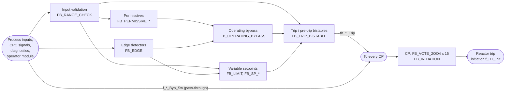

# Software Design Specification - Notional Four-Channel Reactor Protection System (function-block design)

> **STATUS: SYNTHETIC REFERENCE SPECIFICATION - NOT DERIVED FROM ANY PLANT DESIGN - NOT FOR OPERATIONAL, LICENSING OR SAFETY-CLASSIFIED USE WITHOUT FULL INDEPENDENT V&V**
>
> The design inherits every ILLUSTRATIVE placeholder constant of the requirements specification.

| Field | Value |
|---|---|
| Document ID | RPS-SDS-SYN-001 |
| Revision | 1 |
| Date | 2026-09-27 |
| Implements | NUSCR-RPS-SYN-001 (`spec/rps_nuscr_spec.json`) |
| Machine-readable source | `design/rps_design.json` (rps-design-json/2.0) |
| Generated by | `tools/render_design.py` - do not edit by hand |

## Contents

- [1. Scope](#1-scope)
- [2. Recommended design tool](#2-recommended-design-tool)
- [3. Design conventions and decisions](#3-design-conventions-and-decisions)
- [4. Data types](#4-data-types)
- [5. Architecture](#5-architecture)
- [6. Function block library](#6-function-block-library)
- [7. Module BP - Bistable Processor](#7-module-bp---bistable-processor)
- [8. Module CP - Coincidence Processor](#8-module-cp---coincidence-processor)
- [9. Traceability](#9-traceability)
- [10. Verification](#10-verification)
- [11. Open items for the implementation phase](#11-open-items-for-the-implementation-phase)

## 1. Scope

Function-block design of the bistable processor (BP) and coincidence processor (CP) software.  Code generation and implementation are out of scope.

The design refines the NuSCR requirements into reusable function blocks with explicit state.  Every design signal carries the name of the NuSCR variable it implements.  Every instance is proved equivalent to the NuSCR definition it implements (section 10).

## 2. Recommended design tool

**Ansys SCADE Suite**

Rationale:

- Synchronous dataflow with hierarchical state machines (Lustre semantics): one step per scan, the same execution model as the NuSCR requirements.  The single-assignment block bodies of this design map one-to-one onto SCADE equations (last_S is SCADE's last 'S).
- Editor, checker and simulator; Design Verifier for formal property proofs with counterexamples.
- Vendor documentation lists an IEC 60880 certification kit for specific versions of the KCG code generator (also qualifiable to DO-178C/DO-330 TQL-1 and certified for IEC 61508 SIL 3 and EN 50128).  Confirm that the kit covers the version to be used; these credentials matter only if the target platform accepts KCG-generated code.
- Nuclear heritage: SCADE's Lustre-based predecessor SAGA was developed for the SPIN protection system of the French N4 reactors, and the Spinline 3 engineering environment (CLARISSE) uses the SCADE editor.
- Design first, code later: the model is the design artefact; code generation is a separate, later step.

Conditions:

- If the safety I&C platform is already chosen, its qualified engineering tool is normally mandatory.  Such tools build applications from the vendor's pre-qualified function-block library, so each of the 12 blocks must be re-expressed with library primitives and each mapping checked, for example back-to-back against the NuSCR simulator.
- Tool qualification (IEC 60880 / IEEE 7-4.3.2) is required for the programme; a certification kit supports it but does not replace it.  Results from the SCADE simulator or Design Verifier are credited only if that use is qualified or independently checked.
- The exact tool version must be kept under configuration management and supported or archived for the plant lifetime.

Alternatives:

- Platform vendor engineering environments (e.g. those of TELEPERM XS, Common Q, Spinline 3): mandatory when the platform is fixed.
- MATLAB Simulink/Stateflow: capable, but less established on nuclear safety platforms; super-step semantics and time-based temporal operators need care.
- UML/SysML tools (e.g. IBM Rhapsody): suited to architecture, less to safety logic with exact scan semantics.

Mapping of design constructs:

| This design | SCADE Suite (Scade 6) | IEC 61131-3 |
|---|---|---|
| Function block (FB_*) | operator (node) | FUNCTION_BLOCK, or a composition of platform library blocks |
| State S with constant initial value | S declared with last = init | VAR S : T := init (not RETAIN) |
| last_S (previous-scan value of S) | last 'S | value of S at FB entry (read before S is assigned) |
| V := E | V = E; | V := E; |
| Conditional assignment of one variable | if-then-else expression (state machines, if used: strong transitions only, targets entered with restart) | IF/ELSIF/ELSE assigning that one variable |
| Scan counter CNT | CNT = if ... then last 'CNT + 1 else 0 | DINT counter (not TON) |
| Flag X; X = 1 / X = 0 | bool X; X / not X | BOOL X; X / NOT X |
| Module network | operator diagram | FBD program in one cyclic task |

## 3. Design conventions and decisions

- Synchronous scan: each module is one cyclic task with period k_Scan_Period; no instance runs in another task.  Inputs are sampled at the start of the scan and instances execute once, in the module execution order; every connection is a same-scan transfer (no implicit delays).
- Single assignment: in a block body every output, state variable and local is assigned exactly once per scan, in statement order.  last_S is the value of state variable S at the end of the previous scan; S read after its assignment is the current value.  Reading S before its assignment is not allowed.
- Signals are named after the NuSCR variable they implement, so every design signal can be compared scan by scan with the requirements model.
- Flags are carried as 1/0 in this notation and are BOOL in the tool (X = 1 means X is TRUE); see the data types section for the meaning of TRUE per type.  Trip, pre-trip and coincidence signals are TRUE = NORMAL (FALSE = TRIP, de-energize-to-trip); channel votes and FB_INITIATION.TRIPPED are positive logic (TRUE = trip vote / trip present).
- Persistence delays are scan counters: DELAY = delay / k_Scan_Period must be an integer >= 1 and equal to the requirements' TTS delay (both checked).  The requirements define delays in scans; a counter reproduces them exactly, while a clock-based TON timer can expire one scan later under scan-time jitter.  Either form stretches in wall-clock time on cycle overrun, so overrun must be detected (open items).
- Edge detectors start with PREV = TRUE, so a pushbutton held or stuck at power-up never produces a pulse.
- All initial values are constants.  Start values that depend on parameters (setpoint INIT / MAX) are applied on the first scan through a STARTED flag.
- All block state is non-retentive: every start (power-up, watchdog or processor restart, redundancy switchover) is a cold start that applies the initial values.  No RETAIN or PERSISTENT variables.
- Initial states are fail-safe: trip and pre-trip bistables start tripped (HOLD = TRUE), bypasses start removed, falling setpoints start at their maximum and rising setpoints at their minimum.
- Numeric representation: analog values and constants are 64-bit floating point (float64 / LREAL); scaled integers are not used, so intermediate arithmetic cannot overflow.  The design is verified with exact arithmetic; a boundary-value analysis of the floating-point implementation against it is required (open items).
- Block bodies are loop-free: every scan executes a fixed, statically known amount of work.

## 4. Data types

In the block bodies, flags are written as 1/0 (`X = 1` means X is TRUE).

| Type | SCADE | IEC 61131-3 | Meaning |
|---|---|---|---|
| `real` | `float64` | `LREAL` | Real value in engineering units. |
| `count` | `int32` | `DINT` | Non-negative scan count. |
| `bool` | `bool` | `BOOL` | TRUE when the named condition holds. |
| `valid_flag` | `bool` | `BOOL` | TRUE = VALID. |
| `permissive` | `bool` | `BOOL` | TRUE = bypass PERMITTED. |
| `bypass_status` | `bool` | `BOOL` | TRUE = BYPASSED. |
| `pushbutton` | `bool` | `BOOL` | TRUE = PRESSED. |
| `switch` | `bool` | `BOOL` | TRUE = trip channel BYPASS requested. |
| `pulse` | `bool` | `BOOL` | TRUE = PULSE (one scan). |
| `error_flag` | `bool` | `BOOL` | TRUE = ERROR. |
| `trip` | `bool` | `BOOL` | TRUE = NORMAL, FALSE = TRIP (de-energize-to-trip). |
| `pretrip` | `bool` | `BOOL` | TRUE = NORMAL, FALSE = PRETRIP. |
| `vote` | `bool` | `BOOL` | TRUE = TRIP_VOTE (positive logic). |

## 5. Architecture

Each channel runs the BP design; every CP receives the BP outputs of all four channels.  Within the BP the data flow is layered:



## 6. Function block library

Body notation (single assignment): every output, state variable and local is assigned exactly once per scan, in statement order.  `last_S` is the value of state variable S at the end of the previous scan; S read after its assignment is the current value.  `=` is equality, `&&` `||` `!` are logic operators.

### 6.1 `FB_RANGE_CHECK`

Input validity check: VALID while the analog value lies inside [MIN, MAX].

Implements the NuSCR SDT pattern f\_&lt;S>\_Valid.  Used by 10 instances.

| Kind | Name | Type | Description |
|---|---|---|---|
| input | `X` | `real` | Analog process value. |
| parameter | `MIN` | `real` | Lower limit of the valid range. |
| parameter | `MAX` | `real` | Upper limit of the valid range. |
| output | `VALID` | `valid_flag` | TRUE = valid. |

```text
VALID := X >= MIN && X <= MAX;
```

### 6.2 `FB_PERMISSIVE_ABOVE`

Operating-bypass permissive, rising: PERM while the input is valid and X >= LIM.

Implements the NuSCR SDT pattern f\_&lt;X>\_OB\_Perm (rising).  Used by 1 instance.

| Kind | Name | Type | Description |
|---|---|---|---|
| input | `VALID` | `valid_flag` | Validity of X. |
| input | `X` | `real` | Analog value. |
| parameter | `LIM` | `real` | Permissive threshold. |
| output | `PERM` | `permissive` | TRUE = bypass permitted. |

```text
PERM := VALID = 1 && X >= LIM;
```

### 6.3 `FB_PERMISSIVE_BELOW`

Operating-bypass permissive, falling: PERM while the input is valid and X &lt; LIM.

Implements the NuSCR SDT patterns f\_LP\_OB\_Perm and f\_&lt;X>\_OB\_Perm (falling).  Used by 4 instances.

| Kind | Name | Type | Description |
|---|---|---|---|
| input | `VALID` | `valid_flag` | Validity of X. |
| input | `X` | `real` | Analog value. |
| parameter | `LIM` | `real` | Permissive threshold. |
| output | `PERM` | `permissive` | TRUE = bypass permitted. |

```text
PERM := VALID = 1 && X < LIM;
```

### 6.4 `FB_EDGE`

Rising-edge detector: one-scan pulse per press.  PREV starts TRUE, so a pushbutton that is held or stuck at power-up is ignored until it has been seen released (an IEC 61131-3 R\_TRIG whose memory starts TRUE instead of the standard FALSE).

Implements the NuSCR FSM pattern h\_&lt;X>\_OB\_Pulse / h\_&lt;X>\_Reset\_Pulse.  Used by 11 instances.

| Kind | Name | Type | Description |
|---|---|---|---|
| input | `PB` | `pushbutton` | Pushbutton. |
| state | `PREV` | `pushbutton` | Pushbutton value in the previous scan. Initial value `1`. |
| output | `Q` | `pulse` | TRUE for exactly one scan per press. |

```text
Q := PB = 1 && last_PREV = 0;
PREV := PB;
```

### 6.5 `FB_OPERATING_BYPASS`

Operating bypass: reset-dominant latch, set by an initiation pulse while the permissive holds and reset in the first scan without permissive.  Starts removed.

Implements the NuSCR FSM pattern h\_&lt;X>\_OB\_Sta.  Used by 8 instances.

| Kind | Name | Type | Description |
|---|---|---|---|
| input | `PERM` | `permissive` | Bypass permissive. |
| input | `PULSE` | `pulse` | Initiation pulse from FB\_EDGE. |
| state | `MEM` | `bypass_status` | Bypass memory. Initial value `0`. |
| output | `Q` | `bypass_status` | TRUE = bypassed. |

```text
MEM := PERM = 1 && (last_MEM = 1 || PULSE = 1);
Q := MEM;
```

### 6.6 `FB_LIMIT`

Clamp: Q = MN if IN &lt;= MN, MX if IN >= MX, otherwise IN.

Implements the NuSCR SDT pattern f\_&lt;X>\_SP\_Target.  Used by 3 instances.

| Kind | Name | Type | Description |
|---|---|---|---|
| input | `IN` | `real` | Unconstrained value. |
| parameter | `MN` | `real` | Lower limit. |
| parameter | `MX` | `real` | Upper limit. |
| output | `Q` | `real` | Clamped value. |

```text
IF IN <= MN THEN Q := MN;
ELSIF IN >= MX THEN Q := MX;
ELSE Q := IN;
END_IF;
```

### 6.7 `FB_SP_RATE_UP`

Variable setpoint that follows a decreasing target at once and rises by at most STEP per scan.  It starts at INIT, is set to the target on the first scan with a valid input, and holds while the input is invalid.  The start value is applied on the first scan (STARTED) so that every state variable has a constant initial value.

Implements the NuSCR FSM pattern h\_&lt;X>\_Trip\_SP (rate-limited rising).  Used by 1 instance.

| Kind | Name | Type | Description |
|---|---|---|---|
| input | `VALID` | `valid_flag` | Validity of the process input. |
| input | `TGT` | `real` | Setpoint target from FB\_LIMIT. |
| parameter | `STEP` | `real` | Maximum rise per scan. |
| parameter | `INIT` | `real` | Setpoint value until the first valid scan. |
| state | `SP` | `real` | Setpoint. Initial value `0`. |
| state | `READY` | `bool` | TRUE once set from a valid input. Initial value `0`. |
| state | `STARTED` | `bool` | TRUE after the first scan. Initial value `0`. |
| local | `SP0` | `real` | Setpoint at the start of this scan. |
| output | `Q` | `real` | Setpoint. |

```text
IF last_STARTED = 0 THEN SP0 := INIT;
ELSE SP0 := last_SP;
END_IF;
IF VALID = 0 THEN SP := SP0;
ELSIF last_READY = 0 THEN SP := TGT;
ELSIF TGT <= SP0 THEN SP := TGT;
ELSIF TGT - SP0 <= STEP THEN SP := TGT;
ELSE SP := SP0 + STEP;
END_IF;
IF VALID = 1 THEN READY := 1;
ELSE READY := last_READY;
END_IF;
STARTED := 1;
Q := SP;
```

### 6.8 `FB_SP_RATE_DOWN`

Variable setpoint that follows an increasing target at once and falls by at most STEP per scan.  It starts at INIT, is set to the target on the first scan with a valid input, and holds while the input is invalid.

Implements the NuSCR FSM pattern h\_&lt;X>\_Trip\_SP (rate-limited falling).  Used by 2 instances.

| Kind | Name | Type | Description |
|---|---|---|---|
| input | `VALID` | `valid_flag` | Validity of the process input. |
| input | `TGT` | `real` | Setpoint target from FB\_LIMIT. |
| parameter | `STEP` | `real` | Maximum fall per scan. |
| parameter | `INIT` | `real` | Setpoint value until the first valid scan. |
| state | `SP` | `real` | Setpoint. Initial value `0`. |
| state | `READY` | `bool` | TRUE once set from a valid input. Initial value `0`. |
| state | `STARTED` | `bool` | TRUE after the first scan. Initial value `0`. |
| local | `SP0` | `real` | Setpoint at the start of this scan. |
| output | `Q` | `real` | Setpoint. |

```text
IF last_STARTED = 0 THEN SP0 := INIT;
ELSE SP0 := last_SP;
END_IF;
IF VALID = 0 THEN SP := SP0;
ELSIF last_READY = 0 THEN SP := TGT;
ELSIF TGT >= SP0 THEN SP := TGT;
ELSIF SP0 - TGT <= STEP THEN SP := TGT;
ELSE SP := SP0 - STEP;
END_IF;
IF VALID = 1 THEN READY := 1;
ELSE READY := last_READY;
END_IF;
STARTED := 1;
Q := SP;
```

### 6.9 `FB_SP_MANUAL_RESET`

Manually reset falling setpoint: starts at MAX, rises automatically to stay no more than BAND below X (up to MAX); each reset pulse lowers it to X - BAND (not below MIN).  Holds while the input is invalid.

Implements the NuSCR FSM pattern h\_&lt;X>\_Trip\_SP (manual reset).  Used by 3 instances.

| Kind | Name | Type | Description |
|---|---|---|---|
| input | `VALID` | `valid_flag` | Validity of X. |
| input | `X` | `real` | Process value. |
| input | `PULSE` | `pulse` | Reset pulse from FB\_EDGE. |
| parameter | `BAND` | `real` | Band below the process value. |
| parameter | `MIN` | `real` | Setpoint floor. |
| parameter | `MAX` | `real` | Setpoint ceiling. |
| state | `SP` | `real` | Setpoint. Initial value `0`. |
| state | `STARTED` | `bool` | TRUE after the first scan. Initial value `0`. |
| local | `SP0` | `real` | Setpoint at the start of this scan. |
| local | `D` | `real` | Process value minus band. |
| output | `Q` | `real` | Setpoint. |

```text
IF last_STARTED = 0 THEN SP0 := MAX;
ELSE SP0 := last_SP;
END_IF;
D := X - BAND;
IF VALID = 0 THEN SP := SP0;
ELSIF D > SP0 && D <= MAX THEN SP := D;
ELSIF D > MAX && SP0 < MAX THEN SP := MAX;
ELSIF PULSE = 1 && D < SP0 && D >= MIN THEN SP := D;
ELSIF PULSE = 1 && D < MIN && SP0 > MIN THEN SP := MIN;
ELSE SP := SP0;
END_IF;
STARTED := 1;
Q := SP;
```

### 6.10 `FB_TRIP_BISTABLE`

Trip (or pre-trip) bistable with persistence counter, hysteresis latch and fail-safe error handling.  LATCH holds a process trip: it is kept through errors and released only by RESET or BYP in an error-free scan.  HOLD keeps the output tripped after an error or at start-up until the condition clears or has persisted for DELAY scans.  TIMING and CNT count the persistence of the arming condition in scans (CNT stays in [0, DELAY - 1]).

Implements the NuSCR TTS pattern th\_&lt;X>\_Trip / th\_&lt;X>\_Pretrip.  Used by 30 instances.

| Kind | Name | Type | Description |
|---|---|---|---|
| input | `OK` | `bool` | TRUE = no error of the function. |
| input | `BYP` | `bypass_status` | Operating bypass active (FALSE for functions without bypass). |
| input | `COND` | `bool` | Trip (pre-trip) condition. |
| input | `RESET` | `bool` | Recovered past the setpoint by more than the hysteresis. |
| parameter | `DELAY` | `count` | Persistence delay in scans (delay constant / scan period). |
| state | `LATCH` | `bool` | Process trip latched. Initial value `0`. |
| state | `HOLD` | `bool` | Output held tripped after an error or at start-up. Initial value `1`. |
| state | `TIMING` | `bool` | Persistence being timed. Initial value `0`. |
| state | `CNT` | `count` | Scans the arming condition has persisted since timing started. Initial value `0`. |
| local | `ARM` | `bool` | Arming condition: no error, no bypass, condition present. |
| local | `REL` | `bool` | Release condition of a latched process trip. |
| local | `FIRE` | `bool` | Persistence delay completed in this scan. |
| output | `Q` | `trip` | TRUE = NORMAL, FALSE = TRIP. |

```text
ARM := OK = 1 && BYP = 0 && COND = 1;
REL := OK = 1 && (BYP = 1 || RESET = 1);
FIRE := OK = 1 && last_LATCH = 0 && ARM = 1 && last_TIMING = 1 && last_CNT + 1 >= DELAY;
IF OK = 0 THEN LATCH := last_LATCH;
ELSIF last_LATCH = 1 && REL = 1 THEN LATCH := 0;
ELSIF last_LATCH = 1 THEN LATCH := 1;
ELSIF FIRE = 1 THEN LATCH := 1;
ELSE LATCH := 0;
END_IF;
IF OK = 0 && last_LATCH = 0 THEN HOLD := 1;
ELSIF OK = 0 THEN HOLD := last_HOLD;
ELSIF last_LATCH = 1 && REL = 1 THEN HOLD := 0;
ELSIF last_LATCH = 1 THEN HOLD := last_HOLD;
ELSIF ARM = 0 THEN HOLD := 0;
ELSIF FIRE = 1 THEN HOLD := 0;
ELSE HOLD := last_HOLD;
END_IF;
IF OK = 0 THEN TIMING := 0;
ELSIF last_LATCH = 1 THEN TIMING := last_TIMING;
ELSIF ARM = 0 THEN TIMING := 0;
ELSIF FIRE = 1 THEN TIMING := 0;
ELSE TIMING := 1;
END_IF;
IF OK = 0 THEN CNT := 0;
ELSIF last_LATCH = 1 THEN CNT := last_CNT;
ELSIF ARM = 0 THEN CNT := 0;
ELSIF FIRE = 1 THEN CNT := 0;
ELSIF last_TIMING = 1 THEN CNT := last_CNT + 1;
ELSE CNT := 0;
END_IF;
Q := LATCH = 0 && HOLD = 0;
```

### 6.11 `FB_VOTE_2OO4`

2-out-of-4 coincidence with trip channel bypass (2-out-of-3 when exactly one channel requests bypass; all requests ignored when two or more do) and failed links counted as trip votes.  Pure boolean logic, no arithmetic.

Implements the NuSCR SDT group f\_&lt;X>\_Byp\_Cnt, f\_&lt;X>\_Vote\_&lt;c>, f\_&lt;X>\_Vote\_Cnt, f\_&lt;X>\_Coinc.  Used by 15 instances.

| Kind | Name | Type | Description |
|---|---|---|---|
| input | `TRIP_A` | `trip` | Trip of channel A (FALSE = TRIP). |
| input | `TRIP_B` | `trip` | Trip of channel B (FALSE = TRIP). |
| input | `TRIP_C` | `trip` | Trip of channel C (FALSE = TRIP). |
| input | `TRIP_D` | `trip` | Trip of channel D (FALSE = TRIP). |
| input | `BYP_A` | `switch` | Trip channel bypass request of channel A. |
| input | `BYP_B` | `switch` | Trip channel bypass request of channel B. |
| input | `BYP_C` | `switch` | Trip channel bypass request of channel C. |
| input | `BYP_D` | `switch` | Trip channel bypass request of channel D. |
| input | `LINK_A` | `error_flag` | Data-link failure of channel A. |
| input | `LINK_B` | `error_flag` | Data-link failure of channel B. |
| input | `LINK_C` | `error_flag` | Data-link failure of channel C. |
| input | `LINK_D` | `error_flag` | Data-link failure of channel D. |
| local | `ONE_BYP` | `bool` | Exactly one channel requests bypass. |
| local | `V_A` | `vote` | Channel A votes to trip (positive logic). |
| local | `V_B` | `vote` | Channel B votes to trip (positive logic). |
| local | `V_C` | `vote` | Channel C votes to trip (positive logic). |
| local | `V_D` | `vote` | Channel D votes to trip (positive logic). |
| output | `COINC` | `trip` | TRUE = NORMAL, FALSE = coincidence trip. |

```text
ONE_BYP := (BYP_A = 1 && BYP_B = 0 && BYP_C = 0 && BYP_D = 0) || (BYP_A = 0 && BYP_B = 1 && BYP_C = 0 && BYP_D = 0) || (BYP_A = 0 && BYP_B = 0 && BYP_C = 1 && BYP_D = 0) || (BYP_A = 0 && BYP_B = 0 && BYP_C = 0 && BYP_D = 1);
V_A := !(BYP_A = 1 && ONE_BYP = 1) && (TRIP_A = 0 || LINK_A = 1);
V_B := !(BYP_B = 1 && ONE_BYP = 1) && (TRIP_B = 0 || LINK_B = 1);
V_C := !(BYP_C = 1 && ONE_BYP = 1) && (TRIP_C = 0 || LINK_C = 1);
V_D := !(BYP_D = 1 && ONE_BYP = 1) && (TRIP_D = 0 || LINK_D = 1);
COINC := !((V_A = 1 && V_B = 1) || (V_A = 1 && V_C = 1) || (V_A = 1 && V_D = 1) || (V_B = 1 && V_C = 1) || (V_B = 1 && V_D = 1) || (V_C = 1 && V_D = 1));
```

### 6.12 `FB_INITIATION`

Reactor trip initiation: Q is FALSE (initiate) when any coincidence trip is present.

Implements the NuSCR SDT f\_RT\_Init.  Used by 1 instance.

| Kind | Name | Type | Description |
|---|---|---|---|
| input | `TRIPPED` | `bool` | At least one coincidence trip (positive logic). |
| output | `Q` | `trip` | TRUE = NORMAL, FALSE = initiate reactor trip. |

```text
Q := TRIPPED = 0;
```

## 7. Module BP - Bistable Processor

Per-channel design: input validation, shared permissive, then for each trip function the bypass, setpoint and bistable blocks.  Signals carry the names of the NuSCR variables they implement.

Interface: Outputs sent to every coincidence processor: the trip signals th\_&lt;X>\_Trip (through FB\_TRIP\_BISTABLE) and the trip channel bypass switches f\_&lt;X>\_Byp\_Sw, which are BP inputs passed through unchanged (no block).  The pre-trip alarms, operating-bypass status and variable setpoints are indication outputs and are not sent to the CPs.

### 7.1 `g_Input_Validation`

| Instance | Block | Parameters | Inputs | Outputs |
|---|---|---|---|---|
| `VAL_NPWR_LIN` | `FB_RANGE_CHECK` | `MIN` = `k_NPWR_LIN_Valid_Min`<br/>`MAX` = `k_NPWR_LIN_Valid_Max` | `X` = `f_NPWR_LIN` | `VALID` -> `f_NPWR_LIN_Valid` |
| `VAL_NPWR_LOG` | `FB_RANGE_CHECK` | `MIN` = `k_NPWR_LOG_Valid_Min`<br/>`MAX` = `k_NPWR_LOG_Valid_Max` | `X` = `f_NPWR_LOG` | `VALID` -> `f_NPWR_LOG_Valid` |
| `VAL_PZR_P` | `FB_RANGE_CHECK` | `MIN` = `k_PZR_P_Valid_Min`<br/>`MAX` = `k_PZR_P_Valid_Max` | `X` = `f_PZR_P` | `VALID` -> `f_PZR_P_Valid` |
| `VAL_SG1_L` | `FB_RANGE_CHECK` | `MIN` = `k_SG1_L_Valid_Min`<br/>`MAX` = `k_SG1_L_Valid_Max` | `X` = `f_SG1_L` | `VALID` -> `f_SG1_L_Valid` |
| `VAL_SG2_L` | `FB_RANGE_CHECK` | `MIN` = `k_SG2_L_Valid_Min`<br/>`MAX` = `k_SG2_L_Valid_Max` | `X` = `f_SG2_L` | `VALID` -> `f_SG2_L_Valid` |
| `VAL_SG1_P` | `FB_RANGE_CHECK` | `MIN` = `k_SG1_P_Valid_Min`<br/>`MAX` = `k_SG1_P_Valid_Max` | `X` = `f_SG1_P` | `VALID` -> `f_SG1_P_Valid` |
| `VAL_SG2_P` | `FB_RANGE_CHECK` | `MIN` = `k_SG2_P_Valid_Min`<br/>`MAX` = `k_SG2_P_Valid_Max` | `X` = `f_SG2_P` | `VALID` -> `f_SG2_P_Valid` |
| `VAL_CTMT_P` | `FB_RANGE_CHECK` | `MIN` = `k_CTMT_P_Valid_Min`<br/>`MAX` = `k_CTMT_P_Valid_Max` | `X` = `f_CTMT_P` | `VALID` -> `f_CTMT_P_Valid` |
| `VAL_SG1_F` | `FB_RANGE_CHECK` | `MIN` = `k_SG1_F_Valid_Min`<br/>`MAX` = `k_SG1_F_Valid_Max` | `X` = `f_SG1_F` | `VALID` -> `f_SG1_F_Valid` |
| `VAL_SG2_F` | `FB_RANGE_CHECK` | `MIN` = `k_SG2_F_Valid_Min`<br/>`MAX` = `k_SG2_F_Valid_Max` | `X` = `f_SG2_F` | `VALID` -> `f_SG2_F_Valid` |

### 7.2 `g_Permissives`

| Instance | Block | Parameters | Inputs | Outputs |
|---|---|---|---|---|
| `LP_PERM` | `FB_PERMISSIVE_BELOW` | `LIM` = `k_LP_OB_Perm` | `VALID` = `f_NPWR_LOG_Valid`<br/>`X` = `f_NPWR_LOG` | `PERM` -> `f_LP_OB_Perm` |

### 7.3 `g_VOPT`

| Instance | Block | Parameters | Inputs | Outputs |
|---|---|---|---|---|
| `VOPT_SP_TGT` | `FB_LIMIT` | `MN` = `k_VOPT_SP_Min`<br/>`MX` = `k_VOPT_SP_Max` | `IN` = `f_NPWR_LIN + k_VOPT_Band` | `Q` -> `f_VOPT_SP_Target` |
| `VOPT_SP` | `FB_SP_RATE_UP` | `STEP` = `k_VOPT_SP_Step`<br/>`INIT` = `k_VOPT_SP_Min` | `VALID` = `f_NPWR_LIN_Valid`<br/>`TGT` = `f_VOPT_SP_Target` | `Q` -> `h_VOPT_Trip_SP` |
| `VOPT_PRETRIP` | `FB_TRIP_BISTABLE` | `DELAY` = `k_VOPT_Pretrip_Delay / k_Scan_Period` = 2 | `OK` = `f_NPWR_LIN_Valid = 1 && f_Module_Error = 0 && f_Channel_Error = 0`<br/>`BYP` = `0`<br/>`COND` = `f_NPWR_LIN >= h_VOPT_Trip_SP - k_VOPT_Pretrip_Margin`<br/>`RESET` = `f_NPWR_LIN < h_VOPT_Trip_SP - k_VOPT_Pretrip_Margin - k_VOPT_Pretrip_Hys` | `Q` -> `th_VOPT_Pretrip` |
| `VOPT_TRIP` | `FB_TRIP_BISTABLE` | `DELAY` = `k_VOPT_Trip_Delay / k_Scan_Period` = 2 | `OK` = `f_NPWR_LIN_Valid = 1 && f_Module_Error = 0 && f_Channel_Error = 0`<br/>`BYP` = `0`<br/>`COND` = `f_NPWR_LIN >= h_VOPT_Trip_SP`<br/>`RESET` = `f_NPWR_LIN < h_VOPT_Trip_SP - k_VOPT_Trip_Hys` | `Q` -> `th_VOPT_Trip` |

### 7.4 `g_LOGP_HI`

| Instance | Block | Parameters | Inputs | Outputs |
|---|---|---|---|---|
| `LOGP_HI_OB_PERM` | `FB_PERMISSIVE_ABOVE` | `LIM` = `k_LOGP_HI_OB_Perm` | `VALID` = `f_NPWR_LOG_Valid`<br/>`X` = `f_NPWR_LOG` | `PERM` -> `f_LOGP_HI_OB_Perm` |
| `LOGP_HI_OB_EDGE` | `FB_EDGE` |  | `PB` = `f_LOGP_HI_OB_Ini` | `Q` -> `h_LOGP_HI_OB_Pulse` |
| `LOGP_HI_OB` | `FB_OPERATING_BYPASS` |  | `PERM` = `f_LOGP_HI_OB_Perm`<br/>`PULSE` = `h_LOGP_HI_OB_Pulse` | `Q` -> `h_LOGP_HI_OB_Sta` |
| `LOGP_HI_PRETRIP` | `FB_TRIP_BISTABLE` | `DELAY` = `k_LOGP_HI_Pretrip_Delay / k_Scan_Period` = 2 | `OK` = `f_NPWR_LOG_Valid = 1 && f_Module_Error = 0 && f_Channel_Error = 0`<br/>`BYP` = `h_LOGP_HI_OB_Sta`<br/>`COND` = `f_NPWR_LOG >= k_LOGP_HI_Pretrip_SP`<br/>`RESET` = `f_NPWR_LOG < k_LOGP_HI_Pretrip_SP - k_LOGP_HI_Pretrip_Hys` | `Q` -> `th_LOGP_HI_Pretrip` |
| `LOGP_HI_TRIP` | `FB_TRIP_BISTABLE` | `DELAY` = `k_LOGP_HI_Trip_Delay / k_Scan_Period` = 2 | `OK` = `f_NPWR_LOG_Valid = 1 && f_Module_Error = 0 && f_Channel_Error = 0`<br/>`BYP` = `h_LOGP_HI_OB_Sta`<br/>`COND` = `f_NPWR_LOG >= k_LOGP_HI_Trip_SP`<br/>`RESET` = `f_NPWR_LOG < k_LOGP_HI_Trip_SP - k_LOGP_HI_Trip_Hys` | `Q` -> `th_LOGP_HI_Trip` |

### 7.5 `g_LPD_HI`

| Instance | Block | Parameters | Inputs | Outputs |
|---|---|---|---|---|
| `LPD_HI_OB_EDGE` | `FB_EDGE` |  | `PB` = `f_LPD_HI_OB_Ini` | `Q` -> `h_LPD_HI_OB_Pulse` |
| `LPD_HI_OB` | `FB_OPERATING_BYPASS` |  | `PERM` = `f_LP_OB_Perm`<br/>`PULSE` = `h_LPD_HI_OB_Pulse` | `Q` -> `h_LPD_HI_OB_Sta` |
| `LPD_HI_PRETRIP` | `FB_TRIP_BISTABLE` | `DELAY` = `k_LPD_HI_Pretrip_Delay / k_Scan_Period` = 2 | `OK` = `f_CPC_Link_Error = 0 && f_Module_Error = 0 && f_Channel_Error = 0`<br/>`BYP` = `h_LPD_HI_OB_Sta`<br/>`COND` = `f_LPD_HI_Pretrip_In = 0`<br/>`RESET` = `f_LPD_HI_Pretrip_In = 1` | `Q` -> `th_LPD_HI_Pretrip` |
| `LPD_HI_TRIP` | `FB_TRIP_BISTABLE` | `DELAY` = `k_LPD_HI_Trip_Delay / k_Scan_Period` = 2 | `OK` = `f_CPC_Link_Error = 0 && f_Module_Error = 0 && f_Channel_Error = 0`<br/>`BYP` = `h_LPD_HI_OB_Sta`<br/>`COND` = `f_LPD_HI_Trip_In = 0`<br/>`RESET` = `f_LPD_HI_Trip_In = 1` | `Q` -> `th_LPD_HI_Trip` |

### 7.6 `g_DNBR_LO`

| Instance | Block | Parameters | Inputs | Outputs |
|---|---|---|---|---|
| `DNBR_LO_OB_EDGE` | `FB_EDGE` |  | `PB` = `f_DNBR_LO_OB_Ini` | `Q` -> `h_DNBR_LO_OB_Pulse` |
| `DNBR_LO_OB` | `FB_OPERATING_BYPASS` |  | `PERM` = `f_LP_OB_Perm`<br/>`PULSE` = `h_DNBR_LO_OB_Pulse` | `Q` -> `h_DNBR_LO_OB_Sta` |
| `DNBR_LO_PRETRIP` | `FB_TRIP_BISTABLE` | `DELAY` = `k_DNBR_LO_Pretrip_Delay / k_Scan_Period` = 2 | `OK` = `f_CPC_Link_Error = 0 && f_Module_Error = 0 && f_Channel_Error = 0`<br/>`BYP` = `h_DNBR_LO_OB_Sta`<br/>`COND` = `f_DNBR_LO_Pretrip_In = 0`<br/>`RESET` = `f_DNBR_LO_Pretrip_In = 1` | `Q` -> `th_DNBR_LO_Pretrip` |
| `DNBR_LO_TRIP` | `FB_TRIP_BISTABLE` | `DELAY` = `k_DNBR_LO_Trip_Delay / k_Scan_Period` = 2 | `OK` = `f_CPC_Link_Error = 0 && f_Module_Error = 0 && f_Channel_Error = 0`<br/>`BYP` = `h_DNBR_LO_OB_Sta`<br/>`COND` = `f_DNBR_LO_Trip_In = 0`<br/>`RESET` = `f_DNBR_LO_Trip_In = 1` | `Q` -> `th_DNBR_LO_Trip` |

### 7.7 `g_PZR_P_HI`

| Instance | Block | Parameters | Inputs | Outputs |
|---|---|---|---|---|
| `PZR_P_HI_PRETRIP` | `FB_TRIP_BISTABLE` | `DELAY` = `k_PZR_P_HI_Pretrip_Delay / k_Scan_Period` = 2 | `OK` = `f_PZR_P_Valid = 1 && f_Module_Error = 0 && f_Channel_Error = 0`<br/>`BYP` = `0`<br/>`COND` = `f_PZR_P >= k_PZR_P_HI_Pretrip_SP`<br/>`RESET` = `f_PZR_P < k_PZR_P_HI_Pretrip_SP - k_PZR_P_HI_Pretrip_Hys` | `Q` -> `th_PZR_P_HI_Pretrip` |
| `PZR_P_HI_TRIP` | `FB_TRIP_BISTABLE` | `DELAY` = `k_PZR_P_HI_Trip_Delay / k_Scan_Period` = 2 | `OK` = `f_PZR_P_Valid = 1 && f_Module_Error = 0 && f_Channel_Error = 0`<br/>`BYP` = `0`<br/>`COND` = `f_PZR_P >= k_PZR_P_HI_Trip_SP`<br/>`RESET` = `f_PZR_P < k_PZR_P_HI_Trip_SP - k_PZR_P_HI_Trip_Hys` | `Q` -> `th_PZR_P_HI_Trip` |

### 7.8 `g_PZR_P_LO`

| Instance | Block | Parameters | Inputs | Outputs |
|---|---|---|---|---|
| `PZR_P_LO_OB_PERM` | `FB_PERMISSIVE_BELOW` | `LIM` = `k_PZR_P_LO_OB_Perm` | `VALID` = `f_PZR_P_Valid`<br/>`X` = `f_PZR_P` | `PERM` -> `f_PZR_P_LO_OB_Perm` |
| `PZR_P_LO_OB_EDGE` | `FB_EDGE` |  | `PB` = `f_PZR_P_LO_OB_Ini` | `Q` -> `h_PZR_P_LO_OB_Pulse` |
| `PZR_P_LO_OB` | `FB_OPERATING_BYPASS` |  | `PERM` = `f_PZR_P_LO_OB_Perm`<br/>`PULSE` = `h_PZR_P_LO_OB_Pulse` | `Q` -> `h_PZR_P_LO_OB_Sta` |
| `PZR_P_LO_RST_EDGE` | `FB_EDGE` |  | `PB` = `f_PZR_P_LO_SP_Reset` | `Q` -> `h_PZR_P_LO_Reset_Pulse` |
| `PZR_P_LO_SP` | `FB_SP_MANUAL_RESET` | `BAND` = `k_PZR_P_LO_Band`<br/>`MIN` = `k_PZR_P_LO_SP_Min`<br/>`MAX` = `k_PZR_P_LO_SP_Max` | `VALID` = `f_PZR_P_Valid`<br/>`X` = `f_PZR_P`<br/>`PULSE` = `h_PZR_P_LO_Reset_Pulse` | `Q` -> `h_PZR_P_LO_Trip_SP` |
| `PZR_P_LO_PRETRIP` | `FB_TRIP_BISTABLE` | `DELAY` = `k_PZR_P_LO_Pretrip_Delay / k_Scan_Period` = 2 | `OK` = `f_PZR_P_Valid = 1 && f_Module_Error = 0 && f_Channel_Error = 0`<br/>`BYP` = `h_PZR_P_LO_OB_Sta`<br/>`COND` = `f_PZR_P <= h_PZR_P_LO_Trip_SP + k_PZR_P_LO_Pretrip_Margin`<br/>`RESET` = `f_PZR_P > h_PZR_P_LO_Trip_SP + k_PZR_P_LO_Pretrip_Margin + k_PZR_P_LO_Pretrip_Hys` | `Q` -> `th_PZR_P_LO_Pretrip` |
| `PZR_P_LO_TRIP` | `FB_TRIP_BISTABLE` | `DELAY` = `k_PZR_P_LO_Trip_Delay / k_Scan_Period` = 2 | `OK` = `f_PZR_P_Valid = 1 && f_Module_Error = 0 && f_Channel_Error = 0`<br/>`BYP` = `h_PZR_P_LO_OB_Sta`<br/>`COND` = `f_PZR_P <= h_PZR_P_LO_Trip_SP`<br/>`RESET` = `f_PZR_P > h_PZR_P_LO_Trip_SP + k_PZR_P_LO_Trip_Hys` | `Q` -> `th_PZR_P_LO_Trip` |

### 7.9 `g_SG1_L_LO`

| Instance | Block | Parameters | Inputs | Outputs |
|---|---|---|---|---|
| `SG1_L_LO_PRETRIP` | `FB_TRIP_BISTABLE` | `DELAY` = `k_SG1_L_LO_Pretrip_Delay / k_Scan_Period` = 2 | `OK` = `f_SG1_L_Valid = 1 && f_Module_Error = 0 && f_Channel_Error = 0`<br/>`BYP` = `0`<br/>`COND` = `f_SG1_L <= k_SG1_L_LO_Pretrip_SP`<br/>`RESET` = `f_SG1_L > k_SG1_L_LO_Pretrip_SP + k_SG1_L_LO_Pretrip_Hys` | `Q` -> `th_SG1_L_LO_Pretrip` |
| `SG1_L_LO_TRIP` | `FB_TRIP_BISTABLE` | `DELAY` = `k_SG1_L_LO_Trip_Delay / k_Scan_Period` = 2 | `OK` = `f_SG1_L_Valid = 1 && f_Module_Error = 0 && f_Channel_Error = 0`<br/>`BYP` = `0`<br/>`COND` = `f_SG1_L <= k_SG1_L_LO_Trip_SP`<br/>`RESET` = `f_SG1_L > k_SG1_L_LO_Trip_SP + k_SG1_L_LO_Trip_Hys` | `Q` -> `th_SG1_L_LO_Trip` |

### 7.10 `g_SG2_L_LO`

| Instance | Block | Parameters | Inputs | Outputs |
|---|---|---|---|---|
| `SG2_L_LO_PRETRIP` | `FB_TRIP_BISTABLE` | `DELAY` = `k_SG2_L_LO_Pretrip_Delay / k_Scan_Period` = 2 | `OK` = `f_SG2_L_Valid = 1 && f_Module_Error = 0 && f_Channel_Error = 0`<br/>`BYP` = `0`<br/>`COND` = `f_SG2_L <= k_SG2_L_LO_Pretrip_SP`<br/>`RESET` = `f_SG2_L > k_SG2_L_LO_Pretrip_SP + k_SG2_L_LO_Pretrip_Hys` | `Q` -> `th_SG2_L_LO_Pretrip` |
| `SG2_L_LO_TRIP` | `FB_TRIP_BISTABLE` | `DELAY` = `k_SG2_L_LO_Trip_Delay / k_Scan_Period` = 2 | `OK` = `f_SG2_L_Valid = 1 && f_Module_Error = 0 && f_Channel_Error = 0`<br/>`BYP` = `0`<br/>`COND` = `f_SG2_L <= k_SG2_L_LO_Trip_SP`<br/>`RESET` = `f_SG2_L > k_SG2_L_LO_Trip_SP + k_SG2_L_LO_Trip_Hys` | `Q` -> `th_SG2_L_LO_Trip` |

### 7.11 `g_SG1_L_HI`

| Instance | Block | Parameters | Inputs | Outputs |
|---|---|---|---|---|
| `SG1_L_HI_PRETRIP` | `FB_TRIP_BISTABLE` | `DELAY` = `k_SG1_L_HI_Pretrip_Delay / k_Scan_Period` = 2 | `OK` = `f_SG1_L_Valid = 1 && f_Module_Error = 0 && f_Channel_Error = 0`<br/>`BYP` = `0`<br/>`COND` = `f_SG1_L >= k_SG1_L_HI_Pretrip_SP`<br/>`RESET` = `f_SG1_L < k_SG1_L_HI_Pretrip_SP - k_SG1_L_HI_Pretrip_Hys` | `Q` -> `th_SG1_L_HI_Pretrip` |
| `SG1_L_HI_TRIP` | `FB_TRIP_BISTABLE` | `DELAY` = `k_SG1_L_HI_Trip_Delay / k_Scan_Period` = 2 | `OK` = `f_SG1_L_Valid = 1 && f_Module_Error = 0 && f_Channel_Error = 0`<br/>`BYP` = `0`<br/>`COND` = `f_SG1_L >= k_SG1_L_HI_Trip_SP`<br/>`RESET` = `f_SG1_L < k_SG1_L_HI_Trip_SP - k_SG1_L_HI_Trip_Hys` | `Q` -> `th_SG1_L_HI_Trip` |

### 7.12 `g_SG2_L_HI`

| Instance | Block | Parameters | Inputs | Outputs |
|---|---|---|---|---|
| `SG2_L_HI_PRETRIP` | `FB_TRIP_BISTABLE` | `DELAY` = `k_SG2_L_HI_Pretrip_Delay / k_Scan_Period` = 2 | `OK` = `f_SG2_L_Valid = 1 && f_Module_Error = 0 && f_Channel_Error = 0`<br/>`BYP` = `0`<br/>`COND` = `f_SG2_L >= k_SG2_L_HI_Pretrip_SP`<br/>`RESET` = `f_SG2_L < k_SG2_L_HI_Pretrip_SP - k_SG2_L_HI_Pretrip_Hys` | `Q` -> `th_SG2_L_HI_Pretrip` |
| `SG2_L_HI_TRIP` | `FB_TRIP_BISTABLE` | `DELAY` = `k_SG2_L_HI_Trip_Delay / k_Scan_Period` = 2 | `OK` = `f_SG2_L_Valid = 1 && f_Module_Error = 0 && f_Channel_Error = 0`<br/>`BYP` = `0`<br/>`COND` = `f_SG2_L >= k_SG2_L_HI_Trip_SP`<br/>`RESET` = `f_SG2_L < k_SG2_L_HI_Trip_SP - k_SG2_L_HI_Trip_Hys` | `Q` -> `th_SG2_L_HI_Trip` |

### 7.13 `g_SG1_P_LO`

| Instance | Block | Parameters | Inputs | Outputs |
|---|---|---|---|---|
| `SG1_P_LO_OB_PERM` | `FB_PERMISSIVE_BELOW` | `LIM` = `k_SG1_P_LO_OB_Perm` | `VALID` = `f_SG1_P_Valid`<br/>`X` = `f_SG1_P` | `PERM` -> `f_SG1_P_LO_OB_Perm` |
| `SG1_P_LO_OB_EDGE` | `FB_EDGE` |  | `PB` = `f_SG1_P_LO_OB_Ini` | `Q` -> `h_SG1_P_LO_OB_Pulse` |
| `SG1_P_LO_OB` | `FB_OPERATING_BYPASS` |  | `PERM` = `f_SG1_P_LO_OB_Perm`<br/>`PULSE` = `h_SG1_P_LO_OB_Pulse` | `Q` -> `h_SG1_P_LO_OB_Sta` |
| `SG1_P_LO_RST_EDGE` | `FB_EDGE` |  | `PB` = `f_SG1_P_LO_SP_Reset` | `Q` -> `h_SG1_P_LO_Reset_Pulse` |
| `SG1_P_LO_SP` | `FB_SP_MANUAL_RESET` | `BAND` = `k_SG1_P_LO_Band`<br/>`MIN` = `k_SG1_P_LO_SP_Min`<br/>`MAX` = `k_SG1_P_LO_SP_Max` | `VALID` = `f_SG1_P_Valid`<br/>`X` = `f_SG1_P`<br/>`PULSE` = `h_SG1_P_LO_Reset_Pulse` | `Q` -> `h_SG1_P_LO_Trip_SP` |
| `SG1_P_LO_PRETRIP` | `FB_TRIP_BISTABLE` | `DELAY` = `k_SG1_P_LO_Pretrip_Delay / k_Scan_Period` = 2 | `OK` = `f_SG1_P_Valid = 1 && f_Module_Error = 0 && f_Channel_Error = 0`<br/>`BYP` = `h_SG1_P_LO_OB_Sta`<br/>`COND` = `f_SG1_P <= h_SG1_P_LO_Trip_SP + k_SG1_P_LO_Pretrip_Margin`<br/>`RESET` = `f_SG1_P > h_SG1_P_LO_Trip_SP + k_SG1_P_LO_Pretrip_Margin + k_SG1_P_LO_Pretrip_Hys` | `Q` -> `th_SG1_P_LO_Pretrip` |
| `SG1_P_LO_TRIP` | `FB_TRIP_BISTABLE` | `DELAY` = `k_SG1_P_LO_Trip_Delay / k_Scan_Period` = 2 | `OK` = `f_SG1_P_Valid = 1 && f_Module_Error = 0 && f_Channel_Error = 0`<br/>`BYP` = `h_SG1_P_LO_OB_Sta`<br/>`COND` = `f_SG1_P <= h_SG1_P_LO_Trip_SP`<br/>`RESET` = `f_SG1_P > h_SG1_P_LO_Trip_SP + k_SG1_P_LO_Trip_Hys` | `Q` -> `th_SG1_P_LO_Trip` |

### 7.14 `g_SG2_P_LO`

| Instance | Block | Parameters | Inputs | Outputs |
|---|---|---|---|---|
| `SG2_P_LO_OB_PERM` | `FB_PERMISSIVE_BELOW` | `LIM` = `k_SG2_P_LO_OB_Perm` | `VALID` = `f_SG2_P_Valid`<br/>`X` = `f_SG2_P` | `PERM` -> `f_SG2_P_LO_OB_Perm` |
| `SG2_P_LO_OB_EDGE` | `FB_EDGE` |  | `PB` = `f_SG2_P_LO_OB_Ini` | `Q` -> `h_SG2_P_LO_OB_Pulse` |
| `SG2_P_LO_OB` | `FB_OPERATING_BYPASS` |  | `PERM` = `f_SG2_P_LO_OB_Perm`<br/>`PULSE` = `h_SG2_P_LO_OB_Pulse` | `Q` -> `h_SG2_P_LO_OB_Sta` |
| `SG2_P_LO_RST_EDGE` | `FB_EDGE` |  | `PB` = `f_SG2_P_LO_SP_Reset` | `Q` -> `h_SG2_P_LO_Reset_Pulse` |
| `SG2_P_LO_SP` | `FB_SP_MANUAL_RESET` | `BAND` = `k_SG2_P_LO_Band`<br/>`MIN` = `k_SG2_P_LO_SP_Min`<br/>`MAX` = `k_SG2_P_LO_SP_Max` | `VALID` = `f_SG2_P_Valid`<br/>`X` = `f_SG2_P`<br/>`PULSE` = `h_SG2_P_LO_Reset_Pulse` | `Q` -> `h_SG2_P_LO_Trip_SP` |
| `SG2_P_LO_PRETRIP` | `FB_TRIP_BISTABLE` | `DELAY` = `k_SG2_P_LO_Pretrip_Delay / k_Scan_Period` = 2 | `OK` = `f_SG2_P_Valid = 1 && f_Module_Error = 0 && f_Channel_Error = 0`<br/>`BYP` = `h_SG2_P_LO_OB_Sta`<br/>`COND` = `f_SG2_P <= h_SG2_P_LO_Trip_SP + k_SG2_P_LO_Pretrip_Margin`<br/>`RESET` = `f_SG2_P > h_SG2_P_LO_Trip_SP + k_SG2_P_LO_Pretrip_Margin + k_SG2_P_LO_Pretrip_Hys` | `Q` -> `th_SG2_P_LO_Pretrip` |
| `SG2_P_LO_TRIP` | `FB_TRIP_BISTABLE` | `DELAY` = `k_SG2_P_LO_Trip_Delay / k_Scan_Period` = 2 | `OK` = `f_SG2_P_Valid = 1 && f_Module_Error = 0 && f_Channel_Error = 0`<br/>`BYP` = `h_SG2_P_LO_OB_Sta`<br/>`COND` = `f_SG2_P <= h_SG2_P_LO_Trip_SP`<br/>`RESET` = `f_SG2_P > h_SG2_P_LO_Trip_SP + k_SG2_P_LO_Trip_Hys` | `Q` -> `th_SG2_P_LO_Trip` |

### 7.15 `g_CTMT_P_HI`

| Instance | Block | Parameters | Inputs | Outputs |
|---|---|---|---|---|
| `CTMT_P_HI_PRETRIP` | `FB_TRIP_BISTABLE` | `DELAY` = `k_CTMT_P_HI_Pretrip_Delay / k_Scan_Period` = 2 | `OK` = `f_CTMT_P_Valid = 1 && f_Module_Error = 0 && f_Channel_Error = 0`<br/>`BYP` = `0`<br/>`COND` = `f_CTMT_P >= k_CTMT_P_HI_Pretrip_SP`<br/>`RESET` = `f_CTMT_P < k_CTMT_P_HI_Pretrip_SP - k_CTMT_P_HI_Pretrip_Hys` | `Q` -> `th_CTMT_P_HI_Pretrip` |
| `CTMT_P_HI_TRIP` | `FB_TRIP_BISTABLE` | `DELAY` = `k_CTMT_P_HI_Trip_Delay / k_Scan_Period` = 2 | `OK` = `f_CTMT_P_Valid = 1 && f_Module_Error = 0 && f_Channel_Error = 0`<br/>`BYP` = `0`<br/>`COND` = `f_CTMT_P >= k_CTMT_P_HI_Trip_SP`<br/>`RESET` = `f_CTMT_P < k_CTMT_P_HI_Trip_SP - k_CTMT_P_HI_Trip_Hys` | `Q` -> `th_CTMT_P_HI_Trip` |

### 7.16 `g_SG1_F_LO`

| Instance | Block | Parameters | Inputs | Outputs |
|---|---|---|---|---|
| `SG1_F_LO_OB_EDGE` | `FB_EDGE` |  | `PB` = `f_SG1_F_LO_OB_Ini` | `Q` -> `h_SG1_F_LO_OB_Pulse` |
| `SG1_F_LO_OB` | `FB_OPERATING_BYPASS` |  | `PERM` = `f_LP_OB_Perm`<br/>`PULSE` = `h_SG1_F_LO_OB_Pulse` | `Q` -> `h_SG1_F_LO_OB_Sta` |
| `SG1_F_LO_SP_TGT` | `FB_LIMIT` | `MN` = `k_SG1_F_LO_SP_Min`<br/>`MX` = `k_SG1_F_LO_SP_Max` | `IN` = `f_SG1_F - k_SG1_F_LO_Band` | `Q` -> `f_SG1_F_LO_SP_Target` |
| `SG1_F_LO_SP` | `FB_SP_RATE_DOWN` | `STEP` = `k_SG1_F_LO_SP_Step`<br/>`INIT` = `k_SG1_F_LO_SP_Max` | `VALID` = `f_SG1_F_Valid`<br/>`TGT` = `f_SG1_F_LO_SP_Target` | `Q` -> `h_SG1_F_LO_Trip_SP` |
| `SG1_F_LO_PRETRIP` | `FB_TRIP_BISTABLE` | `DELAY` = `k_SG1_F_LO_Pretrip_Delay / k_Scan_Period` = 2 | `OK` = `f_SG1_F_Valid = 1 && f_Module_Error = 0 && f_Channel_Error = 0`<br/>`BYP` = `h_SG1_F_LO_OB_Sta`<br/>`COND` = `f_SG1_F <= h_SG1_F_LO_Trip_SP + k_SG1_F_LO_Pretrip_Margin`<br/>`RESET` = `f_SG1_F > h_SG1_F_LO_Trip_SP + k_SG1_F_LO_Pretrip_Margin + k_SG1_F_LO_Pretrip_Hys` | `Q` -> `th_SG1_F_LO_Pretrip` |
| `SG1_F_LO_TRIP` | `FB_TRIP_BISTABLE` | `DELAY` = `k_SG1_F_LO_Trip_Delay / k_Scan_Period` = 2 | `OK` = `f_SG1_F_Valid = 1 && f_Module_Error = 0 && f_Channel_Error = 0`<br/>`BYP` = `h_SG1_F_LO_OB_Sta`<br/>`COND` = `f_SG1_F <= h_SG1_F_LO_Trip_SP`<br/>`RESET` = `f_SG1_F > h_SG1_F_LO_Trip_SP + k_SG1_F_LO_Trip_Hys` | `Q` -> `th_SG1_F_LO_Trip` |

### 7.17 `g_SG2_F_LO`

| Instance | Block | Parameters | Inputs | Outputs |
|---|---|---|---|---|
| `SG2_F_LO_OB_EDGE` | `FB_EDGE` |  | `PB` = `f_SG2_F_LO_OB_Ini` | `Q` -> `h_SG2_F_LO_OB_Pulse` |
| `SG2_F_LO_OB` | `FB_OPERATING_BYPASS` |  | `PERM` = `f_LP_OB_Perm`<br/>`PULSE` = `h_SG2_F_LO_OB_Pulse` | `Q` -> `h_SG2_F_LO_OB_Sta` |
| `SG2_F_LO_SP_TGT` | `FB_LIMIT` | `MN` = `k_SG2_F_LO_SP_Min`<br/>`MX` = `k_SG2_F_LO_SP_Max` | `IN` = `f_SG2_F - k_SG2_F_LO_Band` | `Q` -> `f_SG2_F_LO_SP_Target` |
| `SG2_F_LO_SP` | `FB_SP_RATE_DOWN` | `STEP` = `k_SG2_F_LO_SP_Step`<br/>`INIT` = `k_SG2_F_LO_SP_Max` | `VALID` = `f_SG2_F_Valid`<br/>`TGT` = `f_SG2_F_LO_SP_Target` | `Q` -> `h_SG2_F_LO_Trip_SP` |
| `SG2_F_LO_PRETRIP` | `FB_TRIP_BISTABLE` | `DELAY` = `k_SG2_F_LO_Pretrip_Delay / k_Scan_Period` = 2 | `OK` = `f_SG2_F_Valid = 1 && f_Module_Error = 0 && f_Channel_Error = 0`<br/>`BYP` = `h_SG2_F_LO_OB_Sta`<br/>`COND` = `f_SG2_F <= h_SG2_F_LO_Trip_SP + k_SG2_F_LO_Pretrip_Margin`<br/>`RESET` = `f_SG2_F > h_SG2_F_LO_Trip_SP + k_SG2_F_LO_Pretrip_Margin + k_SG2_F_LO_Pretrip_Hys` | `Q` -> `th_SG2_F_LO_Pretrip` |
| `SG2_F_LO_TRIP` | `FB_TRIP_BISTABLE` | `DELAY` = `k_SG2_F_LO_Trip_Delay / k_Scan_Period` = 2 | `OK` = `f_SG2_F_Valid = 1 && f_Module_Error = 0 && f_Channel_Error = 0`<br/>`BYP` = `h_SG2_F_LO_OB_Sta`<br/>`COND` = `f_SG2_F <= h_SG2_F_LO_Trip_SP`<br/>`RESET` = `f_SG2_F > h_SG2_F_LO_Trip_SP + k_SG2_F_LO_Trip_Hys` | `Q` -> `th_SG2_F_LO_Trip` |

### 7.18 Execution order

<details><summary>Show all 73 instances</summary>

1. `VAL_NPWR_LIN` (FB_RANGE_CHECK)
2. `VAL_NPWR_LOG` (FB_RANGE_CHECK)
3. `VAL_PZR_P` (FB_RANGE_CHECK)
4. `VAL_SG1_L` (FB_RANGE_CHECK)
5. `VAL_SG2_L` (FB_RANGE_CHECK)
6. `VAL_SG1_P` (FB_RANGE_CHECK)
7. `VAL_SG2_P` (FB_RANGE_CHECK)
8. `VAL_CTMT_P` (FB_RANGE_CHECK)
9. `VAL_SG1_F` (FB_RANGE_CHECK)
10. `VAL_SG2_F` (FB_RANGE_CHECK)
11. `LP_PERM` (FB_PERMISSIVE_BELOW)
12. `VOPT_SP_TGT` (FB_LIMIT)
13. `VOPT_SP` (FB_SP_RATE_UP)
14. `VOPT_PRETRIP` (FB_TRIP_BISTABLE)
15. `VOPT_TRIP` (FB_TRIP_BISTABLE)
16. `LOGP_HI_OB_PERM` (FB_PERMISSIVE_ABOVE)
17. `LOGP_HI_OB_EDGE` (FB_EDGE)
18. `LOGP_HI_OB` (FB_OPERATING_BYPASS)
19. `LOGP_HI_PRETRIP` (FB_TRIP_BISTABLE)
20. `LOGP_HI_TRIP` (FB_TRIP_BISTABLE)
21. `LPD_HI_OB_EDGE` (FB_EDGE)
22. `LPD_HI_OB` (FB_OPERATING_BYPASS)
23. `LPD_HI_PRETRIP` (FB_TRIP_BISTABLE)
24. `LPD_HI_TRIP` (FB_TRIP_BISTABLE)
25. `DNBR_LO_OB_EDGE` (FB_EDGE)
26. `DNBR_LO_OB` (FB_OPERATING_BYPASS)
27. `DNBR_LO_PRETRIP` (FB_TRIP_BISTABLE)
28. `DNBR_LO_TRIP` (FB_TRIP_BISTABLE)
29. `PZR_P_HI_PRETRIP` (FB_TRIP_BISTABLE)
30. `PZR_P_HI_TRIP` (FB_TRIP_BISTABLE)
31. `PZR_P_LO_OB_PERM` (FB_PERMISSIVE_BELOW)
32. `PZR_P_LO_OB_EDGE` (FB_EDGE)
33. `PZR_P_LO_OB` (FB_OPERATING_BYPASS)
34. `PZR_P_LO_RST_EDGE` (FB_EDGE)
35. `PZR_P_LO_SP` (FB_SP_MANUAL_RESET)
36. `PZR_P_LO_PRETRIP` (FB_TRIP_BISTABLE)
37. `PZR_P_LO_TRIP` (FB_TRIP_BISTABLE)
38. `SG1_L_LO_PRETRIP` (FB_TRIP_BISTABLE)
39. `SG1_L_LO_TRIP` (FB_TRIP_BISTABLE)
40. `SG2_L_LO_PRETRIP` (FB_TRIP_BISTABLE)
41. `SG2_L_LO_TRIP` (FB_TRIP_BISTABLE)
42. `SG1_L_HI_PRETRIP` (FB_TRIP_BISTABLE)
43. `SG1_L_HI_TRIP` (FB_TRIP_BISTABLE)
44. `SG2_L_HI_PRETRIP` (FB_TRIP_BISTABLE)
45. `SG2_L_HI_TRIP` (FB_TRIP_BISTABLE)
46. `SG1_P_LO_OB_PERM` (FB_PERMISSIVE_BELOW)
47. `SG1_P_LO_OB_EDGE` (FB_EDGE)
48. `SG1_P_LO_OB` (FB_OPERATING_BYPASS)
49. `SG1_P_LO_RST_EDGE` (FB_EDGE)
50. `SG1_P_LO_SP` (FB_SP_MANUAL_RESET)
51. `SG1_P_LO_PRETRIP` (FB_TRIP_BISTABLE)
52. `SG1_P_LO_TRIP` (FB_TRIP_BISTABLE)
53. `SG2_P_LO_OB_PERM` (FB_PERMISSIVE_BELOW)
54. `SG2_P_LO_OB_EDGE` (FB_EDGE)
55. `SG2_P_LO_OB` (FB_OPERATING_BYPASS)
56. `SG2_P_LO_RST_EDGE` (FB_EDGE)
57. `SG2_P_LO_SP` (FB_SP_MANUAL_RESET)
58. `SG2_P_LO_PRETRIP` (FB_TRIP_BISTABLE)
59. `SG2_P_LO_TRIP` (FB_TRIP_BISTABLE)
60. `CTMT_P_HI_PRETRIP` (FB_TRIP_BISTABLE)
61. `CTMT_P_HI_TRIP` (FB_TRIP_BISTABLE)
62. `SG1_F_LO_OB_EDGE` (FB_EDGE)
63. `SG1_F_LO_OB` (FB_OPERATING_BYPASS)
64. `SG1_F_LO_SP_TGT` (FB_LIMIT)
65. `SG1_F_LO_SP` (FB_SP_RATE_DOWN)
66. `SG1_F_LO_PRETRIP` (FB_TRIP_BISTABLE)
67. `SG1_F_LO_TRIP` (FB_TRIP_BISTABLE)
68. `SG2_F_LO_OB_EDGE` (FB_EDGE)
69. `SG2_F_LO_OB` (FB_OPERATING_BYPASS)
70. `SG2_F_LO_SP_TGT` (FB_LIMIT)
71. `SG2_F_LO_SP` (FB_SP_RATE_DOWN)
72. `SG2_F_LO_PRETRIP` (FB_TRIP_BISTABLE)
73. `SG2_F_LO_TRIP` (FB_TRIP_BISTABLE)

</details>

## 8. Module CP - Coincidence Processor

One FB_VOTE_2OO4 per trip function and one FB_INITIATION.

Interface: Inputs from each channel c: th\_&lt;X>\_Trip as f\_&lt;c>\_&lt;X>\_Trip, f\_&lt;X>\_Byp\_Sw as f\_&lt;c>\_&lt;X>\_Byp, and the link diagnostic f\_&lt;c>\_Link\_Error.  Output: f\_RT\_Init.

### 8.1 `g_VOPT_Coincidence`

| Instance | Block | Parameters | Inputs | Outputs |
|---|---|---|---|---|
| `VOPT_VOTE` | `FB_VOTE_2OO4` |  | `TRIP_A` = `f_A_VOPT_Trip`<br/>`BYP_A` = `f_A_VOPT_Byp`<br/>`LINK_A` = `f_A_Link_Error`<br/>`TRIP_B` = `f_B_VOPT_Trip`<br/>`BYP_B` = `f_B_VOPT_Byp`<br/>`LINK_B` = `f_B_Link_Error`<br/>`TRIP_C` = `f_C_VOPT_Trip`<br/>`BYP_C` = `f_C_VOPT_Byp`<br/>`LINK_C` = `f_C_Link_Error`<br/>`TRIP_D` = `f_D_VOPT_Trip`<br/>`BYP_D` = `f_D_VOPT_Byp`<br/>`LINK_D` = `f_D_Link_Error` | `COINC` -> `f_VOPT_Coinc` |

### 8.2 `g_LOGP_HI_Coincidence`

| Instance | Block | Parameters | Inputs | Outputs |
|---|---|---|---|---|
| `LOGP_HI_VOTE` | `FB_VOTE_2OO4` |  | `TRIP_A` = `f_A_LOGP_HI_Trip`<br/>`BYP_A` = `f_A_LOGP_HI_Byp`<br/>`LINK_A` = `f_A_Link_Error`<br/>`TRIP_B` = `f_B_LOGP_HI_Trip`<br/>`BYP_B` = `f_B_LOGP_HI_Byp`<br/>`LINK_B` = `f_B_Link_Error`<br/>`TRIP_C` = `f_C_LOGP_HI_Trip`<br/>`BYP_C` = `f_C_LOGP_HI_Byp`<br/>`LINK_C` = `f_C_Link_Error`<br/>`TRIP_D` = `f_D_LOGP_HI_Trip`<br/>`BYP_D` = `f_D_LOGP_HI_Byp`<br/>`LINK_D` = `f_D_Link_Error` | `COINC` -> `f_LOGP_HI_Coinc` |

### 8.3 `g_LPD_HI_Coincidence`

| Instance | Block | Parameters | Inputs | Outputs |
|---|---|---|---|---|
| `LPD_HI_VOTE` | `FB_VOTE_2OO4` |  | `TRIP_A` = `f_A_LPD_HI_Trip`<br/>`BYP_A` = `f_A_LPD_HI_Byp`<br/>`LINK_A` = `f_A_Link_Error`<br/>`TRIP_B` = `f_B_LPD_HI_Trip`<br/>`BYP_B` = `f_B_LPD_HI_Byp`<br/>`LINK_B` = `f_B_Link_Error`<br/>`TRIP_C` = `f_C_LPD_HI_Trip`<br/>`BYP_C` = `f_C_LPD_HI_Byp`<br/>`LINK_C` = `f_C_Link_Error`<br/>`TRIP_D` = `f_D_LPD_HI_Trip`<br/>`BYP_D` = `f_D_LPD_HI_Byp`<br/>`LINK_D` = `f_D_Link_Error` | `COINC` -> `f_LPD_HI_Coinc` |

### 8.4 `g_DNBR_LO_Coincidence`

| Instance | Block | Parameters | Inputs | Outputs |
|---|---|---|---|---|
| `DNBR_LO_VOTE` | `FB_VOTE_2OO4` |  | `TRIP_A` = `f_A_DNBR_LO_Trip`<br/>`BYP_A` = `f_A_DNBR_LO_Byp`<br/>`LINK_A` = `f_A_Link_Error`<br/>`TRIP_B` = `f_B_DNBR_LO_Trip`<br/>`BYP_B` = `f_B_DNBR_LO_Byp`<br/>`LINK_B` = `f_B_Link_Error`<br/>`TRIP_C` = `f_C_DNBR_LO_Trip`<br/>`BYP_C` = `f_C_DNBR_LO_Byp`<br/>`LINK_C` = `f_C_Link_Error`<br/>`TRIP_D` = `f_D_DNBR_LO_Trip`<br/>`BYP_D` = `f_D_DNBR_LO_Byp`<br/>`LINK_D` = `f_D_Link_Error` | `COINC` -> `f_DNBR_LO_Coinc` |

### 8.5 `g_PZR_P_HI_Coincidence`

| Instance | Block | Parameters | Inputs | Outputs |
|---|---|---|---|---|
| `PZR_P_HI_VOTE` | `FB_VOTE_2OO4` |  | `TRIP_A` = `f_A_PZR_P_HI_Trip`<br/>`BYP_A` = `f_A_PZR_P_HI_Byp`<br/>`LINK_A` = `f_A_Link_Error`<br/>`TRIP_B` = `f_B_PZR_P_HI_Trip`<br/>`BYP_B` = `f_B_PZR_P_HI_Byp`<br/>`LINK_B` = `f_B_Link_Error`<br/>`TRIP_C` = `f_C_PZR_P_HI_Trip`<br/>`BYP_C` = `f_C_PZR_P_HI_Byp`<br/>`LINK_C` = `f_C_Link_Error`<br/>`TRIP_D` = `f_D_PZR_P_HI_Trip`<br/>`BYP_D` = `f_D_PZR_P_HI_Byp`<br/>`LINK_D` = `f_D_Link_Error` | `COINC` -> `f_PZR_P_HI_Coinc` |

### 8.6 `g_PZR_P_LO_Coincidence`

| Instance | Block | Parameters | Inputs | Outputs |
|---|---|---|---|---|
| `PZR_P_LO_VOTE` | `FB_VOTE_2OO4` |  | `TRIP_A` = `f_A_PZR_P_LO_Trip`<br/>`BYP_A` = `f_A_PZR_P_LO_Byp`<br/>`LINK_A` = `f_A_Link_Error`<br/>`TRIP_B` = `f_B_PZR_P_LO_Trip`<br/>`BYP_B` = `f_B_PZR_P_LO_Byp`<br/>`LINK_B` = `f_B_Link_Error`<br/>`TRIP_C` = `f_C_PZR_P_LO_Trip`<br/>`BYP_C` = `f_C_PZR_P_LO_Byp`<br/>`LINK_C` = `f_C_Link_Error`<br/>`TRIP_D` = `f_D_PZR_P_LO_Trip`<br/>`BYP_D` = `f_D_PZR_P_LO_Byp`<br/>`LINK_D` = `f_D_Link_Error` | `COINC` -> `f_PZR_P_LO_Coinc` |

### 8.7 `g_SG1_L_LO_Coincidence`

| Instance | Block | Parameters | Inputs | Outputs |
|---|---|---|---|---|
| `SG1_L_LO_VOTE` | `FB_VOTE_2OO4` |  | `TRIP_A` = `f_A_SG1_L_LO_Trip`<br/>`BYP_A` = `f_A_SG1_L_LO_Byp`<br/>`LINK_A` = `f_A_Link_Error`<br/>`TRIP_B` = `f_B_SG1_L_LO_Trip`<br/>`BYP_B` = `f_B_SG1_L_LO_Byp`<br/>`LINK_B` = `f_B_Link_Error`<br/>`TRIP_C` = `f_C_SG1_L_LO_Trip`<br/>`BYP_C` = `f_C_SG1_L_LO_Byp`<br/>`LINK_C` = `f_C_Link_Error`<br/>`TRIP_D` = `f_D_SG1_L_LO_Trip`<br/>`BYP_D` = `f_D_SG1_L_LO_Byp`<br/>`LINK_D` = `f_D_Link_Error` | `COINC` -> `f_SG1_L_LO_Coinc` |

### 8.8 `g_SG2_L_LO_Coincidence`

| Instance | Block | Parameters | Inputs | Outputs |
|---|---|---|---|---|
| `SG2_L_LO_VOTE` | `FB_VOTE_2OO4` |  | `TRIP_A` = `f_A_SG2_L_LO_Trip`<br/>`BYP_A` = `f_A_SG2_L_LO_Byp`<br/>`LINK_A` = `f_A_Link_Error`<br/>`TRIP_B` = `f_B_SG2_L_LO_Trip`<br/>`BYP_B` = `f_B_SG2_L_LO_Byp`<br/>`LINK_B` = `f_B_Link_Error`<br/>`TRIP_C` = `f_C_SG2_L_LO_Trip`<br/>`BYP_C` = `f_C_SG2_L_LO_Byp`<br/>`LINK_C` = `f_C_Link_Error`<br/>`TRIP_D` = `f_D_SG2_L_LO_Trip`<br/>`BYP_D` = `f_D_SG2_L_LO_Byp`<br/>`LINK_D` = `f_D_Link_Error` | `COINC` -> `f_SG2_L_LO_Coinc` |

### 8.9 `g_SG1_L_HI_Coincidence`

| Instance | Block | Parameters | Inputs | Outputs |
|---|---|---|---|---|
| `SG1_L_HI_VOTE` | `FB_VOTE_2OO4` |  | `TRIP_A` = `f_A_SG1_L_HI_Trip`<br/>`BYP_A` = `f_A_SG1_L_HI_Byp`<br/>`LINK_A` = `f_A_Link_Error`<br/>`TRIP_B` = `f_B_SG1_L_HI_Trip`<br/>`BYP_B` = `f_B_SG1_L_HI_Byp`<br/>`LINK_B` = `f_B_Link_Error`<br/>`TRIP_C` = `f_C_SG1_L_HI_Trip`<br/>`BYP_C` = `f_C_SG1_L_HI_Byp`<br/>`LINK_C` = `f_C_Link_Error`<br/>`TRIP_D` = `f_D_SG1_L_HI_Trip`<br/>`BYP_D` = `f_D_SG1_L_HI_Byp`<br/>`LINK_D` = `f_D_Link_Error` | `COINC` -> `f_SG1_L_HI_Coinc` |

### 8.10 `g_SG2_L_HI_Coincidence`

| Instance | Block | Parameters | Inputs | Outputs |
|---|---|---|---|---|
| `SG2_L_HI_VOTE` | `FB_VOTE_2OO4` |  | `TRIP_A` = `f_A_SG2_L_HI_Trip`<br/>`BYP_A` = `f_A_SG2_L_HI_Byp`<br/>`LINK_A` = `f_A_Link_Error`<br/>`TRIP_B` = `f_B_SG2_L_HI_Trip`<br/>`BYP_B` = `f_B_SG2_L_HI_Byp`<br/>`LINK_B` = `f_B_Link_Error`<br/>`TRIP_C` = `f_C_SG2_L_HI_Trip`<br/>`BYP_C` = `f_C_SG2_L_HI_Byp`<br/>`LINK_C` = `f_C_Link_Error`<br/>`TRIP_D` = `f_D_SG2_L_HI_Trip`<br/>`BYP_D` = `f_D_SG2_L_HI_Byp`<br/>`LINK_D` = `f_D_Link_Error` | `COINC` -> `f_SG2_L_HI_Coinc` |

### 8.11 `g_SG1_P_LO_Coincidence`

| Instance | Block | Parameters | Inputs | Outputs |
|---|---|---|---|---|
| `SG1_P_LO_VOTE` | `FB_VOTE_2OO4` |  | `TRIP_A` = `f_A_SG1_P_LO_Trip`<br/>`BYP_A` = `f_A_SG1_P_LO_Byp`<br/>`LINK_A` = `f_A_Link_Error`<br/>`TRIP_B` = `f_B_SG1_P_LO_Trip`<br/>`BYP_B` = `f_B_SG1_P_LO_Byp`<br/>`LINK_B` = `f_B_Link_Error`<br/>`TRIP_C` = `f_C_SG1_P_LO_Trip`<br/>`BYP_C` = `f_C_SG1_P_LO_Byp`<br/>`LINK_C` = `f_C_Link_Error`<br/>`TRIP_D` = `f_D_SG1_P_LO_Trip`<br/>`BYP_D` = `f_D_SG1_P_LO_Byp`<br/>`LINK_D` = `f_D_Link_Error` | `COINC` -> `f_SG1_P_LO_Coinc` |

### 8.12 `g_SG2_P_LO_Coincidence`

| Instance | Block | Parameters | Inputs | Outputs |
|---|---|---|---|---|
| `SG2_P_LO_VOTE` | `FB_VOTE_2OO4` |  | `TRIP_A` = `f_A_SG2_P_LO_Trip`<br/>`BYP_A` = `f_A_SG2_P_LO_Byp`<br/>`LINK_A` = `f_A_Link_Error`<br/>`TRIP_B` = `f_B_SG2_P_LO_Trip`<br/>`BYP_B` = `f_B_SG2_P_LO_Byp`<br/>`LINK_B` = `f_B_Link_Error`<br/>`TRIP_C` = `f_C_SG2_P_LO_Trip`<br/>`BYP_C` = `f_C_SG2_P_LO_Byp`<br/>`LINK_C` = `f_C_Link_Error`<br/>`TRIP_D` = `f_D_SG2_P_LO_Trip`<br/>`BYP_D` = `f_D_SG2_P_LO_Byp`<br/>`LINK_D` = `f_D_Link_Error` | `COINC` -> `f_SG2_P_LO_Coinc` |

### 8.13 `g_CTMT_P_HI_Coincidence`

| Instance | Block | Parameters | Inputs | Outputs |
|---|---|---|---|---|
| `CTMT_P_HI_VOTE` | `FB_VOTE_2OO4` |  | `TRIP_A` = `f_A_CTMT_P_HI_Trip`<br/>`BYP_A` = `f_A_CTMT_P_HI_Byp`<br/>`LINK_A` = `f_A_Link_Error`<br/>`TRIP_B` = `f_B_CTMT_P_HI_Trip`<br/>`BYP_B` = `f_B_CTMT_P_HI_Byp`<br/>`LINK_B` = `f_B_Link_Error`<br/>`TRIP_C` = `f_C_CTMT_P_HI_Trip`<br/>`BYP_C` = `f_C_CTMT_P_HI_Byp`<br/>`LINK_C` = `f_C_Link_Error`<br/>`TRIP_D` = `f_D_CTMT_P_HI_Trip`<br/>`BYP_D` = `f_D_CTMT_P_HI_Byp`<br/>`LINK_D` = `f_D_Link_Error` | `COINC` -> `f_CTMT_P_HI_Coinc` |

### 8.14 `g_SG1_F_LO_Coincidence`

| Instance | Block | Parameters | Inputs | Outputs |
|---|---|---|---|---|
| `SG1_F_LO_VOTE` | `FB_VOTE_2OO4` |  | `TRIP_A` = `f_A_SG1_F_LO_Trip`<br/>`BYP_A` = `f_A_SG1_F_LO_Byp`<br/>`LINK_A` = `f_A_Link_Error`<br/>`TRIP_B` = `f_B_SG1_F_LO_Trip`<br/>`BYP_B` = `f_B_SG1_F_LO_Byp`<br/>`LINK_B` = `f_B_Link_Error`<br/>`TRIP_C` = `f_C_SG1_F_LO_Trip`<br/>`BYP_C` = `f_C_SG1_F_LO_Byp`<br/>`LINK_C` = `f_C_Link_Error`<br/>`TRIP_D` = `f_D_SG1_F_LO_Trip`<br/>`BYP_D` = `f_D_SG1_F_LO_Byp`<br/>`LINK_D` = `f_D_Link_Error` | `COINC` -> `f_SG1_F_LO_Coinc` |

### 8.15 `g_SG2_F_LO_Coincidence`

| Instance | Block | Parameters | Inputs | Outputs |
|---|---|---|---|---|
| `SG2_F_LO_VOTE` | `FB_VOTE_2OO4` |  | `TRIP_A` = `f_A_SG2_F_LO_Trip`<br/>`BYP_A` = `f_A_SG2_F_LO_Byp`<br/>`LINK_A` = `f_A_Link_Error`<br/>`TRIP_B` = `f_B_SG2_F_LO_Trip`<br/>`BYP_B` = `f_B_SG2_F_LO_Byp`<br/>`LINK_B` = `f_B_Link_Error`<br/>`TRIP_C` = `f_C_SG2_F_LO_Trip`<br/>`BYP_C` = `f_C_SG2_F_LO_Byp`<br/>`LINK_C` = `f_C_Link_Error`<br/>`TRIP_D` = `f_D_SG2_F_LO_Trip`<br/>`BYP_D` = `f_D_SG2_F_LO_Byp`<br/>`LINK_D` = `f_D_Link_Error` | `COINC` -> `f_SG2_F_LO_Coinc` |

### 8.16 `g_Trip_Initiation`

| Instance | Block | Parameters | Inputs | Outputs |
|---|---|---|---|---|
| `RT_INIT` | `FB_INITIATION` |  | `TRIPPED` = `f_VOPT_Coinc = 0 \|\| f_LOGP_HI_Coinc = 0 \|\| f_LPD_HI_Coinc = 0 \|\| f_DNBR_LO_Coinc = 0 \|\| f_PZR_P_HI_Coinc = 0 \|\| f_PZR_P_LO_Coinc = 0 \|\| f_SG1_L_LO_Coinc = 0 \|\| f_SG2_L_LO_Coinc = 0 \|\| f_SG1_L_HI_Coinc = 0 \|\| f_SG2_L_HI_Coinc = 0 \|\| f_SG1_P_LO_Coinc = 0 \|\| f_SG2_P_LO_Coinc = 0 \|\| f_CTMT_P_HI_Coinc = 0 \|\| f_SG1_F_LO_Coinc = 0 \|\| f_SG2_F_LO_Coinc = 0` | `Q` -> `f_RT_Init` |

### 8.17 Execution order

<details><summary>Show all 16 instances</summary>

1. `VOPT_VOTE` (FB_VOTE_2OO4)
2. `LOGP_HI_VOTE` (FB_VOTE_2OO4)
3. `LPD_HI_VOTE` (FB_VOTE_2OO4)
4. `DNBR_LO_VOTE` (FB_VOTE_2OO4)
5. `PZR_P_HI_VOTE` (FB_VOTE_2OO4)
6. `PZR_P_LO_VOTE` (FB_VOTE_2OO4)
7. `SG1_L_LO_VOTE` (FB_VOTE_2OO4)
8. `SG2_L_LO_VOTE` (FB_VOTE_2OO4)
9. `SG1_L_HI_VOTE` (FB_VOTE_2OO4)
10. `SG2_L_HI_VOTE` (FB_VOTE_2OO4)
11. `SG1_P_LO_VOTE` (FB_VOTE_2OO4)
12. `SG2_P_LO_VOTE` (FB_VOTE_2OO4)
13. `CTMT_P_HI_VOTE` (FB_VOTE_2OO4)
14. `SG1_F_LO_VOTE` (FB_VOTE_2OO4)
15. `SG2_F_LO_VOTE` (FB_VOTE_2OO4)
16. `RT_INIT` (FB_INITIATION)

</details>

## 9. Traceability

NuSCR definition (FOD node) to the design instance that implements it and is proved equivalent to it.  Requirement-level traceability follows through the requirements specification.

### 9.1 Module BP

| FOD node | NuSCR variable | Kind | Design instance |
|---|---|---|---|
| BP.1.1 | `f_NPWR_LIN_Valid` | SDT | `VAL_NPWR_LIN` |
| BP.1.2 | `f_NPWR_LOG_Valid` | SDT | `VAL_NPWR_LOG` |
| BP.1.3 | `f_PZR_P_Valid` | SDT | `VAL_PZR_P` |
| BP.1.4 | `f_SG1_L_Valid` | SDT | `VAL_SG1_L` |
| BP.1.5 | `f_SG2_L_Valid` | SDT | `VAL_SG2_L` |
| BP.1.6 | `f_SG1_P_Valid` | SDT | `VAL_SG1_P` |
| BP.1.7 | `f_SG2_P_Valid` | SDT | `VAL_SG2_P` |
| BP.1.8 | `f_CTMT_P_Valid` | SDT | `VAL_CTMT_P` |
| BP.1.9 | `f_SG1_F_Valid` | SDT | `VAL_SG1_F` |
| BP.1.10 | `f_SG2_F_Valid` | SDT | `VAL_SG2_F` |
| BP.2.1 | `f_LP_OB_Perm` | SDT | `LP_PERM` |
| BP.3.1 | `f_VOPT_SP_Target` | SDT | `VOPT_SP_TGT` |
| BP.3.2 | `h_VOPT_Trip_SP` | FSM | `VOPT_SP` |
| BP.3.3 | `th_VOPT_Pretrip` | TTS | `VOPT_PRETRIP` |
| BP.3.4 | `th_VOPT_Trip` | TTS | `VOPT_TRIP` |
| BP.4.1 | `f_LOGP_HI_OB_Perm` | SDT | `LOGP_HI_OB_PERM` |
| BP.4.2 | `h_LOGP_HI_OB_Pulse` | FSM | `LOGP_HI_OB_EDGE` |
| BP.4.3 | `h_LOGP_HI_OB_Sta` | FSM | `LOGP_HI_OB` |
| BP.4.4 | `th_LOGP_HI_Pretrip` | TTS | `LOGP_HI_PRETRIP` |
| BP.4.5 | `th_LOGP_HI_Trip` | TTS | `LOGP_HI_TRIP` |
| BP.5.1 | `h_LPD_HI_OB_Pulse` | FSM | `LPD_HI_OB_EDGE` |
| BP.5.2 | `h_LPD_HI_OB_Sta` | FSM | `LPD_HI_OB` |
| BP.5.3 | `th_LPD_HI_Pretrip` | TTS | `LPD_HI_PRETRIP` |
| BP.5.4 | `th_LPD_HI_Trip` | TTS | `LPD_HI_TRIP` |
| BP.6.1 | `h_DNBR_LO_OB_Pulse` | FSM | `DNBR_LO_OB_EDGE` |
| BP.6.2 | `h_DNBR_LO_OB_Sta` | FSM | `DNBR_LO_OB` |
| BP.6.3 | `th_DNBR_LO_Pretrip` | TTS | `DNBR_LO_PRETRIP` |
| BP.6.4 | `th_DNBR_LO_Trip` | TTS | `DNBR_LO_TRIP` |
| BP.7.1 | `th_PZR_P_HI_Pretrip` | TTS | `PZR_P_HI_PRETRIP` |
| BP.7.2 | `th_PZR_P_HI_Trip` | TTS | `PZR_P_HI_TRIP` |
| BP.8.1 | `f_PZR_P_LO_OB_Perm` | SDT | `PZR_P_LO_OB_PERM` |
| BP.8.2 | `h_PZR_P_LO_OB_Pulse` | FSM | `PZR_P_LO_OB_EDGE` |
| BP.8.3 | `h_PZR_P_LO_OB_Sta` | FSM | `PZR_P_LO_OB` |
| BP.8.4 | `h_PZR_P_LO_Reset_Pulse` | FSM | `PZR_P_LO_RST_EDGE` |
| BP.8.5 | `h_PZR_P_LO_Trip_SP` | FSM | `PZR_P_LO_SP` |
| BP.8.6 | `th_PZR_P_LO_Pretrip` | TTS | `PZR_P_LO_PRETRIP` |
| BP.8.7 | `th_PZR_P_LO_Trip` | TTS | `PZR_P_LO_TRIP` |
| BP.9.1 | `th_SG1_L_LO_Pretrip` | TTS | `SG1_L_LO_PRETRIP` |
| BP.9.2 | `th_SG1_L_LO_Trip` | TTS | `SG1_L_LO_TRIP` |
| BP.10.1 | `th_SG2_L_LO_Pretrip` | TTS | `SG2_L_LO_PRETRIP` |
| BP.10.2 | `th_SG2_L_LO_Trip` | TTS | `SG2_L_LO_TRIP` |
| BP.11.1 | `th_SG1_L_HI_Pretrip` | TTS | `SG1_L_HI_PRETRIP` |
| BP.11.2 | `th_SG1_L_HI_Trip` | TTS | `SG1_L_HI_TRIP` |
| BP.12.1 | `th_SG2_L_HI_Pretrip` | TTS | `SG2_L_HI_PRETRIP` |
| BP.12.2 | `th_SG2_L_HI_Trip` | TTS | `SG2_L_HI_TRIP` |
| BP.13.1 | `f_SG1_P_LO_OB_Perm` | SDT | `SG1_P_LO_OB_PERM` |
| BP.13.2 | `h_SG1_P_LO_OB_Pulse` | FSM | `SG1_P_LO_OB_EDGE` |
| BP.13.3 | `h_SG1_P_LO_OB_Sta` | FSM | `SG1_P_LO_OB` |
| BP.13.4 | `h_SG1_P_LO_Reset_Pulse` | FSM | `SG1_P_LO_RST_EDGE` |
| BP.13.5 | `h_SG1_P_LO_Trip_SP` | FSM | `SG1_P_LO_SP` |
| BP.13.6 | `th_SG1_P_LO_Pretrip` | TTS | `SG1_P_LO_PRETRIP` |
| BP.13.7 | `th_SG1_P_LO_Trip` | TTS | `SG1_P_LO_TRIP` |
| BP.14.1 | `f_SG2_P_LO_OB_Perm` | SDT | `SG2_P_LO_OB_PERM` |
| BP.14.2 | `h_SG2_P_LO_OB_Pulse` | FSM | `SG2_P_LO_OB_EDGE` |
| BP.14.3 | `h_SG2_P_LO_OB_Sta` | FSM | `SG2_P_LO_OB` |
| BP.14.4 | `h_SG2_P_LO_Reset_Pulse` | FSM | `SG2_P_LO_RST_EDGE` |
| BP.14.5 | `h_SG2_P_LO_Trip_SP` | FSM | `SG2_P_LO_SP` |
| BP.14.6 | `th_SG2_P_LO_Pretrip` | TTS | `SG2_P_LO_PRETRIP` |
| BP.14.7 | `th_SG2_P_LO_Trip` | TTS | `SG2_P_LO_TRIP` |
| BP.15.1 | `th_CTMT_P_HI_Pretrip` | TTS | `CTMT_P_HI_PRETRIP` |
| BP.15.2 | `th_CTMT_P_HI_Trip` | TTS | `CTMT_P_HI_TRIP` |
| BP.16.1 | `h_SG1_F_LO_OB_Pulse` | FSM | `SG1_F_LO_OB_EDGE` |
| BP.16.2 | `h_SG1_F_LO_OB_Sta` | FSM | `SG1_F_LO_OB` |
| BP.16.3 | `f_SG1_F_LO_SP_Target` | SDT | `SG1_F_LO_SP_TGT` |
| BP.16.4 | `h_SG1_F_LO_Trip_SP` | FSM | `SG1_F_LO_SP` |
| BP.16.5 | `th_SG1_F_LO_Pretrip` | TTS | `SG1_F_LO_PRETRIP` |
| BP.16.6 | `th_SG1_F_LO_Trip` | TTS | `SG1_F_LO_TRIP` |
| BP.17.1 | `h_SG2_F_LO_OB_Pulse` | FSM | `SG2_F_LO_OB_EDGE` |
| BP.17.2 | `h_SG2_F_LO_OB_Sta` | FSM | `SG2_F_LO_OB` |
| BP.17.3 | `f_SG2_F_LO_SP_Target` | SDT | `SG2_F_LO_SP_TGT` |
| BP.17.4 | `h_SG2_F_LO_Trip_SP` | FSM | `SG2_F_LO_SP` |
| BP.17.5 | `th_SG2_F_LO_Pretrip` | TTS | `SG2_F_LO_PRETRIP` |
| BP.17.6 | `th_SG2_F_LO_Trip` | TTS | `SG2_F_LO_TRIP` |

### 9.2 Module CP

| FOD node | NuSCR variable | Kind | Design instance |
|---|---|---|---|
| CP.1.1 | `f_VOPT_Byp_Cnt` | SDT | `VOPT_VOTE` |
| CP.1.2 | `f_VOPT_Vote_A` | SDT | `VOPT_VOTE` |
| CP.1.3 | `f_VOPT_Vote_B` | SDT | `VOPT_VOTE` |
| CP.1.4 | `f_VOPT_Vote_C` | SDT | `VOPT_VOTE` |
| CP.1.5 | `f_VOPT_Vote_D` | SDT | `VOPT_VOTE` |
| CP.1.6 | `f_VOPT_Vote_Cnt` | SDT | `VOPT_VOTE` |
| CP.1.7 | `f_VOPT_Coinc` | SDT | `VOPT_VOTE` |
| CP.2.1 | `f_LOGP_HI_Byp_Cnt` | SDT | `LOGP_HI_VOTE` |
| CP.2.2 | `f_LOGP_HI_Vote_A` | SDT | `LOGP_HI_VOTE` |
| CP.2.3 | `f_LOGP_HI_Vote_B` | SDT | `LOGP_HI_VOTE` |
| CP.2.4 | `f_LOGP_HI_Vote_C` | SDT | `LOGP_HI_VOTE` |
| CP.2.5 | `f_LOGP_HI_Vote_D` | SDT | `LOGP_HI_VOTE` |
| CP.2.6 | `f_LOGP_HI_Vote_Cnt` | SDT | `LOGP_HI_VOTE` |
| CP.2.7 | `f_LOGP_HI_Coinc` | SDT | `LOGP_HI_VOTE` |
| CP.3.1 | `f_LPD_HI_Byp_Cnt` | SDT | `LPD_HI_VOTE` |
| CP.3.2 | `f_LPD_HI_Vote_A` | SDT | `LPD_HI_VOTE` |
| CP.3.3 | `f_LPD_HI_Vote_B` | SDT | `LPD_HI_VOTE` |
| CP.3.4 | `f_LPD_HI_Vote_C` | SDT | `LPD_HI_VOTE` |
| CP.3.5 | `f_LPD_HI_Vote_D` | SDT | `LPD_HI_VOTE` |
| CP.3.6 | `f_LPD_HI_Vote_Cnt` | SDT | `LPD_HI_VOTE` |
| CP.3.7 | `f_LPD_HI_Coinc` | SDT | `LPD_HI_VOTE` |
| CP.4.1 | `f_DNBR_LO_Byp_Cnt` | SDT | `DNBR_LO_VOTE` |
| CP.4.2 | `f_DNBR_LO_Vote_A` | SDT | `DNBR_LO_VOTE` |
| CP.4.3 | `f_DNBR_LO_Vote_B` | SDT | `DNBR_LO_VOTE` |
| CP.4.4 | `f_DNBR_LO_Vote_C` | SDT | `DNBR_LO_VOTE` |
| CP.4.5 | `f_DNBR_LO_Vote_D` | SDT | `DNBR_LO_VOTE` |
| CP.4.6 | `f_DNBR_LO_Vote_Cnt` | SDT | `DNBR_LO_VOTE` |
| CP.4.7 | `f_DNBR_LO_Coinc` | SDT | `DNBR_LO_VOTE` |
| CP.5.1 | `f_PZR_P_HI_Byp_Cnt` | SDT | `PZR_P_HI_VOTE` |
| CP.5.2 | `f_PZR_P_HI_Vote_A` | SDT | `PZR_P_HI_VOTE` |
| CP.5.3 | `f_PZR_P_HI_Vote_B` | SDT | `PZR_P_HI_VOTE` |
| CP.5.4 | `f_PZR_P_HI_Vote_C` | SDT | `PZR_P_HI_VOTE` |
| CP.5.5 | `f_PZR_P_HI_Vote_D` | SDT | `PZR_P_HI_VOTE` |
| CP.5.6 | `f_PZR_P_HI_Vote_Cnt` | SDT | `PZR_P_HI_VOTE` |
| CP.5.7 | `f_PZR_P_HI_Coinc` | SDT | `PZR_P_HI_VOTE` |
| CP.6.1 | `f_PZR_P_LO_Byp_Cnt` | SDT | `PZR_P_LO_VOTE` |
| CP.6.2 | `f_PZR_P_LO_Vote_A` | SDT | `PZR_P_LO_VOTE` |
| CP.6.3 | `f_PZR_P_LO_Vote_B` | SDT | `PZR_P_LO_VOTE` |
| CP.6.4 | `f_PZR_P_LO_Vote_C` | SDT | `PZR_P_LO_VOTE` |
| CP.6.5 | `f_PZR_P_LO_Vote_D` | SDT | `PZR_P_LO_VOTE` |
| CP.6.6 | `f_PZR_P_LO_Vote_Cnt` | SDT | `PZR_P_LO_VOTE` |
| CP.6.7 | `f_PZR_P_LO_Coinc` | SDT | `PZR_P_LO_VOTE` |
| CP.7.1 | `f_SG1_L_LO_Byp_Cnt` | SDT | `SG1_L_LO_VOTE` |
| CP.7.2 | `f_SG1_L_LO_Vote_A` | SDT | `SG1_L_LO_VOTE` |
| CP.7.3 | `f_SG1_L_LO_Vote_B` | SDT | `SG1_L_LO_VOTE` |
| CP.7.4 | `f_SG1_L_LO_Vote_C` | SDT | `SG1_L_LO_VOTE` |
| CP.7.5 | `f_SG1_L_LO_Vote_D` | SDT | `SG1_L_LO_VOTE` |
| CP.7.6 | `f_SG1_L_LO_Vote_Cnt` | SDT | `SG1_L_LO_VOTE` |
| CP.7.7 | `f_SG1_L_LO_Coinc` | SDT | `SG1_L_LO_VOTE` |
| CP.8.1 | `f_SG2_L_LO_Byp_Cnt` | SDT | `SG2_L_LO_VOTE` |
| CP.8.2 | `f_SG2_L_LO_Vote_A` | SDT | `SG2_L_LO_VOTE` |
| CP.8.3 | `f_SG2_L_LO_Vote_B` | SDT | `SG2_L_LO_VOTE` |
| CP.8.4 | `f_SG2_L_LO_Vote_C` | SDT | `SG2_L_LO_VOTE` |
| CP.8.5 | `f_SG2_L_LO_Vote_D` | SDT | `SG2_L_LO_VOTE` |
| CP.8.6 | `f_SG2_L_LO_Vote_Cnt` | SDT | `SG2_L_LO_VOTE` |
| CP.8.7 | `f_SG2_L_LO_Coinc` | SDT | `SG2_L_LO_VOTE` |
| CP.9.1 | `f_SG1_L_HI_Byp_Cnt` | SDT | `SG1_L_HI_VOTE` |
| CP.9.2 | `f_SG1_L_HI_Vote_A` | SDT | `SG1_L_HI_VOTE` |
| CP.9.3 | `f_SG1_L_HI_Vote_B` | SDT | `SG1_L_HI_VOTE` |
| CP.9.4 | `f_SG1_L_HI_Vote_C` | SDT | `SG1_L_HI_VOTE` |
| CP.9.5 | `f_SG1_L_HI_Vote_D` | SDT | `SG1_L_HI_VOTE` |
| CP.9.6 | `f_SG1_L_HI_Vote_Cnt` | SDT | `SG1_L_HI_VOTE` |
| CP.9.7 | `f_SG1_L_HI_Coinc` | SDT | `SG1_L_HI_VOTE` |
| CP.10.1 | `f_SG2_L_HI_Byp_Cnt` | SDT | `SG2_L_HI_VOTE` |
| CP.10.2 | `f_SG2_L_HI_Vote_A` | SDT | `SG2_L_HI_VOTE` |
| CP.10.3 | `f_SG2_L_HI_Vote_B` | SDT | `SG2_L_HI_VOTE` |
| CP.10.4 | `f_SG2_L_HI_Vote_C` | SDT | `SG2_L_HI_VOTE` |
| CP.10.5 | `f_SG2_L_HI_Vote_D` | SDT | `SG2_L_HI_VOTE` |
| CP.10.6 | `f_SG2_L_HI_Vote_Cnt` | SDT | `SG2_L_HI_VOTE` |
| CP.10.7 | `f_SG2_L_HI_Coinc` | SDT | `SG2_L_HI_VOTE` |
| CP.11.1 | `f_SG1_P_LO_Byp_Cnt` | SDT | `SG1_P_LO_VOTE` |
| CP.11.2 | `f_SG1_P_LO_Vote_A` | SDT | `SG1_P_LO_VOTE` |
| CP.11.3 | `f_SG1_P_LO_Vote_B` | SDT | `SG1_P_LO_VOTE` |
| CP.11.4 | `f_SG1_P_LO_Vote_C` | SDT | `SG1_P_LO_VOTE` |
| CP.11.5 | `f_SG1_P_LO_Vote_D` | SDT | `SG1_P_LO_VOTE` |
| CP.11.6 | `f_SG1_P_LO_Vote_Cnt` | SDT | `SG1_P_LO_VOTE` |
| CP.11.7 | `f_SG1_P_LO_Coinc` | SDT | `SG1_P_LO_VOTE` |
| CP.12.1 | `f_SG2_P_LO_Byp_Cnt` | SDT | `SG2_P_LO_VOTE` |
| CP.12.2 | `f_SG2_P_LO_Vote_A` | SDT | `SG2_P_LO_VOTE` |
| CP.12.3 | `f_SG2_P_LO_Vote_B` | SDT | `SG2_P_LO_VOTE` |
| CP.12.4 | `f_SG2_P_LO_Vote_C` | SDT | `SG2_P_LO_VOTE` |
| CP.12.5 | `f_SG2_P_LO_Vote_D` | SDT | `SG2_P_LO_VOTE` |
| CP.12.6 | `f_SG2_P_LO_Vote_Cnt` | SDT | `SG2_P_LO_VOTE` |
| CP.12.7 | `f_SG2_P_LO_Coinc` | SDT | `SG2_P_LO_VOTE` |
| CP.13.1 | `f_CTMT_P_HI_Byp_Cnt` | SDT | `CTMT_P_HI_VOTE` |
| CP.13.2 | `f_CTMT_P_HI_Vote_A` | SDT | `CTMT_P_HI_VOTE` |
| CP.13.3 | `f_CTMT_P_HI_Vote_B` | SDT | `CTMT_P_HI_VOTE` |
| CP.13.4 | `f_CTMT_P_HI_Vote_C` | SDT | `CTMT_P_HI_VOTE` |
| CP.13.5 | `f_CTMT_P_HI_Vote_D` | SDT | `CTMT_P_HI_VOTE` |
| CP.13.6 | `f_CTMT_P_HI_Vote_Cnt` | SDT | `CTMT_P_HI_VOTE` |
| CP.13.7 | `f_CTMT_P_HI_Coinc` | SDT | `CTMT_P_HI_VOTE` |
| CP.14.1 | `f_SG1_F_LO_Byp_Cnt` | SDT | `SG1_F_LO_VOTE` |
| CP.14.2 | `f_SG1_F_LO_Vote_A` | SDT | `SG1_F_LO_VOTE` |
| CP.14.3 | `f_SG1_F_LO_Vote_B` | SDT | `SG1_F_LO_VOTE` |
| CP.14.4 | `f_SG1_F_LO_Vote_C` | SDT | `SG1_F_LO_VOTE` |
| CP.14.5 | `f_SG1_F_LO_Vote_D` | SDT | `SG1_F_LO_VOTE` |
| CP.14.6 | `f_SG1_F_LO_Vote_Cnt` | SDT | `SG1_F_LO_VOTE` |
| CP.14.7 | `f_SG1_F_LO_Coinc` | SDT | `SG1_F_LO_VOTE` |
| CP.15.1 | `f_SG2_F_LO_Byp_Cnt` | SDT | `SG2_F_LO_VOTE` |
| CP.15.2 | `f_SG2_F_LO_Vote_A` | SDT | `SG2_F_LO_VOTE` |
| CP.15.3 | `f_SG2_F_LO_Vote_B` | SDT | `SG2_F_LO_VOTE` |
| CP.15.4 | `f_SG2_F_LO_Vote_C` | SDT | `SG2_F_LO_VOTE` |
| CP.15.5 | `f_SG2_F_LO_Vote_D` | SDT | `SG2_F_LO_VOTE` |
| CP.15.6 | `f_SG2_F_LO_Vote_Cnt` | SDT | `SG2_F_LO_VOTE` |
| CP.15.7 | `f_SG2_F_LO_Coinc` | SDT | `SG2_F_LO_VOTE` |
| CP.16.1 | `f_RT_Init` | SDT | `RT_INIT` |

## 10. Verification

Static design check (`tools/design_model.py`): 0 error(s).  It includes the exact wiring check: every instance reads exactly the NuSCR variables, and uses exactly the constants, that the definitions it implements use.

### 10.1 Proofs (`tools/design_verify.py`)

Block equivalence, by exhaustive exploration of every reachable pair of (requirements state, block state) for every input combination:

| Check | Size | Result |
|---|---|---|
| FB_TRIP_BISTABLE == trip TTS pattern (delay 1 scan, with bypass) | 10 state pairs, 160 steps | pass |
| FB_TRIP_BISTABLE == trip TTS pattern (delay 2 scans, with bypass) | 16 state pairs, 256 steps | pass |
| FB_TRIP_BISTABLE == trip TTS pattern (delay 3 scans, with bypass) | 22 state pairs, 352 steps | pass |
| FB_TRIP_BISTABLE == trip TTS pattern (delay 5 scans, with bypass) | 34 state pairs, 544 steps | pass |
| FB_TRIP_BISTABLE == trip TTS pattern (delay 1 scan, without bypass) | 10 state pairs, 80 steps | pass |
| FB_TRIP_BISTABLE == trip TTS pattern (delay 2 scans, without bypass) | 16 state pairs, 128 steps | pass |
| FB_TRIP_BISTABLE == trip TTS pattern (delay 3 scans, without bypass) | 22 state pairs, 176 steps | pass |
| FB_TRIP_BISTABLE == trip TTS pattern (delay 5 scans, without bypass) | 34 state pairs, 272 steps | pass |
| FB_EDGE == pulse FSM pattern (all input sequences) | 5 state pairs, 10 steps | pass |
| FB_OPERATING_BYPASS == operating-bypass FSM pattern (all input sequences) | 4 state pairs, 16 steps | pass |

Instance proofs, one per instance:

| Method | Instances | Proved | What is shown |
|---|---|---|---|
| exhaustive | 16 | 16 | all input combinations of the instance enumerated |
| pattern | 49 | 49 | transition guards equal the pattern guards with the instance bindings substituted (decision procedure); states, targets, actions and delay identical |
| refinement | 6 | 6 | inductive refinement proof, requirement state and value versus block state |
| symbolic | 18 | 18 | block output evaluated symbolically equals the SDT value for every input |

NuSCR definitions covered by a proved instance: 179 of 179.  Pattern proofs rely on the block-equivalence results above.  The instance proofs compose into module equivalence because every signal carries the name of the NuSCR variable it implements and the static check fixes each instance's inputs.  The per-instance results are listed in `design/verification_report.json`.

### 10.2 Back-to-back tests

Additional evidence: the design and the requirements model are simulated side by side and every computed signal is compared in every scan.  The BP stimuli include values placed relative to the moving setpoints.

| Test | Size | Result |
|---|---|---|
| BP back-to-back, boundary-biased random, seed 1, 3000 scans | 219000 computed-signal comparisons | pass |
| BP back-to-back, boundary-biased random, seed 2, 3000 scans | 219000 computed-signal comparisons | pass |
| BP back-to-back, boundary-biased random, seed 3, 3000 scans | 219000 computed-signal comparisons | pass |
| BP back-to-back, boundary-biased random, seed 4, 3000 scans | 219000 computed-signal comparisons | pass |
| BP back-to-back, boundary-biased random, seed 5, 3000 scans | 219000 computed-signal comparisons | pass |
| BP back-to-back, boundary-biased random, seed 6, 3000 scans | 219000 computed-signal comparisons | pass |
| BP back-to-back, boundary-biased random, seed 7, 3000 scans | 219000 computed-signal comparisons | pass |
| BP back-to-back, boundary-biased random, seed 8, 3000 scans | 219000 computed-signal comparisons | pass |
| system back-to-back, independent random channels with bypass switches and link failures, seed 1, 1500 scans | 462000 computed-signal comparisons | pass |
| system back-to-back, independent random channels with bypass switches and link failures, seed 2, 1500 scans | 462000 computed-signal comparisons | pass |
| system back-to-back, scenario cooldown_manual_reset.csv | 46508 computed-signal comparisons | pass |
| system back-to-back, scenario loss_of_flow_4ch.csv | 9548 computed-signal comparisons | pass |
| system back-to-back, scenario pzr_pressure_excursion.csv | 18788 computed-signal comparisons | pass |

Transition coverage of the requirements model in the BP runs: 504 of 504.

These results show that the design implements this synthetic requirements specification exactly.  They are not independent V&V and do not establish fitness for any real plant.

## 11. Open items for the implementation phase

- Choose the target platform, confirm the design tool (SCADE Suite or the platform tool) and its qualification route; if a platform tool is used, map the 12 blocks onto its qualified block library and verify each mapping.
- Floating-point boundary-value analysis: comparators at their thresholds and the accumulation of setpoint rate steps, against the exact-arithmetic design.
- Input conditioning (engineering-unit conversion, filtering) and the mapping of input-module diagnostics and cycle-overrun detection to f_Module_Error / f_Channel_Error.
- Timing budget: scan period, input-to-trip response time, BP-to-CP link latency (modelled here as ideal same-scan transfers) and the effect of unsynchronised BP and CP scan cycles, in scans.
- Confirm on the platform that every restart and redundancy switchover is a cold start.
- Code generation and back-to-back testing of the generated code against this design and the NuSCR requirements model.
- All constants are illustrative placeholders inherited from the requirements specification.

